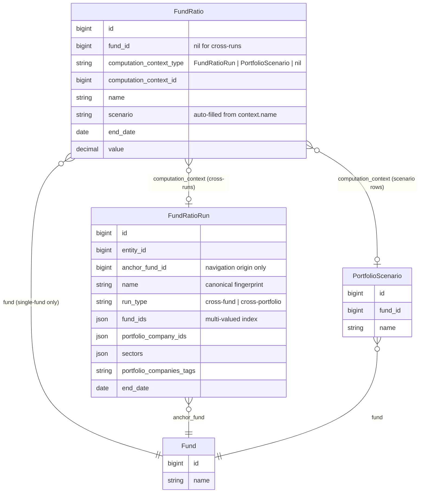
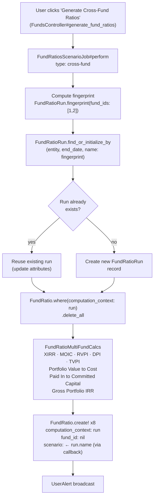
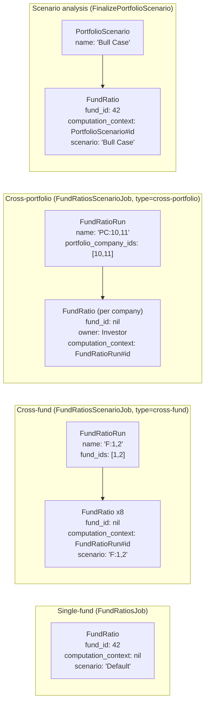

# FundRatioRun — Computation Context for Cross-Fund / Cross-Portfolio Ratios

## Problem

Before this feature, every `FundRatio` record could belong to at most one "parent":
- `fund_id` for single-fund ratios (via `FundRatiosJob`)
- `portfolio_scenario_id` for scenario-analysis ratios

For cross-fund and cross-portfolio jobs the anchor fund was just the fund the user happened
to navigate from — it carried no computational meaning. There was no record of *which* funds
or portfolio companies actually fed the calculation, making results opaque and hard to audit.

Adding a second FK (`fund_ratio_run_id`) alongside `portfolio_scenario_id` exposed a design
smell: both columns represent the same concept (a computation context that groups ratio rows
and records what parameters produced them), but they were separate nullable FKs with no
enforced exclusivity.

---

## Solution: polymorphic `computation_context`

`FundRatio` now has a single polymorphic parent:

```ruby
belongs_to :computation_context, polymorphic: true, optional: true
# computation_context_type: "FundRatioRun" | "PortfolioScenario"
# computation_context_id:   bigint
```

| Context type | Created by | What it records |
|---|---|---|
| `FundRatioRun` | `FundRatiosScenarioJob` | which funds / companies / tags / sectors fed a cross-run |
| `PortfolioScenario` | user / import | a named scenario used for scenario-analysis ratios |

Single-fund ratios (via `FundRatiosJob`) keep their `fund_id` and have no `computation_context`.

Both parent types expose `#name` and `#fund`, so `FundRatio` can use duck typing:

```ruby
# FundRatio — effective fund for document storage
def effective_fund
  fund || computation_context&.fund
end

# FundRatio — scenario label derived from parent name
before_create :set_scenario_if_missing
def set_scenario_if_missing
  # scenario has a DB default of "Default", so blank? is never true on a new record.
  # We also treat the column default as "not explicitly set" so computation_context
  # can override it. A caller-supplied non-default scenario is left untouched.
  col_default = self.class.column_defaults["scenario"]
  if computation_context.present? && (scenario.blank? || scenario == col_default)
    self.scenario = computation_context.name
  end
end
```

`FundRatioRun` exposes `#fund` as an alias for `#anchor_fund` so duck typing works for both
parent types without branching.

---

## Schema overview

### Before

```
fund_ratios
  ├── fund_id              FK → funds        (single-fund rows)
  ├── portfolio_scenario_id FK → portfolio_scenarios  (scenario rows)
  └── fund_ratio_run_id    FK → fund_ratio_runs       (cross-run rows)
         ↑ three separate nullable FKs, mutually exclusive but not enforced
```

### After

```
fund_ratios
  ├── fund_id                    FK → funds  (single-fund rows; nil for cross-runs)
  ├── computation_context_type   "FundRatioRun" | "PortfolioScenario" | nil
  └── computation_context_id     bigint, FK to whichever table the type names
```

### Entity relationship diagram



---

## How a cross-fund run works end-to-end



---

## FundRatioRun — fingerprint name

`FundRatioRun.name` is a **canonical fingerprint** encoding the exact computation inputs.
It is built by `FundRatioRun.fingerprint(...)` and stored on the record — no caller needs to
supply it explicitly.

### Fingerprint anatomy

```
"F:1,2  PC:10,11  Tag:growth,stable  S:Fintech,SaaS"
  │       │          │                  │
  │       │          │                  └── S:  sorted sector names
  │       │          └── Tag: sorted comma-separated tags
  │       └── PC:  sorted portfolio company IDs
  └── F:  sorted fund IDs
```

Only segments with values appear. Segments are sorted so that input order never
changes the fingerprint:

| Input | Fingerprint |
|---|---|
| fund IDs [2, 1] | `"F:1,2"` |
| fund IDs [1, 2] | `"F:1,2"` (same) |
| PC IDs [11, 10], tag "growth" | `"PC:10,11 Tag:growth"` |
| sectors ["SaaS", "Fintech"] | `"S:Fintech,SaaS"` |
| fund IDs [1] + sector "Fintech" | `"F:1 S:Fintech"` |

A unique index on `(entity_id, end_date, name)` enforces that the same computation
on the same date cannot produce two different runs.

### Dashboard exact-match lookup

The multi-portfolio dashboard filter lets the user pick `fund_ids`, `tag_list`, and `sector`.
To find the `FundRatioRun` whose results match the current filter exactly:

```ruby
FundRatioRun.for_filter(
  entity_id: current_entity.id,
  end_date:  params[:end_date],
  fund_ids:  params[:fund_ids],
  tags:      params[:tag_list].join(","),
  sectors:   params[:sector]
)
```

`for_filter` computes the fingerprint from the params and does `WHERE name = ?` on the
indexed column — a single indexed lookup, order-insensitive, exact match.

---

## Which job creates which kind of FundRatio?



---

## JSON Array Indexing in MySQL 8.4

### Why not a join table?

A normalised join table (`fund_ratio_run_funds`) is the classic relational approach, but it
introduces extra tables, additional round-trips, and complexity in the job's delete/recreate
cycle. Since the primary use of these lists is "given a fund, find all runs that included it",
a JSON array with a **multi-valued index** achieves the same query performance with less schema
overhead.

### Multi-valued indexes (MySQL 8.0.17+)

```sql
ALTER TABLE fund_ratio_runs
  ADD INDEX idx_frr_fund_ids ((CAST(fund_ids AS UNSIGNED ARRAY)));
ALTER TABLE fund_ratio_runs
  ADD INDEX idx_frr_portfolio_company_ids ((CAST(portfolio_company_ids AS UNSIGNED ARRAY)));
```

Each array element gets its own index entry, so `MEMBER OF` queries hit the index rather than
scanning the whole table.

### Querying

```sql
-- all runs that included fund 42
SELECT * FROM fund_ratio_runs WHERE 42 MEMBER OF (fund_ids);
```

In Rails scopes (with SQLite fallback for the test suite, which does not support `MEMBER OF`):

```ruby
scope :for_source_fund, ->(id) {
  if connection.adapter_name.downcase.include?("sqlite")
    where("EXISTS (SELECT 1 FROM json_each(fund_ratio_runs.fund_ids) WHERE value = ?)", id)
  else
    where("? MEMBER OF (fund_ids)", id)
  end
}
```

`portfolio_companies_tags` is stored as a plain comma-separated string (not a JSON array),
so `MEMBER OF` is not available. The `for_source_tag` scope uses a sentinel-comma LIKE pattern
instead:

```ruby
scope :for_source_tag, ->(tag) {
  safe_tag = "%,#{sanitize_sql_like(tag.to_s.strip)},%"
  if connection.adapter_name.downcase.include?("sqlite")
    where("(',' || portfolio_companies_tags || ',') LIKE ?", safe_tag)
  else
    where("CONCAT(',', portfolio_companies_tags, ',') LIKE ?", safe_tag)
  end
}
```

---

## Data flow

```
FundRatiosScenarioJob#perform
  └─ FundRatioRun.find_or_initialize_by(entity, end_date, name: fingerprint)
        ├─ [cross-fund]        calc_fund_ratios
        │     └─ FundRatio.create! x8  (XIRR, MOIC, RVPI, DPI, TVPI,
        │                               Portfolio Value to Cost,
        │                               Paid In to Committed Capital,
        │                               Gross Portfolio IRR)
        └─ [cross-portfolio]   calc_portfolio_company_ratios
              └─ FundRatio.create! per company  (IRR, Value To Cost, MOIC)
                 FundRatio.create!              (Gross Portfolio IRR — aggregate)
```

Old single-fund `FundRatiosJob` is unchanged — those rows keep their `fund_id` and have
`computation_context = nil`.

Portfolio-scenario ratios (created via import or `FinalizePortfolioScenario`) set
`computation_context_type = "PortfolioScenario"` instead of the old `portfolio_scenario_id`.

---

## Migration summary

| Migration | Change |
|---|---|
| `create_fund_ratio_runs` | Creates `fund_ratio_runs` with JSON columns + multi-valued indexes |
| `update_fund_ratios_for_runs` | Adds `fund_ratio_run_id` (nullable); makes `fund_id` nullable |
| `rename_scenario_to_name_on_fund_ratio_runs` | Renames `scenario`→`name`; backfills fingerprint; adds unique index on `(entity_id, end_date, name)` |
| `add_computation_context_to_fund_ratios` | Adds polymorphic `computation_context_type/id`; backfills from `fund_ratio_run_id` and `portfolio_scenario_id`; drops old FK columns |

Note: MySQL rejects literal defaults on JSON columns. `fund_ids`, `portfolio_company_ids`,
and `sectors` have no DB-level default; empty-array defaults are set at the application layer
via `attribute :fund_ids, :json, default: -> { [] }` in `FundRatioRun`.

Historical single-fund `FundRatio` rows have `computation_context = nil` and continue to
function via their existing `fund_id`.

---

## FAQ

**Q: Why does `FundRatio.fund_id` end up nil for cross-fund rows?**

The cross-fund calculation aggregates data from multiple funds — there is no single fund to
point at. Assigning the anchor fund's ID would be misleading (it implies the row belongs to
that fund's data, which it doesn't). The anchor fund is stored on `FundRatioRun.anchor_fund`
for document-folder resolution only.

---

**Q: Why is `FundRatioRun.name` a fingerprint string rather than a human label?**

The fingerprint is the primary key for idempotency. The unique index on
`(entity_id, end_date, name)` ensures that re-running the same job on the same date does not
create a second run — it reuses the existing one, deletes stale ratios, and recreates them.
A human label would need to be supplied by the caller and could accidentally differ between
runs (e.g. a different scenario string), breaking idempotency.

---

**Q: What happens if I run the same cross-fund job twice?**

The second invocation:
1. Computes the fingerprint from the inputs.
2. Calls `find_or_initialize_by(entity, end_date, name: fingerprint)` — finds the existing run.
3. Updates `assign_attributes` (same values, no-op in practice).
4. Calls `FundRatio.where(computation_context: run).delete_all` to clear stale rows.
5. Recreates all ratio rows fresh.

Net result: one `FundRatioRun`, no duplicate `FundRatio` rows.

---

**Q: Why does `FundRatio.scenario` get auto-populated from `computation_context.name`?**

The `scenario` column lets `FundRatio` rows be filtered without joining to the parent table.
This is important for Ransack queries, CSV exports, and UI filters that already use `scenario`.
The `set_scenario_if_missing` callback fires `before_create` and populates `scenario` from the
context when the caller didn't supply an explicit, non-default value.

Note: the `scenario` column has a DB default of `"Default"`. The callback checks for this
default as well as blank, so it fires even though the value is never literally blank on a new
record.

---

**Q: Can a `FundRatio` have both `fund_id` and `computation_context` set?**

Yes — portfolio-scenario ratios created by `FinalizePortfolioScenario` have both a `fund_id`
(the fund the scenario belongs to) and `computation_context → PortfolioScenario`. This is
intentional: the fund drives scoping and access control, while the computation_context records
which scenario produced the row.

Cross-fund/cross-portfolio rows have `fund_id: nil` because there is no single source fund.

---

**Q: Why not use `includes` to eager-load `computation_context`?**

Rails' `includes` triggers `EagerLoadPolymorphicError` for polymorphic associations because it
cannot determine which table to JOIN before it knows the type. Use `preload` instead — it
fires one query per distinct type, which is correct and efficient:

```ruby
# Wrong — raises EagerLoadPolymorphicError
FundRatio.includes(:computation_context)

# Correct
FundRatio.includes(:fund).preload(:computation_context)
```

---

**Q: The tests use SQLite but production uses MySQL — do the scopes behave the same?**

Functionally yes, but the SQL differs. Each scope that queries JSON arrays branches on
`connection.adapter_name`:

| Operation | MySQL | SQLite |
|---|---|---|
| "is ID in JSON array?" | `? MEMBER OF (col)` | `EXISTS (SELECT 1 FROM json_each(col) WHERE value = ?)` |
| "does tag string contain tag?" | `CONCAT(',', col, ',') LIKE ?` | `',' \|\| col \|\| ',' LIKE ?` |

Multi-valued indexes (`CAST(col AS UNSIGNED ARRAY)`) only exist in MySQL — SQLite uses a full
scan of the JSON column in tests, which is fine given test data volumes.

---

**Q: What does `anchor_fund` mean on `FundRatioRun`?**

It is the fund the user navigated from when they triggered the job — purely a UX and
document-storage concern. It determines which fund's folder the cashflow CSV documents land in,
and which policy scope governs access to the run's ratios. It does **not** restrict which data
feeds the calculation; that is controlled by `fund_ids` / `portfolio_company_ids` / tags /
sectors.

`FundRatioRun` aliases `anchor_fund` as `fund` so that `computation_context.fund` works for
both `FundRatioRun` and `PortfolioScenario` without type-checking in `FundRatio`.

---

**Q: How do I find all runs that used a specific portfolio company?**

```ruby
FundRatioRun.for_source_portfolio_company(portfolio_company_id)
# → uses MEMBER OF (MySQL) or json_each (SQLite) on portfolio_company_ids
```

And to get the ratio rows:

```ruby
FundRatio.where(computation_context: FundRatioRun.for_source_portfolio_company(pc_id))
```

---

**Q: I added a new metric to `calc_fund_ratios`. What do I need to change?**

Only the job method itself — add a `FundRatio.create!` call with the new `name:`. The
`computation_context`, `fund_id: nil`, `scenario`, and `end_date` are all set via the `shared`
hash. The `fund_ratio_run.feature` scenario *"Cross-fund job creates all eight expected ratio
names"* will fail until you update the table in that scenario to include the new name.
