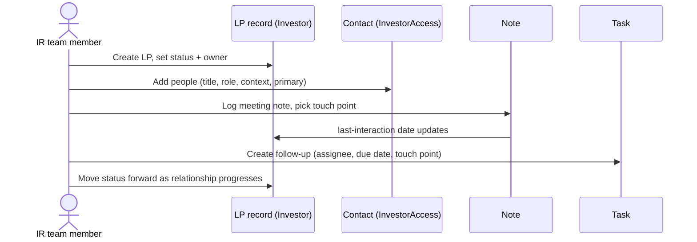

# PRD (Alternative): Minimal LP CRM — Five-Feature MVP

Alternative to `lp_relationship_crm_prd.md`. Same building blocks (Investor, InvestorAccess,
Notes, Tasks, custom fields), but scoped feature-first: the MVP is exactly the five things an
IR team needs day-to-day, and nothing else.

## 1. Overview

A minimal CRM assembled from existing models. Five features: an LP record, the people under
it, an interaction log, follow-ups, and one pipeline list view. Success is behavioural, not
technical: the team logs every interaction, and anyone can pick up any LP relationship cold.

## 2. The five features

### F1. One record per LP

One page per LP showing the essentials at the top: name, type, location, **relationship
status** (Prospect / In Discussion / Due Diligence / Committed / Passed) and **relationship
owner** (the GP team member accountable).

- Maps to: `Investor` (category distinguishes prospects). Status and owner are custom fields
  on the stakeholder form (`Investor` already supports custom fields — zero migration).

### F2. People under each LP

Each LP lists its actual humans: name, title, email, phone, what they handle (Decision Maker /
Finance / Documentation / …), one line of relationship context, and a **primary contact** flag.

- Maps to: `InvestorAccess` with `approved = false` (contact only — no portal access, no
  email sent). Title, role, context line and primary flag are custom fields
  (needs `WithCustomField` enabled on `investor_accesses` — one small generic migration).

### F3. A running log of interactions

Every call, meeting or email becomes a short dated note on the LP, recording **who it was
with**. One timeline per LP, newest first. This is the habit the whole product depends on.

- Maps to: `Note` owned by the `Investor`, plus a new optional **touch point** link to the
  contact record (one nullable FK to `InvestorAccess` — the only new modelling in the MVP), so
  each contact's history is scoped to that stakeholder. Adding a note already stamps the
  investor's last-interaction date.

### F4. Follow-ups with owners and due dates

Tasks per LP: what happens next, which GP user is doing it, by when, and which LP contact it
involves. Overdue items are visually flagged. An LP with no open task is going cold — that
must be visible on the LP page.

- Maps to: `Task` owned by the `Investor` — `assigned_to`, `due_date` and the `delayed` scope
  already exist. Same optional touch-point link as notes.

### F5. One list across all LPs

A filterable stakeholder list answering two questions: *what's in the pipeline right now?*
(filter by status / owner) and *who haven't we spoken to in 90 days?* (sort/filter by last
interaction).

- Maps to: existing stakeholder list + ransack filters on the custom fields; the
  "gone quiet" filter uses the existing `last_interaction_date` / `not_interacted` scope.

## 3. Core loop

## 4. Explicitly out of the MVP

- Automatic email capture — interactions are logged manually as notes.
- Campaigns / bulk outreach — the list view organises who to contact; people do the contacting.
- Pipeline analytics, conversion reporting, stage-transition history.
- Reminders beyond task due dates; weekly digests.
- Multi-participant notes (one touch point per note).
- External CRM sync.

## 5. Phase 2

Small additions that only pay off because the five MVP features exist. Suggested order:
P1 and P4 first (days of work, drive the logging habit), P5 when the first prospect
converts, then P2/P3/P6 by demand.

- **P1. Weekly owner digest** — every Monday each relationship owner gets one email: their
  LPs, open and overdue follow-ups, anything gone quiet 60+ days. Turns the CRM from "a place
  you visit" into "a thing that taps you on the shoulder." (Existing reminder/nudge machinery
  can drive this.)
- **P2. Email-in for logging** — forward/BCC an email to a special address and it lands as a
  note on the right LP. Cheapest attack on the biggest risk: people not logging. The
  stakeholder record already has incoming-email support in the platform.
- **P3. Pipeline board** — the Feature 5 list shown as columns by status; drag LPs forward in
  the Monday meeting. Pure presentation, no new data.
- **P4. Stage history** — when status changes, quietly record the date. Answers "how long has
  this LP been in due diligence?" and "how long do we take to close?" Tiny now, impossible to
  reconstruct later — include early.
- **P5. One-click conversion** — LP commits → one button approves their contacts into portal
  users with full relationship history retained (approve the existing records — history
  carries over).
- **P6. Meeting prep card** — a print-friendly one-pager per LP: who's who, last five
  interactions, open items. What a partner grabs five minutes before a call.

Still out of Phase 2: full inbox sync, campaign/bulk sends, analytics dashboards — Phase 3
conversations only if the digest and prep card show the log is actually being used.

## 6. Known trade-offs (accepted, shared with the original PRD)

- Unapproved contacts appear in the access "Pending" count; mass-approving them would grant
  portal access. Mitigated by UI copy/training, not schema.
- A contact whose email already belongs to a user of another entity cannot be added
  (pre-existing platform constraint); surface a clear error.
- Status/owner as custom fields have no transition history and no referential link to a real
  user — promote to real columns when a funnel board or stage automation is built.
