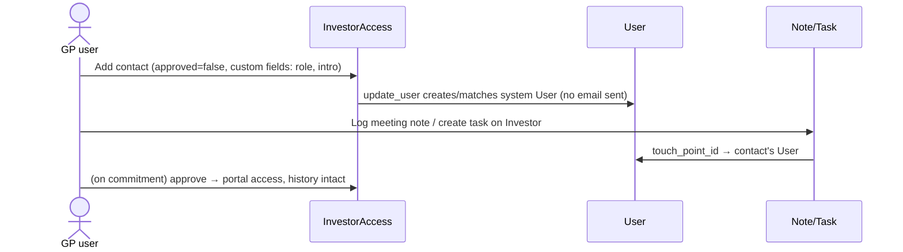

# PRD: LP Relationship CRM (Touch Points on InvestorAccess + Notes/Tasks)

## 1. Overview

A lightweight CRM layer for prospective and existing LPs, built almost entirely from existing
models. Each LP is an `Investor`; each person at the LP (touch point) is an `InvestorAccess`
with `approved = false` (no portal access) and their details stored as custom fields; notes and
tasks gain an optional link to the touch point's `User` so every communication and task is
mapped to a specific person. The goal is to remove person-dependency: anyone at the GP can open
the LP page and see where things stand, who the people are, and who owns which conversation —
and reuse those contacts in the next fund raise.

## 2. Problem

Relationships with prospective LPs live in individual partners' heads and inboxes. An LP
typically has multiple people involved (e.g. one on documentation, one on finance, one decision
maker), and today there is no place to record who they are, what each one cares about, or which
communications and tasks belong to which person.

## 3. Goals

- One repository per LP: status, meetings, communications, tasks in one place.
- Store every touch point at the LP with contact details, role, and a brief intro.
- Map each note and task to the touch point it involves.
- Contacts persist on the `Investor`, so they carry into future fund raises and ongoing catch-ups.
- Minimal schema change: custom fields for all descriptive data; one small migration for
  `WithCustomField` support on `investor_accesses` and the note/task touch-point link.

## 4. Non-Goals

- No new `Contact` model, no `contact_only` column, no engagement-status column or state machine.
- No email/inbox integration (communications are logged manually as notes).
- No multi-participant notes (one touch point per note/task; log two notes if needed).
- No fund-raise campaign/playbook automation (later phase; tags + task templates already exist).

## 5. Design

### 5.1 Touch points = InvestorAccess with `approved = false`

- Contacts are added from the Stakeholder (Investor) page as regular investor accesses, left
  unapproved. Unapproved accesses grant no portal visibility and send no email (access-granted
  notifications only fire from the explicit approve action).
- `update_user` behaviour is unchanged: a `system_created` `User` is still created/matched by
  email. That `User` is the stable anchor the note/task linkage points at.
- Conversion story: when the LP commits and needs portal access, approve the existing record —
  the contact history stays intact.

### 5.2 Person details as custom fields

`InvestorAccess` gets `include WithCustomField` (migration: `json_fields` json +
`form_type_id` bigint, same as every other model using the concern). Suggested tenant-configured
form fields (not enforced by code):

| Field | Type |
|---|---|
| Designation | TextField |
| POC Role (Decision Maker / Finance / Documentation / …) | Selection |
| Intro / relationship context | TextArea |
| LinkedIn | TextField |

Filtering by any of these comes free via `register_cf_ransacker`.

### 5.3 Engagement status as a custom field on Investor

`Investor` already includes `WithCustomField` — zero migration. A tenant-configured selection
field (e.g. Identified → Contacted → In Discussion → Due Diligence → Soft Commit → Committed →
Passed) on the stakeholder form, filterable in the stakeholder list. Prospects are distinguished
by `category` (e.g. "Prospect"), which already exists.

### 5.4 Notes/Tasks → touch point linkage

- Migration: nullable `touch_point_id` (FK → `investor_accesses`) on `notes` and `tasks`, indexed.
- `Note` and `Task` get `belongs_to :touch_point, class_name: "InvestorAccess", optional: true`.
- Owner semantics are unchanged: the note/task owner stays the `Investor`, so the LP-level
  timeline remains unified; the touch point is a filter dimension, not a new home.
- Linking to `InvestorAccess` (not `User`) scopes each contact's history to that stakeholder —
  an access belongs to exactly one investor, so the touch point is always a contact of the
  note's owner.

### 5.5 UI

- **Stakeholder page, accesses tab**: cards/rows show designation, POC role and intro from
  custom fields alongside the existing name/email/phone.
- **Note and Task forms** (when owner is an Investor): a "Touch point" dropdown listing the
  investor's accesses (approved and unapproved), saving `touch_point_id`.
- **Notes/Tasks lists on the stakeholder page**: show the touch point name; filterable by
  touch point.
- Per-person view: from a touch-point card, list that person's notes and tasks.

### 5.6 Flow

## 6. Fund-raise reuse

Contacts live on the `Investor`, which is fund-independent — nothing extra needed for
continuity. For the next raise: filter accesses by POC-role custom field or `tag_list`, then
create tasks per LP aimed at the right touch point. Task templates and recurrence rules already
exist for standing quarterly catch-up tasks.

## 7. Known trade-offs (accepted)

- **Pending badge noise**: unapproved contacts count into `unapproved_investor_access_count`,
  so prospect stakeholders show a "Pending N" badge. Mass-approving them would grant portal
  access and email the contacts. Mitigation is training/UI copy, not schema.
- **Cross-entity email collision**: `ensure_entity_id` blocks adding a contact whose email
  already belongs to a `User` in another entity. Pre-existing limitation; surfaced as a clear
  error message.
- **Custom-field softness**: engagement status has no transition history, and role-driven
  automation would depend on tenant-editable field options. Acceptable until a funnel board or
  stage automation is built — promote to real columns then.
- **Search**: custom-field content (intro, role) is not in the Chewy `InvestorAccessIndex`;
  filterable via ransack only.
