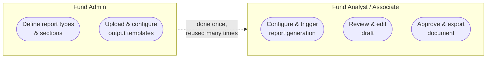
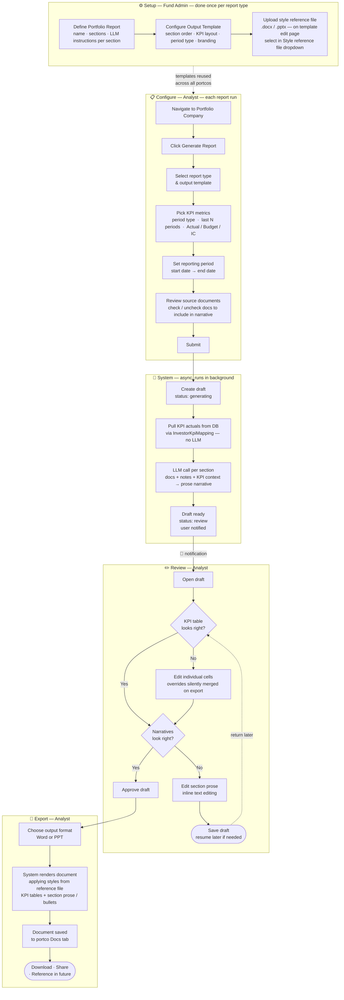
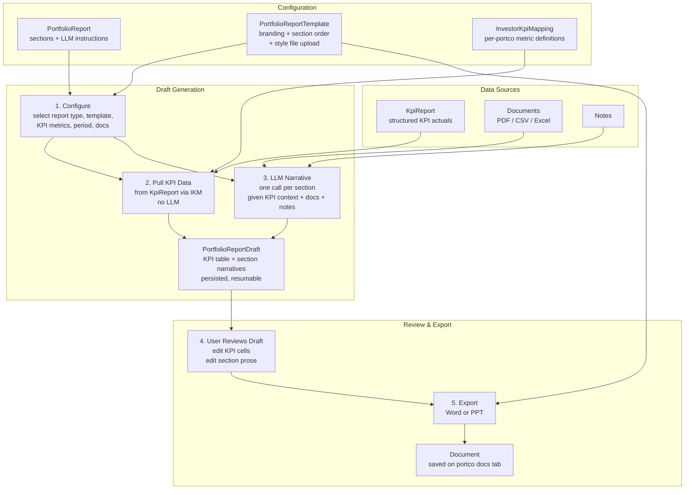

# PRD: Portfolio Report Generation v2

## 1. Problem Statement

Fund teams need to produce periodic written reports on portfolio companies — for LPs, for internal review, and for board packs. Today, generating one requires configuring a confusing form, waiting for an LLM to guess which KPI numbers to include, and receiving an unformatted document with no ability to review or fix it before it goes out. The result: reports either aren't generated at all, or require heavy manual cleanup after the fact.

## 2. Core Insight

The system already stores structured KPI actuals in the database (`KpiReport` / `InvestorKpiMapping`). The current implementation ignores this — it makes the LLM _extract_ numbers from uploaded PDFs, introducing hallucinations and formatting failures.

**The right split:**
- **Numbers** → pulled directly from structured DB records, no LLM involvement
- **Narrative** → LLM synthesizes prose from documents, notes, and KPI context per `PortfolioReportSection`
- **Layout** → driven by a user-uploaded style reference document (Word) or slide master (PPT)
- **User** → reviews and edits a structured draft _before_ the final document is produced

## 3. Goals

- Replace the fire-and-forget form with a multi-step flow: configure → generate draft → review/edit → export.
- Pull KPI data directly from structured DB records — eliminate LLM-based number extraction.
- Give users a named, per-portco KPI metric picker (via `InvestorKpiMapping`) instead of opaque period/as_of rows.
- Render KPI data as formatted tables in the output.
- Persist a saveable, resumable draft (`PortfolioReportDraft`) so work is never lost.
- Support Word and PPT output via uploaded style reference files — no placeholder vocabulary required.

## 4. Non-Goals (v1)

- PDF output (future phase).
- Automated or scheduled report generation.
- Batch runs across multiple portfolio companies simultaneously.
- Chart/graph rendering inside the exported document (tables only for v1).
- Real-time collaborative editing of drafts.

## 5. Who This Is For

**Primary user:** Fund analyst or associate generating a report for one portfolio company.
**Readers:** Limited Partners (external) or investment committee (internal).
**Cadence:** On-demand — triggered per event (board meeting, LP request, quarterly close). Automated scheduling is a future phase.

## 6. Inputs

| Input | Model / Source | Notes |
|---|---|---|
| **Portfolio company** | `Investor` (from URL) | Fixed — report is always for one portco |
| **Report type** | `PortfolioReport` | Defines sections via `PortfolioReportSection`, LLM instructions per section, source tags |
| **Output template** | `PortfolioReportTemplate` (new) | Config record with branding + section order + format rules + uploaded style file |
| **Reporting period** | Date range (start → end) | Scopes notes and documents fed to LLM for narrative sections |
| **KPI metrics** | `InvestorKpiMapping` for this portco | Multi-select from portco's own metric list; `show_in_report = true` pre-checked; grouped by `category` |
| **KPI tag(s)** | `KpiReport::TAG_LIST` (Actual / Budget / IC) | Which submission type(s) to pull; side-by-side vs. stacked determined by template config |
| **KPI period type** | Month / Quarter / Half Year / Year / YTD | Maps to `KpiReport.period` |
| **Last N periods** | Integer | Resolves to N `KpiReport` records ending at the reporting end date |
| **Source documents** | `Document` scoped to portco | Checklist — user includes/excludes docs fed to LLM for narrative context |

### Report Type vs. Output Template

- **Report type** — _what to generate_: sections, LLM instructions per section, source tags.
- **Output template** — _how to present it_: branding, section order in the output, KPI layout, format (Word / PPT). The same report type may have multiple templates (e.g., "LP PDF" vs "Board PPT").

## 7. Outputs

Generation happens in two stages.

### Stage 1 — Persisted Draft (`PortfolioReportDraft`)

Status lifecycle:
```
configuring → generating → review → approved → exported
```

| Block | Content | Source | User-editable? |
|---|---|---|---|
| **KPI table** | Metric × period grid — N periods of actuals/budget/IC | `KpiReport.kpis` via `InvestorKpiMapping` — **no LLM** | Yes — override individual cells; overrides silently merged into export |
| **Period-over-period variance** | Auto-computed delta and % change vs prior period | Computed from DB | Read-only flag; user can suppress display |
| **Section narratives** | One prose block per `PortfolioReportSection` | LLM given KPI context + filtered docs + notes | Yes — inline edit per section |

### Stage 2 — Exported Document

Generated from the approved draft by merging content into the selected output template's style file.

- **Word:** KPI tables as formatted tables, narratives as prose paragraphs, styled per reference `.docx`
- **PPT:** One slide per section, KPI tables per category, narratives condensed to bullets, styled per `.pptx` slide master

Named: `"<template name> — <portco name> — <start> to <end>"`
Saved as a `Document` on the portco's docs tab.

## 8. Template Design

### Word Output — Style Reference Document

The user uploads a `.docx` that defines **styles only**, no content or placeholders. The system reads the styles and applies them when generating the output document programmatically.

**What the uploaded reference `.docx` contains:**

```
┌──────────────────────────────────────────┐
│  [Cover page]                            │
│    Styled "Report Title" paragraph       │
│    Styled "Subtitle" paragraph           │
│    Header: logo + entity name            │
│    Footer: page numbers + date           │
├──────────────────────────────────────────┤
│  [Section heading sample]                │
│    One H1 paragraph: "Section Name"      │
├──────────────────────────────────────────┤
│  [Body text sample]                      │
│    One body paragraph: "Sample text..."  │
├──────────────────────────────────────────┤
│  [KPI table sample]                      │
│    3×3 table — sets border, shading,     │
│    header row style, alternating rows    │
└──────────────────────────────────────────┘
```

No data, no `{{placeholders}}`. The user formats a sample doc to their brand; the system does the rest.

**What the generated `.docx` looks like:**

```
┌─────────────────────────────────────┐
│  [Cover — styled per reference]     │
│  Ace Limited                        │
│  Quarterly Update · Q1 2026         │
│  [Logo]                             │
└─────────────────────────────────────┘
┌─────────────────────────────────────┐
│  Income Statement          [H1]     │
│  ┌──────────┬─────┬─────┬─────┐    │
│  │ Metric   │ Jan │ Feb │ Mar │    │  ← table style from reference
│  │ Revenue  │ 100 │ 110 │ 120 │    │
│  │ EBITDA   │  20 │  22 │  25 │    │
│  └──────────┴─────┴─────┴─────┘    │
└─────────────────────────────────────┘
┌─────────────────────────────────────┐
│  Key Highlights            [H1]     │
│  Revenue grew 20% QoQ driven by...  │  ← body style from reference
│  Gross margins improved to 42%...   │
└─────────────────────────────────────┘
┌─────────────────────────────────────┐
│  Risks & Outlook           [H1]     │
│  Supply chain pressure remains...   │
└─────────────────────────────────────┘
```

### PPT Output — Slide Master

The user uploads a `.pptx` containing a **slide master only** — background, fonts, colours, logo position, footer. The system injects content slides into it.

**Slide mapping:**

| Content block | Slide layout used |
|---|---|
| Cover | Title slide layout from master |
| KPI table (per category) | Content slide — table fills body |
| Section narrative | Content slide — heading + bullet points (LLM condenses prose to 3-5 bullets for PPT) |

**What the generated `.pptx` looks like:**

```
┌────────────────────┐  ┌────────────────────┐  ┌────────────────────┐
│  [Title slide]     │  │  Income Statement  │  │  Key Highlights    │
│                    │  │  ┌──┬────┬────┐    │  │                    │
│  Ace Limited       │  │  │  │Jan │Feb │    │  │  • Revenue +20%    │
│  Q1 2026 Update    │  │  │  │100 │110 │    │  │  • Margins at 42%  │
│  [logo]            │  │  └──┴────┴────┘    │  │  • Pipeline strong │
└────────────────────┘  └────────────────────┘  └────────────────────┘
    Slide 1                  Slide 2                  Slide 3
```

### Why No Placeholders (vs. Mail Merge)

| Mail merge (Option A) | Style reference (Option D — chosen) |
|---|---|
| User must embed `{{placeholders}}` in exact locations | User just formats a sample doc — no vocabulary to learn |
| Breaks silently if placeholder name is wrong | Template is styles only — structure is config-driven |
| Adding a new KPI section requires editing the template | New sections appear automatically per config |
| Table layout hand-crafted per template | Tables rendered by system, styled by reference |

## 9. User Journey

### User Roles

Two roles interact with this feature:



---

### Full User Journey



---

### Journey Summary

| Phase | Who | What happens | Output |
|---|---|---|---|
| **Setup** | Fund Admin | Define report type + sections; upload style file; configure template | `PortfolioReport` + `PortfolioReportTemplate` records |
| **Configure** | Analyst | Select template, KPI metrics, period, source docs | `PortfolioReportDraft` created (status: generating) |
| **Background** | System | Extract KPI data from DB; LLM generates one narrative per section | Draft populated (status: review) |
| **Review** | Analyst | Edit KPI cells and/or narratives; save and resume if needed | Approved draft |
| **Export** | Analyst | Choose Word or PPT; system renders and saves | Document on portco Docs tab |

---

## 11. High-Level Architecture

### System Components




## 12. New Data Models

### `PortfolioReportTemplate`

| Field | Type | Purpose |
|---|---|---|
| `portfolio_report_id` | FK | Which report type this template belongs to |
| `name` | String | e.g., "LP Quarterly — Word", "Board Deck — PPT" |
| `output_format` | Enum | `word / ppt` |
| `branding` | JSON | Logo, primary colour, font — fallback if not in style file |
| `section_order` | JSON | Ordered list of `PortfolioReportSection` ids to include |
| `kpi_layout` | JSON | Which categories, tags, n_periods; side-by-side vs stacked |
| `style_document_id` | FK (Document) | Selected style file — must be owned by this template |
| `documents` (polymorphic) | has_many | Style `.docx`/`.pptx` files uploaded directly on the template edit page |

### `PortfolioReportDraft`

| Field | Type | Purpose |
|---|---|---|
| `portfolio_company_id` | FK | The portco this draft is for |
| `portfolio_report_id` | FK | The report type |
| `portfolio_report_template_id` | FK | The output template |
| `start_date`, `end_date` | Date | Reporting period |
| `kpi_period_type` | String | Month / Quarter / etc. |
| `kpi_tag` | String | Actual / Budget / IC |
| `n_periods` | Integer | How many periods of KPI data |
| `selected_kpi_mapping_ids` | JSON Array | Which `InvestorKpiMapping` records to include |
| `kpi_table_data` | JSON | Structured KPI grid; user cell overrides stored here and silently merged into export |
| `section_data` | JSON | Keyed by `PortfolioReportSection.id` — LLM output + user edits per section |
| `status` | Enum | `configuring / generating / review / approved / exported` |
| `generated_document_id` | FK (Document) | Populated after export; draft is never deleted |
| `user_id` | FK | Who initiated the draft |

## 13. What Changes vs. v1

| v1 | v2 |
|---|---|
| Single form → fire-and-forget job | Multi-step: configure → generate draft → review/edit → export |
| LLM extracts KPI numbers from PDFs | KPI numbers from `KpiReport` DB records via `InvestorKpiMapping` |
| KPI input: opaque period + as_of rows | KPI input: named metric picker, tag, period type, last N |
| No review before final document | Every block editable before export |
| Output: unformatted bullets | Output: KPI tables + section prose, styled per reference document |
| No state — cannot resume | `PortfolioReportDraft` persisted, resumable, never deleted |
| One output format (Word) | Word and PPT; same draft, format-specific rendering |
| Template = Word file with placeholders | Template = style reference file (no placeholders) + config |

## 14. Resolved Design Decisions

| Question | Decision |
|---|---|
| Actual vs Budget side-by-side? | Determined by `PortfolioReportTemplate.kpi_layout` config |
| Flag user cell overrides in export? | No — silently merge; exported doc shows exactly what user approved |
| Delete draft after export? | No — drafts are kept permanently for reference and audit |
| Default metric selection source? | `show_in_report = true` on `InvestorKpiMapping`; layout of those metrics determined by template config |
| Mail merge vs style reference? | Style reference — user uploads a styled `.docx` or `.pptx` with no placeholders |

## 16. Manual Testing Guide

### Prerequisites — seed test data

Run the seed task to create a fully configured portfolio company with KPI data, report definition, and output template:

```bash
# zsh — quote required to prevent glob expansion of brackets
rails "portfolio_report:seed[<entity_id>]"

# example
rails "portfolio_report:seed[157]"
```

The task prints the IDs you need:
```
Portfolio company id : 1483
PortfolioReport id   : 9  (Test Analyst Report)
Template id          : 1  (Test Analyst Report — Word)
Generate report at   : /investors/1483/generate_reports
```

Confirm in console (`bin/rails c`):

```ruby
pc = Investor.find(1483)
pc.investor_kpi_mappings.show_in_report.count   # => 8
KpiReport.where(portfolio_company: pc).count    # => 6

pr = PortfolioReport.find(9)
pr.portfolio_report_sections.pluck(:name)
# => ["Business Overview", "Financial Highlights", "Operational Metrics", "Risks & Outlook"]

PortfolioReportTemplate.find(1).kpi_config
# => { categories: ["Income Statement", "Operational Metrics"], tags: ["Actual"], n_periods: 6, ... }
```

---

### Step 1 — Style reference file (handled by seed task)

The seed task now creates a minimal `.docx` stub and attaches it directly to the template as the style reference file. No manual upload is needed.

To verify: navigate to `/portfolio_reports/9` → **Output Templates** tab → **Edit** on "Test Analyst Report — Word". The **Style reference file** dropdown should show "Seed Style Reference — Test Analyst Report — Word" already selected.

To replace with a real branded `.docx`:

1. Open the template edit page (link above)
2. Scroll to the **Style Files** section at the bottom
3. Upload your `.docx` — styles only, no content or placeholders
4. Select it in the **Style reference file** dropdown → **Update Template**

---

### Step 2 — Open the configure form

1. Navigate to `http://localhost:3001/investors/1483/generate_reports`
2. You should see **Generate Report for Report Gen Test Co** with:
   - **Report type** dropdown → select "Test Analyst Report"
   - **Output template** dropdown → auto-populates with "Test Analyst Report — Word"
   - **KPI metrics** checklist → 8 metrics pre-checked, grouped by Income Statement / Operational Metrics
   - Start/end dates defaulting to ~3 months ago → today

---

### Step 3 — Submit the form

Fill in:
- Report type: **Test Analyst Report**
- Output template: **Test Analyst Report — Word**
- Start date: `2025-11-01`, End date: `2026-05-31`
- KPI period: **Month**, Last N periods: **6**
- KPI data type: **Actual**
- Leave all KPI metrics checked

Click **Generate Report Draft**.

Expected: redirect to `/portfolio_report_drafts/:id` with notice `"Generating your report draft…"`

Verify in console:

```ruby
draft = PortfolioReportDraft.last
draft.status                              # => "configuring"
draft.portfolio_company.investor_name     # => "Report Gen Test Co"
draft.n_periods                           # => 6
draft.selected_kpi_mapping_ids.length     # => 8
```

---

### Step 4 — Run the draft generation job

`PortfolioReportDraftJob` is enqueued via Sidekiq. To run it synchronously in dev:

```ruby
draft = PortfolioReportDraft.last
PortfolioReportDraftJob.new.perform(draft.id)
```

After it runs:

```ruby
draft.reload
draft.status           # => "review"
draft.kpi_table_data   # hash of metric_id => { period_label => value }
draft.section_data     # hash of section_id => { "llm_output" => "..." }
```

Check that each section has an `llm_output` key and that `kpi_table_data` has values (not all N/A).

---

### Step 5 — Review the draft

Navigate to `http://localhost:3001/portfolio_report_drafts/:id`.

Expected on the page:
- A KPI table with metric rows and period columns (pulled from DB — no LLM)
- One prose block per section (LLM-generated narrative)
- **Approve** button (disabled until status is `review`)

**Test KPI cell override:**

```bash
curl -X PATCH http://localhost:3001/portfolio_report_drafts/:id/update_kpi_cell \
  -d "metric_id=<ikm_id>&period_label=Jan-2026&value=999" \
  -H "X-CSRF-Token: ..." \
  -b "_session=..."
```

Or in console:
```ruby
draft.override_kpi_cell(draft.selected_kpi_mapping_ids.first, "Jan-2026", 999)
draft.save!
draft.effective_kpi_table   # override should appear merged in
```

**Test narrative edit:**

```ruby
section_id = PortfolioReport.find(9).portfolio_report_sections.first.id
draft.set_user_edit(section_id, "This is my edited narrative.")
draft.save!
draft.narrative_for(section_id)   # => "This is my edited narrative."
```

---

### Step 6 — Approve the draft

```bash
# Via UI: click Approve on the draft page

# Or in console:
draft.update!(status: :approved)
draft.status   # => "approved"
```

---

### Step 7 — Export

`PortfolioReportExportJob` is enqueued on export. To run synchronously in dev:

```ruby
PortfolioReportExportJob.new.perform(draft.id, User.first.id)
```

After export:
- `draft.reload.status` → `"exported"`
- `draft.generated_document_id` → populated
- Navigate to `http://localhost:3001/investors/1483` → Docs tab → document named `"Test Analyst Report — Word — Report Gen Test Co — 2025-11-01 to 2026-05-31"` should appear
- Download it and verify: KPI table rendered as a formatted table, sections as prose paragraphs

---

### What to check if things go wrong

| Symptom | Where to look |
|---|---|
| Template dropdown stays empty after selecting report type | Check console for JS errors; verify `PortfolioReportTemplate` records exist for the selected report |
| Draft stays `configuring` | Check Sidekiq queue; run job manually in console |
| `kpi_table_data` is empty after job runs | Verify `KpiReport` records exist for the portco within the date range; check `kpi_period_type` matches |
| Sections missing from `section_data` | Check `PortfolioReportSection` tags vs documents/notes tags; LLM may have returned an error |
| Export fails | Check `PortfolioReportTemplate.style_document_id` — must point to a valid `.docx` file |

---

## 17. Open Questions

1. Should `show_in_report` on `InvestorKpiMapping` be the sole default for metric selection, or does the template config need its own metric filter on top?
2. For PPT: should narrative condensation to bullets happen during draft generation (stored as bullets in `section_data`) or at render time (prose stored, condensed on export)?
3. Who manages `PortfolioReportTemplate` records — fund admins only, or any user?
