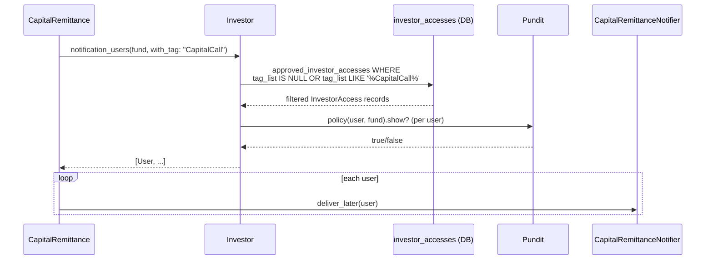

# Feature: Tag-Based Notification Filtering on InvestorAccess

## Status: BRANCH (feat/tagged-ia-notifications) — implementation pending

## What's Already on `main`

**No migration needed.** The `investor_accesses.tag_list` column (varchar 120) already exists in the schema. `InvestorAccess` already has:

```ruby
scope :with_tag, ->(tag) { where("investor_accesses.tag_list LIKE ?", "%#{tag}%") }
```

`Investor#notification_users` already accepts `with_tag:`:

```ruby
def notification_users(model = nil, with_tag: nil)
  if with_tag.present?
    tagged_accesses = approved_investor_accesses.with_tag(with_tag)
    return tagged_accesses.includes(:user).map(&:user) if tagged_accesses.exists?  # ← BUG
  end
  ...
end
```

KPI reports already use `with_tag: 'Kpi'`. However the current logic is **broken**.

---

## The Bug: Positive Selection vs. Subscription

The current `with_tag:` implementation is **positive selection**: if any tagged accesses exist, return only them; otherwise fall back to all approved users. This silently cuts off untagged contacts the moment anyone in the fund gets a tag.

Walk through a concrete fund with four contacts:

| Contact | `tag_list` |
|---|---|
| alice@lp1.com | `"Kpi"` |
| bob@lp1.com | `nil` |
| carol@lp2.com | `nil` |
| dan@lp2.com | `nil` |

**KPI report fires `notification_users(model, with_tag: 'Kpi')`:**
- `tagged_accesses.exists?` → true (alice matches)
- Current code returns: `[alice]` only
- Bob, Carol, Dan are silently excluded — they have no tags, meaning they haven't opted out of anything. They just never got tagged in.

**Now the fund admin adds CapitalCall tagging to alice:**

| Contact | `tag_list` |
|---|---|
| alice@lp1.com | `"Kpi,CapitalCall"` |
| bob@lp1.com | `nil` |
| carol@lp2.com | `nil` |
| dan@lp2.com | `nil` |

Capital remittance fires `notification_users(fund, with_tag: 'CapitalCall')`:
- `tagged_accesses.exists?` → true (alice matches `CapitalCall`)
- Current code returns: `[alice]` only
- Bob, Carol, Dan are cut off from their own capital call notice. The fund admin added a tag to *route* the call to alice, not realising they just silenced three other contacts.

The correct model is **subscription filtering**:

> An investor user with **no tags** is subscribed to all notification types. An investor user with tags is subscribed **only** to those topics. An untagged notification (no `with_tag:` caller) always goes to everyone.

| InvestorAccess `tag_list` | Notification `with_tag:` | Outcome | Reason |
|---|---|---|---|
| `nil` / blank | any / none | **Send** | Untagged = subscribed to all |
| `"KYC,Approval"` | `'KYC'` | **Send** | Tags intersect |
| `"KYC,Approval"` | `'CapitalCall'` | **Exclude** | Has tags, none match |
| `"KYC,Approval"` | `nil` | **Send** | Untagged broadcast goes to all |

Under subscription semantics, the same four-contact fund with `with_tag: 'CapitalCall'`:

| Contact | `tag_list` | Included? |
|---|---|---|
| alice@lp1.com | `"Kpi,CapitalCall"` | ✓ CapitalCall matches |
| bob@lp1.com | `nil` | ✓ No tags = receives all |
| carol@lp2.com | `nil` | ✓ No tags = receives all |
| dan@lp2.com | `nil` | ✓ No tags = receives all |

Eve at a third LP who has opted into only KYC emails:

| Contact | `tag_list` | Included? |
|---|---|---|
| eve@lp3.com | `"KYC"` | ✗ Has tags, none match CapitalCall |

Eve explicitly opted into KYC only. She won't receive capital calls. Everyone else does.

---

## Core Change 1: Fix `notification_users` Semantics

**File**: `app/packs/core/investors/models/investor.rb`

Replace the current `with_tag:` block with subscription semantics, inlined into the same method:

```ruby
def notification_users(model = nil, with_tag: nil)
  accesses = approved_investor_accesses.includes(user: :roles)

  if with_tag.present?
    # Subscription filter: include users with no tags (subscribed to all)
    # OR whose tags include the notification topic.
    accesses = accesses.where(
      "investor_accesses.tag_list IS NULL OR investor_accesses.tag_list = '' " \
      "OR investor_accesses.tag_list LIKE ?",
      "%#{with_tag}%"
    )
  end

  users = accesses.map(&:user)
  return users unless model

  users.select do |user|
    if user.has_cached_role?(:investor_advisor)
      policy = Pundit.policy(user, model)
      policy.permissioned_investor_advisor?(as_entity_id: investor_entity_id) || policy.show?
    else
      policy = Pundit.policy(user, model)
      policy.show? || (policy.respond_to?(:overview?) && policy.overview?)
    end
  end
end
```

No concern, no extra class. The logic is straightforward enough to live here.

---

## Canonical Tag List

Tags are PascalCase strings. Each domain owns one tag; callers must use the constant, not inline strings.

Define in `app/packs/core/investors/models/investor.rb` (or a dedicated constants file):

```ruby
NOTIFICATION_TAGS = {
  capital_call:            "CapitalCall",        # remittances and call notices
  capital_distribution:    "CapitalDistribution",
  fund_commitment:         "FundCommitment",     # welcome / commitment confirmed
  investment_opportunity:  "InvestmentOpportunity",
  approval:                "Approval",
  kyc:                     "KYC",
  document:                "Document",
  deal:                    "Deal",
  secondary:               "Secondary",
  kpi:                     "Kpi",                # already in use
}.freeze
```

---

## Core Change 2: Update All Callers

### Scope: what tag filtering applies to and what it doesn't

`tag_list` lives on `investor_accesses`. Tag filtering therefore **only affects recipients found via `approved_investor_accesses`** — that is, investor users and investor advisors. Employee recipients are resolved through an entirely separate path (`entity.employees.active` or direct `AccessRight.user_id`) and are **not affected by this change at all**.

**Investor advisor note:** investor advisors have `InvestorAccess` records with `is_investor_advisor: true`. They go through the same `approved_investor_accesses` query as regular investor users, so tag filtering applies to them equally. An IA with `tag_list = "KYC"` will not receive capital call notifications, regardless of their Pundit access.

Several models send to **both** investors and employees via independent paths. Tag filtering touches only the investor side:

| Model | Investor path (tag-filtered) | Employee path (unchanged) |
|---|---|---|
| `InvestorKyc` | `investor.notification_users(with_tag: 'KYC')` | `entity.employees.active.select { enable_kycs && !investor_advisor? }` |
| `PerformActivityAction` (deal stage move) | `investor.notification_users(deal, with_tag: 'Deal')` when `notify_investor` flag set | `deal.entity.employees.active.company_admins` when `notify_employees` flag set |
| `Document` | `access_rights` with `access_to_investor_id` → `investor.notification_users(doc, with_tag: 'Document')` | `access_rights` with `user_id` → `[user]` directly — no investor lookup, no tag check |

For the remaining models (`CapitalRemittance`, `CapitalDistributionPayment`, `ApprovalResponse`, `InvestmentOpportunity`, `Interest`, secondaries) there is only an investor path — no parallel employee notification exists in those flows.

---

### Comprehensive Notifier Inventory

All callers go through `investor.approved_investor_accesses` → tag filter → optional Pundit check. The table shows which investor link is used, what Pundit model is checked (if any), and the required tag change. Rows without a Pundit model pass no access check beyond InvestorAccess approval.

| Notifier | Trigger | Investor link | Pundit model | Current call | New call |
|---|---|---|---|---|---|
| `CapitalRemittanceNotifier` | `CapitalRemittance#send_notification` | `remittance.investor` | `fund` | `notification_users(fund)` | `notification_users(fund, with_tag: 'CapitalCall')` |
| `CapitalRemittanceNotifier` | `CapitalRemittance#payment_received_notification` | `remittance.investor` | `fund` | `notification_users(fund)` | `notification_users(fund, with_tag: 'CapitalCall')` |
| `CapitalRemittancePaymentNotifier` | `CapitalRemittancePayment` | `payment.investor` | `fund` | `notification_users(fund)` | `notification_users(fund, with_tag: 'CapitalCall')` |
| `CapitalDistributionPaymentNotifier` | `CapitalDistributionPayment` | `payment.investor` | `fund` | `notification_users(fund)` | `notification_users(fund, with_tag: 'CapitalDistribution')` |
| `CapitalCall` notice | `CapitalCall` (looped over remittances) | `cr.investor` | `fund` | `notification_users(fund)` | `notification_users(fund, with_tag: 'CapitalCall')` |
| `FundCommitmentNotifier` | `FundNotificationJob` | `commitment.investor` | `commitment` | `notification_users(commitment)` | `notification_users(commitment, with_tag: 'FundCommitment')` |
| `ApprovalNotifier` | `ApprovalResponse#notify_investors` | `approval_response.investor` | none | `notification_users` | `notification_users(with_tag: 'Approval')` |
| `InvestmentOpportunityNotifier` | `InvestmentOpportunity` notify methods | `investor` per access right | none | `notification_users` | `notification_users(with_tag: 'InvestmentOpportunity')` |
| `ExpressionOfInterestNotifier` | `ExpressionOfInterest#send_notification` | `eoi.investor` | none | `notification_users` | `notification_users(with_tag: 'InvestmentOpportunity')` |
| `InvestmentOpportunitySender` | `InvestmentOpportunitySender` | `investor` per access right | none | `notification_users` | `notification_users(with_tag: 'InvestmentOpportunity')` |
| `InvestorKycNotifier` | `InvestorKyc#notification_users` | `kyc.investor` | `kyc` (consolidates existing separate filter) | `notification_users` | `notification_users(self, with_tag: 'KYC')` |
| `InvestorKycNotifier` | `InvestorKycsController` | `kyc.investor` | none | `notification_users` | `notification_users(with_tag: 'KYC')` |
| `InvestorKycNotifier` | `KycReminderJob` | `kyc.investor` | none | `notification_users` | `notification_users(with_tag: 'KYC')` |
| `DealActivityMoveNotifier` | `PerformActivityAction#notify_activity_move` | `deal_investor.investor` | `deal` (`show?`/`overview?`) | `notification_users(deal)` | `notification_users(deal, with_tag: 'Deal')` |
| `DocumentNotifier` | `Document#send_notification_for_owner` | indirect via `AccessRight` — see ★ | `document` | see ★ note | see ★ note |
| `InterestNotifier` | `Interest#send_notification` | `interest.investor` | none | `notification_users` | `notification_users(with_tag: 'Secondary')` |
| `SecondarySaleNotifier` | `SecondarySaleNotifiers` (various) | `interest.investor`, `offer.investor` | `secondary_sale` (where passed) | `notification_users` | `notification_users(with_tag: 'Secondary')` |
| `KpiReportNotifier` | `SendPortcoNotification`, `KpiReportCreateShell` | `portco` as `Investor` | `kpi_report` | `notification_users(model, with_tag: 'Kpi')` | **already correct** |
| `AccessRightNotifier` | `AccessRight#send_notification` | `investor` when `access_to_investor_id` | `owner` | `notification_users(owner)` | **no tag** — one-time access-granted notice |

### ★ Document notifications — indirect routing

`Document.notification_users` doesn't call `investor.notification_users` directly. It calls:

```ruby
def notification_users
  users = access_rights.map(&:users).flatten
  users += owner.access_rights.map(&:users).flatten if %w[Fund Deal ...].include?(owner_type)
  users.uniq
end
```

`AccessRight#users` calls `investor.notification_users(owner)` when `access_to_investor_id` is set. To propagate the tag through this chain, add an optional parameter:

```ruby
# access_right.rb
def users(with_tag: nil)
  if user_id.present?
    [user]
  elsif access_to_investor_id.present?
    investor.notification_users(owner, with_tag:)
  elsif access_to_category.present?
    User.joins(...)...
  else
    []
  end
end

# document.rb
def notification_users
  users = access_rights.map { |ar| ar.users(with_tag: 'Document') }.flatten
  users += owner.access_rights.map { |ar| ar.users(with_tag: 'Document') }.flatten if %w[Fund Deal ...].include?(owner_type)
  users.uniq
end
```

### Models with no investor association

Some notification paths do not involve `investor.notification_users` at all and are **unaffected** by this feature:

| Notifier | Trigger | Recipient lookup | Tag impact |
|---|---|---|---|
| `SecondarySaleNotifier` (employee path) | `SecondarySale.notification_users` | Deserialises `notification_employee_ids` → `entity.employees.where(id: ids)` | None — explicit list, no investor |
| `AgentSchedulerNotifier` | `AgentSchedule.notification_users` | `entity.employees.active.where(enable_support: true)` | None |
| `TaskNotifier` | Task assigned / updated | `[task.assigned_to]` + task followers | None |
| `ReminderNotifier` | `Reminder` due | `[reminder.user]` | None |
| `UserNotifier` | Password reset, confirmation | `[user]` — direct mailer | None |
| `InvestorAdvisorNotifier` | Advisor-related event | `[investor_advisor.user]` — direct | None |
| `InvestorAccessNotifier` | New `InvestorAccess` approved | `[investor_access.user]` — direct to the newly-added contact | None |
| `AccessRightNotifier` (`user_id` present) | Access right granted to a named user | `[access_right.user]` — direct | None |
| `AccessRightNotifier` (`access_to_category`) | Access right granted to a category | `User.joins(investor_accesses: :investor).where(entity_id:, 'investors.category': category, 'investor_accesses.approved': true)` | None — category query, no per-investor tag |

---

## Core Change 3: `InvestorKyc#notification_users` — pass `self` as model

Currently this method calls `investor.notification_users` with no model, then filters separately via `InvestorKycPolicy#show?`. Consolidate:

```ruby
# investor_kyc.rb
def notification_users
  investor.notification_users(self, with_tag: Investor::NOTIFICATION_TAGS[:kyc])
end
```

The existing Pundit check inside `notification_users` already handles `InvestorKycPolicy#show?` for advisor users, and `show?` / `overview?` for normal users. The separate `.select { InvestorKycPolicy.new(user, self).show? }` can be removed.

---

## UI Change 1: InvestorAccess Form Tag Input

`tag_list` is already in `ransackable_attributes` on `InvestorAccess`. Add the input to the form partial:

**File**: `app/packs/core/investor_accesses/views/investor_accesses/_form.html.erb`

```erb
<div class="mb-3">
  <%= f.label :tag_list, "Notification Topics", class: "form-label" %>
  <%= f.text_field :tag_list, class: "form-control",
      placeholder: "e.g. CapitalCall,KYC,Approval",
      data: { bs_toggle: "tooltip",
              bs_title: "Comma-separated topics. Leave blank to receive all notifications." } %>
</div>
```

Permit in the controller: `params.require(:investor_access).permit(..., :tag_list)`.

---

## UI Change 2: Email Preview — Mismatched Tags

`email_list_for(model)` in `FundsHelper` currently has no concept of tag filtering. Extend it to show which approved contacts would be excluded.

### `funds_helper.rb` — add `with_tag:` parameter

```ruby
def email_list_for(model, with_tag: nil)
  data = initialize_email_list_data(model)
  ...
  user_access_stats = calculate_user_access_stats(model, data[:investor_accesses], with_tag:)
  { ..., approved_investor_access_mismatched_tags: user_access_stats[:mismatched_tags] }
end
```

### `calculate_user_access_stats` — split approved accesses into matched vs. mismatched

```ruby
def calculate_user_access_stats(model, investor_accesses, with_tag: nil)
  approved = investor_accesses.approved.email_enabled
  
  if with_tag.present?
    matched     = approved.not_investor_advisors.where(
      "investor_accesses.tag_list IS NULL OR investor_accesses.tag_list = '' OR investor_accesses.tag_list LIKE ?",
      "%#{with_tag}%"
    )
    mismatched  = approved.not_investor_advisors.where(
      "investor_accesses.tag_list IS NOT NULL AND investor_accesses.tag_list != '' " \
      "AND investor_accesses.tag_list NOT LIKE ?",
      "%#{with_tag}%"
    )
  else
    matched    = approved.not_investor_advisors
    mismatched = InvestorAccess.none
  end
  
  { ..., mismatched_tags: mismatched.includes(:user, :granter).distinct }
end
```

### `show_email_list.html.erb` — add Mismatched Tags card

Add to the stats bar definition and render a table card (same pattern as the existing "Unapproved Users" card) with heading:

```
Investor Access (Mismatched Tags: CapitalCall)
```

---

## Sequence: Capital Call notification with tag filtering



---

## Implementation Order

1. Fix `Investor#notification_users` subscription semantics (single method change, all benefits flow from here)
2. Add `NOTIFICATION_TAGS` constants
3. Update all callers (add `with_tag:` — mechanical, ~15 sites)
4. Update `AccessRight#users` to accept `with_tag:` and `Document#notification_users` to pass it
5. Consolidate `InvestorKyc#notification_users`
6. Add `tag_list` input to InvestorAccess form + permit in controller
7. Extend `email_list_for` + `calculate_user_access_stats` + `show_email_list` with mismatched tags

Steps 1–5 have no UI surface and can be verified with the existing Cucumber scenarios updated to set `tag_list` on InvestorAccess records and assert inclusion/exclusion.

---

## What the Old Branch Did Differently (and Why We Don't)

### New `tags` column

The old branch added a migration for a new `tags` column. `tag_list` already exists. No migration needed.

### Changed signature to `notification_users(model:, custom_notification:)`

Breaking all 30+ callers to pass a `custom_notification` object is unnecessary. The `with_tag:` keyword already exists. The caller sets the topic tag; the custom notification is only for template selection.

### Deriving the tag from `custom_notification.tag`

This is the subtlest mistake and deserves a worked example.

`custom_notification.tag` already has a job on main: it disambiguates which notification **template** to use. A fund can have two custom notifications for capital calls:

| custom_notification | `tag` | `subject` |
|---|---|---|
| CN-1 | `"FirstCall"` | "Welcome — your first drawdown" |
| CN-2 | `"SubsequentCall"` | "Capital call notice" |

When sending a "FirstCall" notice the system picks CN-1 because `tag = "FirstCall"` matches. That is **template selection** — Question A: *which email to send?*

Under the old branch, `notification_users` would then also use `"FirstCall"` as the recipient filter — Question B: *who gets it?* No investor contact would ever have `tag_list = "FirstCall"` on their InvestorAccess. That is a notification-template label, not a subscription topic. The filter would find no matching contacts, fall through to the "both blank → allow all" branch, and send to everyone — meaning the tagging system would never actually filter anyone for model-driven notifications.

The two questions operate at completely different granularities:

| Question | Answered by | Granularity |
|---|---|---|
| Which email template? | `custom_notification.tag` | Per-notification, per-stage, per-context |
| Who receives it? | `investor_access.tag_list` + `with_tag:` | Per-domain topic (CapitalCall, KYC, …) |

**The clean separation:**

```ruby
# Template selection — picks CN-1 ("FirstCall") or CN-2 ("SubsequentCall")
custom_notification = capital_call.custom_notification(:send_notice)

# Recipient filtering — contacts who subscribed to CapitalCall notifications
investor.notification_users(fund, with_tag: 'CapitalCall')
```

`custom_notification` answers what to send. `with_tag:` answers who receives it. They don't talk to each other.

### `FilteredAccess` concern

The old branch extracted this logic into a shared concern across `WithInvestorAccess` and `InvestorsGrantedAccess`. That adds two files, two `include` declarations, and a call chain to follow for logic that fits in 12 lines inside `notification_users`. The subscription filter is a single SQL clause — it belongs where the query is built.

### "Tagged investor excluded from untagged notification"

The old branch excluded tagged contacts even when the notification had no tag. A fund admin sending a generic announcement would miss all tagged contacts. Untagged broadcasts go to everyone.
