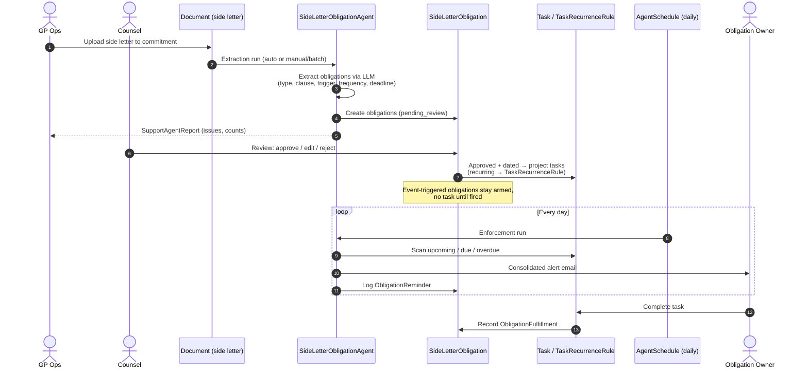

# Side Letter & LP Obligation Matrix

**Approach:** Build — delivered as a new SupportAgent (`SideLetterObligationAgent`) plus a small `funds/side_letters` pack
**Phase:** P1 — AI extraction ships in the MVP behind a mandatory human review gate; MFN comparison and automatic event-trigger firing are deferred
**Terminology:** obligations extracted from side letters are sometimes called *covenants*. This feature uses **obligation** throughout — "covenant" is reserved for the private-credit loan covenant feature (`private_credit_funds.md`, `LoanCovenant`) to avoid a model-name collision.

---

## What This Is

Side letters are legally binding agreements between a GP and a specific LP that modify or supplement the terms of the Limited Partnership Agreement. They create obligations: reporting requirements, fee arrangements, co-investment rights, notice requirements, key person provisions, transfer rights, and more. These obligations are operationally dangerous because they live in PDFs reviewed at closing and then largely forgotten — until an LP calls to enforce them.

The LP Obligation Matrix is CapHive's answer: a structured, searchable, actionable record of every obligation in every side letter, with action owners, trigger conditions, and reminder workflows. A new **SideLetterObligationAgent** extracts obligations from side letter documents attached to capital commitments, holds them for counsel review, projects approved date-driven obligations into the existing task system (including recurring tasks), and enforces due dates with alerts.

### Obligation shapes

Not every obligation is date-driven, and the design must not pretend otherwise:

| Shape | Example | System behaviour |
|-------|---------|------------------|
| **Calendar-driven (recurring)** | "Quarterly ESG report within 45 days of quarter-end" | `TaskRecurrenceRule` generates recurring tasks; due-date alerts |
| **One-time / dated** | "Deliver audited financials by Apr 30" | Single `Task` with `due_date`; due-date alerts |
| **Event-triggered / standby** | "Notify within 5 business days if a key person leaves"; "offer co-invest on deals > $15M"; reduced fee arrangements | No task until triggered. The obligation sits **armed** in the matrix; a human fires it when the event occurs (automation deferred) |

A first-class `SideLetterObligation` record is therefore the source of truth; tasks are only the *projection* of its dated instances. Tasks alone cannot represent standby obligations, review state, source clauses, or fulfillment history.

---

## Who Uses It

| Persona | When | What They Need |
|---------|------|----------------|
| **General Counsel / Legal Team** | After a closing and ongoing | Know every obligation that was agreed to; approve AI-extracted obligations before they become active |
| **IR Director** | Ongoing LP servicing | See upcoming reporting obligations and co-investment notifications before they trigger |
| **Deal Team** | When a new investment is being made | Check whether any LP has a co-investment right that must be offered before the investment closes |
| **Finance / CFO** | Fee calculation periods | See all reduced fee arrangements and verify they are applied correctly |
| **COO** | Compliance review and LP due diligence | Demonstrate that all side letter obligations are tracked and fulfilled |

---

## Use Cases

### UC-1: Quarterly ESG Report Obligation
LP Alpha has a side letter requiring a quarterly ESG impact report within 45 days of each quarter-end. The obligation matrix shows this as an active obligation with the next due date (October 14 for Q3 2026), the owner (IR team), and the trigger (Q3 close). 10 days before the due date, the owner receives a reminder notification.

### UC-2: Reduced Management Fee
LP Beta has a reduced management fee of 1.5% during the commitment period (vs. standard 1.75%). The obligation matrix records this as a fee arrangement. Each time a management fee notice is issued, the system flags LP Beta's fee for review to confirm the reduced rate is applied.

### UC-3: Co-Investment Right Trigger
LP Gamma has a right to co-invest alongside the fund on deals above $15M total investment. When the deal team is preparing a new investment above the threshold, CapHive alerts the IR team: "LP Gamma has a co-investment right — notify by [date] before this deal closes." The team sends the notification and records it.

### UC-4: MFN Clause Detection
Counsel reviews the newly extracted obligation matrix and notices that LP Epsilon's side letter contains a reporting obligation more favorable than the standard LPA. Three other LPs have MFN provisions in their side letters. Counsel reviews whether the MFN is triggered and documents their determination.

### UC-5: Key Person Notification
LP Delta's side letter requires the GP to notify LP Delta within 5 business days if a key person leaves. When a key person event occurs, the system surfaces all LPs with key person notice obligations and prompts the IR team to send notifications. The notification is logged with timestamp and method.

### UC-6: Transfer Right Negotiation
An LP wants to transfer part of their fund interest. The operations team checks the obligation matrix to confirm: does this LP have a side letter restricting transfer? Does the transfer require GP consent? Are there right-of-first-offer provisions that apply? All of these are surfaced in under 30 seconds.

### UC-7: Extraction With Review Gate
After a closing, 15 side letters are uploaded to the respective commitments. The SideLetterObligationAgent processes each one and creates draft obligations in `pending_review`. Counsel reviews the draft matrix, approves 42 obligations, corrects 3 misclassifications, and adds 2 the AI missed. Only on approval do tasks and reminders go live.

---

## Current CapHive State (verified against codebase)

| Capability | Status | Notes |
|------------|--------|-------|
| Document upload and storage per commitment | ✅ Exists | `CapitalCommitment` includes `WithFolder`; documents attach polymorphically (`owner_type = "CapitalCommitment"`) |
| SupportAgent framework | ✅ Exists | `agent_type` string → Trailblazer `SupportAgentService` subclass; config via `FormType(name: "SupportAgent", tag: agent_type)` custom fields; `AgentSchedule`, `AgentExecutionLog`, `SupportAgentReport`, batch/single runs, step UI |
| Document→field LLM extraction pattern | ✅ Exists | `KycDocExtractorAgent` (rules in `json_fields`, docs matched by name, RubyLLM via `LlmService.ruby_llm_chat`); `FolderDocumentExtractor` for PDF/Excel/PPT text |
| Recurring tasks | ✅ Exists | `TaskRecurrenceRule` (iCal RRULE via ice_cube) + nightly `RecurringTaskGeneratorJob` materializes occurrences 3 months ahead |
| Tasks module | ✅ Exists | Polymorphic `owner`, `due_date`, `assigned_to`, kanban `status`, `delayed` scope |
| Task due-date alerting | ❌ Missing | `TaskNotifier` fires on create/update only. `Reminder` model exists but is not exposed on the task form and its notifier is mis-wired (`ReminderNotifier#mailer_name` returns `InvestorKycMailer`) |
| Side letter model | ❌ Missing | Side letters are plain documents (fund Data Room or commitment folder) with no structured data |
| LP obligation record | ❌ Missing | No obligation model |
| MFN tracking | ❌ Missing | No comparison logic across investor side letters |
| Obligation trigger and reminder workflow | ❌ Missing | Nothing ties obligations to fund calendar events or scans for due dates |
| AI-assisted obligation extraction | ❌ Missing | Built here, as the agent's extraction mode |

---

## Build Approach

Two pieces: a data pack `funds/side_letters` (models + matrix UI) and a new agent type `SideLetterObligationAgent` in `ai/support_agents` (extraction + enforcement).

### New Models (`funds/side_letters` pack)

**`SideLetter`** (belongs to CapitalCommitment)
- `capital_commitment_id` FK — the anchor; `fund_id` and `investor_id` are derived through the commitment (denormalized only if query patterns demand it)
- `document_id` FK (the executed side letter PDF, a `Document` on the commitment)
- `executed_at` date
- `extraction_status` — enum: `pending`, `ai_extracted`, `manually_entered`, `counsel_reviewed`
- `notes` text

**`SideLetterObligation`** (belongs to SideLetter)
- `side_letter_id` FK
- `obligation_type` — enum: `reporting`, `fees`, `co_investment`, `notice`, `transfer`, `excuse`, `confidentiality`, `key_person`, `mfn`, `other`
- `title` string (short description, e.g. "Quarterly ESG report")
- `description` text (full obligation text or paraphrase)
- `source_clause` string (e.g. "Section 4.3(b)") — extraction must retain citations
- `owner_user_id` FK
- `owner_team` — enum: `ir`, `finance`, `legal`, `deal_team`, `operations`
- `trigger_type` — enum: `calendar_event`, `fund_event`, `deal_event`, `status_change`, `one_time`, `ongoing`
- `trigger_description` text (e.g. "Within 45 days of each quarter-end")
- `frequency_rrule` string (iCal RRULE for calendar-driven obligations; feeds `TaskRecurrenceRule`)
- `next_due_date` date (computed for calendar-driven; manually set otherwise)
- `review_status` — enum: `pending_review`, `approved`, `rejected` (the human gate)
- `status` — enum: `active`, `fulfilled`, `waived`, `expired`, `disputed`
- `task_recurrence_rule_id` FK (nullable — set when a recurring projection exists)
- `reminder_days_before` integer (lead time for pre-due alerts; 0 suppresses)
- `mfn_relevant` boolean (flags obligations that may trigger MFN rights for other LPs)
- `mfn_review_status` — enum: `not_reviewed`, `no_trigger`, `triggered_matched`, `triggered_exception`
- `extracted_by` — enum: `manual`, `ai`
- `ai_confidence` decimal

**`ObligationFulfillment`** (belongs to SideLetterObligation)
- `side_letter_obligation_id` FK
- `fulfilled_at` date
- `fulfilled_by_user_id` FK
- `method` text (e.g. "ESG report sent via portal and email")
- `document_id` FK (evidence document, if applicable)
- `period_covered` string (e.g. "Q3 2026")
- `task_id` FK (nullable — set when fulfillment came from completing a projected task)

**`ObligationReminder`** (belongs to SideLetterObligation) — the sent-alert log
- `side_letter_obligation_id` FK
- `kind` — enum: `upcoming`, `due`, `overdue`
- `sent_at` timestamp
- `recipient_user_id` FK

### Task projection

- Approved **calendar-driven** obligations create a `TaskRecurrenceRule` from `frequency_rrule` (reusing the existing nightly `RecurringTaskGeneratorJob` — no new recurrence machinery).
- Approved **one-time** obligations create a single `Task` with `due_date = next_due_date`.
- Projected tasks are owned by the `SideLetterObligation` (polymorphic `Task#owner`), assigned to `owner_user_id`, category "Compliance". Completing the task creates an `ObligationFulfillment`.
- **Event-triggered / ongoing** obligations create no tasks; they appear as armed rows in the matrix. A human can "fire" one, which creates a dated task on the spot (e.g. key person notice due in 5 business days).
- Rejecting or waiving an obligation tears down its projected rule/tasks.

### The SideLetterObligationAgent

Registered like every other agent type: entry in `SupportAgent::AGENT_TYPES`, config in `SupportAgentsSetupService::SUPPORT_AGENT_FORM_CONFIGS`, entity license bitflag (appended to the **end** of the `entity_enabled.rb` flag array), `FormType(name: "SupportAgent", tag: "SideLetterObligationAgent")` whose custom fields are the config UI.

**Config (agent `json_fields` via form custom fields):**
- `side_letter_doc_label` — document name that identifies a side letter on a commitment (the same name-match pattern `KycDocExtractorAgent` and portfolio `required_docs` use)
- `auto_extract_on_upload` — Yes/No: run extraction when a matching document lands
- `default_reminder_days_before` — lead time default for new obligations
- `overdue_escalation_days` — repeat-alert cadence for overdue obligations
- `notify_tag` — tag-based recipient group for consolidated alerts (existing scheduler pattern)

**Run modes (mirrors `PortfolioCompanyAgent`'s mode matrix):**

1. **Extraction run** (per commitment; manual, batch, or document-upload triggered)
   - locate side letter document(s) on the commitment by configured label
   - extract text (`FolderDocumentExtractor` pattern), prompt LLM for structured obligations: type, title, description, source clause, trigger type, frequency, deadline formula, suggested owner team, confidence
   - obligations without a source clause citation are not surfaced
   - diff against existing obligations for that side letter — re-extraction after an amendment produces a reviewable delta, never duplicates or silent overwrites
   - create/refresh `SideLetterObligation` rows in `pending_review`
   - emit `SupportAgentReport` per commitment: missing side letter (info — not every LP has one), extraction failures (blocking), unreviewed obligations (warning)

2. **Enforcement run** (daily, via `AgentSchedule`)
   - **upcoming**: obligations with a task due within `reminder_days_before` days → alert owner
   - **due today**: alert owner
   - **overdue**: re-alert on `overdue_escalation_days` cadence, escalating to the `notify_tag` group
   - every alert logged as an `ObligationReminder`; consolidated per owner (one email listing all their items, the `PortfolioCompanyAgent` consolidated-reminder pattern)
   - alerts delivered through the Noticed stack (email; in-app/WhatsApp per entity settings)

### LP Obligation Matrix View

The matrix is the primary UI: a table of all obligations across all LPs for a fund, grouped by type or investor, surfaced both as a standalone view and as the agent's report tab (`AgentReportsQuery` entry + report partial).

| Investor | Type | Obligation | Owner | Next Due | Status |
|----------|------|-----------|-------|----------|--------|
| LP Alpha | Reporting | Quarterly ESG report (45 days after Q-end) | IR | Oct 14 | ⚠️ Due in 12 days |
| LP Beta | Fees | Management fee 1.5% (vs. 1.75% standard) | Finance | On each fee notice | Armed |
| LP Gamma | Co-invest | Offer deals > $15M | Deal Team | On deal close | Armed |
| LP Delta | Notice | Key person event — notify within 5 days | Legal | On event | Armed |
| LP Epsilon | Reporting | Audited financials by Apr 30 | IR | Apr 30 | Active |
| LP Zeta | Reporting | (extracted) Monthly NAV within 10 BD | — | — | 🔍 Pending review |

Filters: by obligation type, by owner team, by due date range, by review status, by MFN relevance.

### MFN Comparison (deferred, data model ready)

- Counsel marks `mfn_relevant = true` on obligations during review
- A later phase surfaces an "MFN Review" dashboard showing all MFN-relevant obligations across investors
- No automatic MFN determination — this is a legal judgment; the system only surfaces the data

---

## Functional Requirements

1. A side letter is identified per commitment by a configured document label — never by guessing from arbitrary uploads.
2. Extraction produces structured obligations with type, title, description, source clause, trigger type, frequency, deadline, suggested owner, and confidence. Obligations without a source-clause citation are not surfaced.
3. **No extracted obligation becomes active — and no task, recurrence rule, or alert is generated — without human approval** (`review_status = approved`). These are legal obligations; a hallucinated or missed deadline is worse than manual entry.
4. Every `SideLetterObligation` must have an `owner_user_id` or `owner_team` before it can be approved.
5. Approved calendar-driven obligations project into `TaskRecurrenceRule`; one-time obligations into a single `Task`; event-triggered/ongoing obligations remain armed with no task until fired by a user.
6. A daily enforcement run alerts on upcoming (per-obligation `reminder_days_before`), due-today, and overdue items, consolidated per owner, with overdue escalation on a configured cadence. Every sent alert is logged as an `ObligationReminder`.
7. Reminders cannot be disabled at the user level; per-obligation `reminder_days_before = 0` suppresses pre-due alerts only.
8. Completing a projected task records an `ObligationFulfillment` (who, when, method; evidence document optional but encouraged).
9. Re-running extraction after a side letter amendment diffs against existing obligations; approved obligations are never overwritten automatically — counsel reviews the delta.
10. Manual obligation entry (no AI) is fully supported: create a `SideLetter` + obligations by hand through the same review flow.
11. Obligation history (all fulfillment records) is included in the Compliance Evidence Binder.

### Out of MVP scope (designed-for, deferred)
- MFN comparison dashboard and cross-side-letter analysis
- Automatic firing of event-triggered obligations from platform events (deal close above threshold, key person change) — MVP surfaces armed rows for humans to fire
- Fee-arrangement enforcement hooks at fee-notice generation time (`capital_events_us.md`)

---

## Open build questions

- **Upload location in practice:** commitment folder vs fund Data Room — determines the extraction source and whether "side letter missing" is a meaningful issue. Verify with real tenant usage before finalizing the doc-label config.
- **Scheduler wiring:** `SchedulerPollingJob` (which drives all `AgentSchedule`s) has no cron registration in `config/initializers/sidekiq.rb` — confirm how scheduled agents fire in production before hanging daily enforcement on it.

---

## Integration Points

- `ai_document_intelligence.md` — LPA term-sheet extraction and fund-document chat remain there (P2); **side letter obligation extraction is delivered here** by the SideLetterObligationAgent
- Existing `SupportAgent` framework — agent registration, scheduling, execution logs, reports, notification plumbing
- Existing `Task` / `TaskRecurrenceRule` / `RecurringTaskGeneratorJob` — task projection and recurrence
- `closing_room.md` — side letter execution status is a required closing readiness dimension
- `compliance_evidence_binder.md` — all active obligations and their fulfillment history included in evidence binder
- `capital_events_us.md` — fee arrangement obligations flagged when generating management fee notices (deferred hook)
- Existing `Document` model — side letter document linked to `SideLetter` record
