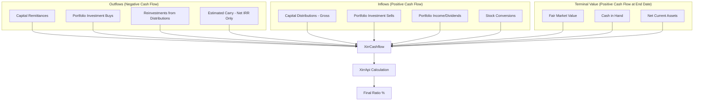

# Financial Ratios Calculation Document

## 1. Fund and Entity Level Ratios

These ratios provide a high-level view of the performance of a Fund or an Entity (multi-fund).

| Ratio | Formula | Description |
| :--- | :--- | :--- |
| **XIRR** (Internal Rate of Return) | Calculated using `XirrApi` based on a sequence of cash flows. | Measures the annualized rate of return for a series of irregular cash flows. Can be Gross or Net (of Estimated Carry). |
| **MOIC** (Multiple on Invested Capital) | $\frac{Total Value (FMV + Total Sold)}{Total Bought}$ | Measures how many times the invested capital has been returned or is currently valued. |
| **DPI** (Distributed to Paid-In) | $\frac{Net Distributions}{Collected Capital}$ | The ratio of money returned to investors to the total capital they have paid in. |
| **RVPI** (Residual Value to Paid-In) | $\frac{FMV + NCA + CashInHand}{Collected Capital}$ | The ratio of the current value of remaining investments (plus fund assets) to the total capital paid in. |
| **TVPI** (Total Value to Paid-In) | $DPI + RVPI$ | The total return (distributed + remaining) relative to the total capital paid in. |
| **PIC** (Paid-In to Committed) | $\frac{Collected Capital}{Committed Capital}$ | Percentage of committed capital that has been called and collected. |
| **Portfolio Value to Cost** | $\frac{Total FMV}{Total Investment Costs}$ | The current market value of the portfolio divided by its remaining cost basis. |

---

## 2. Portfolio Company and Asset (API) Level Ratios

These ratios measure performance at the individual investment or portfolio company level.

| Ratio | Formula | Description |
| :--- | :--- | :--- |
| **Company XIRR** | `XirrApi` using company-specific cash flows. | Annualized return for a specific portfolio company. |
| **Company MOIC** | $\frac{Company FMV + Company Sold}{Company Bought}$ | Total value realized and unrealized for a specific company relative to total investment in it. |
| **Value to Cost** | $\frac{FMV}{Cost of Remaining}$ | Current value of the remaining stake relative to its cost basis. |
| **API IRR** | `XirrApi` using API-specific cash flows. | Annualized return for a specific Aggregate Portfolio Investment (API). |

---

## 3. Cash Flow Logic (XIRR/MOIC)

The system constructs a `XirrCashflow` object by aggregating various transactions. The sign convention used is:
- **Negative (-)**: Outflows (Capital calls, buys, reinvestments).
- **Positive (+)**: Inflows (Distributions, sales, income, FMV/residual value at the end date).

### Cash Flow Components Diagram

---

## 4. Key Calculation Details

### Currency Handling
- **Original Currency**: Default behavior in `FundRatioCalcs`.
- **Tracking Currency**: Used if `use_tracking_currency: true`. Amounts are converted using the exchange rate as of the transaction date or end date.
- **Base/Entity Currency**: Used in `FundRatioMultiFundCalcs` to aggregate data from multiple funds into a single entity currency.

### FMV and Scenarios
The `fmv_on_date` method handles the valuation. If a **Scenario** is provided (e.g., for stress testing), a `percentage_change` is applied to the FMV of specific assets before it is included in the ratios.

---

## 5. Enhancement Rules (Proposed)

The following table defines how specific account entries should be incorporated into the ratio calculations.

| Type | Ratio | Action | Account Entries | Period |
| :--- | :--- | :--- | :--- | :--- |
| Fund | XIRR, DPI, TVPI, MOIC | Add | Mutual Fund investment | As-on |
| Fund | XIRR, DPI, TVPI, MOIC | Add | Non Deal Expenses | All |
| Folio | XIRR | Reduce | Temp income distribution | All |

---

## 6. Implementation Plan (Finalized)

### **1. Data Storage (`RatioFormula` Model)**
*   **Model Name**: `RatioFormula`
*   **Associations**: Belongs to `Entity` and `Fund`.
*   **Fields**:
    *   `entity_id`: Integer (Tenancy)
    *   `fund_id`: Integer (Per-fund configuration)
    *   `level`: String (`Fund` or `Folio`)
    *   `ratios`: Array/String (e.g., `['XIRR', 'DPI', 'TVPI', 'MOIC']`)
    *   `action`: String (`add_cashflow`, `reduce_cashflow`, `add_numerator`, `reduce_numerator`, `add_denominator`, `reduce_denominator`)
    *   `account_entry_name`: String
    *   `period`: String (`as_on` or `all`)

### **2. Calculation Integration Logic**
The calculators will be modified to check for existing `RatioFormula` records for the specific fund being calculated.
*   **Fallback**: If no rules exist for a fund, the system will use the current hardcoded logic (e.g., for Cash In Hand, NCA). If rules exist, they will **replace** the hardcoded defaults for the specified ratios.
*   **Entry Filtering**:
    *   Only **non-cumulative** `AccountEntry` records are considered.
    *   **Period "All"**: Aggregate all matching entries up to the `@end_date`. Each entry is treated as a separate cash flow event for XIRR.
    *   **Period "As-on"**: Take the single **latest** matching entry on or before `@end_date` as a terminal value.
*   **Account Entry Scope**:
    *   When calculating at the "Fund" level, only Fund-level account entries (where `capital_commitment_id` is null) are considered.
    *   When calculating at the "Folio" level, only consider account entries (where `account_entry.folio_id` is the same as the capital_commitment.folio_id) are considered.
    *   When calculating at the "Portfolio Company" level, only consider account entries (where `owner_type=Investor and account_entry.parent_id` is the same as the portfolio_company.id ) are considered.

### **3. Mathematical Application**
*   **XIRR**:
    *   `add_cashflow`: `cf << XirrTransaction.new(ae.amount_cents, date: ae.reporting_date)`
    *   `reduce_cashflow`: `cf << XirrTransaction.new(-ae.amount_cents, date: ae.reporting_date)`
*   **Static Ratios (DPI, MOIC, RVPI, TVPI)**:
    *   `add_numerator`: Adds the amount to the numerator (e.g., Distributions, Total Value).
    *   `add_denominator`: Adds the amount to the denominator (e.g., Collected Capital, Total Bought).
    *   `reduce_...`: Subtracts the amount accordingly.

### **4. Refactoring Target Areas**
*   `FundRatioCalcs`: Core logic for fetching and applying formulas.
*   `FundPortfolioCalcs` & `CapitalCommitmentCalcs`: Instance-specific implementations.
*   `FundRatioMultiFundCalcs`: Will iterate through rules for each fund and aggregate results.

---

### **Follow-up Questions**

1.  **Folio Level Rules in Fund Calcs**: If a rule is defined at the "Folio" level (e.g., "Temp income distribution"), should these entries also be aggregated into the **Fund-level** XIRR/DPI, or are Folio-level rules strictly for the individual Capital Commitment ratios? Its strictly for the CapitalCommitment
2.  **Multi-fund Entity Rules**: When calculating for an Entity (Multi-fund), we will apply each fund's specific rules to its own entries. Do we also need the ability to define "Entity-level" rules that apply to all funds within that entity globally?
3.  **UI for Management**: Should I proceed with creating basic Rails admin/dashboard views for managing these `RatioFormula` records, or will they be managed via console/migrations for now?

