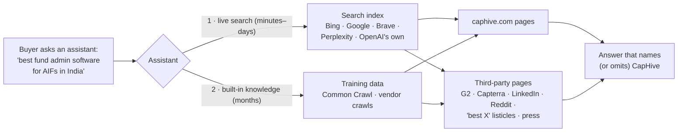
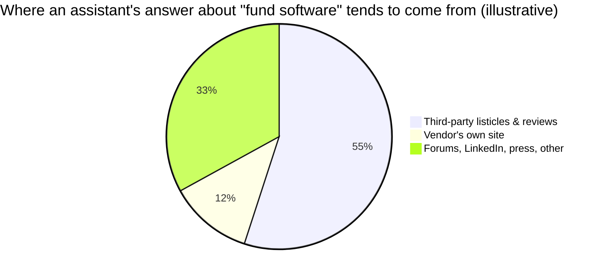
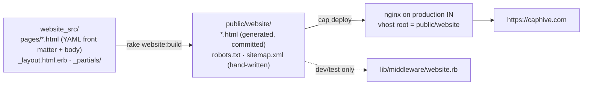
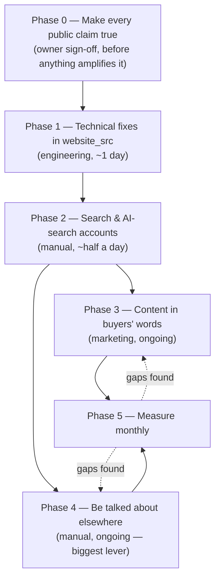
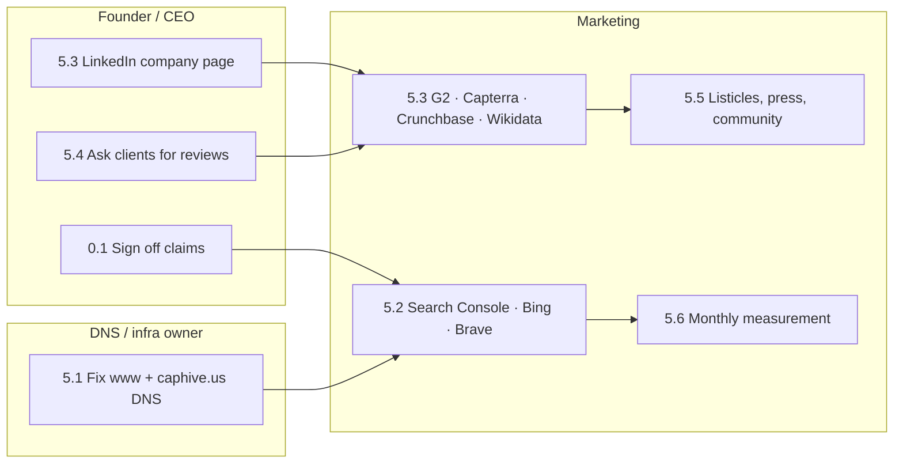

# Getting CapHive into AI answers — plan

Audit and plan as of **2026-10-30**. Repo facts come from `website_src/`, `lib/tasks/website.rake`
and the live site (`curl` against https://caphive.com on 2026-10-30). Facts about outside
vendors are cited in [Sources](#sources). Anything we could not verify says so.

## The short answer

**No file gets a company into ChatGPT or Claude.** Assistants learn about CapHive in two ways:

1. **Live web search while they answer.** This is fast, and we can influence it now.
2. **Training data.** This is slow, indirect and lags by months.

Both depend on the same three things:

- crawlers can read the site;
- the site says plainly what CapHive is, in the words buyers use;
- **other websites talk about CapHive**, which is the factor most strongly linked to being cited.

Where caphive.com stands:

- **The basics are already right.** robots.txt allows every crawler, AI crawlers get a `200`, the
  pages are static HTML that crawlers without JavaScript can read, and blog posts carry structured data.
- **The gaps are:**
  - a few technical loose ends: a broken `www`, the sitemap, entity markup;
  - buyer vocabulary missing from the core pages;
  - search-engine and AI-search accounts nobody has set up yet;
  - almost no presence on the third-party sites assistants quote.
- **Most of the work is manual.** Section 5 lists it by owner.



---

## 1. How AI assistants find a company

### 1.1 Which crawler does what

Each AI vendor now runs **separate** crawlers for training, for its search index, and for
fetching a page while a user waits. **For appearing in answers today, the search crawlers
are the ones that matter.**

| Vendor | Training | Search index (gets you cited) | Fetch on user request |
|---|---|---|---|
| OpenAI (ChatGPT) | `GPTBot` | `OAI-SearchBot` — blocking it removes you from ChatGPT search answers | `ChatGPT-User` |
| Anthropic (Claude) | `ClaudeBot` | `Claude-SearchBot` | `Claude-User` |
| Perplexity | — (says it does not train) | `PerplexityBot` | `Perplexity-User` |
| Google (Gemini, AI Overviews, AI Mode) | `Google-Extended` (robots token only; does **not** affect Search or AI Overviews) | `Googlebot` | `Google-Agent`, `Google-GeminiNotebook` |
| Microsoft Copilot | — | `bingbot` (Copilot answers come from Bing) | — |
| Apple | `Applebot-Extended` (training opt-out only, crawls nothing) | `Applebot` | — |
| Meta | `meta-externalagent` | `meta-webindexer` | `meta-externalfetcher` |
| Amazon | `Amazonbot` | `Amzn-SearchBot` | `Amzn-User` |
| Common Crawl | `CCBot` (feeds many training sets) | — | — |
| Mistral | `MistralAI-Training` | `MistralAI-Index` | `MistralAI-User` |
| DuckDuckGo | — | `DuckAssistBot` | — |

### 1.2 Which index each assistant searches

| Assistant | Where its web answers come from | Verified? |
|---|---|---|
| ChatGPT | OpenAI's own index (`OAI-SearchBot`) plus partner providers, mainly Bing | Partly: OpenAI says "partners"; Bing comes from 2024 reporting |
| Claude | Brave Search | Brave confirmed (Anthropic subprocessor list, March 2025); a second provider is reported but unverified |
| Perplexity | Its own index | Yes |
| Gemini, Google AI Overviews and AI Mode | Google Search | Yes |
| Microsoft Copilot | Bing | Yes |

**What this means for us:** being indexed by **Google, Bing and Brave** covers almost
every assistant. Many companies set up Google Search Console and never touch Bing, and
that leaves out both Copilot and much of ChatGPT.

### 1.3 Three things that are true now and were not two years ago

- **AI crawlers do not run JavaScript.** GPTBot, ClaudeBot and PerplexityBot fetch the
  raw HTML only; Googlebot and Applebot are the exceptions. Our site is static HTML, so we
  are fine. Do not move it to a JavaScript framework that renders in the browser.
- **llms.txt is not used by anyone who matters yet.** Google says Search ignores it, no
  other major vendor documents using it, and log studies show almost no bot requests for
  it. We can add one cheaply (section 4.6), but it is not a lever.
- **FAQ rich results are gone.** Google stopped showing them on 2026-05-07. FAQ *markup*
  no longer earns anything in Google. What assistants read is the **visible Q&A text**,
  and our FAQ page already has that.

### 1.4 What actually gets cited

These are the strongest findings from independent studies (sources at the end):

1. **Assistants mostly cite pages outside Google's top 10.** Only about 12% of URLs cited by
   ChatGPT, Gemini and Copilot also rank in Google's top 10 for the same query. Classic SEO
   rank is not the main lever. Google's own AI Overviews are the exception, at about 76%.
2. **Mentions on other sites beat backlinks.** Across 75,000 brands, being mentioned
   correlated about 3× more strongly with AI visibility than backlinks did (0.664 vs 0.218).
3. **B2B software answers lean on "best X software" listicles and review sites.** Vendor
   studies, which we could not independently verify, found:
   - listicles were about 44% of ChatGPT's B2B SaaS citations;
   - ChatGPT cited the recommended vendor's *own* site only about 12% of the time;
   - every tool ChatGPT named had a Capterra profile, and 99% had G2 reviews.
4. **Sources shift quickly.** ChatGPT's use of Reddit and Wikipedia citations fell sharply
   in September 2025, and LinkedIn is the top domain in Google AI Mode. Do not bet on a
   single platform.



> The pie chart is illustrative only. It is assembled from the vendor studies in point 3,
> which use different methods. Read it as "most of the answer is other people's pages",
> not as exact shares.

---

## 2. Where caphive.com stands today

### 2.1 How the site is built and served



- **Pages:** each page's `title` and `description` come from its front matter. The canonical URL
  and `og:url` are worked out in `WebsiteBuild::Context#canonical` in `lib/tasks/website.rake`.
- **Hand-written files:** `robots.txt` and `sitemap.xml` live directly in `public/website/` and
  are **not** generated.

### 2.2 Audit

| # | Check | Status | Evidence |
|---|---|---|---|
| A1 | AI crawlers allowed by robots.txt | ✅ OK | Live `robots.txt` is `User-agent: *` / `Allow: /`, disallowing only `thank-you.html` and `404.html` |
| A2 | Nothing at the edge blocks AI bots | ✅ OK | `curl -A` as GPTBot, ClaudeBot, PerplexityBot, OAI-SearchBot and CCBot → `200`. Response header is `server: nginx` with no Cloudflare `cf-ray`, so Cloudflare's default AI blocking does not apply |
| A3 | Readable without JavaScript | ✅ OK | Static HTML. Homepage has about 1,140 visible words, funds about 1,190, FAQ about 1,720, all in the raw HTML |
| A4 | Canonical URLs | ✅ OK | Every page has `<link rel="canonical">` to `https://caphive.com/…` |
| A5 | Blog structured data | ✅ OK | 29 long-form pages carry `BlogPosting` JSON-LD |
| A6 | **`www.caphive.com` broken** | ✅ Fixed 2026-10-30 | The CNAME's value was a whole URL (`https://h3d.73d.myftpupload.com/.`, the old GoDaddy/WordPress host), so nothing could resolve it. Repointed in Route 53 to the IN load balancer; `https://www.caphive.com/` now 301s to `https://caphive.com/` |
| A7 | **`caphive.us` has no DNS** | ✅ Fixed 2026-10-30 | Added an A-alias record to the US load balancer, plus an ACM certificate for `caphive.us` + `*.caphive.us` attached as an extra listener certificate, because the default cert was wildcard-only. `https://caphive.us/` returns 200 with HSTS, `www.caphive.us` 301s to it, and the demo-form preflight from `https://caphive.us` is allowed by `app.caphive.us`. The site keeps serving on .us (not redirecting to .com) so US leads stay in the US database; pages are canonical to caphive.com. The new cert was added in the console, so it is not in the Pulumi state; see `IRM-Infra/PULUMI_STATE.md` before the next `pulumi up` on `production-us-east-1` |
| A8 | **Old URLs return 404** | 🔧 Built — live after `cap production_in nginx:update` | The Wayback Machine lists 22 pages from the WordPress-era site (`/about-us/`, `/contact-us/`, `/fund-saas/`, 7 blog posts, 6 `/case-study/…` pages, …). All of them return `404`, so any links and index entries pointing at them are lost. All 22, plus two convenience aliases (`/blog/` and `/case-study/`, which are not in the archive), now 301 to their new pages via `website_src/redirects.yml` (section 4.4) |
| A9 | **Sitemap incomplete and stale** | ✅ Built | Was 62 URLs. `distribution-readiness.html` and `semantic-layer.html` are missing; only 21 entries have `<lastmod>`; the file was hand-maintained (already flagged in `docs/gtm/website_todos.md` §3). Now generated by `rake website:build`: 64 URLs, all dated — section 4.1 |
| A10 | **Organization markup is thin** | ✅ Built (partly) | Was only on the homepage: name, url, email, address. Now on every page with `logo`, `founder` and `areaServed` added. `foundingDate` and company `sameAs` still wait for confirmed facts — section 4.2 |
| A11 | **No company profile links** | ❌ Fix | The footer links only to `app.caphive.com` / `app.caphive.us`. There is no company LinkedIn link, which is the usual `sameAs` anchor |
| A12 | Title bug | ✅ Not a bug | The front-matter title wraps onto a second YAML line, so the built page title already ends `| CapHive`. The audit read only the first line |
| A13 | **Buyer vocabulary on core pages** | ❌ Content | Across the 9 core pages (index, products, funds, portfolios, deals-secondaries, who-we-serve, faq, pricing, about): "SEBI" 0, "GIFT City" 0, "LP portal" 0, "capital call" 1, "India" 2, "fund administration" 2 |
| A14 | **Claims an assistant will repeat** | ⚠️ Verify | Security claims are on the page now: "SOC 2 Type II" in the trust strip and "certified against ISO/IEC 27001:2022" in the FAQ. `website_todos.md` §1 (2026-08-09) flagged SOC 2 as unverified, and so are the headline metrics (US$10bn+ AUM, 4,000+ investors). Once indexed, an assistant states these as fact and can keep doing so for months after we change the page |
| A15 | Search Console and Bing verification | ❓ Unknown | No `google-site-verification` or `msvalidate` meta tag in `website_src`. Verification may have been done through DNS; whoever owns the accounts has to confirm |
| A16 | llms.txt | — Optional | `https://caphive.com/llms.txt` → 404. Low value (section 1.3) |

---

## 3. The plan



| Phase | Who | Effort | What it buys |
|---|---|---|---|
| 0. True claims | Founder / CEO | 1–2 hours of decisions | Assistants never learn something we would have to retract |
| 1. Technical | Engineering | About 1 day | Every page found, the right URL, a clear company identity |
| 2. Accounts | Whoever owns DNS and Google | About half a day | Google, Bing and Brave index us; we can see AI citations |
| 3. Content | Marketing plus product | Ongoing, 2–4 pages a month | We show up for the questions buyers actually ask |
| 4. Off-site | Founder plus marketing | Ongoing | The single largest factor in being named by ChatGPT and Claude |
| 5. Measure | Marketing | 1 hour a month | We know whether it is working |

**Timing:** live-search results (ChatGPT search, Perplexity, Copilot, Claude) can move within
**days to weeks** of indexing. Built-in model knowledge only changes at the next training
cut-off, typically **6–12 months** later, and only if the third-party footprint exists by then.

---

## 4. Phase 1 — technical changes (engineering)

> **Status (2026-10-30):** 4.1–4.4 are built on branch `website/ai-search-visibility`, not yet
> committed or deployed. 4.5 is waiting on the company LinkedIn URL; 4.6 is optional; 4.7 needs
> no change.

### 4.1 Generate `sitemap.xml` from the build

- **Why:** A9. The hand-written sitemap already misses two live pages and will keep drifting.
  A `<lastmod>` tells Bing and Google to re-crawl changed pages, which matters for
  live-search freshness.
- **Where:** `WebsiteBuild::Builder#build` in `lib/tasks/website.rake`.
- **How:**
  - after the pages are written, emit one `<url>` per page;
  - skip pages whose front matter sets `robots` (today `404.html`) and `thank-you.html`;
  - take `<lastmod>` from the page's last git commit date;
  - optionally take `<priority>` from front matter.

Example output line:

```xml
<url><loc>https://caphive.com/semantic-layer.html</loc><lastmod>2026-10-21</lastmod></url>
```

### 4.2 Fuller `Organization` markup on every page

- **Why:** A10 and A11. Assistants and Google build an *entity* ("CapHive, the private-markets
  software company in Mumbai") from consistent facts and `sameAs` links to our profiles
  elsewhere. Without them, we risk being confused with other companies called CapHive.
- **Where:** move the block out of `_partials/index_scripts.html` into a partial rendered by
  `_layout.html.erb`, so every page has it.
- **What:** add
  - `logo`;
  - `sameAs` (the company LinkedIn page, Crunchbase, G2, Capterra, YouTube, filled in once the
    profiles from section 5.3 exist);
  - `foundingDate`;
  - `founder`;
  - `areaServed` (India, United States);
  - a short `description` in buyer language.

  Facts we have not confirmed stay out until the owner confirms them.

### 4.3 `SoftwareApplication` markup on `products.html`

- **Why:** labels CapHive as a business application in the "fund management software" category.
- **Caveat:** Google's rich result for it requires a price and ratings. We quote pricing per
  engagement and have no public reviews yet, so this is for entity clarity only, not a rich
  result. Add `aggregateRating` only once G2 or Capterra reviews exist (section 5.3).

### 4.4 Redirect old WordPress URLs

- **Why:** A8. Old links and index entries pointing at `/about-us/` and the like currently die.
- **Where:** a `location` map in `config/deploy/templates/nginx_conf.erb` (website vhost),
  mirrored in `lib/middleware/website.rb` for dev/test.
- **Built:** the list lives in `website_src/redirects.yml`, one line per old URL. It holds 24
  URLs taken from the Wayback Machine's index of the WordPress-era site (2026-10-30), e.g.:

```
/about-us/                      → 301 → /about.html
/fund-saas/                     → 301 → /funds.html
/case-study/portfolio-reports/  → 301 → /case-portfolio-reports.html
```

- **How it matches:** with or without the trailing slash, in any letter case, and the query
  string is carried over. `rake website:build` aborts if a target page does not exist.
- **Manual step:** production picks it up only after `cap production_in nginx:update`.
  Uploading the site with `website:deploy` does not re-render the nginx config.
- **Adding more:** if Search Console's "Not found (404)" report shows other old URLs, add one line
  each to `redirects.yml`, then run `nginx:update` again.

### 4.5 Small fixes

- Add the company LinkedIn link to `_partials/footer.html.erb` once the URL is confirmed (A11).

### 4.6 Optional: `llms.txt`

- **What:** a short markdown file at `/llms.txt` covering what CapHive is, who it is for, and links
  to the core pages, the FAQ and the agent directory. It could be generated from the same page list as
  the sitemap.
- **Value:** cheap but low (section 1.3). Do it last, or skip it.

### 4.7 robots.txt — no change needed

The existing `User-agent: *` / `Allow: /` already admits every crawler in section 1.1.

> **Do not** add per-bot groups unless you mean to. A named group (`User-agent: GPTBot`)
> **replaces** the `*` group for that bot, so it would quietly lose the `thank-you.html` and
> `404.html` disallows unless they are repeated.

If we ever want "search yes, training no", that is a deliberate business decision. It would
add `Disallow: /` for `GPTBot`, `ClaudeBot`, `CCBot`, `Google-Extended` and `Applebot-Extended`
only. For a company that *wants* to be known, the recommendation is to leave training open.

---

## 5. The manual work — who does what

This is the part code cannot do. Each item says **why**, **where**, the **steps**, and **how to
know it is done**.



### 5.0 Phase 0 — sign off every public claim (Founder / CEO)

**Why first:** once a figure is indexed, assistants repeat it as fact and keep doing so long
after we change the page (training lag). A false compliance claim in an AI answer to an LP's
diligence question is the worst outcome on this list.

| Claim | Where it appears | Decision needed |
|---|---|---|
| "SOC 2 Type II" | `security.html` trust strip | Do we hold a SOC 2 Type II report? If not, remove it or say "in progress" with a date |
| "ISO/IEC 27001:2022 certified" | `security.html` FAQ | Confirm the certificate exists and its scope |
| US$10bn+ AUM, 4,000+ investors, US$500m+ raised & secondaries, 1,000+ sellers & investors | Nav chip, OG image, 8 pages | One owner signs off on each figure and its as-of date |
| Integrations, including named banks | `integrations.html` (7 TODOs) | Mark each one live or roadmap |
| Case-study figures | `case-studies.html`, `case-*.html` | Real, anonymised but real, or removed |

**Done when:** `grep -c "VERIFY" website_src/pages/*.html` shows none left on public claims.

### 5.1 Fix the domains (DNS / infrastructure owner)

1. **`www.caphive.com`:** repoint it from the GoDaddy host to the production IN app
   (the same target as the apex, `13.205.167.116`, or the ALB alias). The nginx vhost already
   301s `www` → apex (`nginx_conf.erb`, the `server_name www.<website_domain>` block). The
   certificate must cover `www`.
   - *Check:* `curl -sI https://www.caphive.com/` → `301` to `https://caphive.com/`.
2. **Retire the GoDaddy Website Builder site** once `www` is moved, so nothing serves the old
   content.
3. **`caphive.us`:** decide whether it serves the site (`website_todos.md` §6). If it does, the
   pages stay canonical to caphive.com, so there is no duplication risk.
4. **Deploy the old-URL redirects** (section 4.4): `cap production_in nginx:update`. Later, check
   Search Console → Pages → *Not found (404)* for old URLs the Wayback list missed.

### 5.2 Search and AI-search accounts (Marketing)

| Account | Why | Steps | Done when |
|---|---|---|---|
| **Google Search Console** | Feeds Gemini, AI Overviews and AI Mode. The *Search Generative AI performance* report (since June 2026) shows impressions in AI Overviews and AI Mode | Add a **Domain property** for `caphive.com` (DNS TXT record, which covers `www` and http) → submit `https://caphive.com/sitemap.xml` → check *Pages* for "Discovered – not indexed". **Leave the "Search generative AI" opt-out control off** | Sitemap status "Success"; about 60 pages indexed |
| **Bing Webmaster Tools** | Feeds Copilot and is ChatGPT's main search partner. The **AI Performance** report (public preview since 2026-02-10) shows how often Copilot and Bing AI cite our pages | Sign in → *Import from Google Search Console* (fastest) → submit the sitemap → open *AI Performance* | Pages indexed; the AI Performance report shows data after a few weeks |
| **IndexNow** | Tells Bing (and Yandex, Seznam and others) the moment a page changes, instead of waiting for a re-crawl | Generate a key in Bing Webmaster Tools and host `/<key>.txt` in `public/website/`. Engineering can then ping IndexNow from `rake website:build` or the deploy (a follow-up to section 4.1) | Bing *IndexNow* tab shows submissions |
| **Brave Search** | Claude's web search uses Brave | Brave has no webmaster console. Check `https://search.brave.com/search?q=site%3Acaphive.com`. Brave discovers pages through links and its own crawl, so the off-site work in 5.3 is what helps here | Core pages appear for `site:caphive.com` |
| **OpenAI / Perplexity / Anthropic** | — | Nothing to submit; there is no console. Being allowed in robots.txt (A1) and being in Bing is all we control | — |

> If the site is ever put behind **Cloudflare**, check *AI Crawl Control* straight away.
> Since 2025, new Cloudflare zones block AI crawlers by default and add
> `Content-Signal: ai-train=no` to robots.txt. That would silently undo A1/A2.

### 5.3 Profiles that establish the entity (Founder plus Marketing)

**Why:** assistants answer "what is CapHive" and "best fund software for AIFs" mostly from
third-party pages. Review-site presence correlates with being named in category answers.
These profiles are also the `sameAs` targets for section 4.2.

**Rule for every profile:** use the **same one-line description** and the same facts
everywhere, so every source describes the same company. Draft line, for the owner to confirm:

> *CapHive is fund operations software for private markets — fund accounting, investor
> onboarding and LP portal, capital calls and distributions, portfolio monitoring, and deals &
> secondaries — used by AIFs in India and funds in the US, with AI agents built in.*

| Profile | Priority | Notes |
|---|---|---|
| **LinkedIn company page** | P0 | LinkedIn is Google AI Mode's most-cited domain. Fill in description, website, industry and specialties; post each blog article there |
| **G2** | P0 | Claim the listing, choose the categories (Fund Administration, Investor Portal, Portfolio Management), then ask clients for reviews (5.4) |
| **Capterra / GetApp / Software Advice** | P0 | One Gartner Digital Markets listing covers all three |
| **Crunchbase** | P1 | Company facts: founded, HQ, founders, description |
| **Wikidata** | P1 | An item for CapHive (instance of: business; industry; official website; country). Factual entries only, with sources. **No Wikipedia article** until independent press coverage exists; one without it will be deleted |
| **Google Business Profile** | P2 | For the Mumbai office (address already in the JSON-LD) |
| **YouTube** | P2 | A 3–5 minute product walkthrough, with a description that uses the buyer terms from 6.1 |

### 5.4 Client reviews (Founder)

- **Ask:** live clients for G2 and Capterra reviews. Even 5–10 named-company reviews change how
  the category answers look.
- **Never:** pay for reviews or write them ourselves. That breaks both platforms' terms, and
  Google's spam policies apply to AI answers too.

### 5.5 Be in the places assistants quote (Marketing plus Founder, ongoing)

- **"Best X" listicles:** find the articles that rank for "best fund administration software",
  "AIF management software India", "LP portal software" and "portfolio monitoring software for
  VC". Write to each author with a short pitch and a demo login. These pages are the largest
  single source of B2B citations.
- **Industry press and associations:**
  - India: IVCA, VCCEdge, Inc42, Entrackr, the Economic Times' BFSI/tech desks;
  - US: the fund-ops and fund-admin trade press.
- **Partners:** fund administrators, RTAs and law firms we work with naming CapHive on their
  own sites ("we work with…") is exactly the kind of independent mention that counts.
- **Communities:** the founder and team answering real questions on LinkedIn and relevant
  Reddit/forum threads, with no spam. Reddit is Perplexity's most-cited domain.
- **Comparison content on our own site** (6.2) gives listicle authors something to quote.

### 5.6 Monthly measurement (Marketing, about 1 hour)

1. **Prompt panel:** ask the same 10 questions, in a logged-out or incognito session, in
   ChatGPT (search on), Claude, Perplexity, Gemini and Copilot. Record whether CapHive is named,
   which URL is cited, and whether the facts are right. Example prompts:
   - "What is CapHive?"
   - "Best fund administration software for AIFs in India"
   - "Software for SEBI AIF compliance and investor reporting"
   - "LP portal software for venture funds"
   - "Alternatives to [competitor] for fund accounting"
   - "How do I automate capital call notices for a VC fund?"
2. **GA4:** create a channel group "AI assistants" covering
   - source `chatgpt.com` (ChatGPT adds `utm_source=chatgpt.com`);
   - `perplexity.ai`;
   - `claude.ai`;
   - `gemini.google.com`;
   - `copilot.microsoft.com`.
3. **Bing AI Performance** and the **Search Console generative AI report:** citations and
   impressions trend.
4. **Server logs** on the production IN nginx: request counts by user agent for
   `OAI-SearchBot`, `Claude-SearchBot`, `PerplexityBot` and `bingbot`. Rising counts mean pages
   are being picked up. **Read-only:** pull the logs, do not change the box.
5. **Paid tools (optional, later):** Profound, Semrush AI Visibility, Ahrefs Brand Radar,
   Peec AI and Otterly track prompt panels automatically.

---

## 6. Phase 3 — content in buyers' words (Marketing plus Product)

### 6.1 Use the words buyers type

- **Problem (A13):** the core pages describe CapHive in its own terms ("system of record", "one
  ledger", "waterfalls") but rarely use the phrases a buyer types into an assistant.
- **Fix:** each core page should state plainly, in body text, which buyer terms it covers.

| Buyer phrase | Today (of 9 core pages) | Natural home |
|---|---|---|
| SEBI AIF (Cat I / II / III), SEBI reporting | 0 | `funds.html`, `who-we-serve.html`, `faq.html` |
| GIFT City funds | 0 | `who-we-serve.html` (only if we support it — confirm) |
| LP portal / investor portal | 0 / 1 | `funds.html`, `products.html` |
| Capital call notices / drawdowns | 1 | `funds.html` (a dedicated long-form page already exists) |
| Fund administration / fund accounting software | 2 | `index.html`, `funds.html` |
| India, US, Delaware LP | 2, 1, 0 | `who-we-serve.html`, `faq.html` |

### 6.2 Pages assistants like to cite

Make them factual and specific, with a clear one-paragraph answer at the top:

- **"What is CapHive"**: a short page or the opening of `about.html` with founded date, HQ,
  who it is for, modules, and regions served.
- **"CapHive vs …" and "alternatives to …" pages** for the 3–5 products buyers compare us
  with. Be fair and factual: an assistant quotes a comparison table it can trust.
- **Use-case pages per buyer type:** "Software for SEBI Category II AIFs", "For fund
  administrators", "For family offices". `who-we-serve.html` can link to each one.
- **Original data:** `outlook-for-aifs-in-india.html` is the right kind of page. Google's AI
  guide explicitly favours original, "non-commodity" content. More of this (anonymised
  benchmarks from the platform, if clients agree) is what gets cited and linked.

### 6.3 Keep doing

- **Visible FAQ text:** the 22-question `faq.html` is good. Add the questions the monthly
  prompt panel shows assistants getting wrong. Visible text matters, not FAQ markup (1.3).
- **One date per long-form page:** `datePublished` is already in the `BlogPosting` markup.
  Add `dateModified` when a page is meaningfully updated.

---

## 7. What not to do

| Don't | Why |
|---|---|
| Block `OAI-SearchBot`, `Claude-SearchBot`, `PerplexityBot` or `bingbot` | Removes us from those assistants' live answers |
| Expect `llms.txt` or FAQ schema to move anything | No major vendor documents using llms.txt; Google retired FAQ rich results in May 2026 |
| Publish an unconfirmed claim "for now" | Assistants repeat it for months (5.0) |
| Buy reviews or seed fake forum posts | Platform bans, and Google's spam policies apply to AI answers |
| Pay a "GEO agency" promising guaranteed ChatGPT placement | Google states no third-party tool can see its ranking or AI systems; nobody can guarantee placement |
| Change the website DB, nginx or DNS from this plan without the usual approval | Ops changes follow the normal deploy and approval path |

---

## 8. FAQ

**Why doesn't CapHive show up when I ask ChatGPT about fund software, even though the site is crawlable?**
Being crawlable only makes us *eligible*. Category answers ("best X") are mostly built from
third-party listicles and review sites (1.4), and CapHive has almost no presence there yet. The
fix is section 5.3–5.5, not a website change.

**Why does an assistant's answer about CapHive sometimes have old or wrong facts?**
Answers with no search come from the model's training data. That data was frozen months ago
and may include the old WordPress site. Answers *with* search use the current index. Fixing
`www`, adding 301s (5.1, 4.4) and keeping one consistent description everywhere (5.3)
replaces the stale picture over time.

**What happens if we block AI training but allow search?**
We would still be cited in live answers, but future models would know less about CapHive
without searching. For a company that wants to be known, that is a poor trade. The current
robots.txt allows both, and we recommend keeping it that way (4.7).

**How long until we see results?**
- Search-based answers in Perplexity, ChatGPT search and Copilot: days to weeks after Bing and
  Google index a page.
- Built-in model knowledge: the next training cycle, typically 6–12 months, and only if the
  off-site footprint exists by then.

**Do we need a separate site or file for AI?**
No. The same HTML pages serve search engines and AI crawlers, and our static HTML is already
the format they read best (A3).

**Does `caphive.us` need its own sitemap or Search Console property?**
Only if it serves different content. Today every page is canonical to caphive.com, so one
property and one sitemap on caphive.com is right.

---

## Sources

Vendor documentation (primary):
- OpenAI crawlers — https://developers.openai.com/api/docs/bots ; publisher FAQ (utm_source) — https://help.openai.com/en/articles/12627856-publishers-and-developers-faq ; search providers — https://help.openai.com/articles/9237897
- Anthropic crawlers — https://support.claude.com/en/articles/8896518-does-anthropic-crawl-data-from-the-web-and-how-can-site-owners-block-the-crawler
- Perplexity crawlers — https://docs.perplexity.ai/guides/bots
- Google crawlers — https://developers.google.com/search/docs/crawling-indexing/google-common-crawlers ; user-triggered fetchers — https://developers.google.com/search/docs/crawling-indexing/google-user-triggered-fetchers
- Google AI features guidance — https://developers.google.com/search/docs/appearance/ai-features ; AI optimization guide (llms.txt ignored) — https://developers.google.com/search/docs/fundamentals/ai-optimization-guide ; changelog (FAQ rich results retired) — https://developers.google.com/search/updates ; generative AI performance report — https://developers.google.com/search/blog/2026/06/gen-ai-performance-reports
- Google structured data: Organization — https://developers.google.com/search/docs/appearance/structured-data/organization ; SoftwareApplication — https://developers.google.com/search/docs/appearance/structured-data/software-app
- Gemini grounding with Google Search — https://ai.google.dev/gemini-api/docs/google-search
- Microsoft Copilot web grounding via Bing — https://learn.microsoft.com/en-us/copilot/microsoft-365/manage-public-web-access
- Apple — https://support.apple.com/en-us/119829 ; Meta — https://developers.facebook.com/docs/sharing/webmasters/web-crawlers ; Amazon — https://developer.amazon.com/amazonbot ; Common Crawl — https://commoncrawl.org/ccbot ; Mistral — https://docs.mistral.ai/robots ; DuckDuckGo — https://duckduckgo.com/duckduckgo-help-pages/results/duckassistbot
- Cloudflare default AI blocking — https://blog.cloudflare.com/content-independence-day-no-ai-crawl-without-compensation/ ; Content Signals — https://blog.cloudflare.com/content-signals-policy/

Studies and reporting (secondary):
- AI crawlers and JavaScript (Vercel/MERJ, Dec 2024) — https://vercel.com/blog/the-rise-of-the-ai-crawler
- Claude search uses Brave — https://simonwillison.net/2025/Mar/21/anthropic-used-brave
- Citations vs Google top 10 (Ahrefs) — https://ahrefs.com/blog/ai-search-overlap/ ; mentions vs backlinks — https://ahrefs.com/blog/ai-overview-brand-correlation/
- Citation patterns by platform (Profound) — https://www.tryprofound.com/blog/ai-platform-citation-patterns ; most-cited domains (Semrush) — https://www.semrush.com/blog/most-cited-domains-ai/
- AI Overview click impact (Seer, 2026) — https://seerinteractive.com/insights/aio-impact-on-google-ctr-2026-update
- Bing AI Performance report — https://ppc.land/bing-gives-publishers-first-look-at-how-ai-systems-cite-their-content/
- B2B SaaS citation benchmarks (vendor research, unverified) — https://www.averi.ai/how-to/chatgpt-vs.-perplexity-vs.-google-ai-mode-the-b2b-saas-citation-benchmarks-report-%282026%29 ; https://derivatex.agency/report/b2b-saas-ai-citation-study/

**Not verified:**
- how much ChatGPT search depends on Bing today;
- Claude's reported second search provider;
- which index Siri's web answers use;
- any LLM vendor using llms.txt or FAQPage markup.
