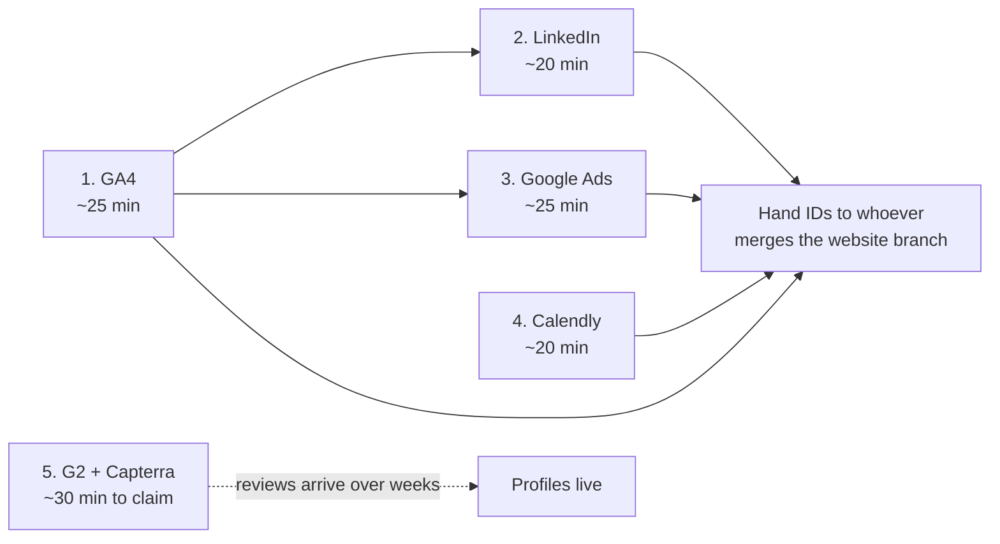

# Account Setup Runbook — Calendly, GA4, LinkedIn, Google Ads, G2, Capterra

**Who this is for:** whichever founder is doing the setup. No developer needed for most of it.
**What it covers:** prerequisite rows A3, B1, B2, B3, D3 and D4 in [`us_gtm_prerequisites.md`](us_gtm_prerequisites.md).
**Total time:** about 2 hours for the five tool accounts, plus an ongoing ask campaign for the two review sites.
**Total cost:** $0. Every account below has a free tier that covers what this plan needs. Decline every paid upgrade offered during signup.

---

## 0. Do These In This Order

The order matters in two places, and only two:

- **GA4 before Google Ads**, so the Ads account can be linked to the analytics property during setup rather than retrofitted.
- **Calendly before the website branch is merged**, because the booking URL is one of the values the site config needs.

Everything else can be done in any order, or in parallel by two people.

**Collect the output values as you go.** Five of these produce an ID or URL that must be pasted into `site_config.html.erb` in the website branch (`../IRM-gtm-prereqs`, branch `gtm/website-prereqs`), which currently ships them empty with `TODO-HUMAN` markers. Keep them in one note:

| Value | Format | From |
|---|---|---|
| GA4 Measurement ID | `G-XXXXXXXXXX` | Step 1 |
| LinkedIn Partner ID | 7-digit number | Step 2 |
| Google Ads Conversion ID | `AW-XXXXXXXXX` | Step 3 |
| Google Ads Conversion Label | short alphanumeric string | Step 3 |
| Calendly booking URL | `https://calendly.com/...` | Step 4 |

---

## 1. Google Analytics 4 — ~25 minutes

**What it does here:** tells you which channel produced a site visit and which visits became demo requests. Without it, the §5 kill criteria in the GTM plan cannot be evaluated for anything except email.

1. Go to **analytics.google.com**, sign in with a Google account the company controls — **not a personal account**. If nobody has a company Google account for this, create one first; migrating a GA property later is painful.
2. **Admin → Create → Account.** Account name: `CapHive`. Accept the data-sharing defaults.
3. Create a **Property**: name `caphive.com`, time zone and currency set to whatever you report in. This matters for how sessions are bucketed by day.
4. Business details: industry `Computers & Electronics` or `Finance`, size as applicable. Objective: **Generate leads**.
5. Choose platform **Web**. Website URL `https://caphive.com`, stream name `CapHive Website`.
6. **Copy the Measurement ID** — it looks like `G-XXXXXXXXXX`. This is the value the site config needs.
7. Skip the "install instructions" screen entirely. The tag is already built into the website branch; it just needs the ID.

**Note — there is already a GA4 property on the signed-in application** (`G-4CPQNX69HM`, configured in `app/javascript/application.js`). That one tracks the product, not the marketing site. Use a **separate property** for the website so product usage and marketing traffic do not contaminate each other's reporting.

**Verify:** once the ID is in the site config and the branch is deployed, open caphive.com on a phone using mobile data (not office wifi, which may already be filtered out) and check GA4 → Reports → Realtime. You should appear within seconds.

---

## 2. LinkedIn Campaign Manager — ~20 minutes

**What it does here:** the Insight Tag builds a retargeting audience from site visitors. You need the audience to exist *before* you would ever want to use it — LinkedIn will not serve to an audience under roughly 300 members, and it only counts people who visit after the tag goes live. Installing it now costs nothing and starts the clock.

1. Go to **linkedin.com/campaignmanager**. Sign in with a personal LinkedIn account that is an admin of the CapHive company page.
2. **Create account.** Name it `CapHive`, set currency, and associate it with the **CapHive LinkedIn Page**. If the association option is greyed out, you are not a page admin — fix that first on the company page.
3. Skip billing. You are not running ads yet, and the Insight Tag works without a payment method on file.
4. Go to **Analyze → Insight Tag** (older layouts: Account Assets → Insight Tag).
5. Choose **"I will install the tag myself"** and **copy the Partner ID** — a 7-digit number. That is the only value you need; ignore the JavaScript snippet, it is already in the website branch.

**Verify:** after deployment, return to the Insight Tag screen. Status moves from *Unverified* to *Active* within a few hours of the first real traffic.

---

## 3. Google Ads — ~25 minutes

**What it does here:** two things, only one of which you need now. The conversion tag lets you measure demo requests; the ad account itself sits dormant until you decide to run the capped search test in GTM §3.6. Set up the measurement now, spend nothing.

1. Go to **ads.google.com**, sign in with the **same Google account used for GA4**.
2. Google will push you hard into "Smart campaign" setup. Look for **"Switch to Expert Mode"** — usually a small link at the bottom. Take it. If you miss it, you will be forced to create a live campaign with a budget.
3. In Expert Mode choose **"Create an account without a campaign."**
4. Confirm business details and time zone. **Currency cannot be changed later** — set it to what you will actually bill in.
5. Billing: enter it or skip it. Nothing charges until a campaign runs and you have no campaign.
6. **Tools → Data manager → Link Google Analytics.** Your GA4 property will be listed because it is under the same Google account. Link it. This is why GA4 comes first.
7. **Goals → Conversions → New conversion action → Website.** Name it `Demo form submitted`, category **Submit lead form**, value: leave blank, count: **One**.
8. Choose **"Install the tag yourself"** and copy two values: the **Conversion ID** (`AW-XXXXXXXXX`) and the **Conversion Label**.

**Verify:** the conversion action shows *Unverified* until the tag fires once. After deployment, submit a test demo request and check back within a day.

---

## 4. Calendly — ~20 minutes

**What it does here:** removes an email round-trip from every positive reply. A prospect in New York who has to email to find a time is a prospect who may not bother.

1. Go to **calendly.com**, sign up with the CEO's `caphive.com` address — this is the calendar prospects will book into, so it must be his real one.
2. Connect the calendar (Google or Microsoft). Grant conflict-checking permission; without it Calendly will double-book him.
3. Set the Calendly account time zone to **your local zone**, and turn ON **"Display times in invitee's time zone."** Prospects should see 9am ET, not your local equivalent.
4. Create an event type: **30-minute meeting**, named `CapHive — 30 minutes` or similar. Avoid "demo" in the name — the GTM playbook's first call is a discovery conversation, not a product pitch, and the title sets that expectation.
5. **Availability is the decision that matters.** Publish only hours you will genuinely honour, in **US Eastern time**. The GTM plan commits to US-hours coverage; publishing slots you then decline is worse than publishing fewer. A realistic India-evening window is roughly 8:00am–12:00pm ET.
6. Set a buffer (10 minutes after) and minimum notice (at least 4 hours, so you are not ambushed).
7. **Copy the public booking URL.**

**Free tier limit:** one event type. That is sufficient — you need one meeting type.

**Verify:** open the URL in a private browser window, in a US time zone if you can simulate one, and confirm the slots shown are the ones you intended.

---

## 5. G2 — ~15 minutes to claim, then an ongoing ask

**What it does here:** it is the only proof asset you cannot write yourself. US buyers check review sites as a due-diligence step, usually right after the first call, and an empty profile reads as "no real customers."

1. Go to **g2.com**, search for CapHive. If a profile exists, click **Claim your profile**; if not, use **Add a product** / **List your product**.
2. Verify ownership — G2 sends a confirmation to an email at your company domain, or asks you to sign in with a company email.
3. Complete the free profile: description, categories, screenshots, logo, pricing page link. Choose categories your buyer actually browses — investor portal, fund administration, alternative investment management.
4. **Decline the paid tier.** G2 will pitch enhanced profiles and lead data running into thousands per year. You need none of it.
5. Use G2's **review invitation link** to ask customers. Do not write reviews yourself and do not offer anything conditional on a positive review — both platforms police this and the penalty is profile removal.

**Target:** 3–5 reviews. That means personally asking 8–10 customers; each review takes them 10–15 minutes.

---

## 6. Capterra — ~15 minutes to claim, then an ongoing ask

Same purpose, different audience. Capterra is owned by Gartner and shares an ecosystem with GetApp and Software Advice, so one listing typically propagates.

1. Go to **capterra.com**, search for CapHive, and use **Claim this profile** or the vendor listing flow at `capterra.com/vendors`.
2. Verify with a company-domain email address.
3. Complete the free listing: description, categories, screenshots, pricing link.
4. **Decline pay-per-click placement.** Capterra's monetisation is bidding for category placement; that is a paid-acquisition decision, not a prerequisite, and it is out of scope until GTM §3.6 triggers fire.
5. Send review invitations to the same customer list.

---

## 7. After All Six

1. **Hand the five values** from the table in §0 to whoever merges the website branch. Nothing tracks and nothing books until they are in `site_config.html.erb`.
2. **Update the Status column** in `us_gtm_prerequisites.md` for rows A3, B1, B2, B3, D3, D4.
3. **Set a calendar reminder for 3 days after deployment** to verify all four tags actually fire. A tag that silently fails looks exactly like a channel that is not working, and you will not discover it for weeks.
4. **Diarise the review asks.** Claiming the profiles is 30 minutes; getting reviews onto them is the part that takes real effort and does not happen without someone owning it.

---

## Cautions

- **Use company-controlled accounts throughout.** An analytics property or ad account tied to a personal Gmail becomes a hostage the day that person is unavailable. The exception is LinkedIn, where the ad account is necessarily attached to a personal profile — make sure at least two people are admins.
- **Google Ads currency and GA4 time zone cannot be changed after creation.** Get both right the first time.
- **Never write your own reviews on G2 or Capterra, and never make an incentive conditional on a positive rating.** Both platforms detect it, and the penalty falls on exactly the asset you were trying to build.
- **Expect the reviewer base to look India-concentrated.** That is honest and consistent with the positioning everywhere else in the plan, and it is still substantially better than an empty listing.
