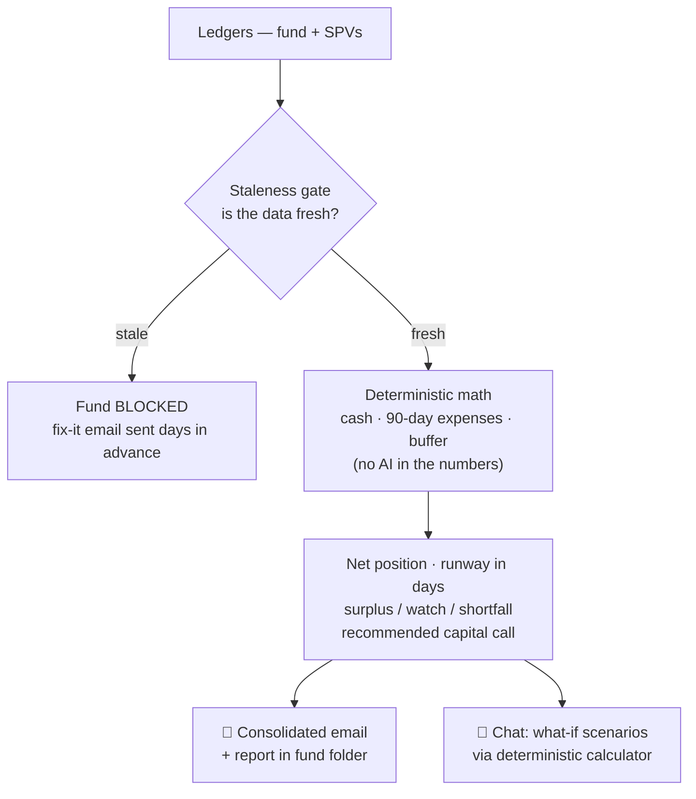
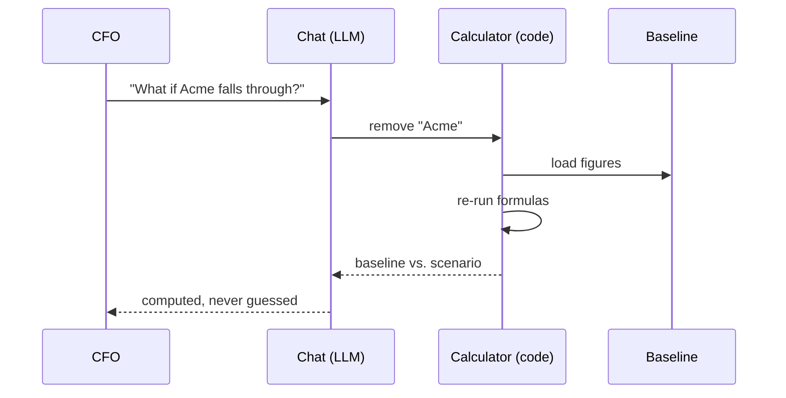

# LinkedIn Article #1 — Cash Flow Assistant Agent

```yaml
series: "Fund Ops, Unstacked #1"
format: LinkedIn Article (or company blog) + short feed teaser post
feature: Cash Flow Assistant Agent (scheduled cash position + runway + capital call sizing)
persona: CFO / Head of Fund Finance
hook_rationale: >
  Leads with the counterintuitive trust feature — the agent refuses to answer on
  stale data — instead of "we automate cash reporting", which every vendor claims.
impact_used: >
  Capital call sizing goes from a hand-stitched spreadsheet across fund + SPV
  ledgers to a scheduled email. Hard numbers from code: 90-day forecast window,
  30-day default cash freshness threshold, runway in days, shortfall/watch/surplus
  statuses, recommended call = gap + buffer restore. Deterministic math — no LLM
  ever computes the numbers.
status: draft — not posted
```

---

## Article

# The Cash Flow Agent That Refuses to Answer

*Inside CapHive's Cash Flow Assistant — fund runway, capital call sizing across SPVs, and why its most important feature is saying "not with this data."*

---

It's Thursday afternoon. Your CFO needs one number: can Fund II cover next month's deployment without a capital call?

The number exists — in pieces. Cash sits in the fund's own entity and in three SPVs underneath it. Each has its own ledger. One SPV's balances were last updated… nobody is quite sure when.

So the answer gets stitched together by hand: exports, a spreadsheet, a few Slack messages to whoever owns each ledger. By the time it's assembled, it's already stale. And the capital call it justifies — its size, its timing — inherits every one of those weaknesses.

We built an agent for exactly this. And the design decision we're proudest of is not what it computes. It's when it refuses to.

## Where cash truth actually lives

For a fund of any real structure, "how much cash do we have" is not one query. It's a roll-up:

- The fund's main entity holds accounts.
- Each SPV underneath it holds accounts.
- Deployments in the pipeline are committed but not yet wired.
- A reserve buffer is supposed to stay untouched.

Every one of those moves on its own schedule, maintained by different people. The traditional answer is a quarterly spreadsheet ritual. The failure mode is not that the math is hard — it's that the inputs are quietly out of date.

## What the agent does

CapHive's Cash Flow Assistant runs on a schedule — weekly or monthly — and for every configured fund:

1. **Verifies data freshness** for the fund and every SPV under it, against per-fund thresholds you control.
2. **Rolls up cash** from the latest balances across all of those entities.
3. **Totals upcoming deployments** from the committed-but-unexecuted pipeline.
4. **Forecasts 90 days of expenses** from your ledger history.
5. **Computes the position**: net position, runway in days, and a status — surplus, watch, or shortfall.
6. **Sizes the capital call** for any fund in shortfall.
7. **Delivers**: one consolidated email to your team, plus a report filed in each fund's private Reports folder.

> **Key line:** A confident answer computed on stale data is worse than no answer at all.

## The staleness gate

Here is the feature that matters most, and the one you won't see demoed often.

Before the agent computes anything, it checks how fresh the underlying data is — for the fund's entity *and every SPV under it*. Cash balances older than the fund's threshold (30 days by default), or a pipeline that hasn't been updated within its own threshold (90 days by default)? That fund is **blocked** for the run.

Blocked means blocked. No partial numbers, no "best effort" runway, no silently excluding one SPV from the total. The report says exactly why: *"Entity X: cash data is 45 days old, maximum allowed is 30."*

That is a deliberately uncomfortable design. A dashboard that always shows a number feels better — right up until a capital call gets sized off a balance that was true six weeks ago.

> **Key point 01** — Freshness is a gate, not a warning. A warning gets ignored on a busy Thursday; a gate cannot be.

## It warns you before it blocks you

A gate alone would just move the frustration: run day arrives, half the funds are blocked, everyone scrambles.

So the agent works ahead of its own schedule. In the days before each scheduled run, it checks freshness daily and emails the team a preview: which funds would be blocked if the run happened now, and precisely which entity's data is the problem. The stale ledger gets updated *before* the run, and the report arrives complete.

Deadline pressure, applied automatically, while there's still time to act.

## No AI in the numbers

Underneath, this agent is deliberately boring — and that's the point. The figures are pure, deterministic ledger arithmetic. No AI model ever touches them:

```
Net position   = Cash available − Upcoming deployments − 90-day expenses − Buffer
Runway (days)  = Cash available ÷ average daily outflow
Recommended call (shortfall funds) = |shortfall| + buffer
```

Same inputs, same answer, every time — and every figure traces back to identifiable ledger entries. Note the capital call formula: it doesn't just plug the hole. It restores the reserve too, because a call that only covers the gap leaves you exposed the following quarter.

Statuses are just as mechanical: **shortfall** if the net position is negative, **watch** if runway is under 90 days, **surplus** otherwise.

> **Key point 02** — If a number moves money, it must be reproducible. Same inputs, same answer, traceable to the ledger.

## The AI is only the interface

There *is* an AI layer — as the conversation, never the calculator.

A chat assistant sits on top of the latest run, so anyone on the team can ask "Which funds are running low?" or "Show me the cash breakdown for Fund II" in plain language and get an answer grounded in the most recent completed report.

And for hypotheticals — "What if the Acme deal falls through?", "What if we call more capital?", "What if expenses run 20% hot?" — the assistant is required to invoke a deterministic scenario calculator that re-runs the real formulas against the real baseline with your hypothetical adjustments applied. The language model is never allowed to do the arithmetic itself. You get baseline vs. scenario, computed the same way the report was.

> **Key point 03** — The model asks the question. The code computes the answer. That division of labour is the whole trust model.

## A forecast that's honest about its own confidence

The 90-day expense forecast adapts to how much history your ledgers actually contain:

| Expense history | Method used |
|---|---|
| 4+ months | Trend-based projection |
| 2–3 months | Recency-weighted average |
| 1 month | Repeat of the latest month |
| None | Zero — explicitly flagged "no data" |

The report tells you which method it used. A forecast built on one month of data should not present itself with the same confidence as one built on a year — so it doesn't.

## What lands in your inbox

One consolidated email per run:

- A status banner up top: **Action Required / Monitor / All Clear** — triage in one glance.
- A portfolio summary table: one row per fund — status, net position, runway, recommended action.
- A detail section per fund: cash with a per-entity breakdown and last-updated dates, deployment pipeline, expense forecast and its method, buffer, net position.
- Blocked funds shown honestly: dashes, and "Update stale data" as the action.

## Takeaways

1. **A confident answer on stale data is worse than no answer.** Build refusal into your reporting — a system that can say "not with this data" is a system you can trust when it does answer.
2. **Use AI as the interface, never the calculator.** Numbers that drive money movements belong in deterministic, auditable code. Let the model translate questions, not compute answers.
3. **Warn before the deadline, not after.** A staleness reminder three days early beats a blocked report on run day.
4. **Size capital calls to close the gap *and* restore the reserve.** Plugging only the hole leaves you exposed next quarter.
5. **Make forecasts disclose their own confidence.** If the method degraded because history is thin, the report should say so.

## See it on your own fund structure

Bring one fund, its SPVs, and your current spreadsheet ritual. We'll show you the staleness gate, the runway math, and the what-if calculator running on a structure like yours — in 30 minutes.

**→ Call us for a demo** — or DM us here on LinkedIn; we answer these ourselves.

---

One question before you go, for your next ops review: when your cash position finally lands in the spreadsheet, how old is the oldest number in it?

And would you trust an agent more — or less — because it sometimes refuses to answer?

*Fund Ops, Unstacked #1 — one CapHive feature, properly explained, each week.*

---

## Images to prepare before publishing

1. **Cover** — use the designed cover block from the preview artifact (dark navy, title lockup).
2. **Pipeline diagram** — export from the preview artifact (staleness gate → deterministic math → email/chat).
3. **Staleness reminder email screenshot** — placeholder in the article; capture from staging with fictional fund names.
4. **What-if sequence diagram** — export from the preview artifact.
5. **Consolidated email summary** — designed mock included in the artifact (fictional funds/figures) — screenshot it as the article image.

---

## Feed teaser post (paste-ready, links to the article)

```
Most GPs size capital calls from a spreadsheet stitched together across SPV ledgers.

We built an agent for that.

Its most important feature: 𝗶𝘁 𝗿𝗲𝗳𝘂𝘀𝗲𝘀 𝘁𝗼 𝗮𝗻𝘀𝘄𝗲𝗿 𝘄𝗵𝗲𝗻 𝘆𝗼𝘂𝗿 𝗱𝗮𝘁𝗮 𝗶𝘀 𝘀𝘁𝗮𝗹𝗲.

In the full write-up (link in comments):

→ The staleness gate — one out-of-date SPV ledger blocks the whole fund. No partial numbers.
→ Why the numbers never touch an AI model — and why the AI layer must call a deterministic calculator for every "what if".
→ How the recommended capital call is sized to close the gap AND restore the reserve.

Would you trust an agent more, or less, because it sometimes refuses to answer? 👇

#PrivateEquity #FundOperations #CFO #FundAdministration #VentureCapital
```

## First-comment text

```
Full article: <link>

If you'd like to see the Cash Flow Assistant running on your own fund structure, my DMs are open.
```

---

## Diagrams (export as images from the preview artifact)

### 1. The pipeline (article hero diagram)



*(Top-down orientation on purpose — a left-to-right version scales below readability inside a 640px article column.)*

### 2. AI as interface, not calculator


