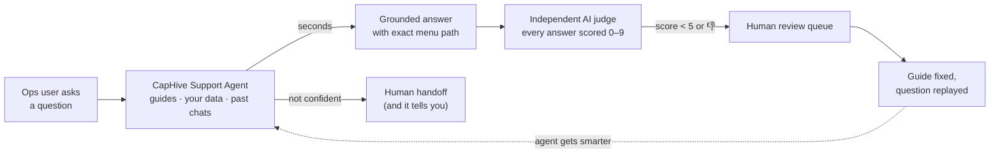

# LinkedIn Post #1 — Customer Support Agent

```yaml
series: "Fund Ops, Unstacked #1"
feature: Customer Support Agent (AI chat + CS Feedback Review Dashboard)
persona: COO / Head of Fund Operations
hook_rationale: >
  Leads with the counterintuitive claim (the judge matters more than the agent)
  rather than "we have a chatbot", which is table stakes in 2026. Survives the
  3-line fold with pain (support wait) implied and payoff (audited AI) explicit.
impact_used: >
  Seconds vs next-business-day ticket; 100% of answers scored (not a sample);
  hard numbers from code: 0–9 judge scale, <5 auto-review threshold, 6-tool-call
  cap, mandatory tenant-scope placeholder on every SQL query.
status: spare draft — not posted; renumber series label ("Fund Ops, Unstacked #1" in text) before posting
```

---

## Article title

**How Do You Know When Your Bot Is Wrong?**

*We put an AI support agent inside our fund platform. Then we built a second AI whose only job is to grade the first one — every answer, scored out of nine.*

---

## Article

It's quarter-end. Your operations manager needs to reissue a capital call notice and can't remember where the setting lives.

So they email the vendor's support desk. And wait.

That "quick question" just cost a day — and it wasn't a hard question. It was a question whose answer is sitting in a product guide nobody has time to search.

**[STAT BAND: 100% of answers scored · 6 tool calls maximum · below 5 of 9 goes to a human]**

### The easy half: an agent that answers

The support agent lives inside the platform and answers from three sources: the product guides, for "how do I" questions; your firm's live data, for "how many LPs have signed" questions; and your own past conversations, for "what did we ask about last month" follow-ups.

Answers arrive in seconds, with the menu path to follow rather than a paragraph of theory.

That part is not the interesting part. In 2026, a chat box over a documentation set is table stakes — the differentiator is what happens when it's wrong.

**[KEY POINT #1: "Every vendor can show you their agent answering correctly. Ask instead how they find out when it answered badly."]**

### The hard half: a second AI that grades the first

Every response the agent produces is scored asynchronously by an independent LLM judge, on completeness, grounding, and actionability. Not a sample. Not a weekly spot-check. **Every answer, scored 0 to 9.**

Anything scoring below 5 — or receiving a thumbs-down from the person who asked — lands in a human review queue. Our team reads the conversation, fixes the underlying guide, and then replays the exact question side by side to prove the fix actually worked.

That loop is the product. The agent isn't static: each bad answer improves the next one, and there's a record showing it did.

**[PULL QUOTE: "An unscored answer is unknown quality. At one answer a week that's fine. At a thousand it's a liability you can't see."]**

### ⚙️ Under the hood: unable, not merely instructed

The agent can query your firm's live data, which is exactly where an AI support tool becomes dangerous rather than useful. Three constraints make it safe enough to leave running.

**Every query is validated before it runs.** Read-only, against an explicit allowlist of tables. A query touching anything outside that list is rejected rather than executed.

**Tenant scope is mandatory.** A query that does not carry your firm's scope is refused. The agent is *unable* to see another firm's data — that's a property of the query layer, not an instruction in a prompt that a cleverly-worded question might talk it out of.

**A hard cap of six tool calls per question.** If the agent can't reach a grounded answer within six, it stops and escalates to a human. It does not keep going until it produces something that sounds like an answer.

That last one matters more than it looks. The failure mode of a capable model isn't refusing to answer — it's answering anyway, fluently, from nothing. A cap converts that failure into an escalation.

**[KEY POINT #2: "Make the agent unable to do the wrong thing. Prompts are guidance; allowlists and scope checks are guarantees."]**

### Escalation is a feature

When the agent escalates, the conversation is marked and lands in the support team's queue, and the person who asked is told plainly that a human now has it. They don't have to start again — the agent stays available for everything else while the escalated question is handled separately.

Escalation happens for a few reasons: the question is beyond what the agent can ground an answer in, the tool-call cap was reached, or the person asked for a human.

Every one of those is a better outcome than a confident guess about a capital call setting.

### 📊 The impact

Before: a "how do I" question becomes a support ticket, answered next business day, at quarter-end, when the answer was in a guide all along.

After: seconds instead of a day for the routine questions — and, more importantly, **every single answer audited automatically in the background**, with the bad ones filing their own tickets.

The measurable claim isn't deflection rate. It's this: **the proportion of answers whose quality anyone actually knows goes from roughly zero to one hundred percent.**

### ✅ Takeaways

**1. Ship the judge with the agent.** If you can't say how many of your AI's answers were poor last week, you don't have a quality problem — you have a measurement problem, and it's hiding the quality problem.

**2. Make the agent unable, not merely instructed.** Read-only access, table allowlists, enforced tenant scope. Anything you can achieve structurally, don't achieve with a prompt.

**3. Cap the loop.** An agent that keeps trying will eventually produce something. A cap turns "eventually produces something" into "escalates to a person".

**4. Let bad answers file their own tickets.** Thumbs-downs and low judge scores should land in one queue, and fixing the source material should be the standard response.

**5. Ask every AI vendor one question.** *How do you know when your bot is wrong?* The quality of that answer tells you more than any demo.

———

### 💡 See it on your own structure

If you're evaluating AI support tooling this year, the useful comparison isn't the answers — it's the review queue behind them. Ask to see it.

**Question: what would it take for you to trust an AI agent with questions about your own fund data — and is it a capability bar, or a governance one?**

---

## Paste-ready post text

```
We put an AI support agent inside our fund platform.

Then we built a second AI whose only job is to grade the first one — every answer, scored 0–9.

Here's why the second AI matters more than the first. 👇

It's quarter-end. Your ops manager needs to reissue a capital call notice and can't remember where the setting lives.

So they email the vendor's support desk. And wait.

That "quick question" just cost a day.

CapHive ships a support agent inside the platform itself. It answers from three sources:

→ the product guides (for "how do I…" questions)
→ your firm's live data (for "how many LPs have signed?" questions)
→ your past conversations (for "what did we ask last month?" follow-ups)

Answers arrive in seconds, with the exact menu path to follow. And when it isn't confident, it doesn't improvise — it hands you to a human, and says so.

⚙️ Under the hood

This is where the engineering effort actually went:

→ Every database query the agent writes is validated before it runs: read-only, an explicit allowlist of tables, and rejected outright unless it carries your firm's tenant scope. The agent is 𝘂𝗻𝗮𝗯𝗹𝗲 to see another firm's data — not just instructed not to.

→ A hard cap of 6 tool calls per question. If it can't reach a grounded answer, it escalates to our team instead of guessing.

→ Every response is scored asynchronously by an independent LLM judge on completeness, grounding, and actionability. 𝟭𝟬𝟬% 𝗼𝗳 𝗮𝗻𝘀𝘄𝗲𝗿𝘀 𝗮𝗿𝗲 𝘀𝗰𝗼𝗿𝗲𝗱 — not a sample.

→ Any answer below 5/9 — or any thumbs-down from a user — lands in a human review queue. Our team fixes the underlying guide, then replays the exact question side-by-side to prove the fix worked.

That last loop is the product. The agent isn't static — every bad answer makes the next one better.

📊 The impact

A "how do I" question: answered in seconds instead of a next-business-day ticket.
Quality control: every single answer audited, automatically, in the background.

———

✅ Takeaways for anyone deploying AI agents

1. Ship the judge with the agent. An unscored answer is unknown quality at scale.

2. Make the agent unable to do the wrong thing — read-only access, table allowlists, enforced tenant scoping — don't just prompt it to behave.

3. Escalation is a feature, not a failure. "I don't know — here's a human" builds more trust than a confident guess.

4. Let bad answers file their own tickets: user thumbs-downs and low judge scores should feed one review queue.

Evaluating AI support tools this year? Ask every vendor one question: "How do you know when your bot is wrong?"

What would it take for you to trust an AI agent with questions about your fund data? 👇

— Fund Ops, Unstacked #1: one CapHive feature, properly explained, each week.

#PrivateEquity #FundOperations #AIAgents #FundAdministration #CFO
```

---

## First-comment text

```
Full walkthrough of the support agent and the review dashboard behind it (judge scores, escalation queues, re-testing) is in our product guide — link below.

If you'd like to see it running on your own fund structure, my DMs are open.

<link>
```

---

## Diagram (attach as image — export from the preview artifact)



---

## Carousel variant (optional, 7 slides)

1. **Hook** — "We built an AI to grade our AI. Every answer, 0–9."
2. **Problem** — Quarter-end. A 'quick question' to a support desk costs a day.
3. **How it works** — 3 sources: guides, your live data, past conversations. Seconds, not tickets.
4. **Guardrails** — Read-only. Table allowlist. Tenant scope enforced on every query. Unable, not just instructed.
5. **The judge** — 100% of answers scored on completeness, grounding, actionability. Below 5/9 → human review.
6. **The loop** — Thumbs-down → review → guide fixed → question replayed → agent improves.
7. **Takeaways + CTA** — Ship the judge with the agent. Ask your vendor: "How do you know when your bot is wrong?"
```
