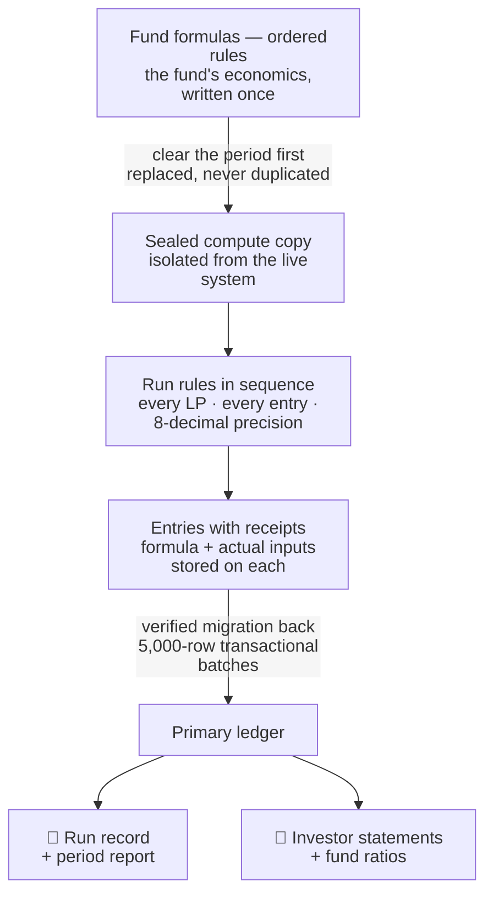
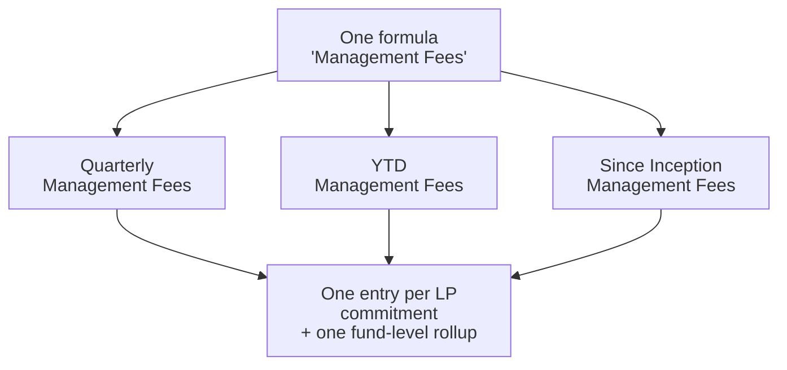

# LinkedIn Article #2 — Allocation Engine & Fund Formulas

```yaml
series: "Fund Ops, Unstacked #2"
feature: Allocation Engine + Fund Formulas (account entry generation, period rollups, run locking, per-entry explanations)
persona: CFO / Head of Fund Finance
hook_rationale: >
  Opens with the audit moment every CFO dreads — "walk me through this number" —
  and answers it with the differentiated claim: every generated number stores its
  own receipt (formula + actual input values) at creation time. Avoids "we automate
  your close" (table stakes); leads with defensibility.
impact_used: >
  Headline scale claim (user-supplied): 100k+ numbers generated in minutes in a
  single run. Hard numbers from code: 21 formula rule types; DECIMAL(30,8) = 8-decimal-place
  precision; 15 formulas collapsed to 3 by GenerateAccountEntryMultiple; 5,000-row
  transactional migration batches; 3-commitment sample mode; locked periods refuse
  re-runs; per-formula execution time in ms; audit attribution of every generated
  row to the triggering user; full change history on formulas (audited gem).
compliance_note: >
  "Meridian Capital Partners", folio "MC-0142", and all amounts are fictional.
  Softened repeatability claim per engineering review: "re-running a period
  replaces that period's entries rather than duplicating them" (deletion is scoped
  to the formulas being run — do NOT claim absolute idempotence).
status: ready for review — Fund Ops, Unstacked #2
```

---

## Article title

**The Quarter-End That Explains Itself**

Sub: How an allocation engine turns fund economics into ordered, versioned rules — so every month, quarter, and year number is re-runnable, lockable, and carries its own receipt.

---

## Article body (source; the HTML preview is the formatted version)

The email arrives mid-audit: *"Please walk us through the Q3 management fee charged to folio MC-0142."*

One number. One investor. And in most funds, that question starts an excavation: the workbook with the fee logic, the person who built it (who left in March), the tab named `Q3_FINAL_v14(2)`, and the quiet hope that nobody re-sorted a range since.

The number is probably right. But *probably right* is not what audits, LP advisory committees, or your own sign-off are made of. What they need is a number that can show its work.

That is the design goal of CapHive's allocation engine: **a quarter-end that explains itself.**

**[STAT BAND: 21 rule types · 8 decimal places · 100k+ numbers generated in minutes]**

### Your fund's economics, written down once

Every fund's economics live somewhere. Management fee schedules, admin cost splits, income allocations, master–feeder pass-throughs, portfolio expense allocations. Usually they live in spreadsheets — which means they live in *people*.

CapHive stores them as **formula rules**: named, ordered, versioned rules attached to the fund. Twenty-one rule types cover the spectrum — generate an entry per LP, allocate a fund-level cost across commitments, pull master-fund entries down into a feeder, compute ownership percentages, roll amounts up into cumulative totals.

Run a period — month, quarter, or year — and the engine executes the rules in sequence, computes every entry for every LP commitment at 8-decimal-place precision, rolls per-LP entries up into fund-level totals, and hands back the statements, ratios, and reports built on top. For a real fund structure that is **hundreds of thousands of generated numbers — in minutes**, each one traceable to the rule and run that produced it.

**[DIAGRAM 1: the run pipeline]**

**[PULL QUOTE: "A close you can re-run identically is a close you can defend."]**

### Every number carries its own receipt

Here is the part we think matters most.

When the engine computes an entry, it doesn't just store the amount. It stores, on the entry itself, at the moment of computation:

- **the exact formula** that produced it,
- **a plain description** of what the rule does, and
- **a variable-by-variable breakdown** — every input the formula used, with the actual value it had: committed capital, fee rate, day count, FX rate.

**[RECEIPT MOCK: Quarterly Management Fees — MC-0142]**

Not reconstructed after the fact. Not "we can probably rebuild it." Stored at creation, on the number, where an auditor's question lands.

And because the breakdown is data, an AI layer can turn it into a sentence on demand: *"2% per annum on $5.0M of committed capital, accrued for 92 days of Q3."* The AI explains the receipt — it never computes the number.

**[KEY POINT 01: If a number reaches an LP statement, it must be able to show the formula — and the exact values — that produced it.]**

### Re-running is safe. Locking is final.

Numbers change late. A restated invoice, a corrected commitment, a fee rebate agreed after the quarter ended. The question is what a correction costs you.

In the engine, re-running a period **replaces that period's entries rather than duplicating them**. The run deletes what its formulas generated last time, then regenerates from the current data. Correction becomes: fix the input, run again, compare.

Before touching a full fund, you can run in **sample mode** — three LP commitments, end to end — and read the results like a proof.

And every run is a record: who ran it, for what period, with which formulas, how long each formula took (to the millisecond), and whether it succeeded. The Previous Runs page is a run ledger; every entry links back to its run and its formula.

Then there's the other direction: a period you never want to change again. **Lock the run**, and the engine refuses to execute anything overlapping those dates. Not a policy. A refusal.

**[KEY POINT 02: Re-running replaces; locking refuses. Those two behaviours are what "closed books" means when software takes them seriously.]**

### ⚙️ Under the hood: the close runs in a sealed room

The engineering here is what makes the guarantees above real:

- **A private compute copy.** Each run snapshots the fund's data — 15 tables — into an isolated scratch database. The heavy quarter-end computation happens there, never contending with the live platform your team is using. Two funds can close simultaneously without touching each other.
- **Fail-closed isolation.** The scratch models are physically unable to reach the primary database — the connection layer raises a safety violation rather than fall through. Not "instructed not to." Unable.
- **Verified migration back.** Finished entries return to the primary database in 5,000-row transactional batches, each batch flagged as migrated only after it lands, with a final sweep that catches anything a failure left behind.
- **Numeric guardrails.** A formula that divides by zero or produces a non-finite value fails loudly with the formula text and the LP named — it cannot silently write garbage.
- **Attribution everywhere.** Every generated row is attributed to the user who triggered the run, and the formulas themselves carry full change history — who edited what, when, from what to what.

**[COMPARISON TABLE: spreadsheet close vs engine close]**

| | The workbook close | The engine close |
|---|---|---|
| Where the logic lives | One person's spreadsheet | Named, ordered, versioned rules |
| Re-running a period | New tab, duplicate risk | Replaces its own entries |
| "Walk me through this number" | Archaeology | Receipt stored on the entry |
| Who changed the fee logic | Unknown | Full change history, attributed |
| A closed quarter | A promise | Locked — the engine refuses |

### One run, every period

Month, quarter, and year are not three reporting projects. A formula can be flagged to emit its **Quarterly, YTD, and Since-Inception** variants automatically — same run, three period views, for every LP. Fiscal years are respected (an April-start year works out of the box).

And formulas consolidate: one multi-fee rule type generates entries for a whole list of fee types at once. The documented example: a reporting setup that needed **15 formulas became 3** — same entries, same totals, a third of the surface area to maintain.

**[DIAGRAM 2: one formula → Quarterly / YTD / Since Inception → every LP + fund rollup]**

When someone asks "what happened this quarter?", the period report answers on the fly: totals, entry counts, composition by fee type, a trailing-quarters trend, and drill-down from fund level to any single LP's folio — the same report an investor can be given for their own folio. AI commentary is on demand and anomaly-aware: *"Management Fee is 42% above its trailing 4-quarter average"* is a sentence you want **before** the LP asks.

And the numbers don't stop at reports you read on screen. Every generated entry feeds the **statement and report builders**: the same run can produce bespoke investor statements from your own templates — one per LP, built from that LP's entries — and custom reports that pull any generated number, for any period, into exactly the layout your team and your LPs expect. No re-keying, no export-and-paste. **The number on the statement is the number in the ledger** — receipt and all.

**[KEY POINT 03: Month, quarter, and year aren't three projects. They're three outputs of the same run.]**

### The five properties of a close you can defend

1. **Repeatable** — re-running a period replaces its entries; correction is cheap.
2. **Explainable** — every number stores its formula and inputs at creation.
3. **Isolated** — computation runs on a sealed copy, never the live system.
4. **Attributed** — every row, every formula edit, traced to a person.
5. **Locked** — closed periods are refused by the engine, not by policy.

### Six questions for your next quarter-end

Can your team answer yes to all six?

1. Could you re-run last quarter today and get the same entries?
2. Can any fee number on an LP statement show the formula that produced it?
3. …and the actual values that went into it?
4. Do you know who last changed the fee logic, and what it said before?
5. Is it *impossible* — not just forbidden — to overwrite a closed quarter?
6. Could you answer an auditor's "walk me through this" in one click?

———

✅ **Takeaways**

1. Write fund economics as rules, not workbook cells. The logic must outlive its author — that's true whether or not you ever buy software for it.
2. Make every generated number store its inputs at creation time. A receipt reconstructed later is an alibi, not evidence.
3. Re-runs should replace, never duplicate. Idempotent periods are what make corrections cheap enough to actually do.
4. Lock closed periods in software, not in policy. A promise can be broken at 11pm before a deadline; a refusal can't.
5. Test the logic on a sample first — three LPs, read every receipt, then run the fund.

**[CTA PANEL: "See your own fee schedule as rules" — Bring your gnarliest allocation — equalisation, mid-period fee changes, master–feeder pass-throughs — and we'll model it live on a demo fund. → Call us for a demo]**

One question before you go: if an auditor picked one number off your last quarterly statement, how long would the full walk-through take — and how many people would it involve?

— *Fund Ops, Unstacked #2: one CapHive feature, properly explained, each time.*

---

## Feed teaser (paste-ready, ≤3,000 chars)

```
An auditor points at one management fee number on one LP's statement: "Walk me through this."

In most funds, that question starts a spreadsheet excavation.

In ours, the number answers it — 𝗲𝘃𝗲𝗿𝘆 𝗴𝗲𝗻𝗲𝗿𝗮𝘁𝗲𝗱 𝗻𝘂𝗺𝗯𝗲𝗿 𝗰𝗮𝗿𝗿𝗶𝗲𝘀 𝗶𝘁𝘀 𝗼𝘄𝗻 𝗿𝗲𝗰𝗲𝗶𝗽𝘁. 👇

Your fund's economics — fee schedules, cost allocations, master-feeder pass-throughs — written once as ordered, versioned formula rules instead of living in one person's workbook.

Run a month, a quarter, a year: the engine computes every entry for every LP, and stores 𝗼𝗻 𝗲𝗮𝗰𝗵 𝗲𝗻𝘁𝗿𝘆 the formula that produced it and the actual values it used. Committed capital, fee rate, day count. At creation time — not reconstructed when someone asks.

In the full write-up (link in comments):

→ Re-running a period replaces its entries instead of duplicating them — and a locked period refuses to be overwritten at all. That's what "closed books" means in software.

→ Why the close computes on a sealed copy of the fund's data (15 tables, snapshotted per run) and returns in verified 5,000-row batches — two funds can close at once without touching each other, or your live system.

→ How one multi-fee rule collapsed a 15-formula reporting setup into 3 — and one flag emits Quarterly, YTD, and Since-Inception views from a single run.

→ Every generated number flows straight into bespoke investor statements and custom reports — one statement per LP, from your own templates, in the same run. The number on the statement 𝗶𝘀 the number in the ledger.

Test it like an engineer: sample mode runs the whole close on 3 LP commitments first, so you read the receipts before you run the fund.

If an auditor picked one number off your last quarterly statement — how long would the full walk-through take, and how many people would it involve? 👇

— Fund Ops, Unstacked #2: one CapHive feature, properly explained, each time.

#PrivateEquity #FundOperations #CFO #FundAccounting #FundAdministration
```

---

## First-comment text

```
Full article: <link>

It covers the receipt stored on every generated number, run locking, and the sealed-room architecture behind the close.

If you'd like to see your own fee schedule modelled as rules on a demo fund, my DMs are open.
```

---

## Diagram sources (pre-rendered to SVG for the standalone file)

### Diagram 1 — the run pipeline



### Diagram 2 — one formula, every period



---

## Images to prepare before publishing

1. Cover: export the navy cover block from the preview HTML.
2. Diagram 1 + Diagram 2: screenshot from the preview HTML (already inline SVG at full quality).
3. Receipt mock ("Quarterly Management Fees — MC-0142"): screenshot the card from the preview.
4. Product screenshot: the fund's Formulas page (sequence, name, rule type, execution ms columns) on a staging fund with fictional names.
5. Product screenshot: the Previous Runs page showing a locked run.
6. Comparison table: screenshot from the preview if LinkedIn's article editor mangles tables.

## Carousel variant (optional, 7 slides)

1. **Hook** — "Every number in your quarter-end should carry its own receipt."
2. **Problem** — Mid-audit: "walk me through this number." The workbook. The person who left. v14_FINAL(2).
3. **Rules, not cells** — 21 rule types; economics written once, ordered, versioned.
4. **The receipt** — formula + description + actual input values, stored on the entry at creation.
5. **Re-run / lock** — re-runs replace, never duplicate; locked periods are refused, not discouraged.
6. **Sealed room** — snapshot compute copy, fail-closed isolation, verified 5k-row batches back.
7. **Takeaways + CTA** — five properties of a defensible close · "Bring your gnarliest allocation — call us for a demo."
```
