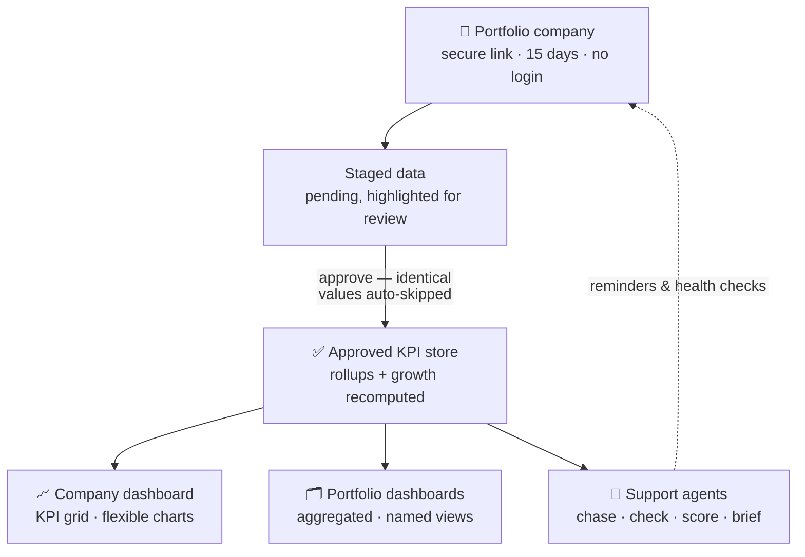
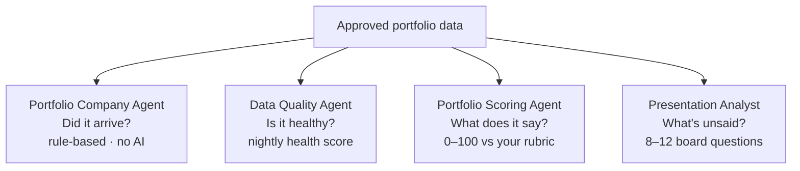

# LinkedIn Article #3 — Portfolio KPIs at Scale (Collection → Dashboards → Agents)

```yaml
series: "Fund Ops, Unstacked #3"
feature: >
  KPI management for portfolio companies at scale: magic-link self-reporting with
  status lifecycle + auto reminders, staged→approved data integrity, single-company
  dashboards (KPI grid + flexible charts), multi-company aggregated dashboards with
  named views, AI Agent Charts, and the Support Agents that assist (Portfolio Company
  Agent, Data Quality Agent, Portfolio Scoring Agent, Investor Presentation Analyst).
persona: COO / Head of Fund Operations
hook_rationale: >
  Opens with the quarterly consolidation-spreadsheet chase every portfolio ops team
  lives ("30 companies, 30 templates, 3 weeks of chasing") and pivots to the claim
  that collection should be a monitored workflow, not a mailbox. Avoids generic
  "portfolio monitoring software" framing; leads with the chase ending.
impact_used: >
  Hard numbers from docs/code: 20+ recognized date-header formats across 6 period
  families; 15-day magic links with zero portal logins; 0 reminder emails after a
  company submits (auto-skip of submitted reports in every reminder cycle);
  reminders only on configured days (default 7/14/21, max once/day); 5-state report
  lifecycle; identical re-uploaded values skipped automatically; quarterly/YTD/annual
  totals recomputed on approval and never double-counted; one Agent Chart prompt
  generates a chart for every tagged company; nightly Data Quality health score with
  90-day stale-valuation default; Portfolio Scoring 0–100; Presentation Analyst
  produces 8–12 grounded pre-board questions + Management Accountability Score.
  Before/after: quarterly email chase + consolidation workbook → status badges,
  self-stopping reminders, dashboards that update on approval.
compliance_note: >
  All company names in mocks ("Brightloom Labs", "NorthPeak Robotics", "Solstice
  Health", "Fund I") are fictional. No performance/returns implied — scores and
  health metrics are described as data-completeness/process metrics. AI positioning
  matches the governance FAQ: agents are decision support, deterministic checks
  where stated, tenant- and permission-scoped.
status: ready for review — Fund Ops, Unstacked #3
```

---

## Article title

**The Portfolio That Reports Itself**

Sub: How KPI collection becomes a monitored pipeline — self-reporting links, staged approvals, single- and multi-company dashboards, and the support agents that keep every quarter honest.

---

## Article body (source; the HTML preview is the formatted version)

It's the second week of the quarter, and somewhere in your firm there is a file called `Fund I KPI Consolidation v7.xlsx`.

Thirty portfolio companies. Thirty templates that started identical and drifted. Three call the same number "Revenue", "Net Revenue", and "Sales". Eleven haven't replied to the request email. Two replied with a PDF.

Someone on your ops team turns that into one board-ready view. Every quarter. By hand.

The uncomfortable truth: most funds don't have a portfolio monitoring problem. They have a **collection** problem — and dashboards built on chased, unreconciled data just make the chase prettier.

Here is how CapHive ends the chase.

**[STAT BAND: 20+ period formats parsed · 15-day secure links, zero logins · 0 reminders after a company submits]**

### Collection is a workflow, not a mailbox

The quarter starts with one click: notify every portfolio company that hasn't reported. Each company gets a **secure upload link** — valid 15 days, expiry date printed in the email, no portal login, no password reset ticket. Each company can name **designated KPI contacts**, so the reminder reaches the person who actually owns the numbers.

From that moment, every company has a **status badge**: Link Sent → Draft Saved → Submitted → Reviewed. Your ops team stops asking "who's missing?" — the request tracker answers at a glance.

**[MOCK: KPI request tracker — fictional companies with status pills]**

Companies save drafts as they work; nobody loses progress to a browser tab. When they hit Submit, the fund team is emailed instantly and the report locks. And the reminder engine has one rule your inbox never learned: **it stops**. Submitted companies are skipped in every future reminder cycle — automatically, every time.

Even the workbook itself is checked at the door: if the uploaded file's date headers are missing or malformed, the Submit button stays disabled and the company sees exactly what to fix — before bad structure ever reaches your team.

**[KEY POINT #1: "A KPI you chase by email is a liability. A KPI with a status badge is a workflow."]**

### Nothing touches a dashboard without approval

Here is the design decision that matters most: **collection and consumption never share a pipe.**

Every uploaded number lands in a **staged** state — visible to your team, highlighted for review, but invisible to every dashboard, performance table, and growth calculation. An authorized approver reviews the staged values (changes are flagged; identical re-uploads are skipped entirely) and promotes them in one action.

Only on approval does the platform recompute what depends on the data: quarter, YTD, and annual totals roll up from monthly actuals — or from quarterly actuals when that's all a company reports, never both, so a year is never double-counted. Growth percentages recalculate. An audit note records who approved what, and when.

**[DIAGRAM: the KPI pipeline — company upload → staged → approve → approved store → dashboards + agents]**

**[PULL QUOTE: "Dashboards read approved data only. The moment 'received' and 'reviewed' mean the same thing, your board pack is one typo away from being wrong."]**

### One company on one screen

Open any portfolio company and its dashboard is assembled from widgets you control: the **KPI grid** (choose categories, periods, and Actual/Budget/Projected tags), the cap table with ownership charts, document embeds, data cards.

The grid doubles as a charting surface. Tick the KPIs you care about, mix chart types — Revenue as bars, margin as a line — and the chart follows every grid filter live. Save the layout ("Revenue vs Margin, 12M") and reopen it next quarter in one click, or load several saved views side by side to compare eras of the same company.

Because charts use the **standard investor-facing KPI names** from your mapping layer, the legend says "Revenue" even when the company's workbook said "Net Sales". Consistency is enforced by the system, not by the analyst's memory.

**[SCREENSHOT PLACEHOLDER: Portfolio company dashboard — KPI grid widget with a mixed bar/line chart above it]**

### The whole portfolio on one screen

The same widget system builds the **aggregated portfolio dashboard**: a multi-company investment table grouped however you slice it, portfolio IRR, fair-market-value distribution, sector and company breakdowns.

Two capabilities make this scale operationally:

**Named dashboards.** Every dashboard type supports multiple saved configurations — an operational *Default*, a condensed *Board View*, a *Budget View* — switchable from a dropdown, bookmarkable by URL, with per-user defaults so the managing partner lands on the board view while ops lands on the working view. One data foundation, many audiences, zero rebuilt decks.

**Agent Charts.** Describe a chart once, in plain English — "line chart of Revenue and EBITDA, last 12 months" — and the AI generates it **for every portfolio company that matches a tag**. Thirty companies, one definition, thirty consistent charts, each embedded on its company's dashboard and regenerable the moment new KPIs are approved. Chart standardization stops being a manual discipline.

**[KEY POINT #2: "Define the chart once. Every company that matches the tag gets its own copy, built from its own approved data."]**

### ⚙️ Under the hood

The reason this holds up at scale is a set of deliberately boring guarantees:

- **A KPI mapping layer** translates each company's raw metric names to your standard names — matching is case- and space-insensitive, so "gross profit" and "Gross Profit" are the same metric, and every dashboard legend speaks one language.
- **A date parser that meets companies where they are**: monthly, quarterly, half-year, annual, YTD, and day formats — `Jan 2024`, `Q1 FY24`, `H1 2023`, `YTD Nov 23` — 20+ recognized formats across 6 period families, detected anywhere in the first 10 rows of the sheet.
- **Idempotent re-uploads**: if a company resubmits the same workbook, unchanged values are skipped — no duplicate approvals, no phantom "changes" to review.
- **Rollups that refuse to double-count**: annual totals compute from monthly actuals, or from quarterly actuals when monthly data doesn't exist — never both for the same year.
- **Scoped access**: upload links grant access to exactly one company's report for one period. Fund-side, every dashboard and agent operates inside the viewer's tenant and role permissions — enforced by the application layer, not by AI goodwill.

Each of these is invisible on a good day. Together they are why the numbers on the board slide survive an audit question.

### The agents that keep it honest

Dashboards show you what the data says. Four support agents make sure the data deserves to be believed — each answering one question:

1. **Did it arrive?** The **Portfolio Company Agent** — fully rule-based, no AI involved — sweeps the portfolio: KPIs submitted for the period? Required documents attached? Valuation recorded? Missing items are flagged as blocking, and reminder emails go out only on the days you configure (say, day 7, 14, and 21), never more than once a day.
2. **Is it healthy?** The **Data Quality Agent** runs nightly integrity checks — stale valuations past your threshold, stale FX rates, commitment overflows — and emails a health score with a fix-it list.
3. **What does it say?** The **Portfolio Scoring Agent** reads each company's approved KPIs, documents, and valuations against a sector-specific rubric you define, and produces a structured 0–100 score with written justification — decision support, reviewable and editable, never auto-actioned.
4. **What is management not telling you?** The **Investor Presentation Analyst** reads board decks across periods, compares them, surfaces quietly dropped risks and missed commitments, and hands you 8–12 grounded pre-board questions plus a management accountability score.

Every run is logged with full execution history. Deterministic agents need no AI key at all; AI agents are pinned to the model and provider you choose, per entity.

**[KEY POINT #3: "The agents don't make the numbers. They make sure the numbers arrive, reconcile, and get looked at."]**

### 📊 The impact

**[COMPARISON TABLE: quarterly chase vs monitored pipeline]**

| | The email-and-spreadsheet quarter | The monitored pipeline |
|---|---|---|
| Who's missing? | Reply-all archaeology | Status badge per company |
| Reminders | Manually, apologetically | Automatic, and they stop on submit |
| "Revenue" vs "Net Sales" | Analyst fixes it in the workbook | Mapping layer fixes it once |
| Board pack charts | Rebuilt by hand each quarter | Saved layouts + tag-based generation |
| Data trust | "It should be right" | Staged → approved, with an audit note |
| Between quarters | Silence | Nightly health score + agent sweeps |

What used to be a quarterly chase across 30 companies — with a consolidation workbook only one person understood — becomes a pipeline: **statuses instead of follow-ups, approvals instead of hope, dashboards that update the moment data is promoted.**

### ✅ Takeaways

1. **Separate "received" from "approved" — even in Excel.** Never let a number reach a board pack without a second pair of eyes and a record of who looked. This one is free and worth adopting regardless of tooling.
2. **Make the chase self-terminating.** Reminders that keep nagging submitted companies train your portfolio to ignore you.
3. **Standardize KPI names in one mapping, not in every analyst's head.** Consistent legends are a systems property, not a diligence habit.
4. **Define portfolio charts by rule, not by hand.** One definition per chart, applied by tag, is the only approach that survives company #30.
5. **Let deterministic checks run nightly.** Stale valuations and missing reports are cheap to detect and expensive to discover in a board meeting.

**[CTA PANEL: See it on your own portfolio — call us for a demo, or DM for a walkthrough on your fund structure. Link in the first comment.]**

A genuine question for portfolio ops teams: **what share of your quarter is collecting the numbers versus actually reading them?**

*Fund Ops, Unstacked #3 — one CapHive feature, properly explained.*

---

## Diagrams (Mermaid source — export as images from the preview)

### Diagram 1 — the KPI pipeline



### Diagram 2 — four agents, four questions



---

## Feed teaser post (paste-ready, links to the article)

30 portfolio companies. 30 Excel templates. 3 weeks of chasing.
Every quarter, someone turns that into one board-ready view — by hand.
Here's what it looks like when the platform does the chasing instead.

Most funds don't have a monitoring problem. They have a 𝗰𝗼𝗹𝗹𝗲𝗰𝘁𝗶𝗼𝗻 problem.

In this week's Fund Ops, Unstacked — how CapHive turns portfolio KPIs into a monitored pipeline:

⚙️ Self-reporting links with status badges — reminders that stop automatically the moment a company submits

⚙️ Staged → approved data flow — dashboards and growth calcs only ever read approved numbers

📊 One-click dashboards, single company or whole portfolio — plus AI charts defined once and generated for every tagged company

🤖 Four support agents on watch: did it arrive, is it healthy, what does it say, what is management not telling you

———

💡 One practice worth stealing even if you never use CapHive: separate "data received" from "data approved". No number reaches a board pack without a second pair of eyes and a record of who looked.

Full article in the first comment. What share of your quarter goes to collecting the numbers vs actually reading them?

#PrivateEquity #FundOperations #PortfolioMonitoring #VentureCapital #KPIs

---

## First-comment text

Full article — The Portfolio That Reports Itself: how KPI collection, staged approvals, dashboards, and support agents work together at portfolio scale → [ARTICLE LINK]

If you'd rather see it on your own fund structure, my DMs are open.

---

## Carousel variant (optional, 8 slides)

1. **Hook** — "30 companies. 30 templates. 3 weeks of chasing." / The quarterly KPI chase, ended.
2. **Problem** — Consolidation workbook v7: drifted templates, three names for Revenue, silent non-responders.
3. **Collection** — Secure 15-day links, status badges, reminders that stop on submit.
4. **Integrity** — Staged → approved. Dashboards only read approved data. Rollups never double-count.
5. **One company** — KPI grid + mixed charts, saved layouts, consistent names via mapping.
6. **Whole portfolio** — Aggregated dashboards, named views per audience, AI charts by tag: define once, generate for all.
7. **The agents** — Arrived? Healthy? What does it say? What's unsaid? (4 agents, 1 question each.)
8. **Takeaway + CTA** — "Separate received from approved — even in Excel." / See it on your portfolio → DM us.

---

## Images to prepare before publishing

1. Cover image (navy, title + sub) — export from preview.
2. Diagram 1 (pipeline) — export from preview.
3. Diagram 2 (four agents) — export from preview.
4. Screenshot: KPI request tracker with status badges (fictional data).
5. Screenshot: portfolio company dashboard with KPI grid + flexible chart.
6. Screenshot: aggregated portfolio dashboard (Board View).
