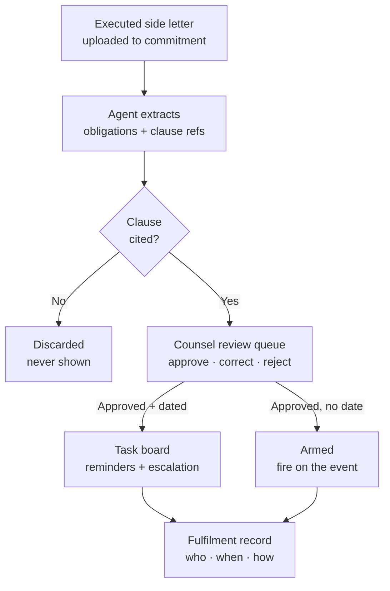

# LinkedIn Article #4 — Side Letter Obligations Agent

```yaml
series: "Fund Ops, Unstacked #4"
format: LinkedIn Article + short feed teaser post
feature: Side Letter Obligations Agent (extraction → counsel review → tracked tasks → fulfilment audit trail)
persona: Director of Investor Relations
hook_rationale: >
  Leads with the liability framing — "you signed it, you owe it, and nobody is
  tracking it" — rather than "we extract data from documents", which reads as
  OCR. The differentiated claim is the review gate: an obligation the AI cannot
  cite to a clause is discarded before a human ever sees it.
impact_used: >
  Hard numbers from code (app/packs/funds/side_letters/models/side_letter_obligation.rb,
  app/packs/ai/support_agents/services/side_letter_obligation_agent.rb):
  10 obligation types; 6 trigger shapes; 5 owner teams; source_clause is a model-level
  validation on every AI-extracted row — an uncited obligation cannot be persisted;
  approved obligations are never overwritten on re-extraction (changes arrive as
  new delta rows); rejected clauses never resurface; 7-day default reminder lead
  time; one consolidated email per owner per day, worst-first; recurring obligations
  carry an iCal RRULE and project into the task board automatically.
  Before/after: a folder of executed PDFs and one person's memory → a filterable
  obligation matrix with a named owner on every row.
compliance_note: >
  "Kestrel Partners", "Fund II", "Northgate Pension", "Section 4.3(b)" and all
  dates/amounts are fictional. No client, fund, or LP is named. No performance
  claim is made anywhere in the piece.
status: draft — ready for review
```

---

## Article title

**Your Side Letters Are in a Folder. Your Obligations Are on Your Balance Sheet.**

*Every side letter you sign creates work that outlives the person who negotiated it. Here's how we turned that from institutional memory into a tracked, owned, auditable list.*

---

## Article

Nobody misses a side letter obligation on purpose.

They miss it because the person who negotiated it left in 2023. Because the commitment was one of forty that closed that quarter. Because the obligation is a single sentence on page nineteen of a document that has been opened twice since it was signed.

And you find out the way everyone finds out: an LP's counsel, mid re-up diligence, asks whether you've been sending the quarterly ESG report their letter requires.

**[STAT BAND]**
| 10 | 5 | 0 |
|---|---|---|
| obligation types recognised — reporting, fees, co-investment, notice, transfer, excuse, confidentiality, key person, MFN, other | owner teams an obligation can be routed to — IR, finance, legal, deal team, operations | obligations stored without a clause citation. Not "few". Zero — it's a database constraint. |

### The problem isn't finding the side letter. It's knowing what's in it.

Ask a fund operations team where their side letters live and you'll get a confident answer: the data room, filed under each commitment. Fine.

Now ask a harder question: *which obligations are due this quarter, and who owns each one?*

That answer lives in three places at once — a partner's memory, a spreadsheet someone maintained until they didn't, and the documents themselves. None of the three is queryable. All three drift.

The gap isn't storage. It's that a signed PDF is not a workflow.

**[KEY POINT #1]**
> *A document you can find is not the same as an obligation you can track. Storage is not compliance.*

### What we built

The Side Letter Obligations Agent reads the executed side letter attached to each capital commitment and pulls out every commitment it creates — reporting cadences, fee arrangements, co-investment rights, notice requirements, transfer restrictions, excuse rights, confidentiality terms, key person provisions, MFN clauses.

Each extracted obligation arrives with the clause it came from.

Then it stops. Nothing goes live until your counsel approves it.

**[MOCK: Obligation Matrix — fictional data]**

| Investor | Obligation | Type | Trigger | Owner | Next due | Status |
|---|---|---|---|---|---|---|
| Northgate Pension | Quarterly ESG report | Reporting | Within 45 days of quarter-end | IR | 14 Feb 2026 | ● Active |
| Northgate Pension | Management fee rebate — 15bps | Fees | Annually, on anniversary | Finance | 30 Jun 2026 | ● Active |
| Ashford Family Office | Co-invest right of first offer | Co-investment | On each new deal | Deal team | — | ◆ Armed |
| Ashford Family Office | Notify on key person departure | Key person | On event | Legal | — | ◆ Armed |
| Beacon Endowment | MFN election window | MFN | One-time | Legal | 11 Mar 2026 | ⚠ Pending review |

Two things in that table matter more than the rest.

**Every row has an owner.** An obligation cannot be approved without one — a named person or one of five teams. "The fund" is not an owner. Someone is on the hook, by construction.

**Not every row has a date.** This is the part most tools get wrong.

### Half of a side letter has no due date at all

"Notify the investor if a key person departs." "Offer a right of first refusal on co-investments." "Honour MFN if a later LP gets better terms."

These aren't calendar items. They're conditions. A tool that only models due dates either drops them or invents fake deadlines for them.

We model six trigger shapes instead:

1. **Calendar event** — recurs on a schedule (quarterly, annually), carrying a standard iCal RRULE
2. **One-time** — a single dated deadline
3. **Fund event** — fires when something happens at the fund
4. **Deal event** — fires on a new investment
5. **Status change** — fires on a state transition
6. **Ongoing** — a standing condition with no discrete trigger

Dated obligations project straight onto the task board with reminders attached. The other four stay **Armed** — visible in the matrix, owned, waiting. When the key person actually leaves, you fire the obligation, give it a deadline, and a task exists that second.

**[KEY POINT #2]**
> *An obligation without a due date is not less important. It's more dangerous — because nothing reminds you it exists.*

## ⚙️ Under the hood: the constraint that makes it usable

Here is the design decision that took the longest and matters the most.

An AI-extracted obligation **cannot be saved without a clause citation.** Not "we prompt for one" — the model refuses the write:

> `validates :source_clause, presence: true, if: :extracted_by_ai?`

The extraction prompt instructs the model to omit any obligation it can't cite. The review gate drops uncited rows before they're persisted. And the database constraint backstops both, so a plausible-sounding obligation with no clause behind it cannot reach your counsel's queue even if the first two layers fail.

Why go to three layers for one field?

Because the failure mode of AI on legal documents isn't missing an obligation. It's **confidently producing one that isn't in the document.** A reviewer who finds one invented obligation in a queue of forty stops trusting the other thirty-nine — and correctly so. The citation isn't a nice-to-have feature. It's the thing that makes the review economical: counsel checks a claim against a named section instead of re-reading the letter.

The same principle governs what happens when a side letter is amended and you re-extract:

- **Approved obligations are never overwritten.** A changed extraction lands as a *new* row flagged as a delta, sitting beside the approved one. Counsel reviews the diff.
- **Rejected clauses never come back.** If your counsel said no to an interpretation once, re-running extraction doesn't resurface it next quarter.
- **Pending drafts are refreshed in place** — the review queue stays current without accumulating near-duplicates.

The rule underneath all three: *the agent may propose, only a human may promote.* Re-running it is always safe, which is what makes people actually run it.

**[DIAGRAM — flow]**

### Then the calendar takes over

Once approved, a dated obligation becomes a task with the fund's own reminder machinery behind it:

- **Ahead of the due date** — to the owner, using that obligation's lead time (7 days by default; set it to zero to suppress the early nudge)
- **On the due date** — to the owner
- **After** — repeated on your configured escalation cadence, copied to the team you nominated

Each person gets **one consolidated email per day**, worst first — not one email per obligation. That distinction is the difference between a system people read and a system people filter.

Completing the task records a fulfilment: who satisfied the obligation, when, and how. Over a fund's life that becomes the answer to the question that started this article — asked by an LP's counsel, three years later, about a report someone else was supposed to send.

## 📊 The impact

Before: executed side letters filed by commitment, obligations tracked in a spreadsheet and a partner's memory, and no way to answer "what's due this quarter across all LPs" without reading documents.

After: **one filterable matrix** across every investor in the fund — by obligation type, owning team, due-date range, review status, or MFN relevance — with **a named owner on every approved row** and **a fulfilment record behind every completed one**.

The number that matters isn't hours saved. It's this: **the count of obligations your team can currently name, without opening a document, is the count you're actually managing.** For most funds that number is well below what they've signed.

**[KEY POINT #3]**
> *You don't have a side letter problem until you have a re-up. Then you have one, in front of the person deciding whether to re-up.*

## ✅ Takeaways

**1. Inventory before you automate.** Pull every executed side letter for one fund and list the obligations by hand. The length of that list is the business case — and you can do it this week without buying anything.

**2. Give every obligation a name, not a department.** "IR handles it" is how things get missed at handover. One person, on the record.

**3. Track the undated ones hardest.** Event-driven obligations — key person, MFN, co-invest rights — carry the most legal weight and have the least natural reminder. They need a home even when nothing is due.

**4. Demand a citation from any AI touching legal documents.** If an extraction tool can't tell you which section an obligation came from, you haven't saved review time — you've moved it, and added a verification job that didn't exist before.

**5. Keep the human gate, permanently.** Not as a training-wheels phase. Extraction proposes; counsel decides. Re-running should always be safe.

———

### 💡 See it on your own structure

If you're running twenty or more LPs with negotiated letters, the interesting exercise isn't a demo of ours — it's the inventory in takeaway #1. Do that first.

If the list surprises you, DM me and I'll walk you through how we model it, including the trigger shapes that don't have due dates.

**Question for the fund ops and IR people here: how does your team currently track an obligation that has no due date — the MFN clause, the co-invest right, the key person notice? I've yet to hear two firms answer this the same way.**

---

## Mermaid diagram



---

## Feed teaser post (paste-ready, ≤3,000 chars)

```
Nobody misses a side letter obligation on purpose.

They miss it because the person who negotiated it left two years ago, and the obligation is one sentence on page 19 of a PDF that's been opened twice since signing.

You find out during an LP's re-up diligence. 👇

We built an agent that reads executed side letters and extracts every obligation they create — reporting cadences, fee arrangements, co-invest rights, MFN clauses, key person notices.

But the extraction isn't the interesting part. Three design decisions are:

𝟭. 𝗡𝗼 𝗰𝗶𝘁𝗮𝘁𝗶𝗼𝗻, 𝗻𝗼 𝗼𝗯𝗹𝗶𝗴𝗮𝘁𝗶𝗼𝗻.
An AI-extracted obligation cannot be saved without the clause it came from. Not a prompt instruction — a database constraint. Counsel checks a claim against "Section 4.3(b)", not against the whole letter.

𝟮. 𝗧𝗵𝗲 𝗮𝗴𝗲𝗻𝘁 𝗽𝗿𝗼𝗽𝗼𝘀𝗲𝘀. 𝗢𝗻𝗹𝘆 𝗮 𝗵𝘂𝗺𝗮𝗻 𝗽𝗿𝗼𝗺𝗼𝘁𝗲𝘀.
Every obligation waits in a review queue. Approved ones are never overwritten by a re-extraction — an amended letter produces a new row beside the old one, so counsel reviews the diff. Rejected clauses never resurface.

𝟯. 𝗛𝗮𝗹𝗳 𝗼𝗳 𝗮 𝘀𝗶𝗱𝗲 𝗹𝗲𝘁𝘁𝗲𝗿 𝗵𝗮𝘀 𝗻𝗼 𝗱𝘂𝗲 𝗱𝗮𝘁𝗲.
"Notify us if a key person departs." "Offer ROFO on co-investments." Those aren't calendar items — they're conditions. They stay Armed in the matrix, owned and visible, until the event fires them.

The result: one filterable matrix across every LP in the fund, a named owner on every row, and a fulfilment record behind every completed one.

Because the count of obligations your team can name without opening a document is the count you're actually managing.

For most funds, that's well below what they've signed.

• • •

✅ Three things worth doing whether or not you ever buy software:

→ Inventory the obligations in one fund's side letters by hand. That list is your business case.
→ Assign a person, not a department. "IR handles it" is how things break at handover.
→ Track the undated ones hardest — they carry the most legal weight and have the least natural reminder.

How does your team track an obligation with no due date? I've yet to hear two firms answer the same way.

Full write-up in the first comment.

#PrivateEquity #InvestorRelations #FundOperations #LimitedPartners #SideLetters
```

---

## First comment

```
Full article — including the six trigger shapes we model (and why "ongoing" and "on event" obligations need different handling from quarterly reports): [LINK]

Part of Fund Ops, Unstacked — a series on the operational machinery behind running a private fund. Previous: the cash flow agent that refuses to answer on stale data.
```

---

## Carousel variant (7 slides)

1. **Hook** — "Nobody misses a side letter obligation on purpose." / They miss it because the negotiator left and it's one sentence on page 19.
2. **The problem** — Ask where your side letters live: easy. Ask what's due this quarter and who owns it: three answers, none queryable.
3. **10 obligation types** — reporting · fees · co-investment · notice · transfer · excuse · confidentiality · key person · MFN · other
4. **The citation rule** — No clause reference → the obligation is never stored. A database constraint, not a prompt.
5. **Propose vs promote** — The agent proposes. Counsel approves. Approved rows are never overwritten; rejected clauses never resurface.
6. **Six trigger shapes** — Dated ones become tasks. Event-driven ones stay *Armed* — owned and visible, fired when the event happens.
7. **CTA** — Inventory one fund's obligations by hand this week. The length of that list is your business case. / DM for a walkthrough.

---

## Assets to produce

1. Diagram: extraction → citation gate → review → task/armed → fulfilment (Mermaid above, rendered to SVG).
2. Screenshot: Obligation Matrix filtered to one fund, fictional investor names, status pills visible.
3. Screenshot: a single obligation page showing the cited clause beside the extracted text.
4. Screenshot: the consolidated daily reminder email, worst-first ordering visible.
