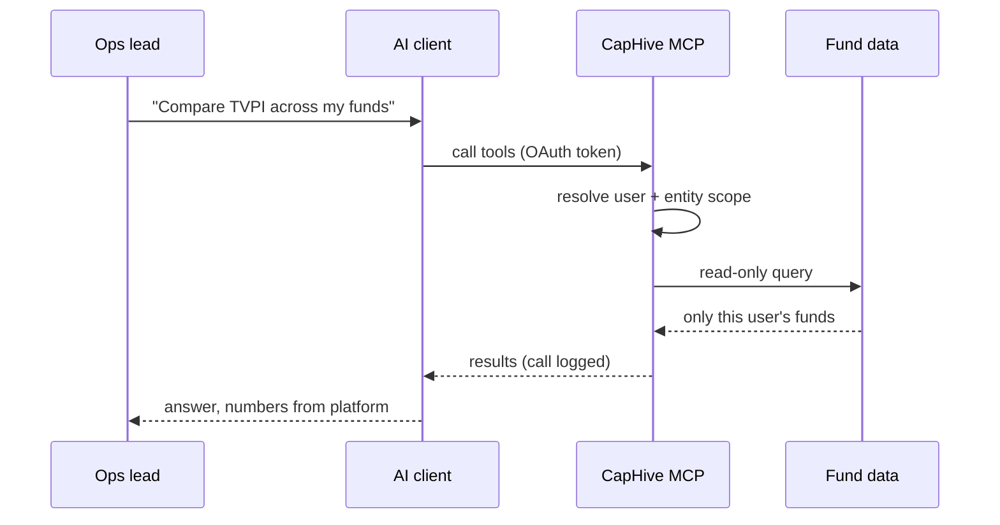

# LinkedIn Article #5 — Your Fund Data, Inside Your Own AI Client (MCP)

```yaml
series: "Fund Ops, Unstacked #5"
format: LinkedIn Article + short feed teaser post
feature: CapHive MCP Server (22 read-only tools, OAuth/PKCE, two-level governance) + entity-level LLM configuration (bring-your-own API key)
persona: COO / Head of Fund Operations — specifically the technically fluent one who owns the "what's our AI strategy" question
hook_rationale: >
  Inverts the category. Every vendor's AI story is "we added a chatbot to our
  product." The counter-position — "we made our product callable from the AI
  client you already use, read-only, under your keys" — is both differentiated
  and hard to copy, and it pre-empts the data-governance objection instead of
  waiting for it in procurement.
impact_used: >
  Hard numbers from the guide and code (docs/user_guides/mcp_server/,
  app/packs/ai/mcp_server/): 22 read-only tools across 6 domains (verified —
  22 tool classes registered in McpController#authorized_tools; note there are
  23 *_tool.rb files, but application_mcp_tool.rb is the abstract base class,
  not a tool — an earlier draft of this doc counted files and said 23);
  zero write operations exposed; OAuth Dynamic Client
  Registration per RFC 7591 with PKCE, so no shared client secret is ever
  distributed or rotated; 30-day access tokens with automatic refresh, revocable
  by disconnecting; every tool call logged for audit; two-level governance
  (platform billing gate, then entity-admin self-serve role and client
  allow-lists); per-entity Anthropic/OpenRouter API keys with independent
  billing and per-entity default model.
  Before/after: exporting to a spreadsheet to ask a cross-fund question →
  asking the question in the AI client, with tenant scoping enforced server-side.
compliance_note: >
  No client or fund named. Example queries use "Fund II" / generic phrasing.
  The MCP URL shown in the user guide is the staging host — do NOT publish a
  hostname in the post; refer to "your CapHive MCP endpoint".
  Avoid implying the LLM computes fund numbers — it retrieves them; the
  platform computes them.
status: draft — ready for review
```

---

## Article title

**We Didn't Add a Chatbot. We Made the Fund Callable.**

*Why the most useful AI feature we shipped this year has no interface of its own — and runs on your API key, not ours.*

---

## Article

Every software vendor serving private funds shipped an AI feature in the last eighteen months. Almost all of them shipped the same one: a chat box in the bottom-right corner of their product.

We shipped one of those too. It's genuinely useful, and it's not what this article is about.

This is about the opposite move — the one that took longer and matters more.

Instead of putting an AI inside our product, we made our product available *to the AI you already use.* Twenty-two read-only tools. Your own API key. Your own model choice. Your governance rules, enforced on our side.

**[STAT BAND]**
| 22 | 0 | 30 |
|---|---|---|
| read-only tools exposed — funds, capital activity, portfolio, cap table, documents, commitments | write operations. No create, update, or delete path exists through the connection | day access-token lifetime, auto-refreshing, revocable by the user in one click |

### The question your IC is already asking

"What's our AI strategy?"

The honest answer at most GPs in the $500M–$10B band is some version of: *our administrator's platform added a chat box, and two people on the team pay for a consumer AI subscription out of their own pocket.*

That second half is the interesting one. Your team is already using an AI client daily. What it can't do is see your fund data — so they paste it in. Screenshots of the cap table. Exported capital account statements. A pasted KPI grid.

That's not an AI strategy. That's an exfiltration channel with a subscription.

**[KEY POINT #1]**
> *Your team isn't waiting for you to choose an AI tool. They chose one. The only open question is whether it reaches your data through a governed connection or through the clipboard.*

### What it looks like in practice

An operations lead opens their AI client — the same one they already use — and types:

> *"Compare TVPI and DPI across all my funds as of last quarter, and flag any fund where called capital is above 80% of commitments."*

The client calls our tools. It pulls the fund list, the ratio set, and the commitment aggregates. It assembles the answer.

What it does **not** do is compute the ratios. Those come out of the platform, calculated by the same engine that produced the numbers in the last LP report — because a number that an LLM arrived at by arithmetic is a number you cannot defend in a diligence call.

The AI's job here is retrieval, framing, and synthesis. The fund's job is the math. That line is deliberate, and we don't cross it.

**[DIAGRAM — sequence]**

### The three questions procurement will ask

Every one of these came up before we shipped. Each shaped the design.

**"Can it change anything?"**

No. Not "we've restricted it" — there is no write path. All 22 tools are read-only. The connection cannot create a capital call, edit a valuation, or delete a document, because no tool exists that does those things.

**"Whose data does it see?"**

Only what the authenticated user could already see in the product. Every query resolves through the same user and entity scoping the web interface uses. There's no service account, no elevated connector identity, no cross-tenant surface. If a user can't open a fund in the UI, the AI can't read it either.

**"Who decides who gets it?"**

Two levels, deliberately separated:

1. **The platform gate** — whether your firm has MCP access at all. Commercial, controlled by us.
2. **Your gate** — which roles inside your firm can connect, and which AI clients are permitted. Self-serve, controlled by your own admin, changeable without a support ticket.

That second gate includes an option most firms don't expect: you can extend access to the **investor role**. An LP asking their own AI client about their own capital account, scoped to exactly their own folio. Most firms will start with employees only — but the model supports it, and the scoping is the same code either way.

**[KEY POINT #2]**
> *"Read-only" is a promise. "No write tool exists" is an architecture. Ask any vendor which of the two they're offering.*

## ⚙️ Under the hood: no secrets to distribute

The part I'd want to know about if I were evaluating this.

Connecting doesn't involve a client ID or a client secret. The AI client registers itself dynamically — **OAuth 2.0 Dynamic Client Registration, RFC 7591** — and authorises with **PKCE**, the flow designed for public clients that can't keep a secret.

This sounds like plumbing. It's actually the security property that matters most operationally.

The alternative — issuing each firm a client secret — means a credential exists that has to be transmitted, stored, rotated, and revoked when someone leaves. That credential is the thing that leaks. It leaks in a Slack message, a runbook, a screenshot in a support ticket.

With dynamic registration, there's no such artifact. A user authorises with their own login, gets a token scoped to themselves, and that token expires in 30 days with automatic refresh. When they leave, disabling their account ends their AI access at the same moment it ends their web access — no separate revocation step to forget.

And every tool call is logged. Not just the connection — each individual query, attributable to a user, available for audit.

**[COMPARISON TABLE]**

| | Chatbot inside the vendor's product | Fund data callable from your AI client |
|---|---|---|
| Where the AI runs | Vendor's infrastructure, vendor's model | Your client, your model, your key |
| Model choice | Whatever the vendor picked | Yours — set a default model per entity |
| Who pays for inference | Bundled into the licence, opaque | Your API account, itemised |
| Scope of data | Whatever the vendor's chat is wired to | Exactly what that user can already see |
| Works alongside your other tools | No | Yes — same client, same conversation |
| Leaves an audit trail | Sometimes | Every tool call, per user |

### Bring your own key — and your own model

The same principle runs through our LLM configuration. Each entity can supply its own Anthropic or OpenRouter API key, and set its own default model.

Three consequences, all commercial rather than technical:

**Billing is yours and it's itemised.** AI usage shows up on your API account, not buried in a per-seat licence with a margin on top. You can see what you're spending and on what.

**Model choice is yours.** When a better or cheaper model ships — and one will, within months — you switch. You don't wait for our release cycle, and you don't get switched without being told.

**The data-residency conversation gets simpler.** You're contracting with the model provider directly, under your own terms, rather than asking us to explain a sub-processor relationship in an LP's diligence questionnaire.

**[KEY POINT #3]**
> *If your AI features run on your vendor's key, your AI cost, your model, and your data-processing terms are all decisions someone else makes for you.*

## 📊 The impact

Before: a cross-fund question meant an export, a workbook, and an analyst's afternoon — or a screenshot pasted into a consumer AI tool with no governance at all.

After: the question is asked in the client the team already uses, against **22 read-only tools**, scoped to the asker's own permissions, with **every call logged** and **zero write paths** exposed.

The measurable shift isn't time saved on any single query. It's this: **the number of times fund data leaves your controlled environment to answer a question goes to zero** — because the governed path is now easier than the clipboard.

## ✅ Takeaways

**1. Assume your team is already using AI on your data.** The useful question isn't whether to allow it. It's whether the path they're using is one you can audit.

**2. "Read-only" should mean no write tool exists.** Ask any vendor to describe the write path they've disabled. If they can describe one, it's a configuration, not an architecture.

**3. Scoping must reuse the product's own permissions.** A connector with its own service account and its own permission model is a second access-control system to keep in sync — and it will drift.

**4. Prefer dynamic registration over shared secrets.** Any credential a human has to copy between systems is a credential that ends up somewhere it shouldn't.

**5. Don't let an LLM compute your numbers.** Retrieval, comparison, and drafting: yes. Arithmetic that reaches an LP: no. Keep the calculation in the system that can show its work.

———

### 💡 See it on your own structure

If you want to see what your own funds look like from inside your AI client — same permissions your team already has, nothing new granted — DM me and I'll set up a walkthrough on your structure.

Worth doing even if you don't take it further: it makes the governance conversation concrete in a way a policy document never does.

**Question for the operators here: has your firm written down what your team is allowed to paste into an AI tool? Not what the policy should be — whether the policy exists. My sense is that most firms are one quarter behind their own staff on this.**

---

## Mermaid diagram



---

## Feed teaser post (paste-ready, ≤3,000 chars)

```
Every fund software vendor shipped an AI feature this year.

Almost all of them shipped the same one: a chat box in the bottom-right corner.

We shipped the opposite. 👇

Instead of putting an AI inside our product, we made our product callable from the AI client your team already uses.

22 read-only tools. Your API key. Your model. Your governance rules, enforced on our side.

Here's why that framing matters more than the feature:

Your team is already using AI on fund data. Not "will be" — is. And because their AI client can't see your data, they paste it in. Cap table screenshots. Exported capital accounts. A pasted KPI grid.

That's not an AI strategy. That's an exfiltration channel with a subscription.

𝗧𝗵𝗿𝗲𝗲 𝗱𝗲𝘀𝗶𝗴𝗻 𝗱𝗲𝗰𝗶𝘀𝗶𝗼𝗻𝘀 𝘁𝗵𝗮𝘁 𝗺𝗮𝘁𝘁𝗲𝗿𝗲𝗱 𝗺𝗼𝗿𝗲 𝘁𝗵𝗮𝗻 𝘁𝗵𝗲 𝘁𝗼𝗼𝗹 𝗹𝗶𝘀𝘁:

→ 𝗡𝗼 𝘄𝗿𝗶𝘁𝗲 𝗽𝗮𝘁𝗵 𝗲𝘅𝗶𝘀𝘁𝘀. Not "restricted" — there is no tool that creates, edits, or deletes anything. "Read-only" as an architecture, not a setting.

→ 𝗡𝗼 𝘀𝗲𝗿𝘃𝗶𝗰𝗲 𝗮𝗰𝗰𝗼𝘂𝗻𝘁. Every query resolves through the same user and entity scoping as the web app. If someone can't open a fund in the UI, their AI can't read it either. One permission system, not two that drift apart.

→ 𝗡𝗼 𝘀𝗵𝗮𝗿𝗲𝗱 𝘀𝗲𝗰𝗿𝗲𝘁. The client registers itself dynamically and authorises with PKCE. There's no credential to distribute, rotate, or leak in a Slack thread. Disabling someone's account ends their AI access at the same instant it ends their login.

And the AI never computes your numbers. It retrieves them. Ratios come out of the same engine that produced your last LP report — because a figure an LLM arrived at by arithmetic is a figure you can't defend in a diligence call.

• • •

✅ Worth applying to any AI vendor conversation, not just ours:

→ Ask them to describe the write path they've disabled. If they can describe one, it's a config.
→ Ask whose permission model the connector uses. If it has its own, it will drift from yours.
→ Ask whose API key inference runs on. If it's theirs, your model choice and your AI cost are their decision.

Has your firm actually written down what staff may paste into an AI tool? Not what it should say — whether it exists.

Most firms are a quarter behind their own team on this.

Full write-up in the first comment.

#PrivateEquity #FundOperations #AI #DataGovernance #FundTech
```

---

## First comment

```
Full article — including the two-level governance model (platform gate vs. your own role and client allow-lists) and why we let entities bring their own model keys: [LINK]

Part of Fund Ops, Unstacked. Previous: what happens when an agent refuses to answer because the data is stale.
```

---

## Carousel variant (8 slides)

1. **Hook** — Every vendor shipped a chat box. We shipped the inverse.
2. **The real situation** — Your team already uses AI on fund data. It reaches the data through the clipboard.
3. **The move** — 22 read-only tools, callable from the client they already use.
4. **No write path** — Read-only as architecture. No tool creates, edits, or deletes.
5. **No service account** — Same user + entity scoping as the web app. One permission system.
6. **No shared secret** — Dynamic registration + PKCE. Nothing to distribute or rotate.
7. **Your key, your model** — Itemised AI billing, your own model choice, simpler residency answer.
8. **CTA** — Ask your vendor to describe the write path they disabled. / DM for a walkthrough on your structure.

---

## Assets to produce

1. Diagram: the sequence above, rendered to SVG (4 participants, terse messages).
2. Screenshot: the entity admin "AI Client Integration" panel showing role and client allow-lists — **crop out the hostname**.
3. Screenshot: an AI client conversation answering a cross-fund ratio question, fictional fund names only.
4. Optional: the tool list grouped by domain, as a designed graphic rather than a raw table.
