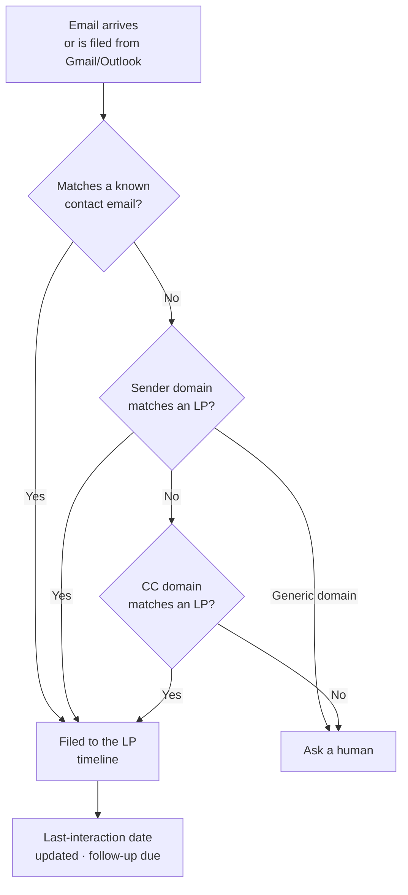
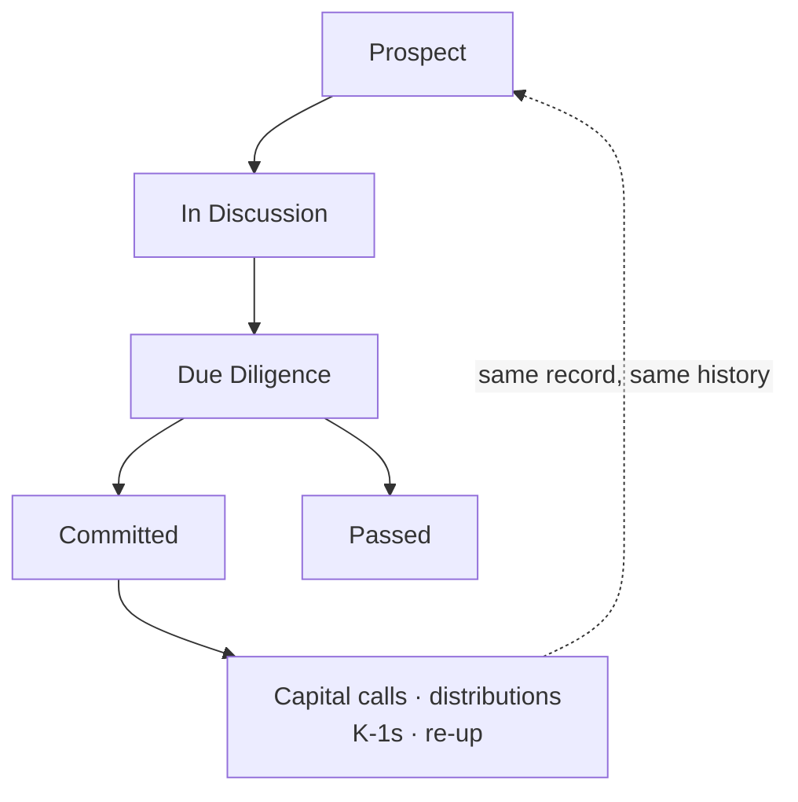

# LinkedIn Article #6 — The LP CRM (relationship record → email capture → pipeline board → commitment)

```yaml
series: "Fund Ops, Unstacked #6"
format: LinkedIn Article + short feed teaser post
feature: >
  LP Relationship CRM, assembled across: the LP record with relationship status +
  owner (custom fields on Investor), contacts under each LP (InvestorAccess as
  contact-only, no portal access), the interaction log (Notes with a touch-point
  link to the specific human), follow-ups (Tasks with assignee, due date, touch
  point), the Kanban task board, the cross-LP list with a "gone quiet" filter,
  automatic email capture (Gmail add-on, Outlook add-in, per-record incoming email
  addresses, InvestorEmailMatcher), the Note Summarizer Agent, and the Deals
  workspace for the fundraise itself.
persona: Director of Investor Relations
hook_rationale: >
  The differentiated claim is NOT "we have a CRM" — everyone has a CRM. It's that
  the prospect record and the investor record are the same record, so nothing is
  re-keyed at the moment of commitment. That's the one thing a horizontal CRM
  structurally cannot do, and it's where every GP's current stack actually breaks.
impact_used: >
  Hard facts from code and PRD (feature/lp-crm-mvp; docs/modules/investors/lp_relationship_crm_alt_mvp_prd.md;
  app/packs/misc/incoming_emails/services/investor_email_matcher.rb;
  app/packs/core/tasks/models/task.rb):
  5 relationship stages (Prospect / In Discussion / Due Diligence / Committed / Passed);
  3-tier email matching cascade (contact email → sender domain → cc domain) with 9
  generic consumer domains excluded from domain matching so a gmail.com sender never
  mis-files; notes and tasks link to a touch point — the specific human at the LP, not
  just the institution — validated so a touch point must belong to that LP;
  logging a note stamps the LP's last-interaction date, which drives a "nobody has
  spoken to these LPs in 90 days" filter; 3-column Kanban board (To do / In progress /
  Done) with drag-and-drop, filterable by assignee, stakeholder and tag, kept in
  two-way sync with the completed flag; Note Summarizer Agent writes a monthly or
  quarterly AI summary back as a note on the LP.
  Before/after: a horizontal CRM whose pipeline ends at "Committed" and is re-keyed
  into the fund system → one record that carries its whole history across the line.
compliance_note: >
  ⚠️ SHIPPING STATUS: the LP CRM MVP work (relationship status/owner fields, contacts,
  touch points, Kanban board) lives on branch `feature/lp-crm-mvp` and is NOT on main
  as of this draft. Do not publish before merge/release, or soften to "shipping shortly".
  Email capture, Notes, Tasks, Deals and the Note Summarizer Agent are already live.
  All names fictional ("Northgate Pension", "Ashford Family Office", "Priya", "Marcus").
  No client named, no performance claim, no real LP data in any mock.
status: draft — HOLD FOR MERGE of feature/lp-crm-mvp
```

---

## Article title

**Your CRM Ends at "Committed." That's Exactly Where the Work Starts.**

*Most funds run their fundraise in one system and their investors in another. The handover between them is where relationship history goes to die.*

---

## Article

Watch what happens at a GP the day an LP finally commits.

Eighteen months of relationship live in the CRM: who introduced them, the three objections raised in the second meeting, which partner they actually trust, the fact that their head of alternatives is on leave until March.

Then the commitment gets signed — and the record starts again. Somebody re-keys the investor into the fund system. Legal name, entity type, contacts, addresses, bank details. The eighteen months stay behind in a system the operations team doesn't open.

Two years later a new IR hire is preparing for that LP's re-up. They read a record that begins on the day the money arrived.

**[STAT BAND]**
| 5 | 3 | 90 |
|---|---|---|
| relationship stages — Prospect, In Discussion, Due Diligence, Committed, Passed — on the same record that later holds the commitment | ways an inbound email is matched to the right LP before we give up and ask a human | day "gone quiet" filter: which LPs has nobody spoken to since before last quarter? |

### The problem isn't that funds lack a CRM

Every fund has one. Some run a horizontal CRM, some run a relationship-intelligence tool, plenty run a spreadsheet with conditional formatting that one person maintains beautifully.

They all work fine for the part they're built for — tracking a pipeline.

The failure is at the seam. A generic CRM models a *deal that closes*. A fund needs a record that *keeps going for twelve years after it closes* — through calls, distributions, K-1s, side letters, an AGM, a re-up, and eventually a transfer to somebody else.

So the CRM's job ends at the exact moment the relationship becomes valuable.

**[KEY POINT #1]**
> *A prospect and an investor are not two records at two stages. They are one record, and every system that treats them as two loses the history at the handover.*

### What we built: one record, five stages, no re-keying

The LP record starts life as a prospect and never gets replaced. It carries a **relationship status** — Prospect → In Discussion → Due Diligence → Committed → Passed — and a **relationship owner**, the person on your team accountable for it.

When the LP commits, nothing migrates. The commitment attaches to the record that already holds eighteen months of notes, the contacts, the open follow-ups, the email history. Their contacts get approved into portal users — the same people, now with logins — and everything behind them carries over.

**[MOCK: LP pipeline list — fictional data]**

| LP | Stage | Owner | Primary contact | Last interaction | Open follow-ups |
|---|---|---|---|---|---|
| Northgate Pension | Due Diligence | Priya | J. Almeida (Head of Alts) | 4 days ago | 2 |
| Ashford Family Office | In Discussion | Marcus | R. Ashford (Principal) | 11 days ago | 1 |
| Beacon Endowment | Prospect | Priya | T. Okonjo (Investment Dir.) | 94 days ago ⚠ | 0 |
| Clearwater Insurance | Committed | Marcus | S. Lindqvist (CIO) | 6 days ago | 3 |

Look at the Beacon row. No open follow-ups, no contact in 94 days, still sitting in Prospect. That combination is the single most useful signal in a fundraise and almost no team can query for it, because the two halves live in different systems — or in nobody's head at all.

### The people, not just the institution

Here's a modelling decision that sounds small and changes how the log gets used.

Every note and every follow-up can point at a **touch point** — the specific human at the LP it involves. Not "we spoke to Northgate." *"Call with J. Almeida, Head of Alternatives."*

The difference shows up when someone leaves. Your relationship isn't with Northgate Pension; it's with three people there, and when the one who championed you moves to another institution, you need to know instantly what they knew, what they asked, and what you promised them — and that they're now a warm contact somewhere else.

Contacts sit under the LP with a title, what they handle (decision maker, finance, documentation), a line of context, and a primary flag. Crucially, **adding someone as a contact doesn't give them portal access or send them anything.** A prospect's CFO can be in your CRM for a year before they ever get a login — and on the day the commitment closes, approving them into a portal user is one action, not a re-entry.

**[KEY POINT #2]**
> *You don't have a relationship with an institution. You have relationships with four people inside it, and two of them will change jobs during your fund's life.*

## ⚙️ Under the hood: the logging problem, and how we attacked it

Every CRM deployment at every firm in history has failed for the same reason. Not features. **Nobody logs anything.**

An IR team that logs every interaction has a CRM. One that logs when they remember has a directory of names and stale dates. So the engineering effort went where the failure actually is: making the log fill itself.

**Email capture, three ways.** File an email onto an LP from inside **Gmail** or **Outlook** without leaving the mailbox. Or use the per-record email address the platform generates and simply BCC it — the email files itself against the right record on arrival.

**And when the sender isn't an exact match**, a three-tier cascade runs before anyone is asked to intervene:

1. **Exact contact match** — the sender (or anyone cc'd) matches a known contact email under an LP.
2. **Sender domain match** — no exact hit, so match the sender's domain against LPs' primary email domains. `@northgatepension.com` finds Northgate.
3. **CC domain match** — still nothing, so try the domains of everyone cc'd. Catches the intro email where the LP is copied but the sender is a placement agent.

With one guard that matters more than the three tiers combined: **nine generic consumer domains are excluded from domain matching.** `gmail.com`, `outlook.com`, `yahoo.com`, `icloud.com` and the rest. Without that exclusion, one LP using a personal address would silently claim every consumer-domain email that ever hit the system — and a CRM that files things to the wrong LP is worse than one that files nothing, because now you distrust the whole log.

If the cascade produces exactly one LP, it files. Several, it asks. None, it asks. **The system guesses only when it can be sure.**

**[DIAGRAM — email capture flow]**

**Then the follow-ups become a board.** Tasks carry an assignee, a due date and a touch point, and appear on a three-column drag-and-drop board — To do, In progress, Done — filterable by assignee, LP or tag. Drag a card and the underlying task updates; tick the task complete anywhere else in the product and the card moves. One state, two views, kept in sync in both directions so the board never lies.

**And an agent reads the log back to you.** The Note Summarizer Agent runs across every LP, summarises the last month or quarter of notes, and writes the summary back as a note on the record — so it sits in the same timeline as everything else. It can tag untagged notes first, which quietly cleans up the log that busy people made a mess of.

## 📊 The impact

Before: a horizontal CRM for the raise, a fund platform for everyone who committed, and a manual re-key between them. Relationship history stops at the commitment date. "When did we last speak to them?" requires opening someone's inbox.

After: **one record across all five stages**, with **notes and tasks attached to named humans**, **emails filing themselves through a 3-tier match**, and a list that answers *who's gone quiet* in one filter instead of a partner's memory.

The number worth measuring in your own firm: **what percentage of your LP interactions last quarter left a trace anyone else can find?** Not in an inbox — in a place a new hire could read.

For most funds that number is under half. Everything above is aimed at it.

**[COMPARISON TABLE]**

| | Horizontal CRM | LP CRM inside the fund platform |
|---|---|---|
| What the record becomes at close | A closed-won deal | The investor — commitments, calls, distributions attach to it |
| Relationship history after commitment | Stays behind in the CRM | Continues on the same record |
| Contacts | CRM contacts | The same people, one action away from portal users |
| Email capture | Inbox sync, all of it | Filed deliberately, or matched by a cascade that refuses to guess |
| Knows what an LP has actually paid | No | Yes — same system as the capital account |
| Cost | A second licence per seat | Already in the platform |

## ✅ Takeaways

**1. Judge a CRM by what survives the close, not by the pipeline view.** Every tool demos well on the pipeline. Ask what happens to the record the day the LP commits.

**2. Log against people, not institutions.** The institution doesn't remember your last conversation. A person does, and that person changes jobs.

**3. Make the log fill itself or accept that it won't fill.** Email capture, a board people actually drag, and summaries written back — three attempts at one problem, because discipline alone has never solved it at any firm.

**4. Never let matching guess.** Silent mis-filing destroys trust in a log far faster than gaps do. Exclude consumer domains, match on multiple signals, and ask a human at any ambiguity.

**5. The most valuable query is the negative one.** Not "who's in the pipeline" — everyone can answer that. *"Which LPs has nobody touched in 90 days, with no follow-up scheduled?"* That's the list that costs you a re-up.

———

### 💡 See it on your own pipeline

If you're running a raise in one system and your investors in another, the useful exercise is to pick three LPs who committed last year and try to read their pre-commitment history in the system your ops team uses today.

If it isn't there, DM me — I'll show you what it looks like when the record doesn't restart at the close.

**Question for IR teams: what percentage of your team's LP interactions last quarter are readable by someone other than the person who had them? Honest answers only — I don't think anyone's number is as high as they'd like.**

---

## Mermaid diagram



**Second diagram (optional — the lifecycle):**



---

## Feed teaser post (paste-ready, ≤3,000 chars)

```
Watch what happens at a fund the day an LP finally commits.

Eighteen months of relationship sit in the CRM. Who introduced them. The objection raised in the second meeting. Which partner they actually trust.

Then the record starts over. 👇

Somebody re-keys the investor into the fund system. Legal name, contacts, addresses, bank details.

The eighteen months stay behind in a system the operations team never opens.

Two years later, a new IR hire prepping for the re-up reads a record that begins on the day the money arrived.

This isn't a discipline problem. It's a modelling problem:

𝗔 𝗴𝗲𝗻𝗲𝗿𝗶𝗰 𝗖𝗥𝗠 𝗺𝗼𝗱𝗲𝗹𝘀 𝗮 𝗱𝗲𝗮𝗹 𝘁𝗵𝗮𝘁 𝗰𝗹𝗼𝘀𝗲𝘀. 𝗔 𝗳𝘂𝗻𝗱 𝗻𝗲𝗲𝗱𝘀 𝗮 𝗿𝗲𝗰𝗼𝗿𝗱 𝘁𝗵𝗮𝘁 𝗸𝗲𝗲𝗽𝘀 𝗴𝗼𝗶𝗻𝗴 𝗳𝗼𝗿 𝘁𝘄𝗲𝗹𝘃𝗲 𝘆𝗲𝗮𝗿𝘀 𝗮𝗳𝘁𝗲𝗿 𝗶𝘁 𝗰𝗹𝗼𝘀𝗲𝘀.

So we built the CRM on the investor record itself. Prospect → In Discussion → Due Diligence → Committed → Passed. At commitment, nothing migrates. The capital commitment attaches to the record that already holds the whole history, and the contacts you've been talking to for a year become portal users in one action.

Three things we learned building it:

→ 𝗟𝗼𝗴 𝗮𝗴𝗮𝗶𝗻𝘀𝘁 𝗽𝗲𝗼𝗽𝗹𝗲, 𝗻𝗼𝘁 𝗶𝗻𝘀𝘁𝗶𝘁𝘂𝘁𝗶𝗼𝗻𝘀. Every note and follow-up points at a specific human. Your relationship isn't with the pension fund — it's with three people there, and one of them will change jobs during your fund's life.

→ 𝗧𝗵𝗲 𝗹𝗼𝗴 𝗵𝗮𝘀 𝘁𝗼 𝗳𝗶𝗹𝗹 𝗶𝘁𝘀𝗲𝗹𝗳. File from Gmail or Outlook without leaving the mailbox, or BCC the record's own address. Every CRM that ever failed at a fund failed because nobody logged anything.

→ 𝗡𝗲𝘃𝗲𝗿 𝗹𝗲𝘁 𝗺𝗮𝘁𝗰𝗵𝗶𝗻𝗴 𝗴𝘂𝗲𝘀𝘀. Inbound email is matched three ways — contact address, sender domain, cc domain — with consumer domains like gmail.com excluded from domain matching. Otherwise one LP using a personal address silently claims everyone else's email. Mis-filing destroys trust in a log much faster than gaps do.

• • •

✅ The most valuable query isn't "who's in the pipeline." Everyone can answer that.

It's: 𝘸𝘩𝘪𝘤𝘩 𝘓𝘗𝘴 𝘩𝘢𝘴 𝘯𝘰𝘣𝘰𝘥𝘺 𝘴𝘱𝘰𝘬𝘦𝘯 𝘵𝘰 𝘪𝘯 90 𝘥𝘢𝘺𝘴, 𝘸𝘪𝘵𝘩 𝘯𝘰 𝘧𝘰𝘭𝘭𝘰𝘸-𝘶𝘱 𝘴𝘤𝘩𝘦𝘥𝘶𝘭𝘦𝘥?

That's the list that costs you a re-up.

What percentage of your team's LP interactions last quarter are readable by someone other than the person who had them?

Full write-up in the first comment.

#InvestorRelations #PrivateEquity #FundraisingCRM #LimitedPartners #FundOperations
```

---

## First comment

```
Full article — including the three-tier email matching cascade and why we exclude consumer domains from domain matching: [LINK]

Part of Fund Ops, Unstacked. Previous: making fund data callable from your own AI client, read-only.
```

---

## Carousel variant (8 slides)

1. **Hook** — The day an LP commits, most funds start the record over.
2. **The seam** — A CRM models a deal that closes. A fund needs a record that runs twelve years past the close.
3. **Five stages, one record** — Prospect → In Discussion → Due Diligence → Committed → Passed. No migration at the line.
4. **Log against people** — Notes and follow-ups point at a named human, not the institution.
5. **The log fills itself** — Gmail, Outlook, or BCC the record's own address.
6. **Matching that refuses to guess** — 3 tiers, consumer domains excluded, ambiguity goes to a human.
7. **The negative query** — Which LPs went quiet 90+ days ago with no follow-up open? That's the re-up you lose.
8. **CTA** — Pick three LPs who committed last year. Can your ops team read their pre-commitment history? / DM for a look.

---

## Assets to produce

1. Diagram 1: email capture cascade (Mermaid above → SVG).
2. Diagram 2: LP lifecycle showing the record continuing past "Committed".
3. Screenshot: LP pipeline list with stage, owner, last-interaction, open follow-ups — fictional names.
4. Screenshot: an LP record showing contacts with roles + the interaction timeline with touch points.
5. Screenshot: the Kanban board with cards filtered by stakeholder.
6. Screenshot: the Gmail add-on side panel filing an email to an LP.

---

## ⚠️ Pre-publication checklist (specific to this post)

- [ ] `feature/lp-crm-mvp` merged and released — relationship status/owner, contacts, touch points, Kanban board
- [ ] Confirm the five stage names shipped as written (they are custom-field values, so they can be renamed per firm — check the seeded set in `lib/tasks/lp_crm_custom_fields.rake`)
- [ ] Confirm Gmail add-on is published/installable for the audience being pitched, not just internal
- [ ] Screenshots use fictional LP names throughout
