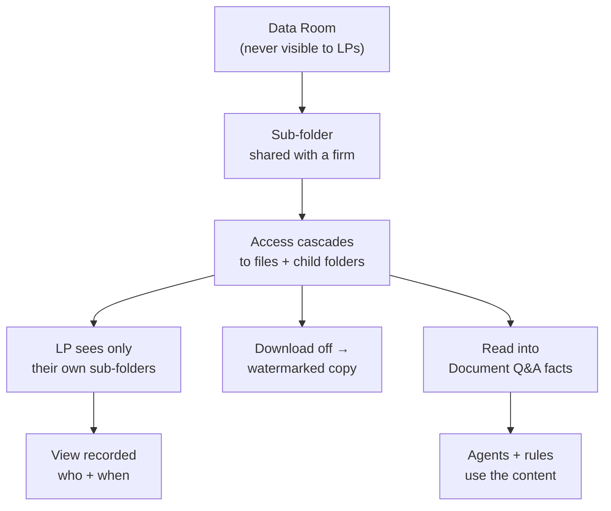

# LinkedIn Article #7 — Data Rooms, Documents, E-Signing (and the agents that read them)

```yaml
series: "Fund Ops, Unstacked #7"
format: LinkedIn Article + short feed teaser post
feature: >
  Data Rooms + document management (folder tree with cascading access inheritance,
  per-document download/print controls with watermarked alternatives, "Viewed By"
  audit trail, secure share links for people with no account, Document Q&A AI
  extraction) + built-in e-signing + E-Sign Monitor Agent. Plus a clearly-labelled
  roadmap section of five data-room agents.
persona: COO / Head of Fund Operations
hook_rationale: >
  Attacks the category on economics AND capability at once: a traditional VDR is
  rented by the page, expires at deal close, and cannot read what's inside it.
  The differentiated claim is that a data room sitting on the same document store
  as the fund's own records can be read by agents that already know what a capital
  account or a side letter is. Avoids naming competitors — contrasts with "renting
  a filing cabinet".
impact_used: >
  Shipped, verified from docs/user_guides/data_rooms_gp_user_guide.md,
  document_management_user_guide.md, agents/esign_monitor_agent_user_guide.md:
  investors never see the Data Room root — only sub-folders explicitly shared with
  them; one "apply to files and sub folders" checkbox cascades access down a whole
  tree; per-document download and print controls, with a watermarked/protected copy
  served instead of the original; every document records who viewed it and when;
  secure view links to people with no account at all; Document Q&A extracts facts as
  question/answer pairs that then power support agents and AI rules; e-signing is
  built in, not bolted on; the E-Sign Monitor sweeps the whole entity daily
  (default 08:00) and flags anything sitting in "requested" beyond a configurable
  window (default 3 days) plus expired/cancelled/voided/failed documents.
  Before/after: a per-project VDR rented by the page that goes dark at close →
  a permanent, permissioned document layer the fund's agents can read.
compliance_note: >
  ⚠️ TWO THINGS TO GET RIGHT:
  1. The five data-room agents in the "What we're building next" section are
     ROADMAP, NOT SHIPPED. They MUST stay under an explicitly forward-looking
     heading with future tense. Never imply they are available today.
  2. The E-Sign Monitor notifies YOUR TEAM. It does not chase signers, and it
     never resends or touches a document — its own email says so. Do not write
     "automatically reminds signers". Also: the guide notes its "Send e-sign
     reminders" toggle currently has no effect — do not reference that toggle at all.
  No competitor named. All folder/document names fictional.
status: draft — ready for review
```

---

## Article title

**You're Renting a Filing Cabinet by the Page. It Can't Read Anything Inside It.**

*The virtual data room is the last piece of fund infrastructure still priced like it's 2009 — and the only one that goes dark the moment the deal closes.*

---

## Article

Ask a fund COO what their data room costs and you'll usually get a pause, then a range.

The pause is the interesting part. Per-page pricing, per-GB overages, per-project licences, per-user seats that renew whether or not anyone logged in this quarter. Very few people can state the number cleanly, which is itself a fact about the category.

But the cost isn't the real problem. This is:

**When the raise closes, the data room goes dark.** The LPA, the DDQ responses, the audited statements, the subscription documents — everything the next three years of LP questions will refer back to — sits in a system your operations team stopped paying attention to the day the fund closed.

And the whole time, the thing holding your most valuable documents could not read a single one of them.

**[STAT BAND]**
| 0 | 1 | ∞ |
|---|---|---|
| documents an LP sees that you didn't explicitly share — they never see the data room root, only their own sub-folders | checkbox to cascade access down an entire folder tree, files included | how long it stays available — it's your document store, not a rented project that expires at close |

### A data room isn't a product. It's a permission model.

Strip away the branding and every VDR does three things: hold files, control who sees which ones, and record who looked.

We didn't build a separate product for that, because we already had the hard part — a folder tree with permissions that flow downward, sitting under the same roof as your funds, investors, commitments and KYC records.

So the data room is a folder. A special one, with rules:

- **Investors never see the root.** They see only the sub-folders you have explicitly shared with them. An LP with access to "Q3 Update" cannot see that "Lead Investor Pack" exists — not "can't open it", *can't see it.*
- **Access cascades.** Grant a firm access to a sub-folder, tick "apply to files and sub folders", and everything beneath it inherits. One decision, one place, no per-file permission grid to maintain and get wrong.
- **Sharing outward doesn't require an account.** A prospect who has never logged in gets a secure view link to a single document — and that link still respects that document's download and print settings.

**[MOCK: data room structure — fictional]**

```
Data Room/
├── Q3 Investor Update/     → shared with all LPs
├── Lead Investor Pack/     → lead investors only
├── DDQ Responses 2026/     → shared per requesting LP
└── New Deal Preview/       → not yet shared with anyone
```

**[KEY POINT #1]**
> *An investor who can see that a folder exists has already learned something you didn't intend to tell them.*

### Control that survives the download

Two features here do more work than their size suggests.

**Download and print are per-document decisions.** Turn them off and the viewer gets a protected, watermarked copy rather than the original file. The document is readable and not portable — which is the actual requirement when you're sharing a term sheet with eleven prospects.

**Every view is recorded.** Each document carries a list of who opened it and when. That's an audit answer, and it's also an intelligence signal: the LP who has opened the LPA four times this week is at a different stage of the decision than the one who never opened it at all.

### Signatures live in the same place as the documents

Subscription documents are the clearest case for why a bolted-on e-sign integration is worse than a built-in one: the document being signed *is* the fund's document, on the investor's record, in the folder the auditor will look in.

So e-signing runs inside the same document store, and a daily agent watches the whole pipeline.

The **E-Sign Monitor** sweeps every document in the entity that was sent for signature and reports two categories: requests sitting unsigned past your configured window (three days by default), and documents that expired, were cancelled, voided, or failed.

Note carefully what it does *not* do. **It never touches a document.** It doesn't resend, re-trigger, or nudge the signer. Its report says so explicitly. It tells your team what's stuck; a human decides what to do about it.

That restraint is deliberate. An agent that automatically re-sends signature requests will, on the day it goes wrong, email a hundred LPs a second copy of a document they already signed. The cost of that mistake is far higher than the cost of a person clicking resend.

**[KEY POINT #2]**
> *For anything that touches an LP's inbox, the safe default is an agent that reports and a human that acts. Automation earns the right to act only where being wrong is cheap.*

## ⚙️ Under the hood: the documents are readable

Here's the capability a rented data room structurally cannot offer, no matter what it charges.

Our documents are read by AI into **Document Q&A** — structured question-and-answer facts extracted from the content. A KYC form becomes queryable fields. A financial statement becomes retrievable figures.

The important part isn't the extraction. It's what consumes it: **those facts power the platform's support agents and AI rules.** The document isn't just stored and searched — it participates. A compliance rule can check a value that only exists inside a PDF. An agent preparing a capital call can verify something the ops team would otherwise have to open a document to confirm.

That's only possible because the data room isn't a separate silo. It's the same document store the rest of the fund runs on, which means anything that can read your documents already knows what a capital commitment, a portfolio company, and an LP are.

A standalone VDR could add AI search tomorrow — and it would still be AI over a folder of PDFs, with no idea which investor, which fund, or which commitment any of them belong to. **Context isn't a feature you add. It's an architecture you either have or don't.**

**[COMPARISON TABLE]**

| | Rented VDR | Data room inside the fund platform |
|---|---|---|
| Pricing | Per page, per GB, per project, per seat | Part of the platform |
| Lifespan | The project. Goes dark at close | Permanent — it's your document store |
| Permissions | Its own model, maintained separately | The platform's own inheritance, one place |
| Knows what a capital commitment is | No | Yes |
| Documents readable by your agents | No | Yes — extracted facts feed agents and rules |
| E-signature | An integration | The same document, same record |
| Audit of who viewed what | Yes | Yes — on the record the auditor already opens |

## 🔭 What we're building next: agents that work the data room

**Everything below is roadmap, not shipped.** It's where this goes, and I'd rather describe it honestly than imply it exists. If one of these would change how your raise runs, tell me — it moves up the list.

**1. Data Room Curator.** Checks each shared folder against the pack it's supposed to be — LP DDQ pack, prospect teaser pack, annual pack — and reports what's missing, what's older than your staleness threshold, and what's duplicated across folders. The question it answers: *is the thing we shared with this LP actually complete?*

**2. DDQ Responder.** An LP sends a 200-question due diligence questionnaire. The agent drafts answers grounded strictly in the documents already in your data room, **citing the source document and page for every answer**, and flagging every question it cannot support rather than composing something plausible. Same rule as our side letter agent: no citation, no answer.

**3. Version Drift Monitor.** Finds superseded documents still sitting in shared folders — last year's LPA, the prior quarter's report, a term sheet that changed after it was shared — and the same document existing in two folders at two versions. This is the error class that causes real damage, and nobody catches it by browsing.

**4. Exposure Check.** Runs before a folder is shared, not after. Scans for content that shouldn't leave: another LP's name or commitment amount in a sample capital account, bank details, personal data in an unredacted attachment. Flags it to a human — never auto-redacts.

**5. Engagement Signals.** Reads the view trail and turns it into a fundraise read: which prospects are actually working through the pack, which document everyone abandons halfway, which LP went quiet three days after opening the LPA. Feeds straight into the relationship record so the follow-up is timed off behaviour rather than a calendar.

**[KEY POINT #3]**
> *The next generation of data room isn't a nicer place to put files. It's a system that has read them, and tells you what's missing before your LP does.*

## 📊 The impact

Before: a per-project VDR priced by the page, holding the documents your LPs will ask about for the next decade, in a system that expires — with a separate permission model your team maintains twice and an e-sign integration that lives somewhere else again.

After: one document store where **access cascades from a single checkbox**, **every view is recorded**, **download and print are per-document decisions**, **signatures happen on the same record**, and **a daily agent reports everything stuck in the signing pipeline**.

The question worth asking internally: **if a prospect asked for your full DDQ pack this afternoon, how long until you could confirm — not assume — that what you shared was complete and current?**

If the answer involves someone opening folders one by one, that's the gap. It's also exactly what roadmap item #1 is for.

## ✅ Takeaways

**1. Price the data room over the fund's life, not the raise.** A per-project VDR looks cheap next to a platform until you count the years after close, when the documents are still being asked about and the room is dark.

**2. Visibility is stronger than permission.** "They can't open it" is a weaker guarantee than "they can't see it exists". Check which one your current tool gives you.

**3. Turn off download by default on anything pre-commitment.** A watermarked view copy is readable and not forwardable. This costs you nothing and closes the most common leak — a helpful prospect sending your deck to a friend.

**4. Treat the view log as a fundraise signal, not just an audit record.** Who opened the LPA, how often, and how recently is the most honest engagement data in your raise — nobody performs interest by re-reading a legal document.

**5. Demand citations from any AI that answers questions about your documents.** A DDQ answer without a source is a liability with good grammar. Applies to every vendor in this space, including us.

———

### 💡 See it on your own structure

If you're paying per page for a room that shuts down at close, the exercise worth doing is simple: list the documents your LPs have asked about in the last twelve months, and check how many are in a system your ops team still opens.

If that list is uncomfortable, DM me and I'll show you what the same folders look like when the fund's own agents can read them.

**Question for fund COOs: what do you actually do with your data room after the fund closes — migrate it, keep paying for it, or export it to a drive and hope? I suspect the third answer is far more common than anyone admits publicly.**

---

## Mermaid diagram



---

## Feed teaser post (paste-ready, ≤3,000 chars)

```
Ask a fund COO what their data room costs and you usually get a pause, then a range.

Per page. Per GB. Per project. Per seat.

But the price isn't the real problem. 👇

𝗪𝗵𝗲𝗻 𝘁𝗵𝗲 𝗿𝗮𝗶𝘀𝗲 𝗰𝗹𝗼𝘀𝗲𝘀, 𝘁𝗵𝗲 𝗱𝗮𝘁𝗮 𝗿𝗼𝗼𝗺 𝗴𝗼𝗲𝘀 𝗱𝗮𝗿𝗸.

The LPA. The DDQ responses. The subscription documents. Everything the next three years of LP questions will refer back to — sitting in a system your ops team stopped opening the day the fund closed.

And the whole time, the thing holding your most valuable documents couldn't read a single one of them.

So we didn't build a separate data room product. We made it a folder in the document store the fund already runs on:

→ 𝗜𝗻𝘃𝗲𝘀𝘁𝗼𝗿𝘀 𝗻𝗲𝘃𝗲𝗿 𝘀𝗲𝗲 𝘁𝗵𝗲 𝗿𝗼𝗼𝘁. Only the sub-folders you explicitly shared. Not "can't open it" — can't see it exists.

→ 𝗔𝗰𝗰𝗲𝘀𝘀 𝗰𝗮𝘀𝗰𝗮𝗱𝗲𝘀. One checkbox pushes a firm's access down a whole tree, files included. No per-file permission grid to maintain and get wrong.

→ 𝗗𝗼𝘄𝗻𝗹𝗼𝗮𝗱 𝗮𝗻𝗱 𝗽𝗿𝗶𝗻𝘁 𝗮𝗿𝗲 𝗽𝗲𝗿-𝗱𝗼𝗰𝘂𝗺𝗲𝗻𝘁. Turn them off and the viewer gets a watermarked copy — readable, not portable.

→ 𝗘𝘃𝗲𝗿𝘆 𝘃𝗶𝗲𝘄 𝗶𝘀 𝗿𝗲𝗰𝗼𝗿𝗱𝗲𝗱. Who opened it, when. An audit answer and a fundraise signal at the same time.

→ 𝗘-𝘀𝗶𝗴𝗻𝗶𝗻𝗴 𝗶𝘀 𝗶𝗻 𝘁𝗵𝗲 𝘀𝗮𝗺𝗲 𝗽𝗹𝗮𝗰𝗲, with a daily agent reporting everything stuck unsigned — and touching nothing itself. It tells your team what's stuck; a human decides. An agent that auto-resends will one day email 100 LPs a second copy of something they already signed.

The part a rented room structurally can't match: our documents get read into structured facts that the platform's agents and rules then use. A standalone VDR could add AI search tomorrow and it would still be AI over a folder of PDFs — with no idea which investor, which fund, or which commitment any of them belong to.

𝗖𝗼𝗻𝘁𝗲𝘅𝘁 𝗶𝘀𝗻'𝘁 𝗮 𝗳𝗲𝗮𝘁𝘂𝗿𝗲 𝘆𝗼𝘂 𝗮𝗱𝗱. 𝗜𝘁'𝘀 𝗮𝗻 𝗮𝗿𝗰𝗵𝗶𝘁𝗲𝗰𝘁𝘂𝗿𝗲 𝘆𝗼𝘂 𝗲𝗶𝘁𝗵𝗲𝗿 𝗵𝗮𝘃𝗲 𝗼𝗿 𝗱𝗼𝗻'𝘁.

• • •

✅ Three things worth doing regardless of what you use:

→ Turn download off by default on anything pre-commitment. A watermarked view costs you nothing and closes the most common leak.
→ Treat the view log as engagement data. Nobody performs interest by re-reading an LPA.
→ Demand a source citation from any AI answering questions about your documents. A DDQ answer without one is a liability with good grammar.

What do you actually do with your data room after the fund closes — migrate, keep paying, or export to a drive and hope?

Full write-up (including the five data-room agents on our roadmap) in the first comment.

#PrivateEquity #FundOperations #DataRoom #DueDiligence #FundTech
```

---

## First comment

```
Full article — including the five data-room agents we're building next (curator, DDQ responder with mandatory citations, version drift, exposure check, engagement signals) and why none of them are allowed to act on a document without a human: [LINK]

Part of Fund Ops, Unstacked. Previous: why your CRM ends at "Committed" and your investor record starts there.
```

---

## Carousel variant (8 slides)

1. **Hook** — Your data room is rented by the page and goes dark at close.
2. **The real cost** — The documents your LPs will ask about for a decade live in a system that expires.
3. **Not a product, a permission model** — Investors never see the root. Only their own sub-folders.
4. **One checkbox** — Access cascades down the whole tree, files included.
5. **Control that survives** — Download off → watermarked copy. Every view recorded.
6. **Signatures in the same place** — Daily agent reports what's stuck. Touches nothing.
7. **The difference** — Our documents are read into facts the fund's agents use. A VDR's AI is AI over a folder of PDFs.
8. **CTA** — After close: migrate, keep paying, or export and hope? / DM for a look.

---

## Assets to produce

1. Diagram: the data room permission + reading flow (Mermaid above → SVG).
2. Screenshot: folder tree with the Data Room and sub-folders, access-rights panel open showing the cascade checkbox.
3. Screenshot: the LP-side view — the Data Rooms dashboard card and one shared sub-folder only.
4. Screenshot: "Viewed By" list on a document, fictional names.
5. Screenshot: E-Sign Monitor report email showing pending + expired sections, with the "no action was taken" line visible.
6. Designed graphic: the five roadmap agents as a 5-card grid, clearly badged "In development".
