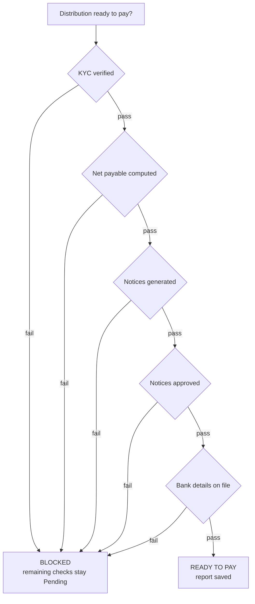

# LinkedIn Article #8 — Distribution Readiness (before the wire leaves)

```yaml
series: "Fund Ops, Unstacked #8"
format: LinkedIn Article + short feed teaser post
feature: Capital distributions + Distribution Readiness Agent (5-check pre-wire gate)
persona: CFO / Head of Fund Finance
hook_rationale: >
  Leads with the two operational events that actually end finance careers —
  paying the wrong amount and paying the wrong account — and positions the
  agent as a gate rather than an automation. The differentiated detail is the
  distinction between "checked and passed" and "never checked", which most
  readiness dashboards blur into one green tick.
impact_used: >
  Verified from docs/user_guides/agents/distribution_readiness_agent_user_guide.md:
  5 independent checks — verified KYC, net payable computed and non-zero, notices
  generated (with a fund-level Distribution Template prerequisite checked once per
  run), notices approved, bank account on file; fail-fast — the agent stops at the
  first failing step and later steps stay "Pending" rather than reporting false
  passes; report finalises as Ready or Blocked; entirely rule-based with zero AI
  calls, works with no AI key configured; on-demand only with no schedule, by
  design; live step-by-step panel when run from the distribution page; a warning
  banner surfaces toggles that were never set, because a silently skipped check
  looks identical to a passed one.
  Before/after: a mental checklist run by whoever is releasing payments →
  a recorded Ready/Blocked report per distribution, with the blocker named.
compliance_note: >
  Never imply the agent moves money, initiates payments, or validates that a bank
  account belongs to the right person — it checks that an account number is on
  file via KYC, nothing more. Do not claim fraud prevention; claim the removal of
  a specific error class. All figures and names fictional.
status: draft — ready for review
```

---

## Article title

**Five Things That Must Be True Before a Distribution Leaves the Building**

*Nobody wires the wrong amount to the wrong account because they were careless. They do it because the checklist was in someone's head, and that someone was on leave.*

---

## Article

Ask a fund CFO what keeps them up and almost none will say "the IRR calculation."

They'll say the wire.

Distributions are the one moment in fund operations where a mistake is immediate, external, and very hard to reverse. The money is gone. The LP has seen an amount that doesn't match their notice. And whatever process produced the error also produced forty-nine other payments that same afternoon.

**[STAT BAND]**
| 5 | 0 | 0 |
|---|---|---|
| independent checks that must pass before a distribution is marked ready to pay | AI calls involved — every check is a deterministic comparison against your own records | scheduled runs. This one is on-demand only, deliberately: you run it when you're about to pay |

### The checklist exists. It just isn't written down.

Every fund has a release process. Ask three people on the same team to state it and you'll get three overlapping lists — accurate in outline, different in detail, and dependent on who happens to be doing it that day.

That's not sloppiness. It's what an undocumented process looks like when it lives in experienced people. It works right up until the quarter your controller is on leave, the distribution is larger than usual, and one investor's KYC lapsed three weeks ago.

So we wrote the checklist down and made it executable.

### The five checks

Run against **every payment** on a single distribution:

**1. KYC is verified.** Every paying investor must have a KYC record, and it must be marked verified. Not present — *verified*.

**2. The net payable is actually computed.** The amount must exist and be non-zero. A zero payable is almost never a real instruction to pay nothing; it's almost always a calculation that didn't run.

**3. Notices have been generated.** First a fund-level check — does this fund even have a Distribution Template uploaded? If not, that single fact blocks the entire distribution, with the fix stated plainly. Then, per payment: does a generated notice document actually exist?

**4. Notices are approved.** Generated isn't approved. Anything still sitting in pending approval blocks the release.

**5. Bank details are on file.** Every paying investor must have a bank account number recorded on their KYC.

Only if all five pass does the distribution get marked ready to pay. Otherwise the report finalises as **Blocked**, naming what stopped it.

**[MOCK: readiness report — fictional data]**

| Check | Result | Detail |
|---|---|---|
| KYC verified | ✅ Passed | 48 of 48 payments |
| Net payable computed | ✅ Passed | 48 of 48 payments |
| Notices generated | ⛔ **Blocked** | 3 payments have no generated notice |
| Notices approved | ⏸ Pending | not run — blocked upstream |
| Bank details on file | ⏸ Pending | not run — blocked upstream |

**Status: BLOCKED** — 3 payments require notice generation before release.

**[KEY POINT #1]**
> *"We always check that" is not a control. A control is something that produces a record when it passes and stops the process when it doesn't.*

## ⚙️ Under the hood: pending is not passed

Look at that mock report again. Checks 4 and 5 say **Pending**, not passed and not failed.

That's the design decision I'd most want to defend, because the alternative is so tempting.

The agent **stops at the first failing check.** It doesn't carry on to evaluate the rest. So when notice generation fails, the approval and bank-detail checks genuinely have not run — and the report says exactly that, instead of showing a hopeful green tick or an alarming red cross that nobody verified.

Why does this matter? Because a readiness report is read in thirty seconds by someone under time pressure who wants to release payments. If that report ever shows something as passed that wasn't actually evaluated, it has done worse than nothing: it has manufactured false confidence at the exact moment confidence should be earned.

The same principle drove a smaller feature that took a surprising amount of argument.

**Each of the five checks can be turned off.** Reasonable — not every fund needs every gate. But a check that has been turned off, or was never explicitly configured, produces no failure. **And a silently skipped check looks exactly like a passed one.**

So the agent's page carries a warning banner that names every toggle that has never been given a value, and flags the case where *all* checks are off — a configuration that would cheerfully mark every distribution "ready to pay" while verifying nothing at all. An explicit "No" is respected and not flagged: deciding not to check something is legitimate; not knowing whether you're checking it is not.

**[KEY POINT #2]**
> *A check you turned off and a check that silently never ran produce the same green screen. Only one of them was a decision.*

### No AI anywhere near it

Worth stating plainly, because in 2026 the assumption runs the other way: **this agent makes no AI calls.** It works with no AI key configured at all.

Every one of the five checks is a deterministic comparison against records you already own. Is this KYC verified — yes or no. Does this amount exist and is it non-zero — yes or no.

There is no judgment to exercise here, and therefore nothing for a model to add. Introducing one would trade a guarantee for a probability, immediately before moving money. We use AI heavily elsewhere in the platform, on problems where reading and summarising are the work. This is not one of them.

### And it doesn't run on a schedule

There's no Schedule tab. That's deliberate too.

A readiness check that ran nightly would tell you a distribution was ready at 3am, based on the data as it stood at 3am. Then someone edits a payment at 10am and releases at noon, reassured by a green tick that describes a state of the world that no longer exists.

So it runs when you run it — from the distribution's own page, with a live step-by-step panel showing each check completing. **The check is part of the release, not a background reassurance.**

**[COMPARISON TABLE]**

| | Undocumented release process | Executable pre-wire gate |
|---|---|---|
| Where the checklist lives | In experienced people | In the system, same every time |
| Consistency when someone's away | Depends who's covering | Identical |
| Evidence it happened | None | A saved Ready/Blocked report per distribution |
| What "not checked" looks like | Same as checked | Explicitly "Pending" |
| Time to run | Varies | Seconds, on the distribution page |

## 📊 The impact

Before: a release process that lives in the team's heads, applied a bit differently by whoever runs it, with no artifact left behind proving it was applied at all.

After: **five deterministic checks**, run in seconds against every payment on the distribution, producing a **saved Ready or Blocked report** that names the blocker — and that never reports a check as passed when it didn't run.

The error class removed is specific and worth naming: **payments released against unverified KYC, uncomputed amounts, unapproved notices, or missing bank details.** Not "fewer errors" — those four, gone, or the release stops.

## ✅ Takeaways

**1. Write your release checklist down this week.** Whether or not you automate it. The exercise of getting three people to agree on the list is where most of the value is.

**2. Distinguish "checked" from "not checked" everywhere in your reporting.** A dashboard that shows green for both is worse than one with a gap in it.

**3. Zero is a red flag, not a value.** A zero payable, a zero fee, a zero allocation — treat each as "the calculation didn't run" until proven otherwise.

**4. Generated is not approved.** The most common near-miss we see isn't a missing document. It's a document that exists, looks finished, and never went through approval.

**5. Keep AI out of the release gate.** Use it to read documents, draft narrative, and summarise. Don't use it where a deterministic comparison is available and money is about to move.

———

### 💡 See it on your own structure

If you run distributions quarterly, the useful test is to take last quarter's and ask: *what evidence exists that each of these five things was true before we paid?*

If the answer is "we'd have noticed", DM me — I'll show you what the recorded version looks like.

**Question for fund CFOs and controllers: what's on your pre-wire checklist that isn't on my list of five? Genuinely asking — I'd like to know what we're missing, and so would everyone else reading this.**

---

## Mermaid diagram



---

## Feed teaser post (paste-ready, ≤3,000 chars)

```
Ask a fund CFO what keeps them up at night.

Almost none of them will say "the IRR calculation."

They'll say the wire. 👇

Distributions are the one moment in fund operations where a mistake is immediate, external, and very hard to reverse. The money is gone. The LP has seen an amount that doesn't match their notice. And whatever produced that error also produced 49 other payments the same afternoon.

Every fund has a release process. Ask three people on the same team to state it and you get three overlapping lists — accurate in outline, different in detail, dependent on who's doing it that day.

That's not sloppiness. That's what an undocumented process looks like when it lives in experienced people.

So we made the checklist executable. Five checks, against every payment on the distribution:

𝟭. KYC exists and is 𝘷𝘦𝘳𝘪𝘧𝘪𝘦𝘥 — not just present
𝟮. Net payable is computed and non-zero
𝟯. Notices have actually been generated
𝟰. Those notices are 𝘢𝘱𝘱𝘳𝘰𝘷𝘦𝘥 — generated isn't approved
𝟱. A bank account is on file

All five pass, or the distribution is marked BLOCKED with the blocker named.

Two design decisions I'd defend harder than the feature itself:

→ 𝗧𝗵𝗲 𝗮𝗴𝗲𝗻𝘁 𝘀𝘁𝗼𝗽𝘀 𝗮𝘁 𝘁𝗵𝗲 𝗳𝗶𝗿𝘀𝘁 𝗳𝗮𝗶𝗹𝘂𝗿𝗲. Later checks report "Pending" — not passed, not failed. Because a readiness report is read in 30 seconds by someone under time pressure, and if it ever shows something green that wasn't evaluated, it has manufactured false confidence at the exact moment confidence should be earned.

→ 𝗡𝗼 𝗔𝗜 𝗮𝗻𝘆𝘄𝗵𝗲𝗿𝗲 𝗻𝗲𝗮𝗿 𝗶𝘁. Zero model calls. Every check is a deterministic yes/no against records you already own. There's no judgment to exercise here, so there's nothing for a model to add — and trading a guarantee for a probability immediately before moving money is a bad trade.

• • •

✅ Worth doing whatever software you run:

→ Write the release checklist down. Getting three people to agree on it is where most of the value is.
→ Treat zero as "the calculation didn't run", not as a value.
→ Distinguish "checked" from "not checked" in every dashboard you build. Green for both is worse than a visible gap.

What's on your pre-wire checklist that isn't on my list of five? Genuinely asking.

Full write-up in the first comment.

#PrivateEquity #FundFinance #FundOperations #CFO #Distributions
```

---

## First comment

```
Full article — including why this one deliberately has no schedule, and the warning banner we built because a silently skipped check looks exactly like a passed one: [LINK]

Part of Fund Ops, Unstacked. Previous: why your data room goes dark the day the fund closes.
```

---

## Carousel variant (7 slides)

1. **Hook** — It isn't the IRR that keeps a fund CFO up. It's the wire.
2. **The real problem** — Ask three people for the release checklist. Three different lists.
3. **The five checks** — Verified KYC · computed payable · notices generated · notices approved · bank details.
4. **Blocked, with a reason** — All five pass or the distribution doesn't release.
5. **Pending ≠ passed** — Stops at the first failure. Later checks say "not run", not green.
6. **No AI in the gate** — Deterministic comparisons only. Don't trade a guarantee for a probability before moving money.
7. **CTA** — What evidence exists that these five were true before last quarter's wire? / DM for a look.

---

## Assets to produce

1. Diagram: the fail-fast gate (Mermaid above → SVG).
2. Screenshot: the live step-by-step readiness panel on a distribution page, mid-run.
3. Screenshot: a Blocked report with the "Pending" rows visible below the blocker.
4. Screenshot: the yellow setup-warning banner listing never-set toggles.
