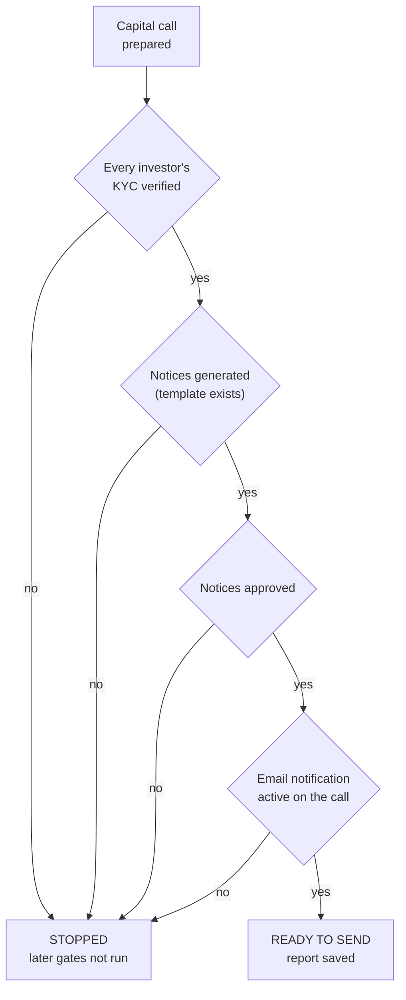

# LinkedIn Article #9 — The Call Notice Agent (pre-flight before notices go out)

```yaml
series: "Fund Ops, Unstacked #9"
format: LinkedIn Article + short feed teaser post
feature: Capital call lifecycle + Call Notice Agent (fixed, non-configurable pre-send checklist)
persona: CFO / Head of Fund Finance
hook_rationale: >
  The pain is reputational rather than financial — a retracted capital call notice
  is remembered by every LP who received it. The differentiated design claim is
  the opposite of the usual enterprise-software boast: this checklist has NO
  configuration at all. Nothing to toggle, reorder, or weaken. That's a deliberate
  stance and it makes a better argument than a feature list.
impact_used: >
  Verified from docs/user_guides/agents/call_notice_agent_user_guide.md:
  runs against exactly one capital call; the checklist is fixed with no settings
  form whatsoever; four gates in strict order — verified investor KYC, call notice
  documents generated (preceded by a fund-level Call Notice template check, and
  respecting commitments explicitly flagged to skip document generation), documents
  approved, and an active email notification configured on the call — each gating
  the next, then a final confirm-ready step and a saved report; six live step
  indicators with a progress bar on the capital call's own page; zero AI/LLM calls;
  a warning banner names every fund missing a Call Notice template, which matters
  because batch runs don't walk the step panel.
  Before/after: a mental pre-send check → a recorded pass/stop report per call.
compliance_note: >
  Do not claim the agent sends notices, schedules them, or prevents fraud. It
  checks and reports; a human sends. Do not state a "retraction rate" or any
  statistic about how often funds retract notices — no such figure is sourced.
  All fund/investor names fictional.
status: draft — ready for review
```

---

## Article title

**The Most Expensive Email Your Fund Sends**

*A capital call notice is a legal instruction to move money, sent to everyone who trusts you with theirs. We gave it a pre-flight checklist — and refused to let anyone configure it.*

---

## Article

There is a particular silence that follows the discovery that a capital call notice went out wrong.

Not catastrophic. Usually the amount is right and something else is wrong — an investor whose KYC lapsed, a notice that was generated but never approved, a call where the notification was drafted and never switched on, so a third of the LPs got nothing at all.

Then comes the follow-up email. The one that begins *"Please disregard our previous notice."*

Nobody gets fired for it. It just quietly costs you something you can't measure: for a few weeks, every LP who received it treats your next communication with slightly more scepticism.

**[STAT BAND]**
| 1 | 4 | 0 |
|---|---|---|
| capital call at a time — this agent is never run in bulk against a fund's history | gates, in fixed order, each one stopping the checklist if it fails | settings. No toggles, no reordering, nothing to switch off |

### Capital calls are a sequence, and the notice is near the end

A call runs roughly like this: decide the amount, work out each investor's share, generate their notices, approve them, send, then record the money as it arrives and confirm receipt.

Most of the risk sits in a narrow window — the moment between *the notices exist* and *the notices have gone out*. Everything before that is internal and fixable. Everything after is in your LPs' inboxes.

So the agent lives exactly there, on the capital call's own page, and answers one question: **is this call actually ready to send?**

### The four gates

**1. Every investor's KYC is verified.** Not present — verified. If one investor fails, the checklist stops. It does not carry on and tell you about the documents.

**2. The notices have been generated.** First a fund-level check: does this fund have a Call Notice template at all? If not, that single missing file blocks the whole call immediately, which is the correct outcome — no template means no notices for anyone. Then, per investor, do the generated documents actually exist? Commitments you've deliberately flagged to skip document generation are excluded, so an intentional exception isn't reported as a failure.

**3. Those notices are approved.** Generated and approved are different states, and the gap between them is where most near-misses live. A document can exist, look complete, and have never been reviewed by anyone.

**4. An active email notification is configured on the call.** This is the gate that surprises people, and it catches the failure that hurts most: everything is perfect, the notices are beautiful, and the delivery was never switched on. You find out from an LP asking why they haven't received their call — after the deadline has started running.

Only then does the agent confirm the call as ready to send and save its report.

**[KEY POINT #1]**
> *The most damaging failure in a capital call isn't a wrong number. It's a correct notice that never left the building.*

## ⚙️ Under the hood: the checklist you can't configure

Here's the part I expect pushback on, and would defend anyway.

**This agent has no settings form.** Not "sensible defaults you can change." Nothing. You cannot turn a check off, reorder them, or make one advisory. Setting the agent up makes it available; it doesn't give you anything to tune.

That runs against everything enterprise software is supposed to do. Configurability is how vendors avoid arguments — ship the toggle, let the customer decide, and nobody has to defend a position.

We took the position instead, for a specific reason: **every one of these four checks describes something that is unambiguously wrong.**

There is no fund, anywhere, in any jurisdiction, that wants to send a capital call notice to an investor with unverified KYC. Or send a notice nobody approved. Or run a call whose notification is switched off. These aren't preferences that vary by house style — they're the definition of the call not being ready.

A toggle here wouldn't be flexibility. It would be an invitation, on a bad Friday, to make the red thing green.

Compare this with our distribution readiness gate, where the checks *are* individually switchable. That difference is deliberate: distributions vary genuinely between funds — some don't issue notices at all — so switching a check off can be a legitimate description of how that fund works. Here, it can't be. Same engineering, different rigidity, because the underlying risk is a different shape.

**[KEY POINT #2]**
> *A configurable control is a control someone will eventually configure away — usually at the exact moment it was about to be useful.*

### Stops at the first failure, and says so

Same principle as the distribution gate: the checklist **stops** at the first thing that fails. The remaining checks don't run and don't pretend to.

If KYC fails, you're not told about documents — because the documents genuinely weren't examined. A report that guessed at the rest would be more comfortable and less true.

Running it from the capital call's page gives you six live step indicators and a progress bar, updating as each gate clears. Watching it move is oddly reassuring in a way a final green tick isn't: you see the order, you see where it stopped, you know what to fix first.

### And zero AI

No model calls anywhere in this agent. It needs no AI key.

Every gate is a yes/no comparison against records you already own. Is this KYC verified. Does this document exist. Is this notification active. There's no reading, no judgment, no summarising — so there is nothing an AI could contribute except uncertainty, immediately before a legally significant email goes to every LP in the fund.

**[COMPARISON TABLE]**

| | The mental pre-send check | The fixed pre-flight gate |
|---|---|---|
| Applied | When someone remembers | Every call, same order |
| Who can weaken it | Anyone in a hurry | Nobody — there's no toggle |
| Notification setup checked | Rarely, until it bites | Explicitly, as gate 4 |
| Evidence afterwards | None | Saved report per call |
| Fund missing a template | Discovered at send | Named in a warning banner beforehand |

### The warning banner nobody asked for

One more detail worth stealing regardless of what software you run.

The agent's page permanently lists **every fund in your entity with no Call Notice template uploaded.**

Not as an error at send time. As a standing statement of a latent problem, visible before anyone starts preparing a call. It's the difference between discovering the missing template on the afternoon you planned to issue the call and knowing about it three weeks earlier when it costs nothing to fix.

Most operational pain in fund administration is like this: not a hard problem, just a problem discovered at the worst possible moment.

## 📊 The impact

Before: a pre-send check that depends on who's preparing the call, with no artifact proving it happened, and a notification setting nobody looks at until an LP complains.

After: **four gates in fixed order**, run from the call's own page with live progress, producing a **saved report** that names exactly where it stopped — plus a **standing list of funds missing a call notice template**, surfaced weeks before anyone needs one.

The error class removed: **notices sent to unverified investors, unapproved notices sent, and calls issued with delivery switched off.** The retraction email that follows any of those is the cost being avoided, and it's paid in credibility rather than currency — which is why it never shows up in an ROI model.

## ✅ Takeaways

**1. Check delivery, not just content.** The notice being correct and the notice being sent are two different facts, and most checklists only verify the first.

**2. Some controls should not be configurable.** If a check describes something unambiguously wrong, a toggle only creates the option to ignore it under pressure. Decide which of your controls are in that category.

**3. Stop at the first failure and say what you didn't check.** Reporting unexamined steps as passed is how a checklist becomes decorative.

**4. Surface latent blockers early and permanently.** A missing template is trivial three weeks out and expensive on the day. Put it on a screen someone sees regularly.

**5. Keep judgment-free checks judgment-free.** Deterministic yes/no comparisons don't need a model, and adding one only widens the range of possible outcomes right before a legally significant send.

———

### 💡 See it on your own structure

If you issue calls quarterly, try this on the last one: can you produce evidence — not recollection — that every investor's KYC was verified and every notice approved before it went out?

If not, DM me and I'll show you what the recorded version looks like on a call of your own shape.

**Question for fund finance teams: has your firm ever sent a "please disregard our previous notice" email? I'd bet the honest answer across this industry is closer to "everyone" than anyone lets on — and I'm curious what caused yours.**

---

## Mermaid diagram



---

## Feed teaser post (paste-ready, ≤3,000 chars)

```
There's a particular silence that follows the discovery that a capital call notice went out wrong.

Then comes the follow-up email. The one that starts:

"Please disregard our previous notice." 👇

Usually the amount was right. Something else was wrong — an investor whose KYC had lapsed, a notice generated but never approved, or a call where the email notification was drafted and never switched on, so a third of the LPs received nothing at all.

Nobody gets fired for it. It just quietly costs you something you can't measure: for a few weeks, every LP who got it reads your next communication with slightly more scepticism.

So we built a pre-flight checklist that runs on the capital call's own page. Four gates, in fixed order, each stopping the checklist if it fails:

𝟭. Every investor's KYC is 𝘷𝘦𝘳𝘪𝘧𝘪𝘦𝘥 — not merely present
𝟮. Notices are generated (and the fund actually has a call notice template)
𝟯. Those notices are 𝘢𝘱𝘱𝘳𝘰𝘷𝘦𝘥 — generated and approved are different states
𝟰. An active email notification is configured on the call

That fourth one catches the failure that hurts most. Everything perfect, notices beautiful, delivery never switched on. You find out when an LP asks why they haven't received their call — after the deadline has started running.

𝗧𝗵𝗲 𝗺𝗼𝘀𝘁 𝗱𝗮𝗺𝗮𝗴𝗶𝗻𝗴 𝗳𝗮𝗶𝗹𝘂𝗿𝗲 𝗶𝗻 𝗮 𝗰𝗮𝗽𝗶𝘁𝗮𝗹 𝗰𝗮𝗹𝗹 𝗶𝘀𝗻'𝘁 𝗮 𝘄𝗿𝗼𝗻𝗴 𝗻𝘂𝗺𝗯𝗲𝗿. 𝗜𝘁'𝘀 𝗮 𝗰𝗼𝗿𝗿𝗲𝗰𝘁 𝗻𝗼𝘁𝗶𝗰𝗲 𝘁𝗵𝗮𝘁 𝗻𝗲𝘃𝗲𝗿 𝗹𝗲𝗳𝘁 𝘁𝗵𝗲 𝗯𝘂𝗶𝗹𝗱𝗶𝗻𝗴.

Now the part I expect pushback on:

𝗧𝗵𝗶𝘀 𝗰𝗵𝗲𝗰𝗸𝗹𝗶𝘀𝘁 𝗵𝗮𝘀 𝗻𝗼 𝘀𝗲𝘁𝘁𝗶𝗻𝗴𝘀. No toggles, no reordering, nothing to switch off.

That runs against everything enterprise software is supposed to do. Configurability is how vendors avoid arguments.

We took the position instead: every one of those four checks describes something unambiguously wrong. No fund anywhere wants to send a call notice to an unverified investor, or send a notice nobody approved. That isn't house style — it's the definition of not being ready.

A toggle there wouldn't be flexibility. It'd be an invitation, on a bad Friday, to make the red thing green.

• • •

✅ Worth applying anywhere:

→ Check delivery, not just content. "Correct" and "sent" are two different facts.
→ Decide which of your controls should NOT be configurable.
→ Surface latent blockers early. A missing template is trivial three weeks out and expensive on the day.

Has your firm ever sent a "please disregard" email? I suspect the honest answer here is closer to "everyone" than anyone admits.

Full write-up in the first comment.

#PrivateEquity #FundFinance #CapitalCalls #FundOperations #CFO
```

---

## First comment

```
Full article — including why the distribution equivalent of this agent DOES have configurable checks, and this one deliberately doesn't: [LINK]

Part of Fund Ops, Unstacked. Previous: the five things that must be true before a distribution leaves the building.
```

---

## Carousel variant (7 slides)

1. **Hook** — "Please disregard our previous notice." The most expensive email your fund sends.
2. **Where the risk sits** — Between "the notices exist" and "the notices have gone out."
3. **Four gates** — Verified KYC · generated · approved · notification active.
4. **Gate 4 is the one** — Everything perfect, delivery never switched on. You hear it from an LP.
5. **No settings** — You can't toggle these off. A configurable control gets configured away.
6. **Stops at the first failure** — Later gates report "not run", never a hopeful green.
7. **CTA** — Can you evidence — not recall — that last quarter's call cleared all four? / DM for a look.

---

## Assets to produce

1. Diagram: the four-gate flow (Mermaid above → SVG).
2. Screenshot: the live readiness panel on a capital call page, six step indicators mid-run.
3. Screenshot: a stopped report showing the failed gate and the un-run steps below it.
4. Screenshot: the standing warning banner listing funds with no Call Notice template.
