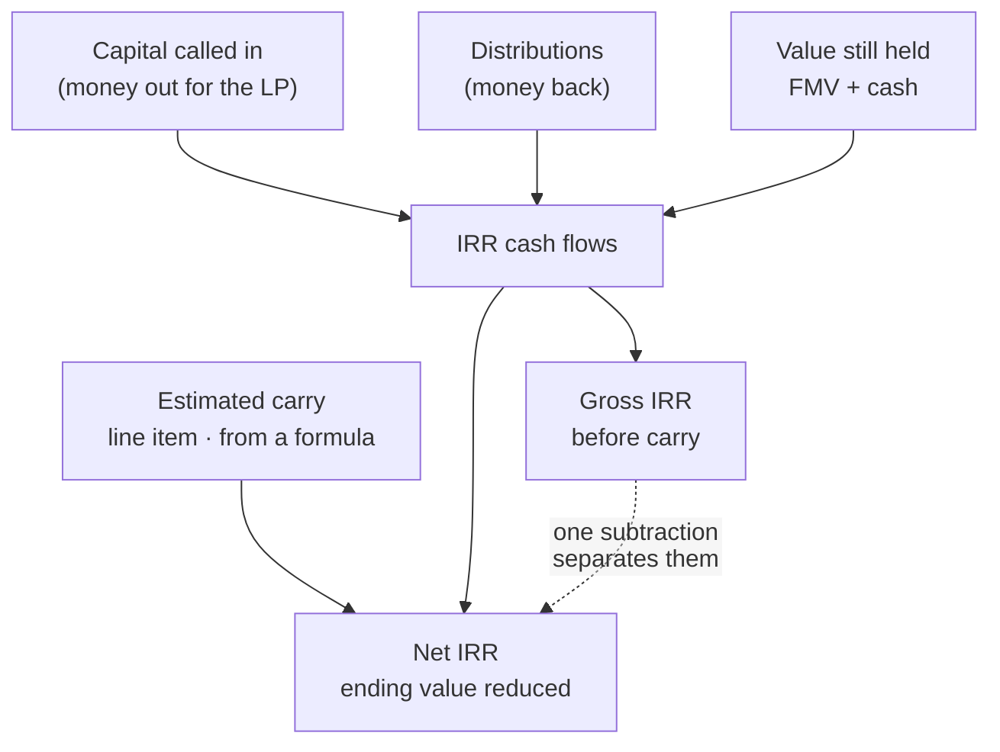

# LinkedIn Article #10 — Carry, Net IRR, and the number that doesn't compute anything

```yaml
series: "Fund Ops, Unstacked #10"
format: LinkedIn Article + short feed teaser post
feature: Carry computations + fund ratios + ratio formulas + ratio run templates
persona: CFO / Head of Fund Finance
hook_rationale: >
  Opens on a genuinely counterintuitive fact from our own model — the carry
  percentage recorded against a unit class does not deduct carry from any
  calculation; it is reference data for reports. Carry enters performance
  through exactly one explicit, inspectable line item. That is a real design
  argument (explicit over implicit) and it beats "we calculate your ratios".
impact_used: >
  Verified from docs/user_guides/carry_computations_user_guide.md,
  fund_ratios_user_guide.md, ratio_formulas_user_guide.md,
  fund_ratio_run_templates_user_guide.md:
  8 headline metrics (Gross IRR, Net IRR, DPI, RVPI, TVPI, MOIC, PIC, Gross
  Portfolio IRR); carry affects performance through ONE mechanism — the Estimated
  Carry line item, subtracted from value still held when computing Net IRR;
  the Carry % on a unit class is reference information for reports and deducts
  nothing by itself; Estimated Carry is normally produced by a fund formula
  derived from current FMV, distributions to date, any hurdle rate and the carry
  rate; ratio formulas let a fund fold in amounts the standard calculation
  doesn't capture (fee rebates, side-pocket investments, expenses that should
  reduce the return); ratio run templates save a filter set and re-run it for any
  date — individually, all at once, or grouped by tag; metrics exist at both fund
  and investor level, and an investor's DPI or XIRR legitimately differs from the
  fund's because they were called and distributed on a different schedule.
  Worked illustration (fictional, from the guide): paid-in 40, distributions 10,
  remaining value 62, total value 72, profit 32, carry at 20% = 6.4, so Net IRR
  runs off 55.6 instead of 62.
compliance_note: >
  ⚠️ HIGHEST-RISK POST IN THE SERIES. All figures are fictional illustration and
  must be labelled as such in the artwork. Never present any number as an actual
  return, achieved or expected. Never imply CapHive produces or improves returns.
  Do not state that carry is deducted from distributions — it is not; it enters
  the Net IRR calculation via the Estimated Carry line item. Do not imply the
  platform validates a fund's waterfall or replaces the LPA — it computes what
  you configure.
status: draft — ready for legal/compliance review before publication
```

---

## Article title

**The 20% in Your LPA Doesn't Compute Anything**

*In our system, the carry percentage recorded against a unit class deducts precisely nothing. That's not an oversight — it's the whole design.*

---

## Article

Here's a sentence that has caused more than one confused support conversation, and that I've come to think is the most defensible decision in our performance engine:

**The carry percentage stored against a fund's unit class does not deduct carry from any calculation.** It's reference information, shown on reports.

The natural reaction is that something must be broken. Twenty percent is right there in the settings. Surely the Net IRR uses it?

It doesn't. Carry reaches performance through exactly one route: an explicit **Estimated Carry** line item, which is subtracted from the value still held when Net IRR is computed. No line item, no deduction — no matter what the settings say.

That's the argument I want to make: **implicit multipliers are how performance numbers become undefendable.**

**[STAT BAND]**
| 8 | 1 | 2 |
|---|---|---|
| headline metrics — Gross IRR, Net IRR, DPI, RVPI, TVPI, MOIC, PIC, Gross Portfolio IRR | mechanism by which carry enters performance: one explicit line item you can open and read | levels every metric exists at — the fund's, and each investor's, and they legitimately differ |

### Why an implicit rate is worse than an explicit line

Imagine carry were applied automatically wherever a rate was configured. Convenient. And then an LP asks the question every LP eventually asks:

*"Walk me through how you got to that net number."*

With an implicit multiplier, the honest answer is "the system applied the rate." Which invites the immediate follow-up — *applied to what, exactly?* — and now you're reconstructing, from the outside, a calculation that happened inside a black box, months ago, under settings that may since have changed.

With an explicit line item there's a record: an amount, on a date, produced by a named formula, sitting in the ledger where anyone can open it.

The Estimated Carry line is normally produced by a **fund formula** rather than typed in — derived from current fair market value, distributions to date, any hurdle, and the carry rate from unit settings. So the rate *does* participate. It participates through a formula that writes down its answer, instead of silently modifying a result at read time.

**[KEY POINT #1]**
> *A number you can point at survives diligence. A number the system "just applies" has to be re-derived by hand every time someone asks.*

### What actually separates Gross from Net

The mechanics are simpler than the mystique around them.

Both IRRs run off the same cash flows: capital called in, distributions out, and the value still held at the end. **Net IRR differs in exactly one input** — the estimated carry is subtracted from that ending value.

**[MOCK: worked illustration — entirely fictional]**

| | Amount |
|---|---|
| Paid in by investors | 40.0 |
| Distributions to date | 10.0 |
| Value still held (FMV + cash) | 62.0 |
| **Total value** | **72.0** |
| Profit above paid-in | 32.0 |
| Estimated carry at 20% | **6.4** |
| Ending value for **Gross** IRR | 62.0 |
| Ending value for **Net** IRR | **55.6** |

*Illustrative figures only. Not a fund, not a return, not a projection.*

One subtraction. That's the entire difference between the number you show in a pitch and the number an LP actually experiences.

And note what didn't happen: **no carry was deducted from any distribution.** The distributions are what they are. Carry is a claim on future profit, estimated at a point in time for the purpose of stating a net return — not a cash movement.

**[KEY POINT #2]**
> *Gross IRR is what the fund produced. Net IRR is what the investor keeps. Only one of them is a promise, and it isn't the first one.*

## ⚙️ Under the hood: your economics don't fit the standard formula, and that's normal

Every performance engine ships with a standard recipe: called capital, distributions, fair market value, cash, net current assets. It's correct for the median fund and wrong for a great many real ones.

Because real funds have particulars. A fee rebate negotiated with an anchor LP. A side-pocket investment that shouldn't sit in the main calculation. An expense that genuinely should reduce the return but isn't in the standard ingredient list.

The usual industry answer is a spreadsheet: export the platform's number, adjust it by hand, publish the adjusted one. Which means the number in your investor report is not the number in your system — and reconciling them is somebody's quarterly chore.

**Ratio formulas** exist for this. They let a ratio fold in additional amounts you've recorded against the fund, so the metric reflects your actual economics rather than a one-size-fits-all recipe. The adjustment lives in the system, is applied consistently, and produces the same answer for everyone who asks.

That's the point. Not that the calculation is customisable — that **the customisation is inside the system rather than in a workbook on someone's laptop.**

### Then make it repeatable

The second half of the problem is nobody's favourite topic: re-running.

Performance isn't computed once. It's computed at quarter-end, then again after a late valuation lands, then again for the annual report, then again for an LP who wants the number as at a date nobody else asked for. Each re-run means reassembling the same filters — funds, date, scope — and each reassembly is a chance to do it slightly differently.

**Ratio run templates** save the parameter set once and re-run it for any date in a click. Individually, all at once, or grouped by tag. Same inputs, different date, no reconstruction.

**[COMPARISON TABLE]**

| | Export-and-adjust | Configured in the system |
|---|---|---|
| Where fund-specific economics live | A workbook | A ratio formula |
| Who can reproduce the number | The person with the workbook | Anyone with access |
| Re-running for a new date | Rebuild the filters | Re-run a saved template |
| What carry does | Applied by hand, or implied | An explicit line item in the ledger |
| Answer to "walk me through this" | Reconstruction | Open the line item |

### One more thing that confuses LPs — and shouldn't

Metrics exist at two levels: the fund's, and each investor's.

They differ. Routinely and legitimately. An investor's DPI or XIRR isn't the fund's, because that investor joined at a different time and was called and distributed on a different schedule. Two LPs in the same fund can hold different XIRRs without anything being wrong.

Some metrics — MOIC, Gross Portfolio IRR — only exist at the fund level, because they describe the portfolio rather than any one investor's experience of it.

Being able to state this clearly, with both numbers visible, ends a conversation that otherwise recurs every reporting cycle.

## 📊 The impact

Before: a standard calculation that doesn't quite fit the fund, adjusted in a workbook, re-derived by hand whenever someone asks how carry was applied — with the report number and the system number quietly diverging.

After: **carry enters through one explicit, inspectable line item**; fund-specific economics live in **ratio formulas inside the system**; and any date's numbers are reproduced by **re-running a saved template** rather than rebuilding filters.

The measurable thing isn't speed. It's this: **how long does it take you to answer "walk me through this net number" — and does the answer depend on one person being available?**

## ✅ Takeaways

**1. Prefer explicit line items to implicit rates.** Anywhere a percentage silently modifies an output, you've created a number that must be re-derived to be defended.

**2. Know which of your reported figures are estimates.** Estimated carry is an estimate at a point in time. Presenting it with the same confidence as a realised distribution invites a correction you'll have to explain.

**3. Get your fund-specific adjustments out of spreadsheets.** Not because spreadsheets are bad — because the adjustment needs to be applied identically by someone who isn't you.

**4. Save the parameter set, not just the result.** Most reconciliation pain is two people running "the same" calculation with subtly different filters.

**5. Publish fund-level and investor-level metrics side by side.** Their divergence is legitimate and explainable. Left unexplained, it reads as an error to the person receiving it.

———

### 💡 See it on your own structure

The test I'd run: take your last reported Net IRR and try to trace the carry deduction to a specific, dated amount in your system. Not to a percentage in a settings screen — to an amount.

If the trail runs into a spreadsheet, DM me and I'll show you what it looks like when it doesn't.

**Question for fund finance teams: what does your standard ratio calculation fail to capture about your fund's economics — the fee rebate, the side pocket, the expense that should reduce the return? I'd like to know which of these is most common, because I suspect nobody's edge case is as unique as they think.**

---

## Mermaid diagram



---

## Feed teaser post (paste-ready, ≤3,000 chars)

```
The carry percentage stored against a fund's unit class deducts precisely nothing.

That surprises people. It's 20%, it's right there in the settings — surely the Net IRR uses it?

It doesn't. And that's the design. 👇

Carry reaches performance through exactly one route: an explicit "Estimated Carry" line item, subtracted from the value still held when Net IRR is computed.

No line item, no deduction — whatever the settings say.

Here's why we'd defend that over the convenient version:

Imagine carry were applied automatically wherever a rate was configured. Then an LP asks the question every LP eventually asks — 𝘸𝘢𝘭𝘬 𝘮𝘦 𝘵𝘩𝘳𝘰𝘶𝘨𝘩 𝘩𝘰𝘸 𝘺𝘰𝘶 𝘨𝘰𝘵 𝘵𝘰 𝘵𝘩𝘢𝘵 𝘯𝘦𝘵 𝘯𝘶𝘮𝘣𝘦𝘳.

With an implicit multiplier, the honest answer is "the system applied the rate." Which invites: applied to what, exactly? And now you're reconstructing, from outside, a calculation that happened in a black box under settings that may since have changed.

With an explicit line item, there's a record. An amount, on a date, produced by a named formula, sitting in the ledger where anyone can open it.

𝗔 𝗻𝘂𝗺𝗯𝗲𝗿 𝘆𝗼𝘂 𝗰𝗮𝗻 𝗽𝗼𝗶𝗻𝘁 𝗮𝘁 𝘀𝘂𝗿𝘃𝗶𝘃𝗲𝘀 𝗱𝗶𝗹𝗶𝗴𝗲𝗻𝗰𝗲. 𝗔 𝗻𝘂𝗺𝗯𝗲𝗿 𝘁𝗵𝗲 𝘀𝘆𝘀𝘁𝗲𝗺 "𝗷𝘂𝘀𝘁 𝗮𝗽𝗽𝗹𝗶𝗲𝘀" 𝗵𝗮𝘀 𝘁𝗼 𝗯𝗲 𝗿𝗲-𝗱𝗲𝗿𝗶𝘃𝗲𝗱 𝗲𝘃𝗲𝗿𝘆 𝘁𝗶𝗺𝗲 𝘀𝗼𝗺𝗲𝗼𝗻𝗲 𝗮𝘀𝗸𝘀.

Two related things worth saying out loud:

→ 𝗖𝗮𝗿𝗿𝘆 𝗶𝘀𝗻'𝘁 𝗱𝗲𝗱𝘂𝗰𝘁𝗲𝗱 𝗳𝗿𝗼𝗺 𝗱𝗶𝘀𝘁𝗿𝗶𝗯𝘂𝘁𝗶𝗼𝗻𝘀. It's a claim on future profit, estimated at a point in time to state a net return. The distributions are what they are.

→ 𝗬𝗼𝘂𝗿 𝗲𝗰𝗼𝗻𝗼𝗺𝗶𝗰𝘀 𝗱𝗼𝗻'𝘁 𝗳𝗶𝘁 𝘁𝗵𝗲 𝘀𝘁𝗮𝗻𝗱𝗮𝗿𝗱 𝗿𝗲𝗰𝗶𝗽𝗲, 𝗮𝗻𝗱 𝘁𝗵𝗮𝘁'𝘀 𝗻𝗼𝗿𝗺𝗮𝗹. A fee rebate for an anchor LP. A side pocket. An expense that should reduce the return. The usual answer is a spreadsheet — which means the number in your report isn't the number in your system, and reconciling them is somebody's quarterly chore.

• • •

✅ Five things worth applying whatever you run:

→ Prefer explicit line items to implicit rates. Anywhere a percentage silently modifies an output, you've created a number that must be re-derived to be defended.
→ Know which reported figures are estimates. Estimated carry is one.
→ Get fund-specific adjustments out of spreadsheets — someone who isn't you needs to apply them identically.
→ Save the parameter set, not just the result. Most reconciliation pain is two people running "the same" calculation with different filters.
→ Show fund-level and investor-level metrics side by side. They differ legitimately — LPs joined at different times. Unexplained, that difference reads as an error.

What does your standard ratio calculation fail to capture about your fund's economics?

Full write-up in the first comment.

#PrivateEquity #FundFinance #CFO #FundPerformance #CarriedInterest
```

---

## First comment

```
Full article — including the worked illustration of exactly what separates Gross from Net (one subtraction), and why an investor's XIRR legitimately differs from the fund's: [LINK]

All figures illustrative and fictional — nothing in this piece is a return, achieved or expected.

Part of Fund Ops, Unstacked. Previous: the most expensive email your fund sends.
```

---

## Carousel variant (7 slides)

1. **Hook** — The 20% in your LPA doesn't compute anything. That's the design.
2. **One route** — Carry enters performance through a single explicit line item. No line item, no deduction.
3. **Why explicit wins** — "The system applied the rate" is not an answer to "walk me through it."
4. **Gross vs Net** — Same cash flows. One subtraction from the ending value. (Illustrative figures.)
5. **Carry isn't taken from distributions** — It's an estimated claim on future profit, not a cash movement.
6. **Your economics don't fit the recipe** — Fee rebates, side pockets, expenses. Put them in the system, not a workbook.
7. **CTA** — Trace your last Net IRR's carry to a dated amount, not a settings percentage. / DM for a look.

---

## Assets to produce

1. Diagram: cash flows → Gross IRR / Net IRR with the single subtraction (Mermaid above → SVG).
2. Designed graphic: the worked illustration table, **watermarked "Illustrative — fictional figures"**.
3. Screenshot: an Estimated Carry line item on a fund, showing the formula that produced it.
4. Screenshot: a ratio run template being re-run for a different date.

---

## ⚠️ Pre-publication checklist (specific to this post)

- [ ] Compliance review — this post discusses performance measurement and needs sign-off
- [ ] Every figure in text and artwork labelled illustrative/fictional
- [ ] No sentence implies the platform produces, improves, or predicts returns
- [ ] Confirm the "carry % is reference only" behaviour still holds at publication time — it is the entire premise of the piece
