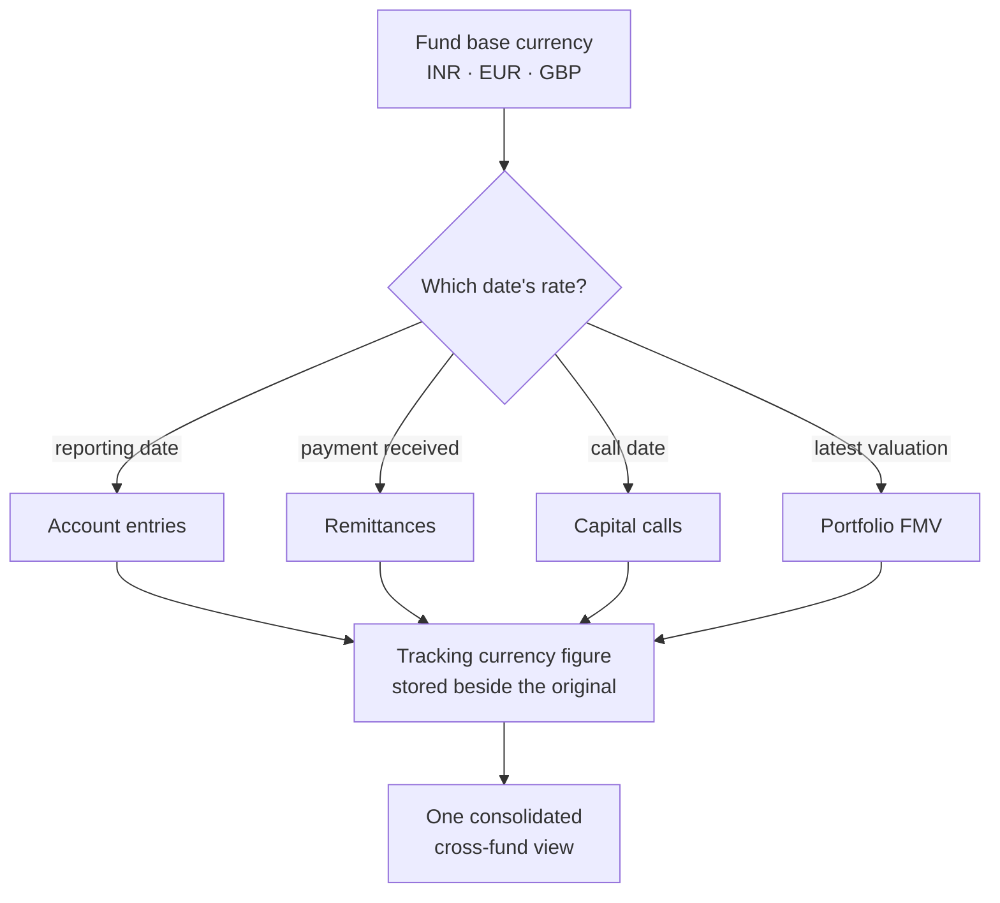

# LinkedIn Article #11 — Tracking Currency (the date is the hard part)

```yaml
series: "Fund Ops, Unstacked #11"
format: LinkedIn Article + short feed teaser post
feature: Tracking currency — automatic restatement of a fund's activity into one reporting currency
persona: CFO / Head of Fund Finance at a multi-currency GP
hook_rationale: >
  Deliberately narrow. Opens by conceding that currency conversion is trivial,
  then argues the entire difficulty is choosing WHICH DATE'S rate applies to
  each record type — a table most teams have never written down and are
  therefore applying inconsistently. Highest intent-per-reader in the series:
  the GPs it fits have an acute, expensive, specific problem.
impact_used: >
  Verified from docs/user_guides/tracking_currency_guide.md:
  7 record families restated (account entries, remittance payments, capital calls
  with both called and collected amounts, distributions with gross/net/reinvestment,
  commitment adjustments, capital commitments with current and original amounts,
  portfolio investments with cost and FMV); 8 distinct rate-date rules, one per
  record type; conversion runs automatically (typically daily) for any fund whose
  tracking currency differs from its base; percentages are never converted and stay
  1:1; investment cost is fixed at the investment date but tracking FMV is
  recomputed every run against the latest valuation and that valuation's rate;
  a missing rate causes the record to be SKIPPED and administrators alerted —
  the system never guesses or interpolates; a corrected historical rate can be
  force-recalculated.
  Before/after: a consolidation workbook restating three funds by hand, with the
  rate date chosen by whoever built the tab → a second figure maintained beside
  every base-currency figure, on a documented per-record rate-date rule.
compliance_note: >
  Do not imply FX gain/loss accounting treatment, hedging, or any tax position.
  This is reporting restatement, not accounting policy. Use fictional funds and
  round-number illustrative rates only, clearly labelled.
status: draft — ready for review
```

---

## Article title

**Converting Currency Is Trivial. Choosing the Date Is the Whole Job.**

*If your firm runs funds in more than one currency, there is a table somewhere in your process that nobody has written down — and everyone is applying slightly differently.*

---

## Article

Every multi-currency GP has had this conversation.

Someone asks for one consolidated view — the INR fund, the EUR fund and the GBP fund, all expressed in dollars. It's a reasonable request. It's also a request for about forty small decisions that nobody wants to make on the record.

Because the multiplication isn't the problem. Anyone can multiply. The problem is that **each figure needs a different date's rate**, and the correct date depends on what the figure actually represents.

**[STAT BAND]**
| 8 | 7 | 0 |
|---|---|---|
| distinct rate-date rules — one per record type, because they describe different moments | record families restated automatically alongside their base-currency amounts | rates guessed. A missing rate skips the record and alerts an administrator |

### The question that has no default answer

Take a capital call. Two amounts matter: what was **called**, and what was actually **collected**.

Those happened on different days. Between them the rate moved. Convert both at the same date and you've produced a shortfall — or a surplus — that exists only in your reporting.

Now scale that across a fund's whole activity. An account entry belongs to its reporting date. A remittance payment belongs to the day the money landed. A distribution belongs to its payment date. A commitment belongs to the day it was made. A portfolio investment's *cost* belongs to the investment date and never changes — but its *fair market value* belongs to the date of the latest valuation, which moves every time a new valuation lands.

**[MOCK: the rate-date table]**

| Record | Rate date used |
|---|---|
| Account entries | The reporting date |
| Remittance payments | The date the money was received |
| Capital calls | The remittance (call) date |
| Distributions | The distribution's payment date |
| Commitment adjustments | The adjustment's "as of" date |
| Capital commitments | The commitment date |
| Portfolio investment — cost | The investment date |
| Portfolio investment — FMV | The date of the latest valuation |

That table is the product. Everything else is arithmetic.

**[KEY POINT #1]**
> *If your consolidation workbook doesn't contain this table explicitly, it contains it implicitly — and implicitly means differently in each tab.*

### What the manual version actually costs

The workbook version isn't wrong because people are careless. It's wrong because it's re-derived.

Someone builds the consolidation for Q1. They make eight reasonable date decisions, most of them undocumented, some of them in cell formulas nobody will read again. Next quarter, under time pressure, someone extends it. A year later a different person adds the new fund and picks a defensible date — a *different* defensible date.

Nothing about that is negligent. It's just what happens when a rule lives in a formula instead of a policy. And you generally discover it when an auditor asks why the same commitment converts at two different rates in two different reports.

**[KEY POINT #2]**
> *A rule applied by a person is a rule that drifts. A rule applied by a system is a rule you can argue with — and correct in one place.*

## ⚙️ Under the hood: the three rules that keep it honest

**Percentages are never converted.** Anything expressed as a percentage — an ownership stake, an allocation share — is currency-neutral and stays exactly as it is. Obvious when stated; a classic workbook bug when a whole column gets multiplied by a rate because it happened to be adjacent to amounts.

**FMV always refreshes.** An investment's cost is set once, at the investment date, and never moves. Its tracking FMV is recomputed on **every run**, against the most recent valuation and that valuation's rate. Two figures on the same record, one deliberately frozen and one deliberately live — because they're describing different kinds of fact.

**Missing rates skip, they never guess.** If a rate isn't available for a date the conversion needs, that record is skipped and administrators are alerted so the rate can be supplied. It is not interpolated from a neighbouring day. It is not carried forward from the last known rate.

That third one is the rule I'd argue for hardest, because the alternatives are so seductive. Carrying yesterday's rate forward produces a complete, plausible, confident report — with a figure in it that no market ever offered. A gap that announces itself is worth more than a number that quietly isn't true.

And when a historical rate is later corrected — as they are — an administrator can force a recalculation, so the restated figures come back into line rather than preserving an error because it's already been reported.

### Two currencies, side by side, permanently

The tracking figure never replaces the base-currency figure. It sits beside it.

That matters more than it sounds. The fund's own currency remains the fund's own currency — for its LPs, its accounts, its LPA. The tracking currency is a reporting lens laid over the top, maintained automatically for any fund whose tracking currency differs from its base.

So the IC gets its one consolidated view, and nobody had to restate the fund's actual books to produce it.

**[COMPARISON TABLE]**

| | Consolidation workbook | Maintained tracking currency |
|---|---|---|
| Rate-date rules | In cell formulas, per tab | Documented, one per record type |
| Consistency across quarters | Depends who built it | Identical |
| Missing rate | Someone picks something | Record skipped, admin alerted |
| Corrected historical rate | Re-do the affected tabs | Force a recalculation |
| FMV freshness | As at whenever the tab was built | Recomputed every run |
| Base-currency books | Untouched (usually) | Untouched (always) |

## 📊 The impact

Before: a quarterly workbook restating several funds into one currency, with the rate date for each figure chosen by whoever built the tab, and no practical way to prove two reports used the same rule.

After: **every restated figure sits beside its base-currency original**, converted on a **documented rule per record type**, refreshed automatically, with **missing rates surfaced rather than filled in**.

The question worth asking your own team: **for the last consolidated report you produced, which date's rate was used for the capital calls — and can two people answer that the same way without opening the file?**

## ✅ Takeaways

**1. Write down your rate-date table.** Eight rows. Do it this week, whatever software you use. It is the single highest-value hour available to a multi-currency finance team.

**2. Called and collected are different dates.** Convert them at the same rate and you invent a variance that never happened.

**3. Never carry a rate forward to fill a gap.** A visible gap is a problem you'll fix. A silently interpolated rate is a wrong number that reports as confidently as a right one.

**4. Keep cost frozen and FMV live.** They're different kinds of fact and shouldn't be refreshed on the same cadence.

**5. Restate for reporting; don't convert the books.** The fund's base currency belongs to the fund. A tracking currency is a lens, not a migration.

———

### 💡 See it on your own structure

If you run funds in more than one currency, the diagnostic is quick: take one commitment and one distribution, and check which date's rate each was converted at in your last two consolidated reports.

If they don't match, DM me — that's precisely the drift this is built to remove.

**Question for finance teams at multi-currency GPs: which figure causes you the most trouble to restate — the called-vs-collected split, FMV, or commitment adjustments? My guess is FMV, because it's the only one that legitimately keeps moving.**

---

## Mermaid diagram



---

## Feed teaser post (paste-ready, ≤3,000 chars)

```
Every multi-currency GP has had this conversation.

Someone asks for one consolidated view — the INR fund, the EUR fund and the GBP fund, all in dollars.

Reasonable request. It's also a request for about forty small decisions nobody wants to make on the record. 👇

Because the multiplication isn't the problem. Anyone can multiply.

The problem is that 𝗲𝗮𝗰𝗵 𝗳𝗶𝗴𝘂𝗿𝗲 𝗻𝗲𝗲𝗱𝘀 𝗮 𝗱𝗶𝗳𝗳𝗲𝗿𝗲𝗻𝘁 𝗱𝗮𝘁𝗲'𝘀 𝗿𝗮𝘁𝗲, and the right date depends on what the figure represents.

Take a capital call. Two amounts matter: what was 𝘤𝘢𝘭𝘭𝘦𝘥, and what was actually 𝘤𝘰𝘭𝘭𝘦𝘤𝘵𝘦𝘥. Those happened on different days. Convert both at the same rate and you've produced a shortfall that exists only in your reporting.

Scale that across everything:

→ Account entries → the reporting date
→ Remittance payments → the day the money landed
→ Capital calls → the call date
→ Distributions → the payment date
→ Commitments → the commitment date
→ Investment cost → the investment date, frozen forever
→ Investment FMV → the date of the 𝘭𝘢𝘵𝘦𝘴𝘵 valuation, which moves every time one lands

𝗧𝗵𝗮𝘁 𝘁𝗮𝗯𝗹𝗲 𝗶𝘀 𝘁𝗵𝗲 𝗽𝗿𝗼𝗱𝘂𝗰𝘁. Everything else is arithmetic.

If your consolidation workbook doesn't contain it explicitly, it contains it implicitly — which means differently in each tab.

Three rules we'd defend hardest:

→ 𝗣𝗲𝗿𝗰𝗲𝗻𝘁𝗮𝗴𝗲𝘀 𝗮𝗿𝗲 𝗻𝗲𝘃𝗲𝗿 𝗰𝗼𝗻𝘃𝗲𝗿𝘁𝗲𝗱. Obvious when stated; a classic workbook bug when a whole column gets multiplied because it sat next to amounts.

→ 𝗖𝗼𝘀𝘁 𝗳𝗿𝗼𝘇𝗲𝗻, 𝗙𝗠𝗩 𝗹𝗶𝘃𝗲. Different kinds of fact, different refresh cadence.

→ 𝗠𝗶𝘀𝘀𝗶𝗻𝗴 𝗿𝗮𝘁𝗲𝘀 𝘀𝗸𝗶𝗽 — 𝘁𝗵𝗲𝘆 𝗻𝗲𝘃𝗲𝗿 𝗴𝘂𝗲𝘀𝘀. No interpolation, no carrying yesterday's rate forward. Carrying it forward gives you a complete, confident report containing a number no market ever offered. A gap that announces itself is worth more than a figure that quietly isn't true.

• • •

✅ Whatever you run: write down your rate-date table. Eight rows. It's the highest-value hour available to a multi-currency finance team, and almost nobody has done it.

Which figure gives you the most trouble to restate — called-vs-collected, FMV, or commitment adjustments?

Full write-up in the first comment.

#PrivateEquity #FundFinance #MultiCurrency #FundReporting #CFO
```

---

## First comment

```
Full article — including the full eight-row rate-date table and why a corrected historical rate should force a recalculation rather than being left alone because it's already been reported: [LINK]

Part of Fund Ops, Unstacked. Previous: why the 20% in your LPA doesn't compute anything.
```

---

## Carousel variant (6 slides)

1. **Hook** — Converting currency is trivial. Choosing the date is the whole job.
2. **The example** — Called and collected happened on different days. Same rate = an invented variance.
3. **The table** — Eight record types, eight rate dates. This table is the product.
4. **Cost frozen, FMV live** — Two figures on one record, deliberately refreshed differently.
5. **Never guess a rate** — Skip and alert. A visible gap beats a confident wrong number.
6. **CTA** — Check which date's rate your last two reports used for the same commitment. / DM if they differ.

---

## Assets to produce

1. Diagram: rate-date routing (Mermaid above → SVG).
2. Designed graphic: the eight-row rate-date table — the single most shareable asset in this post.
3. Screenshot: a record showing base-currency and tracking-currency amounts side by side.
4. Screenshot: the missing-rate alert to administrators.
