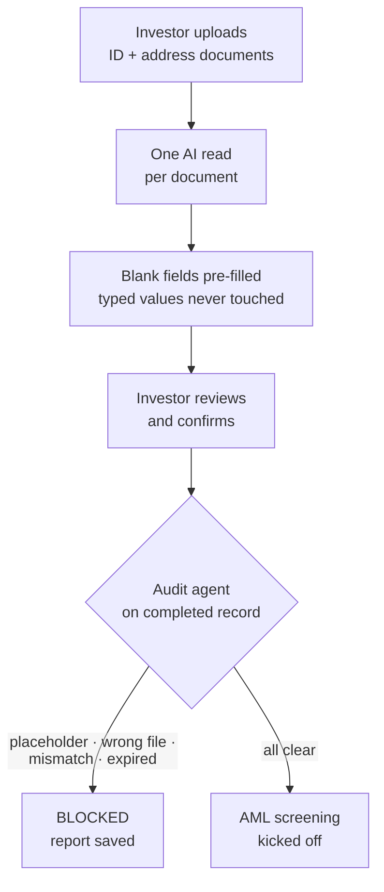

# LinkedIn Article #12 — Document-First KYC (extract, then audit)

```yaml
series: "Fund Ops, Unstacked #12"
format: LinkedIn Article + short feed teaser post
feature: KYC Doc Extractor Agent (document-first onboarding) + KYC Onboarding Agent (completeness/consistency/expiry audit)
persona: COO / Head of Fund Operations
hook_rationale: >
  Leads with the abandonment cause everyone recognises — a form that asks people
  to retype what is already printed on the document they just uploaded — and
  frames the fix as an inversion of order rather than an AI feature. The second
  half earns the compliance buyer's trust: extraction alone would be OCR, so the
  differentiated claim is the audit agent that checks the finished record,
  including whether each uploaded file is actually the document it claims to be.
impact_used: >
  Verified from docs/user_guides/agents/kyc_doc_extractor_agent_user_guide.md and
  kyc_onboarding_agent_user_guide.md:
  ONE AI request per uploaded document (rules are grouped by document, so several
  fields from the same file cost one call); default overwrite mode is "only fill
  blank fields" — anything the investor typed is never overwritten; every field
  reports its own outcome (extracted / skipped / error) with the reason; the final
  save deliberately bypasses form validation so a partially-filled KYC can be saved
  mid-wizard; extraction rules are per KYC form type and are auto-seeded once
  (tax ID and permanent address; individual forms also get full name).
  The audit agent only examines KYC records the investor has marked complete, and
  checks: required fields present AND not placeholder junk ("N/A", "TEST", "--");
  dropdown values are actually allowed options; required documents uploaded; each
  document IS the document its label claims (the file is shown to AI with its
  expected label); typed values cross-checked against the document they came from;
  expiry status with configurable warning windows (60/30/15 by default); then a
  saved ready/blocked report, expiry reminder emails, and automatic AML screening
  when nothing is blocking.
  Before/after: a long form abandoned halfway → upload three files, confirm
  pre-filled fields, and an audit that runs before anyone relies on the record.
compliance_note: >
  Never claim the platform verifies identity, performs KYC/AML determinations, or
  guarantees regulatory compliance — it assists a process your team owns. AML
  screening is "kicked off", not "completed". Do not imply extracted values are
  verified facts; they are pre-filled values the investor confirms. Note honestly
  that several audit toggles are off unless explicitly enabled. Fictional names only.
status: draft — ready for review
```

---

## Article title

**Stop Asking People to Type What's Already on Their Passport**

*Investor onboarding doesn't get abandoned because the form is long. It gets abandoned because the form asks for information the investor has already given you.*

---

## Article

Watch someone start an investor onboarding form.

They upload their passport. Then the form asks for their full name. Then their date of birth. Then their address — which is printed on the utility bill they attached two screens ago.

At some point, usually around the fourth field, a reasonable person thinks: *you have this. I just sent it to you.*

Then they leave the tab open, intending to come back. Your ops team chases them for eleven days.

**[STAT BAND]**
| 1 | 0 | 3 |
|---|---|---|
| AI request per uploaded document, no matter how many fields come out of it | fields overwritten that the investor typed themselves — the default never touches them | checks on the finished record before anyone relies on it: complete, consistent, unexpired |

### The fix is an inversion, not a feature

The conventional order is: fill in the form, then upload documents to prove what you filled in.

We turned it around. **Upload the documents first.** The agent reads them, fills in the matching fields, and the investor's job becomes *review and confirm* rather than *transcribe*.

That's the whole idea. Everything else is making it trustworthy enough to leave on.

### Four rules that keep it honest

**One request per document, not one per field.** Extraction rules are grouped by the document they read, so if five fields come from a tax document, that's a single request asking for all five at once — not five separate reads of the same file that could each return something slightly different.

**Never overwrite what a human typed.** The default mode fills blank fields only. If the investor has already entered something, the agent skips it and says why: *"Field already has a value."* The investor's own entry is authoritative over the machine's reading, always, without anybody having to think about it.

**Every field reports its own outcome.** Not a single success/failure for the run — a per-field result. Extracted. Skipped, because the document wasn't uploaded. Skipped, because there was already a value. Error, because the response couldn't be read. When something doesn't fill in, you know which of those four things happened.

**A half-finished form can still be saved.** The final write deliberately bypasses the form's normal validation, so a KYC that's been partially pre-filled saves cleanly mid-wizard instead of erroring on fields the investor hasn't reached yet. Small thing. It's the difference between a wizard that works and one that fights you at step two.

**[KEY POINT #1]**
> *An onboarding form that asks for what the uploaded document already contains isn't collecting information. It's charging the investor a transcription fee.*

## ⚙️ Under the hood: extraction is the easy half

If the story stopped at pre-filling, this would be OCR with better marketing. The part that makes it usable for a compliance team is what happens *after* the investor says they're done.

A second agent picks up every KYC record the investor has marked complete — and only those; work in progress is left alone — and audits it.

**Are the required fields actually filled in?** Including your own custom required fields. And here's the check I like most: **a value that is placeholder junk doesn't count.** "N/A". "TEST". "--". Every ops team has seen a KYC pass a completeness check because the field technically contained characters. Dropdown answers are validated too — the selected value must genuinely be one of the allowed options, not a stale value left over from a form that has since changed.

**Are the required documents uploaded?** The ones the form fields call for, plus any extra documents your firm requires.

**Is each document actually the document it claims to be?** This is the check nobody expects. The agent shows the AI each uploaded file together with the label it was filed under — "Passport" — and asks whether the file *is* that. Mismatches get flagged, as do files that can't be read or downloaded.

That failure is extremely common and almost invisible to a checklist: a completed form, a document in every slot, and one of them is the wrong file. A green tick against "Passport uploaded" says nothing about whether a passport was uploaded.

**Do the typed values match the documents?** For fields you've configured for cross-checking, the agent reads the value out of the corresponding document and compares it to what's on the form. A typed ID number that disagrees with the ID document gets flagged rather than filed.

**Is it expired, or about to be?** Expiry is checked against configurable warning windows — 60, 30 and 15 days by default — with expired treated as blocking and approaching expiry as a warning. Anything expiring triggers reminder emails to the team.

Then a report is saved, ready or blocked. And when nothing is blocking, **AML screening is kicked off automatically** — the record moves to the next stage without someone remembering to push it.

**[KEY POINT #2]**
> *A completed KYC form and a verified KYC record are different things. Most systems only measure the first, then treat it as the second.*

### An honest note about the toggles

Worth saying plainly, because it affects anyone who'd actually use this: several of these audit checks — field validation, document validation, the reminder email, AML kick-off — are **off unless explicitly switched on.** Anything not set to "on" behaves as off.

That's not ideal, and we've stopped pretending otherwise: the agent's own page now shows a warning banner naming every toggle that has never been given a value, and flags the case where the expiry warning window has been blanked out (which silently disables advance warnings entirely).

The general principle applies well beyond us: **a check that is silently off looks exactly like a check that passed.** If your compliance tooling can't tell you which of its checks are currently active, that's the first thing to fix — before adding any new ones.

**[COMPARISON TABLE]**

| | Form-first onboarding | Document-first + audit |
|---|---|---|
| What the investor does | Transcribes their own documents | Uploads, then confirms |
| Where abandonment happens | Mid-form, at the fourth redundant field | Materially less to abandon |
| "Complete" means | Fields contain characters | Fields contain real values, docs match labels |
| Wrong file in the right slot | Passes | Flagged |
| Expiry | Noticed when someone looks | Checked, with 60/30/15-day warnings |
| Next step after complete | Someone remembers to start AML | Kicked off automatically when clear |

## 📊 The impact

Before: a long form asking investors to retype documents they'd already uploaded, "completed" records containing "N/A" in required fields, wrong files sitting in correctly-labelled slots, and expiry discovered when someone happened to look.

After: **one AI request per document** pre-fills the form, **the investor's own entries are never overwritten**, and a second agent checks **completeness, placeholder junk, document identity, form-to-document consistency and expiry** before the record is relied on — then **starts AML screening** when nothing is blocking.

The number to measure in your own firm: **how long between an investor starting onboarding and your team being able to act on a verified record?** Most of that duration isn't work. It's waiting for someone to return to a form.

## ✅ Takeaways

**1. Ask for documents before you ask for data.** If you can read it from what they've uploaded, don't make them type it. This applies to every form your firm sends, not just KYC.

**2. Treat placeholder text as an empty field.** "N/A", "TEST", "--", a single hyphen. Add these to your completeness checks today — it's a one-line rule that catches a surprising number of records.

**3. Verify that a document is the document.** A tick against "Passport uploaded" tells you a file exists in a slot. Nothing more.

**4. Never let extraction overwrite human input.** The person is authoritative. Fill blanks; leave their answers alone.

**5. Audit what you can currently check.** Before adding a new control, list which of your existing checks are actually switched on. A silently disabled check is indistinguishable from a passing one.

———

### 💡 See it on your own structure

Pick five KYC records your team marked complete last quarter and ask two questions: does every required field contain a real value, and is every uploaded file actually the document its label claims?

If either answer is "probably", DM me — that gap is exactly what the audit agent is for.

**Question for operations and compliance teams: what's the worst thing you've found sitting in a correctly-labelled document slot? I've heard a boarding pass, and I'd like to believe that's the record.**

---

## Mermaid diagram



---

## Feed teaser post (paste-ready, ≤3,000 chars)

```
Watch someone start an investor onboarding form.

They upload their passport. Then the form asks for their full name. Their date of birth. Their address — which is printed on the utility bill they attached two screens ago.

Around the fourth field, a reasonable person thinks: 𝘺𝘰𝘶 𝘩𝘢𝘷𝘦 𝘵𝘩𝘪𝘴. 👇

Then they leave the tab open, meaning to come back. Your ops team chases them for eleven days.

Onboarding doesn't get abandoned because the form is long. It gets abandoned because the form asks for what the investor already gave you.

So we inverted the order. 𝗨𝗽𝗹𝗼𝗮𝗱 𝘁𝗵𝗲 𝗱𝗼𝗰𝘂𝗺𝗲𝗻𝘁𝘀 𝗳𝗶𝗿𝘀𝘁. An agent reads them, fills the matching fields, and the investor's job becomes review-and-confirm instead of transcribe.

Four rules that make it safe to leave on:

→ 𝗢𝗻𝗲 𝗔𝗜 𝗿𝗲𝗾𝘂𝗲𝘀𝘁 𝗽𝗲𝗿 𝗱𝗼𝗰𝘂𝗺𝗲𝗻𝘁, not per field. Five fields from one document = one read, not five reads that could each say something slightly different.
→ 𝗡𝗲𝘃𝗲𝗿 𝗼𝘃𝗲𝗿𝘄𝗿𝗶𝘁𝗲 𝘄𝗵𝗮𝘁 𝗮 𝗵𝘂𝗺𝗮𝗻 𝘁𝘆𝗽𝗲𝗱. Blanks only. The person is authoritative.
→ 𝗘𝘃𝗲𝗿𝘆 𝗳𝗶𝗲𝗹𝗱 𝗿𝗲𝗽𝗼𝗿𝘁𝘀 𝗶𝘁𝘀 𝗼𝘄𝗻 𝗼𝘂𝘁𝗰𝗼𝗺𝗲 — extracted, skipped (and why), or error.
→ 𝗔 𝗵𝗮𝗹𝗳-𝗳𝗶𝗻𝗶𝘀𝗵𝗲𝗱 𝗳𝗼𝗿𝗺 𝘀𝘁𝗶𝗹𝗹 𝘀𝗮𝘃𝗲𝘀. Sounds trivial. It's the difference between a wizard that works and one that fights you at step two.

But extraction is the easy half. If it stopped there, this would be OCR with better marketing.

A second agent audits every record the investor marks complete:

→ Required fields filled — 𝗮𝗻𝗱 "𝗡/𝗔", "𝗧𝗘𝗦𝗧" 𝗮𝗻𝗱 "--" 𝗱𝗼𝗻'𝘁 𝗰𝗼𝘂𝗻𝘁. Every ops team has seen a KYC pass because a field technically contained characters.
→ 𝗜𝘀 𝗲𝗮𝗰𝗵 𝗱𝗼𝗰𝘂𝗺𝗲𝗻𝘁 𝗮𝗰𝘁𝘂𝗮𝗹𝗹𝘆 𝘁𝗵𝗲 𝗱𝗼𝗰𝘂𝗺𝗲𝗻𝘁? The file is shown to AI with the label it was filed under and asked whether it matches. A green tick on "Passport uploaded" tells you a file exists in a slot. Nothing more.
→ Do typed values match the documents they came from?
→ Expired, or expiring in 60/30/15 days?

Clear? AML screening starts automatically. Blocked? A report says exactly why.

𝗔 𝗰𝗼𝗺𝗽𝗹𝗲𝘁𝗲𝗱 𝗞𝗬𝗖 𝗳𝗼𝗿𝗺 𝗮𝗻𝗱 𝗮 𝘃𝗲𝗿𝗶𝗳𝗶𝗲𝗱 𝗞𝗬𝗖 𝗿𝗲𝗰𝗼𝗿𝗱 𝗮𝗿𝗲 𝗱𝗶𝗳𝗳𝗲𝗿𝗲𝗻𝘁 𝘁𝗵𝗶𝗻𝗴𝘀. Most systems measure the first and treat it as the second.

• • •

✅ Two you can apply this week, no software required:

→ Treat placeholder text as an empty field. One rule, surprising catch rate.
→ List which of your compliance checks are currently switched ON. A silently disabled check looks exactly like a passing one.

What's the worst thing you've found in a correctly-labelled document slot? I've heard a boarding pass.

Full write-up in the first comment.

#FundOperations #KYC #InvestorOnboarding #Compliance #PrivateEquity
```

---

## First comment

```
Full article — including the honest bit about which of these audit checks are off by default and the warning banner we added because of it: [LINK]

Part of Fund Ops, Unstacked. Previous: why choosing the exchange-rate date is harder than the conversion.
```

---

## Carousel variant (7 slides)

1. **Hook** — Your form asks people to type what's printed on the passport they just uploaded.
2. **The inversion** — Documents first. Read them. Pre-fill. Confirm.
3. **One read per document** — Not one per field. Five fields from one file, one request.
4. **Never overwrite a human** — Blanks only. The investor's entry wins.
5. **Extraction is the easy half** — A completed form is not a verified record.
6. **The audit** — Placeholder junk rejected · is the document the document · values cross-checked · expiry windows.
7. **CTA** — Check five "complete" records from last quarter. Real values? Right files? / DM for a look.

---

## Assets to produce

1. Diagram: upload → extract → confirm → audit → AML (Mermaid above → SVG).
2. Screenshot: the document-first upload screen (the inverted first step).
3. Screenshot: a pre-filled form with per-field outcome indicators (extracted / skipped / error).
4. Screenshot: an audit report flagging a placeholder value and a document-label mismatch — fictional data.
