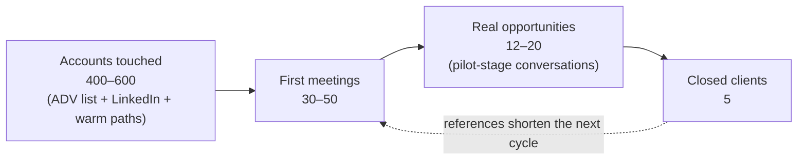
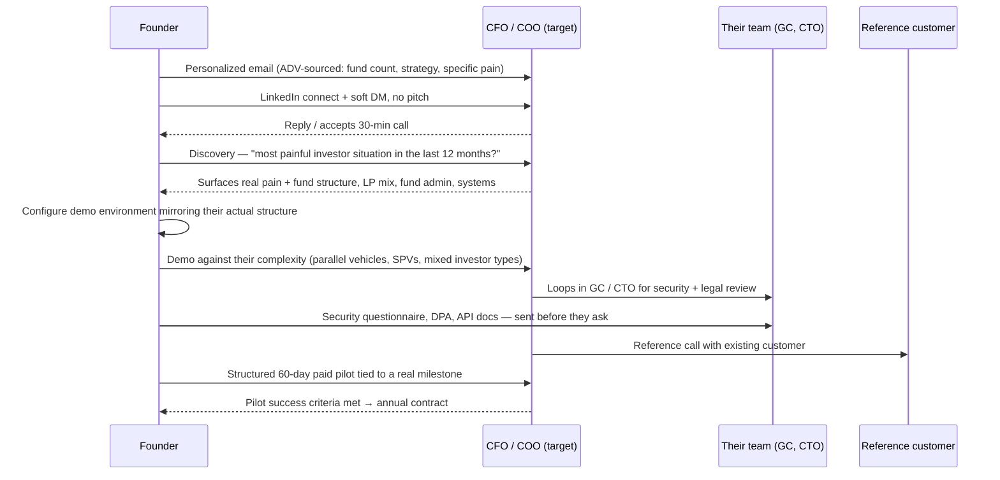

# US GTM: First 5 Paying Customers via Digital Outreach

**Audience:** CapHive founders
**Goal:** Convert **at least 5 paying US customers** through digital channels only — no travel, no conferences, no agency — at the lowest cash cost that still works.
**Relationship to other docs:** Strategy, ICP, personas, pricing, and the sales playbook live in [`docs/gtm/us_gtm.md`](us_gtm.md). The paid-ads plan ([`linkedin_google_ads_plan.md`](linkedin_google_ads_plan.md)) assumes $10–15K/month — that is a scale-up option, not the starting motion. **This doc is the operating plan**: what we do week to week, in what order, with what kill criteria.
**Status:** Working notes. Update as channels prove or fail.

---

## 1. What "5 Customers" Actually Means

At the pricing bands in `us_gtm.md` §4.2, five customers in the primary ICP is **$300K–$750K ARR** plus $25–100K of one-time setup fees. That number drives every decision below:

- **Personalization is cheap relative to ACV.** At $60K+ per deal, spending 15 minutes researching a single account is trivially justified. Volume plays are not just risky here, they are economically pointless.
- **We need roughly 15–20 real opportunities, not 200 leads.** Lead-generation tactics optimized for volume (broad ads, generic gated content, list-blasting) are the wrong instrument.
- **Losing the wrong way is expensive.** Fund CFOs are a small, talkative community. One spammy sequence damages the only asset we have.

**The constraint is trust, not money.** The buyer is a CFO/COO/controller at a mid-market GP (see §1.1 for the exact first-5 profile). Software that touches capital calls, allocations, and LP money is a risk decision before it is a feature decision. The unspoken objection to an unknown India-based vendor with no US presence is not "too expensive" — it is "too risky."

Every channel below is judged on one question: **does this manufacture trust at near-zero cash cost?** Four mechanisms do that remotely:

1. **Proof** — case studies, reference calls, G2/Capterra reviews, live product depth in demos
2. **Specificity** — content and outreach that could only come from someone who knows fund ops deeply
3. **Borrowed credibility** — partners, podcasts, communities, co-authored content
4. **De-risked offers** — structured pilots, white-glove service, SOC 2, US-hours support

### 1.1 Who We Target for These 5 — Tighter Than the Long-Term ICP

`us_gtm.md` §2.1 defines the long-term ICP as $500M–$10B AUM. That range is correct as a destination but too wide to execute against, because it spans two different sales motions: the lower half closes in 6–12 weeks with 3–4 stakeholders, the upper half runs 12–24 weeks with formal vendor evaluation and mandatory InfoSec review. For the first 5 we target the **mid-market** — the lower half — and we tighten on complexity rather than on AUM.

| Dimension | First-5 target | vs. `us_gtm.md` §2.1 |
|---|---|---|
| AUM | $300M–$2B (hard cap $3B) | was $500M–$10B |
| Vehicles | **3+, including at least one SPV or parallel fund** — non-negotiable | was 3–10 |
| LPs | 150–400 | was 150–800 |
| Complexity signal | **At least one of:** foreign LPs >25%, 10+ active side letters, multi-currency, deal-by-deal carry | not previously required |
| Stakeholders | ≤4 in the buying group | implied, never stated |
| Tech posture | Unchanged — already SaaS-native, treats technology as advantage not cost | unchanged |

**Why complexity, not AUM.** AUM is only a proxy for the pain we solve. A $600M fund with 4 vehicles, 200 LPs, foreign investors and 30 side letters is a far better first customer than a $4B single-strategy fund with one vehicle and a clean LP base — the second has no pain we uniquely address, and it has a procurement department.

**Why the ≤4 stakeholder ceiling.** Cycle length in this market is driven by how many people must say yes, not by fund size. It is also the one variable that can be screened for on a discovery call — ask who else needs to be in the room before anything gets signed.

**Why not $3–10B yet.** That band is small — a few hundred firms in the US — and we get one pass at it. Approaching it now, before SOC 2, before a US reference customer, and before a US entity, burns the highest-value list we will ever have on the weakest version of the pitch. It is also the band where cold digital outreach works worst: gatekept buyers, warm-intro-driven, pitched constantly. The bands are a sequence, not alternatives — the first 5 here buy the proof required to enter $3–10B properly later.

**Exception:** if a warm introduction into a $3–10B GP already exists, take it. Just do not build the plan around a channel we do not control.

---

## 2. Prerequisites — Tracked Separately

Several things gate the channels below and most are not marketing tasks: a working conversion path on the site, analytics and retargeting tags, the sending discipline (address verification and a tracking sheet), and the security pack. They are tracked as a live checklist with owners and dates in **[`us_gtm_prerequisites.md`](us_gtm_prerequisites.md)**.

The rule that matters here: **do not scale outbound before the conversion path and tags land.** Outreach drives traffic to the site; if the site cannot capture or book, the effort leaks silently and the best accounts get burned on a broken funnel. Everything else in this doc is founder time.

---

## 3. Channel Stack, Ranked by Cost per Qualified Meeting

### 3.1 Warm paths from existing customers and partners — cheapest, highest-converting, chronically under-used

Warm-introduced deals close **3–5× better** than cold ones and shorten the cycle materially. This is first in the ranking and first in the sequence, because it is the only channel where five closes is a realistic *primary* source rather than a bonus.

- **Existing customers are the only real asset today.** From each happy customer, ask for three things: (a) a written case study with hard numbers ("quarter-close from 15 days to 4"), (b) one warm introduction to a US peer, (c) a G2/Capterra review. US buyers check review sites; an empty G2 profile reads as "no customers."
- **Fund administrators, outsourced-CFO firms, audit/tax firms** serving mid-market GPs are a channel, not competition (`us_gtm.md` §4.1 Phase 2 puts this at month 10 — that is too late for a 5-customer goal; start now). They watch clients drown in Excel daily and take Zoom meetings happily. Offer rev share or reciprocal referrals.
- **Fund counsel.** A single fund-formation partner at a top firm knows 50+ GP clients (`us_gtm.md` §4.4 Step 2). One productive counsel relationship can plausibly source two of the five.

Cash cost: **$0.** Expected yield: 1–3 warm opportunities per productive relationship, at roughly 3–5× the close rate of cold.

### 3.2 Cold email outbound — the volume engine, nearly free

The ICP is unusually identifiable because the regulator publishes the list.

- **SEC Form ADV** filings are a free, public, complete registry of every US registered investment adviser — AUM, strategy, fund count, headcount, offices. Bulk-downloadable. Filter to the §1.1 profile ($300M–$2B, 3+ private fund vehicles) and the target list builds itself. **Form ADV carries the fund count directly**, so the "3+ vehicles" half of the complexity qualifier can be applied at list-build time. The rest cannot: SPV/parallel-fund structure, side letter counts and foreign-LP share are not in the data and must be discovered on the call. The closest usable proxy is 2+ distinct fund types. Verified against the June 2026 bulk file — **1,354 US-headquartered advisers match $300M–$2B RAUM with 3+ private funds**, against the 400–600 this plan needs, so the volume assumption holds with roughly 2–3× headroom. Tightening further to the 2+ fund-type proxy still leaves 411. Working data and a re-runnable script are in [`prerequisites/`](prerequisites/F_form_adv_findings.md).
- **The real bottleneck is not the firm list — it is the person.** ADV gives you the firm, AUM, and fund count; it does not give you the CFO's name or a working email. Resolving name → verified email is where the hours actually go, and it is the one line item worth paying for (email finder ~$30–50/month). Budget the time honestly: **10–15 minutes per account, all-in**, including research and personalization.
- **The CEO sends from his own `caphive.com` mailbox, by hand.** No secondary domain, no mailbox fleet, no sequencer. At this plan's real volume that is both cheaper and better: no 2–3 week warm-up on the critical path, no lookalike-domain problem with buyers who are drilled to spot exactly that pattern, and a CEO-to-CFO email is the highest-status opener available. The reputation risk that justifies a secondary domain belongs to agencies sending thousands per week — see the volume note below.
- **Do not route the cold list through Mailchimp** (or any bulk ESP). Mailchimp's acceptable-use policy requires permission-based lists, and cold sending is a common cause of account suspension — which would take down the existing-client communications that already run through it. Bulk-ESP mail also carries the markers (shared IPs, tracking pixels, campaign footer) that push a cold email from "a person wrote to me" into "this is marketing." Mailchimp keeps the opted-in list; cold outreach stays one-to-one.
- Sequences of 3–4 short emails, personalized from ADV data: their fund count, strategy, a real pain ("deal-by-deal carry across 3 vintages in Excel"). Link to published content as proof, not a deck.
- **The right volume is ~25 accounts/week, not 150–200.** §6 needs 400–600 accounts touched *in total*; at 150–200/week the entire list is exhausted in three weeks, which is why that figure — carried over from an earlier draft — was wrong. Twenty-five accounts a week spreads the list across roughly six months of active sending, costs about 5 hours of CEO time at the 12-minute-per-account rate, and keeps daily sends around 20–30: comfortably inside mailbox limits and low-risk for a two-year-old domain.
- **Verify every address before sending.** Hard bounces are the single largest reputation risk to `caphive.com` — which also carries all transactional mail (`SUPPORT_EMAIL_FROM=support@caphive.com`, sent via SES), so degraded deliverability would hit customers' capital call notices, not just outreach. Keep hard bounces under ~2%. This is the only tooling spend outbound actually needs.
- Comply with CAN-SPAM: real postal address in the signature, a plain opt-out line, no deceptive subject lines. At 25 accounts/week the CEO honours opt-outs by hand — immediately and without exception.
- **Revisit this design above ~50 sends/day**, or if sending moves to an SDR or a sequencing tool. At that point a secondary domain earns its keep.
- Send during US business hours — India evenings, a natural fit.

Cash cost: **~$30–50/month** (address verification only). Expected yield at ~100 accounts/month and the §6 blended rate: **5–8 first meetings/month** at full volume.

### 3.3 Founder-led LinkedIn — make it a system, not a hobby

The content engine exists (`linkedin_posts/`, 13 drafts published as blog articles). Content alone does not convert; the engine has three parts, and the second two are where meetings come from.

| Part | Cadence | What it does |
|---|---|---|
| **Publish** | 2–3 posts/week | Deep, specific fund-ops content — allocation edge cases, capital-call timing, side-letter obligations, LP reporting pain. Signals "this person knows fund ops." |
| **Engage** | 30 min/day | Substantive comments on posts by fund CFOs, fund admins, PE ops voices. Free distribution into the ICP's feed. Most people skip this part. |
| **Connect + soft DM** | Ongoing | Everyone who likes or comments gets a connection request. No pitch — "saw you engaged with the allocation post; what's your setup today?" Converts lurkers into conversations. |

The published articles double as outbound assets: every cold email links to one instead of attaching a deck.

Cash cost: **$0.** Expected yield: 2–4 qualified conversations/month, but only after 3–4 months of compounding. **Treat LinkedIn as the trust layer that makes cold email work, not as a standalone pipeline source.**

### 3.4 Lead magnets from product depth — compounds, near-zero cost

CapHive's domain logic *is* the content. Ship free tools and guides only a real fund-ops platform could produce:

- Interactive calculators (allocation formulas, capital-call schedules, waterfall/carry scenarios)
- The monthly operational guides in `us_gtm.md` §4.3 — each doubles as an outbound email asset
- The side-letter obligations guide is the strongest single candidate for a gated offer (already flagged in `linkedin_posts/00_post_backlog.md`)

### 3.5 Borrowed credibility: podcasts and communities

PE-ops and fund-CFO podcasts constantly need guests. Free borrowed credibility that every cold email can link to. Pitch 2/month. Participate in fund-ops and PE-CFO communities as a practitioner, not a vendor.

### 3.6 Paid — only under a hard cap, and only warm

The full ads plan does not fit this budget. Two bounded exceptions are worth considering **after** tags are live and the site converts:

| Test | Monthly cap | Rationale |
|---|---|---|
| **Retargeting** (Google Display / LinkedIn Matched Audiences) to site visitors only | $300 | Cheapest paid inventory available; audience is already warm. Requires tags live and a 300+ visitor pool. |
| **Google Search on competitor-alternative terms** (`juniper square alternative`, `passthrough alternative`) | $500 | Highest-intent traffic that exists — someone actively shopping. Small keyword set, exact match only. |

Hard rule: **no cold paid spend.** No broad LinkedIn awareness campaigns at these budgets — the delivery algorithm needs $5–10K/month to optimize (`linkedin_google_ads_plan.md` §3.A), so anything less buys noise.

---

## 4. Sequencing — What Happens When

The order matters more than the channel list. Running everything at once wastes founder time on channels that need assets we do not yet have.

| Phase | Weeks | Focus | Done when |
|---|---|---|---|
| **Phase 0 — Assets** | 1–4 | Work the checklist in [`us_gtm_prerequisites.md`](us_gtm_prerequisites.md): conversion path, tags, verification tooling, tracking sheet, case studies, security pack, first 100 ADV accounts. Keep LinkedIn publishing throughout | Groups A–C complete, case studies written, 100 accounts researched |
| **Phase 1 — Warm first** | 5–12 | Work every warm path: customer intros, 3–5 fund-admin/outsourced-CFO conversations, 2 counsel relationships, 2 podcast pitches/month. Outbound starts at ~10 accounts/week to test messaging | 5+ partner conversations live; reply rate measured on 300 accounts |
| **Phase 2 — Scale outbound** | 13–28 | Outbound to full volume (~25 accounts/week) using whichever message won in Phase 1. LinkedIn engagement block daily. Optional paid retargeting turns on if tags are live | Consistent 5–8 meetings/month |
| **Phase 3 — Compound** | 29+ | First closes become references; references shorten every subsequent cycle. Re-evaluate paid spend against `linkedin_google_ads_plan.md` | 5 customers closed |

**Why warm comes before scaled outbound:** a cold email that can link to a named case study converts several times better than one that cannot. Scaling outbound before the case studies exist burns the best accounts on the weakest version of the message.

---

## 5. Kill Criteria — Every Channel Gets One

Channels without an exit condition run forever on founder time. These are the checkpoints:

| Channel | Kill / fix criterion | Check at |
|---|---|---|
| **Cold email** | Reply rate < 1% after **300 accounts sequenced** (not 300 individual emails — a 4-email sequence makes those differ by ~4×) → the list or the message is wrong. Fix before adding volume, do not scale through it | Week 12 |
| **LinkedIn** | < 2 inbound conversations/month after 4 months of consistent 2–3 posts/week + daily engagement → cut publishing to 1 post/week, keep the engagement block (engagement is what produces conversations, not publishing) | Month 4 |
| **Partners / fund admins** | No referral or co-selling conversation converted to a joint call after 8 conversations → deprioritize to 1 hr/month | Month 6 |
| **Podcasts** | < 1 booking per 8 pitches → stop pitching, reallocate to partner outreach | Month 4 |
| **Paid retargeting** | Cost per booked meeting > $1,500 after $900 total spend → stop | 3 months after launch |
| **Paid search** | No demo request after $1,000 total spend → stop | 2 months after launch |

Track weekly: emails sent, reply rate, meetings booked, pilots proposed, warm intros requested vs. received.

**What the 300-account checkpoint can and cannot tell you.** It is a smoke test, not a measurement. At 300 accounts, 3 replies gives a 95% confidence interval of roughly 0.34%–2.90% — wide enough that "1%" and "3%" are indistinguishable. So it is a valid trigger for *stop and rethink* when replies are near zero, and it is not a valid basis for choosing between two messages. Detecting something as large as a doubled reply rate would need on the order of 2,000+ accounts per arm, which this plan will never reach. **Do not run an A/B test at this checkpoint** — with these volumes it manufactures a confident conclusion from noise. Change one thing at a time, sequentially, and judge on direction plus what prospects actually say in replies. Detail in [`outbound/message_testing_plan.md`](outbound/message_testing_plan.md).

---

## 6. Funnel Math to 5 Customers (Honest Version)

`us_gtm.md` §4.1 gives 8–24 weeks across the full ICP. The §1.1 profile deliberately sits at the fast end of that range — **8–14 weeks, 3–4 stakeholders, no formal vendor evaluation** — which is most of the reason this plan can target 5 closes inside a year at all.

Ratios assumed: ~8% of touched accounts become a first meeting (blended cold + warm), ~40% of meetings become real opportunities, ~30% of opportunities close. Warm-sourced accounts run several times better than these blended numbers; cold-only runs worse.

**Expect 8–12 months** of consistent execution. That is the honest number. It is dominated by cycle length rather than top-of-funnel volume — which is why the §1.1 stakeholder ceiling and the warm-path emphasis do more for the timeline than any increase in send volume would.

How the 5 most plausibly break down: **2 from warm paths** (customer intros + partners), **2 from cold outbound**, **1 from inbound** (content, LinkedIn, or search). If cold outbound is carrying 4 of the 5, the warm motion is being under-worked.

The deal itself also has to be de-risked — see §8.

---

## 7. How a Deal Actually Moves

Two details do most of the work: **the demo is configured to their structure before the call** (`us_gtm.md` §4.4 Step 4), and **the security pack is volunteered rather than requested**. Both are free and both directly attack the "too risky" objection.

---

## 8. De-risk the Deal Itself (Where India-Based Vendors Lose)

Pre-empt the objections instead of answering them defensively:

| Objection (usually unspoken) | Pre-emptive move |
|---|---|
| "Are they secure enough to touch LP data?" | In the §1.1 mid-market profile this is usually a **questionnaire, not a formal InfoSec review** — a serious security page, a completed security questionnaire and a DPA ready before it is asked for (`us_gtm.md` §4.3) will carry most of these deals. **SOC 2 Type I is what unlocks the *next* segment**, not this one: above ~$3B it becomes a hard gate that no amount of sales work gets around. Fund it from the first closes and give it a target date then, rather than treating it as a blocker for the first 5. |
| "Will anyone answer when I have a capital call at 9am ET?" | State US-hours coverage explicitly: "support until 2pm ET" is India evening — a real, honest offer. |
| "What if this fails mid-adoption?" | Structured 60-day **paid** pilot tied to a real milestone (`us_gtm.md` §4.4 Step 5), founding-US-customer pricing, white-glove migration included. Service intensity is the one thing US competitors will not match. |
| "Can we even contract with an Indian entity?" | A US entity (Delaware LLC/C-corp) is cheap and removes procurement friction. Do not block on it; fast-follow once the first deal reaches legal. |

---

## 9. Weekly Operating Cadence (Founder Time)

Phase-dependent — the same 15 hours get spent differently as the plan progresses.

| Activity | Phase 0–1 | Phase 2+ | Notes |
|---|---|---|---|
| Warm paths: customer intros, partners, counsel, podcasts | ~5 hrs | ~2 hrs | Front-loaded deliberately; this is the highest-yield hour in Phase 1 |
| Outbound: list build, contact resolution, personalization, sends, follow-up tracking | ~3 hrs | ~6 hrs | ~25 accounts/week at 12 min each, plus follow-up state-keeping. Sent by the CEO from his own mailbox — see §3.2 |
| LinkedIn: publish + daily engagement + DMs | ~4 hrs | ~4 hrs | **Assign a named owner for the daily 30-min engagement block** — this is the step that fails silently when nobody owns it |
| Meetings + demos (US hours = India evenings) | ~2 hrs | variable | Configure the demo to mirror their structure before the call |
| Case-study and reference work | ~2 hrs | ~1 hr | Front-loaded in Phase 0 |

Total: **roughly 15 hrs/week of founder GTM time, sustained.** This plan does not work at 5 hrs/week — if that is the real availability, cut LinkedIn publishing first and protect warm paths and outbound.

---

## 10. Total Cash Budget

| Item | Monthly | One-time |
|---|---|---|
| Email finder + address verification | $30–50 | — |
| Analytics (free tier or lightweight paid) | $0–10 | — |
| Booking tool (free tier) | $0 | — |
| G2/Capterra listings | free | — |
| *Optional* retargeting, capped (§3.6) | $0–300 | — |
| *Optional* paid search on alternative terms, capped (§3.6) | $0–500 | — |
| **SOC 2 Type I** (not required for the §1.1 profile; funds the move to $3–10B — see §8) | — | ~$5–15K |
| US entity (fast-follow, after first deal reaches legal) | — | ~$500–1K |

**Baseline recurring: ~$70–130/month.** With both paid tests running: ~$370–930/month, and both have hard kill criteria. SOC 2 is the one meaningful spend — treat it as sales infrastructure, not marketing.

Against $300–750K ARR from five customers, the entire cash outlay including SOC 2 is under 5% of first-year revenue.

---

## 11. Open Questions

- **ACV confirmation:** the bands in `us_gtm.md` §4.2 imply $60K+ ACV. Confirm against what current customers actually pay — this number is the justification for 10–15 min/account personalization, and if it is materially lower the whole motion needs rethinking.
- **Reference geography:** are current happy customers usable as US references, or India-only? This determines whether Phase 1 leans on case studies or on pilots. **This is the single highest-leverage unknown in the plan** — the warm motion in §3.1 assumes referenceable customers exist.
- **Who owns the daily LinkedIn engagement block?** Name a person, not a role.
- **How many US GPs actually match §1.1?** The plan needs 400–600 targetable accounts. Form ADV can answer this precisely and cheaply — run the filter before committing to the volume assumptions in §6. If the qualifying pool is materially under 400, either the AUM floor drops or the complexity qualifier loosens; decide which deliberately rather than by drift.
- **SOC 2 timing.** Not a blocker for the §1.1 profile, but it should be funded from the first closes. Set the trigger explicitly — e.g. start the engagement after customer #2 signs — so the $3–10B segment opens on schedule rather than whenever someone remembers.
- **When does paid spend beyond §3.6 turn on?** Proposed trigger: 2 published case studies + a validated reply rate + at least 1 closed customer. Then revisit `linkedin_google_ads_plan.md`.
