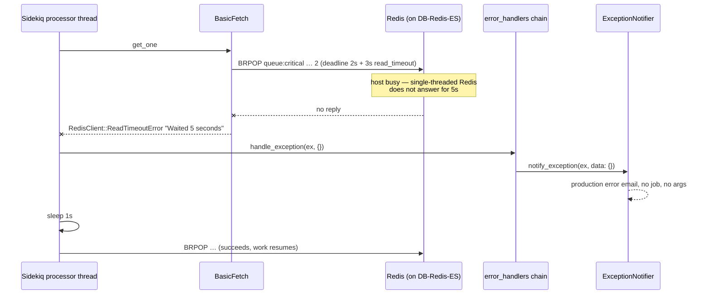

# RedisClient::ReadTimeoutError in Sidekiq's BRPOP fetch loop

- **Incident**: `2d7eca43`
- **Exception occurred**: 2026-08-14 00:22:05 UTC (05:52 IST), production `caphive.us`
- **First seen / last seen by the watcher**: 2026-08-15T09:46:30Z / 2026-08-15T09:46:30Z
- **Occurrences**: 1
- **Surface**: background — Sidekiq's own fetcher, no application frames at all
- **Status**: Alerting defect patched on `fix/incident-2d7eca43`. The Redis stall
  that triggered it is **UNCONFIRMED** — see *Root cause*.

## What happened

One Sidekiq processor thread asked Redis for its next job (`BRPOP`) and Redis did not
answer within the 5-second deadline. Sidekiq handled this by itself: it logged the
failure, slept one second and went back to polling. No job failed, no user saw
anything, and the same error never recurred.

What did happen is that the app emailed a production error alert about it — with no
job, no arguments, no request and an empty data section — which woke the incident
pipeline for an event that had already healed by the time the mail was sent.

## Impact

None to users or data. No job was running when the exception was raised (it fired in
the fetch loop *before* a job was retrieved), so nothing was half-written and nothing
was lost. Background processing paused for roughly one second on one of ~7 processor
threads on one app server.

The real cost was operational: one unactionable production error email, and the RCA
run it triggered.

One caveat worth stating rather than hiding: `BasicFetch` uses `BRPOP`, so if Redis
*had* popped a job and only the reply was lost in the stall, that job would have been
dropped silently. That is a known property of `BasicFetch` (Sidekiq Pro's reliable
fetch exists for exactly this), not something this incident can confirm either way —
nothing in the alert says whether the pop happened. The single occurrence and the
absence of any downstream "expected job never ran" report suggest it did not.

## Root cause

Two separate things, and it matters which one this patch addresses.

**Trigger (UNCONFIRMED, infrastructure).** Redis did not reply to one `BRPOP` within
5 seconds. The arithmetic is exact and worth recording because it makes the timeout a
5-second Redis stall rather than a 5-second network hang:

- `Sidekiq::BasicFetch#retrieve_work` (`sidekiq/fetch.rb:48`) calls
  `conn.blocking_call(2, "brpop", *queues, 2)` — `TIMEOUT = 2`.
- `RedisClient::ConnectionMixin#connection_timeout` (`connection_mixin.rb:87-94`) adds
  the configured `read_timeout` on top of the command timeout, and Sidekiq defaults
  that to 3 (`sidekiq/redis_connection.rb:33`).
- 2 + 3 = 5, hence `ReadTimeoutError "Waited 5 seconds"` at `buffered_io.rb:214`.

So Redis was silent for a full 5 s while a client sat waiting on a socket it had
already written to. Redis is single-threaded and, in this deployment, is **colocated
with MySQL and Elasticsearch on one instance** — `DbRestoreService::PRIMARY_INSTANCE_NAME
= 'DB-Redis-ES'` (`app/packs/core/base/services/db_restore_service.rb:13`), and
`REDIS_URL` is derived from `DB_HOST` (`lib/tasks/aws_utils.rb:447-448`). That host also
runs xtrabackup incrementals every 30 minutes and a nightly full at 23:00
(`lib/tasks/db_backup_xtra.sh:12-14`). Any CPU, disk-I/O or page-cache pressure on that
box stalls Redis for every client at once.

That is a plausible and structurally-confirmed *condition*, not a confirmed cause.
Which of {backup I/O, an ES or MySQL spike, a Redis fork for RDB/AOF, an EBS burst-credit
stall, a network blip} actually stalled it at 00:22 UTC cannot be established from this
repository — it needs host metrics for `DB-Redis-ES` at that minute, which are in
Grafana, not in code. Ruled out from the code side: nothing application-level was in the
stack (`app_backtrace` is empty), no job was executing, and no application change to any
Redis-touching file precedes it.

**Cause of the alert (confirmed, and what this patch fixes).**
`config/initializers/exception_notification.rb:22-29` registers a Sidekiq error handler
that emails *every* exception Sidekiq reports:

```ruby
config.error_handlers << proc do |ex, ctx|
  ExceptionNotifier.notify_exception(ex, data: ctx)
end
```

Sidekiq routes far more than job failures through that chain. `Processor#get_one` rescues
fetch failures into `handle_fetch_exception` (`sidekiq/processor.rb:99-120`), which calls
`handle_exception(ex)` with **no context at all**, then sleeps 1 s and retries — that empty
context is the `* data: {}` in the alert email. The handler cannot tell "a job blew up and
nobody is retrying it" from "the poll loop hiccuped and Sidekiq is already recovering",
so it emailed the second one at the same severity as the first.

Note the deduplication that is already there: `handle_fetch_exception` only notifies once
per downtime episode per thread (`@down`). The problem was never volume — it was that a
self-healing event was routed to a human at all.

## How it got here

`git blame -L 18,30 config/initializers/exception_notification.rb` puts the whole handler in
one commit: **772fe1aba, 2025-07-13, "Added better sidekiq exception_notifier hooks"**.

Its own inline comment names the assumption exactly:

```ruby
data: ctx # job_class, args, jid, queue, etc.
```

`ctx` was understood to always describe a job. The premise the commit was solving for is
right — Rack-oriented `ExceptionNotifier` does miss Sidekiq failures without a handler —
but Sidekiq's `error_handlers` chain is not a job-failure chain, and the fetch loop passes
`{}` through it. Nothing regressed: this has been true since 2025-07-13, and the incident
is simply the first Redis stall that landed while the alert mailbox was being watched.
That is also why `ignore_if`, the gem's own filter hook, is still sitting commented out
eight lines above.

## Sequence



## The fix

Teach the handler the difference, and replace the email with a signal that can actually
distinguish a blip from an outage.

1. **`lib/sidekiq_redis_fetch_error.rb` (new)** — classifies an `(exception, context)`
   pair as a fetch-loop Redis failure. All three conditions must hold, and each one fails
   *open* (i.e. still emails):
   - the exception is a `RedisClient::ConnectionError` (the transient family: read/write
     timeouts, checkout timeout, cannot-connect — a `CommandError` is not transient);
   - the context is empty, which in Sidekiq 8.1.6 only the fetch loop does. Every other
     `handle_exception` call site passes `:context`, `:job` or `:jobstr`;
   - the backtrace contains a `sidekiq/fetch.rb` frame, so a Redis timeout raised by
     application code can never be swallowed by this.
2. **`config/initializers/exception_notification.rb`** — the handler skips the email for
   that case and counts it instead. Everything else notifies exactly as before.
3. **Grafana + Prometheus rules** — the suppressed errors increment
   `ruby_sidekiq_redis_fetch_errors`, and a new alert fires when more than 3 arrive in 10
   minutes.

The counter is what makes the suppression safe rather than blind, and the threshold is not
arbitrary: because Sidekiq notifies once per processor thread per downtime episode, an
isolated stall increments it once or twice, while a Redis outage trips every thread of
every capsule on every app server within seconds (7 threads per process here: 5 default +
1 single-threaded + 1 db_restore). One blip stays silent; a real outage pages.

**Why this layer.** The timeout itself cannot be fixed in Ruby — the code holding the
socket is `redis-client` inside Sidekiq's own loop, and Sidekiq's handling of it (retry,
never lose the worker thread) is already correct. Raising the timeout would only mean
waiting longer for the same stall. The defect that belongs to this repository is the
routing decision, and that is the only thing changed.

**What this deliberately does not do**: it does not make Redis alerting comprehensive.
There is no `redis_exporter` anywhere in `prometheus.prod.*.yml`, so Redis has no memory,
latency, eviction or connection metrics at all — a Redis that is slow but not yet failing
Sidekiq's fetch is still invisible. See *Follow-ups*.

## Why it was not caught

- The `Sidekiq.configure_server` block never executes outside a Sidekiq server process, so
  the error handler has no coverage in the test suite and never had any — no test would
  have caught the classification gap because there was nothing to classify against.
- Redis in development is local, idle and unloaded; a 5-second stall does not happen. The
  production topology that makes it happen (Redis sharing an instance with MySQL, ES and a
  30-minute backup cycle) has no development equivalent.
- The trigger itself is not reproducible in a test — it is a host-level stall on a machine
  this repository does not run. The regression test therefore covers the classification
  decision, which is the part that is actually code.

## Blast radius

`rg "handle_exception"` across Sidekiq 8.1.6 and sidekiq-cron 2.4.0 finds three more call
sites that pass an **empty context** from a self-healing polling loop, and would produce
the same unactionable email on the next Redis stall:

| Location | Loop | Left alone because |
|---|---|---|
| `sidekiq/scheduled.rb:114` (`Poller#enqueue`) | retry/scheduled set poller, every ~5 s | Did not fire. A persistent failure here means scheduled and retried jobs stop being enqueued — less obviously benign than a missed poll, so it should not be silenced without its own thought. |
| `sidekiq/scheduled.rb:125` | same poller, cleanup path | As above. |
| `sidekiq-cron/poller.rb:29,40` | sidekiq-cron's schedule poller | Same shape; same reasoning. |

The classifier is deliberately keyed to `sidekiq/fetch.rb` so extending it to any of these
is a one-line, explicit decision rather than something that happens silently.

No application code matches this pattern — `rg "RedisClient"` returns nothing outside the
gems, since the app touches Redis only through Sidekiq and ActionCable.

## Follow-ups

Out of scope for this patch, in rough priority order:

1. **Run `rake grafana:provision:alert_rules`** against both Grafana instances. Production
   alerting is Grafana-managed (`grafana_provision.yml`); `alerts.yml` only feeds the local
   Docker stack. Until that task runs, the new rule exists in git but not in production —
   the suppression is live and its replacement signal is not.
2. **Deploy `redis_exporter` on `DB-Redis-ES`** and scrape it in `prometheus.prod.in.yml` /
   `prometheus.prod.us.yml`. Redis is the only major component in the stack with no metrics
   whatsoever, which is why this RCA cannot say what stalled it.
3. **Correlate 2026-08-14 00:22 UTC on `DB-Redis-ES`** in Grafana (node CPU/iowait, EBS burst
   balance, `mysql_info_schema_processlist_seconds` for the backup lock) and record the answer
   here. If it lines up with an xtrabackup incremental, the fix is an infrastructure one —
   move Redis off the DB host, or throttle the backup's I/O.
4. **Consider `reconnect_attempts`** on the Sidekiq Redis pool. redis-client retries the
   *connection*, not a blocking read, so it would not have prevented this — but it hardens
   the connect path against the same host-level stalls.
5. **Decide on the pollers** in *Blast radius* — either extend the classifier to them or
   accept the email.
