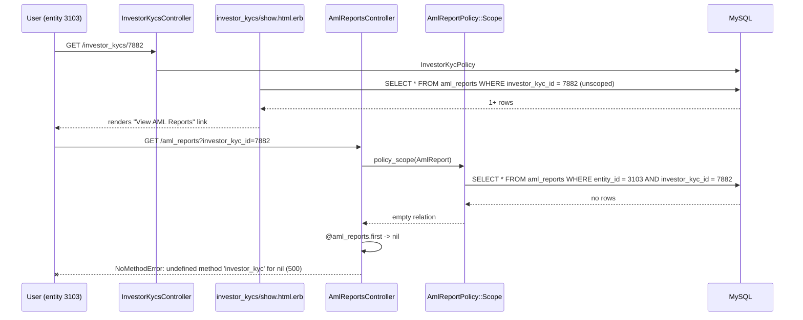

# NoMethodError in aml_reports#index (`undefined method 'investor_kyc' for nil`)

- **Incident**: `45847776`
- **Exception occurred**: 2026-08-13 15:13:50 / 15:13:53 / 15:13:58 IST, production `caphive.com`
- **First seen / last seen by the watcher**: 2026-08-15T09:46:26Z / 2026-08-15T09:46:26Z
- **Occurrences**: 6 alert emails — two per failure, so **3 failed requests** in 8 seconds,
  from one user session (user 1496, entity 3103) retrying the same link
- **Surface**: web — `AmlReportsController#index`, `GET /aml_reports?investor_kyc_id=7882`
- **Root cause**: **CONFIRMED** — unguarded `.first` on a possibly-empty policy-scoped
  relation at `app/packs/core/investor_kycs/controllers/aml_reports_controller.rb:10`.
  *Which* of the three ways the scope can come back empty applied to this particular
  user/KYC pair is **UNCONFIRMED** and needs one production query (see *Root cause*).

## What happened

A logged-in fund user opened KYC 7882, clicked **KYC Actions → View AML Reports**, and got
a 500 error page. They clicked it twice more over the next eight seconds and got the same
500 each time, then stopped.

The link only renders when the KYC has at least one AML report, so from the user's side the
reports exist but the page that lists them is broken. Nothing was written; the request died
while building the breadcrumb, before rendering.

## Impact

One user, one KYC, three failed page loads. Read-only path — no data was written, no partial
state, no job affected. The user could not view the AML reports for that KYC at all; there is
no other route to them (`aml_reports#show` is reachable only from this index page).

Blast radius across the tenant base is **unknown from the alert alone**, but it is not a
one-off data accident: the same click will 500 every time for every user/KYC combination that
lands in the state described below, and it has been reachable since the controller was written
in March 2025. That only one report has surfaced suggests the combination is uncommon, not
that it is unique to KYC 7882.

## Root cause

**Cause** — `app/packs/core/investor_kycs/controllers/aml_reports_controller.rb:10`:

```ruby
@aml_reports = policy_scope(AmlReport)
@aml_reports = @aml_reports.where(investor_kyc_id: params[:investor_kyc_id]) if params[:investor_kyc_id].present?
@bread_crumbs = if params[:investor_kyc_id].present?
                  { KYCs: investor_kycs_path, "#{@aml_reports.first.investor_kyc.full_name}": ... }
```

The breadcrumb takes the KYC's name from `@aml_reports.first` — i.e. it derives the *parent*
from a *child* that the controller has just filtered through `policy_scope`. When the scoped
relation is empty, `.first` is `nil` and `nil.investor_kyc` raises. The exception message
confirms this reading: the receiver is `nil`, so it is `.first` that returned nil, not
`investor_kyc` (which is a `null: false` FK on `aml_reports` and cannot be nil on a persisted
row).

So: **whenever `/aml_reports?investor_kyc_id=<id>` is requested and the policy-scoped relation
for that id is empty, the request is a guaranteed 500.** That is the defect, and it is
independent of why the relation was empty.

**Trigger** — the relation was empty while the KYC's own association was not. The two are
checked in different places with different scopes:

| Where | Expression | Scope |
|---|---|---|
| `investor_kycs/show.html.erb:146` (renders the link) | `@investor_kyc.aml_reports.present?` | **unscoped** — every AML report on the KYC |
| `aml_reports_controller.rb:7` (lists them) | `policy_scope(AmlReport)` | `where(entity_id: user.entity_id)` (`aml_report_policy.rb:3-9`) |

The link guard is the raw `has_many`; the controller applies a strict single-entity scope. The
link therefore renders for users who cannot see the rows. Reading the policies, there are three
ways a user can legitimately reach the KYC page — and thus see the link — while
`AmlReportPolicy::Scope` returns nothing:

1. **Investor-entity user.** `InvestorKycPolicy#show?` (`investor_kyc_policy.rb:39`) grants
   access when `user.entity_id == record.investor&.investor_entity_id` — a user at the *LP*
   entity viewing a KYC that belongs to the *fund's* entity. The KYC Actions dropdown is shown
   to anyone whose `curr_role != "investor"` (`show.html.erb:74`), and the AML link inside it
   has no Pundit gate at all. The AML reports carry the fund entity's `entity_id`
   (`generate_aml_report_job.rb:26` sets `entity_id: investor_kyc.entity_id`), which by
   definition differs from this user's — scope empty, 500.
2. **Group Company parent.** `belongs_to_entity?` (`application_policy.rb:68-71`) and
   `for_company_admin` (`for_investor.rb:30-33`) both extend a parent-entity user's reach to
   `entity.child_ids`. `AmlReportPolicy::Scope` has no equivalent branch — it is strictly
   `user.entity_id` — so a group admin sees every child entity's KYC and none of its AML
   reports.
3. **Support / impersonation.** `AmlReportPolicy#index?` and `#show?` both end in `|| support?`
   (`aml_report_policy.rb:13,17`), but the `Scope` has no support branch — it falls through to
   `scope.none` for anyone lacking the `:employee` role. A support session is therefore
   authorized to open the page and guaranteed to see zero rows.

For **this** incident I cannot tell which applied. The alert gives user 1496 (entity 3103,
`curr_role: "employee"`, roles include `company_admin`), but not KYC 7882's entity, and
`support_user_id` is an `attr_accessor` read from the session (`user.rb:21`), so an
impersonated session is indistinguishable in the payload. One query settles it:

```ruby
AmlReport.where(investor_kyc_id: 7882).pluck(:id, :entity_id)   # vs user 1496's entity_id 3103
InvestorKyc.find(7882).slice(:entity_id) ; Investor.find(InvestorKyc.find(7882).investor_id).investor_entity_id
```

If the report `entity_id`s are not 3103, it is variant 1 (or 2). If they are, it was a support
impersonation (variant 3) or the rows were destroyed between render and click. **The fix below
is the same either way**, which is why the root cause is recorded as confirmed.

## How it got here

`git blame` puts line 10 in `2557a0cd1 "Added Aml reports for kyc custom field additional aml
report attrs (#750)"` (shrikantgour, 2025-03-10) — the whole `index` action is from that
commit and the line has never been touched since. The assumption it encodes is "if
`investor_kyc_id` is in the params, at least one AML report for it is visible to me", which
holds only for a same-entity employee arriving via the dropdown.

The link's guard is younger — `11e14c5055` (Ausang Shulka, 2025-12-10) added
`<% if @investor_kyc.aml_reports.present? %>` around it. That narrowed the failure (before it,
*any* KYC with no AML reports would 500 on click) but kept the mismatch, because the guard
queries the unscoped association while the controller queries the policy scope. This is not a
recent regression; both sides have been in production for months.

## Sequence



## Proposed fix

**Layer: the controller.** The breadcrumb needs the *KYC*, so it should load the KYC, not
guess it from a child row. This removes the nil dereference no matter which of the three
scope-divergence variants caused it, and no matter whether the KYC has zero reports.

`app/packs/core/investor_kycs/controllers/aml_reports_controller.rb:5-15`:

```ruby
def index
  authorize(AmlReport)
  @aml_reports = policy_scope(AmlReport)
  @bread_crumbs = { 'AML Reports': '' }

  if params[:investor_kyc_id].present?
    @aml_reports = @aml_reports.where(investor_kyc_id: params[:investor_kyc_id])
    # Breadcrumb comes from the KYC itself - the policy-scoped report relation can be
    # empty here (cross-entity or support session), and .first would then be nil.
    investor_kyc = InvestorKyc.find_by(id: params[:investor_kyc_id])
    if investor_kyc && policy(investor_kyc).show?
      @bread_crumbs = { KYCs: investor_kycs_path,
                        "#{investor_kyc.full_name}": investor_kyc_path(investor_kyc),
                        'AML Reports': '' }
    end
  end

  @aml_reports = @aml_reports.order(created_at: :desc)
end
```

Notes for the reviewer:

- `find_by` rather than `find`: an unknown/garbage `investor_kyc_id` should give the plain
  "AML Reports" crumb and an empty list, not a 500 or a 404 on a page that is otherwise valid.
- The `policy(investor_kyc).show?` check is deliberate — without it the breadcrumb would leak
  a KYC's `full_name` to a user who is not allowed to open that KYC. It costs one extra policy
  evaluation per request on a low-traffic page.
- `authorize(AmlReport)` stays first, so `verify_authorized` is still satisfied.
- The page then renders **empty** for the affected users. That is honest but confusing —
  `index.html.erb` has no empty state, so they see a bare "Aml Reports" heading. Worth adding
  `<% if @aml_reports.empty? %>` copy in the same change; it is a view-only addition with no
  other callers (the partials in `views/aml_reports/` are used from this page and `show` only).

**Not proposed here, deliberately:** widening `AmlReportPolicy::Scope` to match
`belongs_to_entity?` (child entities) and to have a `support?` branch. That is the deeper
divergence — variants 2 and 3 above — but it is an authorization change on KYC/AML data and
should be decided on its own merits with the entity model in front of you, not folded into a
500 fix. See *Follow-ups*.

## Proposed regression test

`features/misc/aml_report.feature` — the AML steps and `mock_aml` helper already live in
`features/step_definitions/aml_report.rb`, and the existing scenarios already build an entity,
investor, KYC and a generated report.

Scenario: **Viewing AML reports when none are visible does not error**

Data shape needed (not the production ids):

1. An entity with `aml_enabled`, an employee/company_admin user, an investor and a KYC —
   as in "Generate AML report Manually with and without PAN".
2. Visit `/aml_reports?investor_kyc_id=<kyc.id>` for a KYC that has **no** AML report at all.
   Expect the AML Reports page with the KYC breadcrumb and no report cards — this is the
   direct, minimal reproduction of the nil `.first`.
3. A second variant for the real-world trigger: a KYC in entity A with a generated AML report
   (so `entity_id` = A), viewed by a logged-in employee of entity B where
   `investor.investor_entity_id == B`. Following the "View AML Reports" link must render an
   empty list, not a 500.

Both assert on the rendered page rather than the exception, so they fail on the current code
via the Cucumber 500 handling. Keep them in the existing `@doc_gen` feature file; no new step
definitions should be needed beyond a "Given I go to the AML reports page for the KYC" step.

## Why it was not caught

- **No coverage of the empty case.** Every AML scenario in `features/misc/aml_report.feature`
  generates a report first and reaches the page from a same-entity `company_admin`, which is
  exactly the one path where `.first` is never nil.
- **Environment gap in the guard.** In dev and test the user viewing a KYC is almost always an
  employee of the KYC's own entity, so the unscoped `aml_reports.present?` guard and the
  entity-scoped `policy_scope` agree. They only diverge with cross-entity investor access,
  group-company hierarchies or support impersonation — none of which the AML feature exercises.
- The pattern itself (`relation.first.parent`) reads as safe next to a `.present?` check that
  is 130 lines away in a different file.

## Blast radius

Same idiom (`.first.<assoc>` on a policy-scoped relation) elsewhere in the app:

| Path | Status |
|---|---|
| `app/packs/core/investor_kycs/controllers/aml_reports_controller.rb:10` | **the defect — fix this one** |
| `app/packs/startups/deals/controllers/deal_investors_controller.rb:262` | Safe — guarded by `return ... if @deal_investors.empty?` on the line above |
| `app/packs/startups/deals/controllers/deal_investors_controller.rb:280` | Safe — same guard |
| `app/packs/misc/kanbans/controllers/boards_controller.rb:18` | Safe — inside `if @kanban_board.kanban_cards.present?` |

The fix should cover **only** `aml_reports_controller.rb:10` (plus the optional empty-state in
`views/aml_reports/index.html.erb`). The other three are already guarded; touching them adds
diff without reducing risk.

Related but distinct, in the same file: `set_aml_report` (line 23) dereferences
`@aml_report.investor_kyc` *before* `authorize`. `investor_kyc_id` is `null: false` so it
cannot be nil on a live row — but `AmlReportPolicy#show?` defensively checks
`record.investor_kyc &&`, so someone once expected it could be. Left alone; noted below.

The scope divergence itself (unscoped link guard vs entity-scoped `policy_scope`) is the
broader pattern worth a sweep — `has_many` guards in views deciding whether to link to a
policy-scoped index — but that is a separate piece of work, not this fix.

## Follow-ups

- **Decide on `AmlReportPolicy::Scope`.** It is `where(entity_id: user.entity_id)` with no
  group-company (`entity.child_ids`) and no `support?` branch, while `index?`/`show?` both
  allow support. Either widen the scope to match the policy, or drop the `|| support?` from
  the actions — the current asymmetry means "authorized but sees nothing" is a reachable state
  for a whole class of users, and it will keep producing this shape of bug.
- **Gate the link.** `investor_kycs/show.html.erb:146` should ask the same question the
  controller will answer — e.g. `policy_scope(AmlReport).exists?(investor_kyc_id: @investor_kyc.id)`
  — so the entry point disappears when the user cannot see the rows. Do this *after* the scope
  decision above, or it will hide reports from group-company admins who arguably should see them.
- **Confirm the variant for KYC 7882** with the two queries in *Root cause*, and check whether
  other tenants are hitting the same click (log grep for `GET /aml_reports?investor_kyc_id=`
  returning 500). That tells us whether this is one LP-side user or a standing breakage for a
  whole access pattern.
- **`set_aml_report` ordering** — move `authorize @aml_report` above the breadcrumb line so an
  orphaned or cross-entity report fails authorization rather than raising while building a
  breadcrumb. Cosmetic today; free to do alongside the fix.
