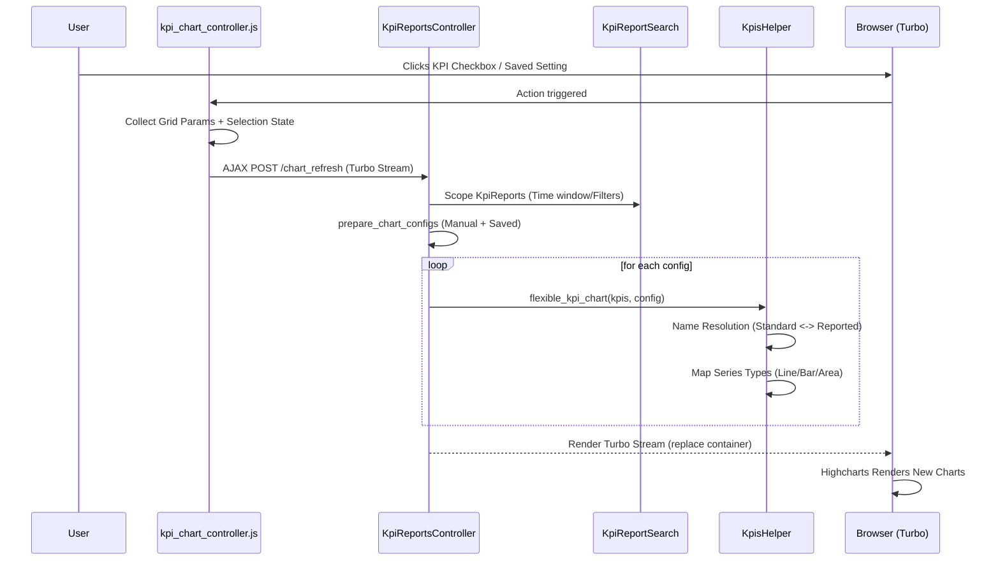

# Technical Documentation: Flexible KPI Charting System

## Overview
The Flexible KPI Charting system provides a highly dynamic visualization layer on top of the KPI Grid View. It allows users to mix different chart types (Line, Bar, Area, Pie) in a single chart, save these configurations, and render multiple charts simultaneously.

## Core Components

### 1. Data Model: `KpiChartSetting`
- **Purpose**: Persists user-defined chart configurations.
- **Key Attributes**:
  - `config` (JSON): An array of objects containing `name` (Standard KPI name) and `type` (chart type).
  - `portfolio_company_id`: Scopes the setting to a specific company.
  - `user_id`: Ownership of the setting.
  - `name`: Display name for the saved configuration.

### 2. Frontend Controller: `kpi_chart_controller.js` (Stimulus)
- **State Management**:
  - `selectedKpis`: Tracks manual selections from the grid checkboxes.
  - `selectedSettingIds`: Tracks which saved settings are toggled in the dropdown.
- **Workflow**:
  1. Captures checkbox changes (`toggleKpi`) or dropdown toggles (`toggleSavedSetting`).
  2. Constructs a complex payload containing the current grid filters (from the URL) and the selection state.
  3. Dispatches an AJAX request to `chart_refresh_kpi_reports_path`.
  4. Updates the DOM using Turbo Stream responses.

### 3. Backend Controller Logic: `KpiReportsController`
- **`fetch_kpi_reports`**: The primary data-scoping engine. It applies Ransack filters, tag filters, and the `no_of_periods` time-window logic defined in `KpiReportSearch`.
- **`prepare_chart_configs`**: 
  - Converts manual parameters into a standardized config object.
  - Fetches saved `KpiChartSetting` records by ID.
  - Aggregates all configs into an array passed to the view.
- **`chart_refresh`**: Responds to Stimulus requests by rendering the `_grid_view_chart` partial via Turbo Stream.

### 4. View Engine: `_grid_view_chart.html.erb`
This partial acts as the rendering loop. For each configuration:
1. It resolves **Standard names** from the config back to **Reported names** in the database using `investor_kpi_mappings`.
2. It scopes KPI fetching to the `kpi_reports` currently visible in the grid (ensuring X-axis alignment).
3. It calls `flexible_kpi_chart` in the helper.

### 5. Helper Logic: `KpisHelper`
- **`build_kpi_chart_data`**: 
  - Groups raw KPI records by Company/Entity/Tag.
  - Resolves every "Reported Name" back to its "Standard Name" for the legend using a lookup hash.
  - Formats data into Highcharts-ready JSON `[[date, value], ...]`.
- **`flexible_kpi_chart`**:
  - Takes the aggregated data and the user's `chart_config`.
  - Performs a fuzzy match between series names and config names.
  - Overrides the Highcharts `type` per series (e.g., mapping "Bar" to "column" or "Donut" to "pie" with `innerSize`).

---

## Logic Flow & Sequence Diagram

### Chart Refresh Flow
The following diagram illustrates the flow when a user toggles a KPI or saved setting:

## Name Resolution Layer
Because the database stores raw names from diverse sources, the system uses a two-way mapping:

1.  **Config -> DB**: To find the data, we take Standard Names from the setting, find their corresponding `reported_kpi_name` in `investor_kpi_mappings`, and query `Kpi.where(name: reported_names)`.
2.  **DB -> Legend**: To display the chart, we take the raw `Kpi.name`, look up the `standard_kpi_name` from the mapping, and use that as the series label.

This ensures that even if two portfolio companies call "Revenue" something different (e.g., "Sales" vs "Turnover"), the chart configuration "Revenue" works for both and displays as "Revenue" in the legend.
