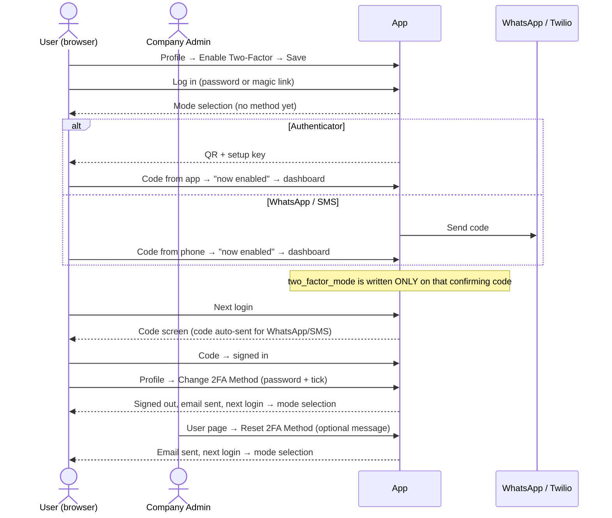

# Manual QA — Two-Factor Authentication

Branch: `2fa_fixes`  
Feature: Enabling 2FA, mode selection, enrollment in Authenticator / WhatsApp / SMS, login
verification (password and magic link), method reset (self-service and administrator),
disabling, and the failure paths (undeliverable codes, lockouts, rate limits).

Related docs: `docs/technical/two_factor_authentication.md`,
`docs/technical/two_factor_gates_and_validations.md`, `docs/user_guides/two_factor_authentication_user_guide.md`.

---

## Flow Overview

---

## Prerequisites

- **Environment**: Sidekiq running with the `critical` and `default` queues (both OTP jobs are
  async). `SMS_OTP_ENABLED=true` in the env file for the SMS sections; Twilio Verify credentials
  (`TWILIO_ACCOUNT_SID`, `TWILIO_AUTH_TOKEN`, `TWILIO_VERIFY_SERVICE_SID`) in credentials; WATI
  configured for WhatsApp. Redis up.
- **Emails** visible via LetterOpener or `/rails/mailers`.
- **Users** (all in one Company entity, all with 2FA initially off):
  - `U1` — plain user, **no phone**.
  - `U2` — user with a **real mobile number** you control, `whatsapp_enabled` **ticked**.
  - `U3` — user with a real mobile number, `whatsapp_enabled` **unticked**.
  - `U4` — user whose stored phone is a **landline** (e.g. a UK `020` number with call code `44`).
  - `ADMIN` — a `company_admin` of the same entity.
  - `OTHER` — a non-admin colleague in the same entity.
- An authenticator app on a phone (Google Authenticator, Microsoft Authenticator or Authy). Set the
  phone's clock to automatic.
- A second browser / incognito window for admin-vs-user scenarios.
- To read DB state: `rails console` → `User.find_by(email: ...).slice(:two_factor_enabled, :two_factor_mode, :otp_secret, :consumed_timestep, :two_factor_reset_at, :two_factor_reset_by_id)`.

Throughout, **"code screen"** means `/two_factor/new` and **"mode selection"** means
`/two_factor/select_mode`.

---

## 1. Enabling 2FA

### 1a. Toggle is self-only

1. As `ADMIN`, open **Edit** on `U1`'s user page.
2. **Expect:** no "Enable Two-Factor Authentication" toggle (it is only rendered on your own profile).
3. As `U1`, open your own **Edit Profile**.
4. **Expect:** the toggle is present with a "Learn more" link that opens the public 2FA guide in a new tab without requiring login.

### 1b. Enabling takes effect at next login, not now

1. As `U1`, tick the toggle, save.
2. **Expect:** you stay signed in; nothing else changes in this session.
3. Open your user page.
4. **Expect:** Two-Factor row shows **enabled** with a yellow badge **"Method not chosen yet"** and **no** "Change 2FA Method" button.

---

## 2. Mode Selection Screen

### 2a. No phone → Authenticator only, preselected

1. As `U1` (2FA on, no phone), log out and log in with password.
2. **Expect:** mode selection. No WhatsApp row, no SMS row. Authenticator is preselected. The "New to this?" help block with the app store links and QR codes is **visible**.

### 2b. Phone present, WhatsApp off → greyed WhatsApp row

1. Enable 2FA on `U3`, log in.
2. **Expect:** WhatsApp row present but disabled, with "Not enabled for your account — contact your administrator". Authenticator preselected. SMS row present (`SMS_OTP_ENABLED=true`, mobile number).

### 2c. Phone present, WhatsApp on → nothing preselected

1. Enable 2FA on `U2`, log in.
2. **Expect:** WhatsApp row enabled, showing the masked number (`+91 xxxxxxx805` style). Nothing preselected. Help block **hidden** until Authenticator is selected; selecting Authenticator reveals it, selecting WhatsApp hides it again.
3. Click **Continue** with nothing selected.
4. **Expect:** "Please select a mode." on the same page, styled as a **red** alert.

### 2d. Landline → no SMS row

1. Enable 2FA on `U4`, log in.
2. **Expect:** no SMS row. WhatsApp row per its flag. Authenticator preselected.

### 2e. Kill switch hides SMS everywhere

1. Set `SMS_OTP_ENABLED=false`, restart, log in as `U3`.
2. **Expect:** no SMS row even though the number is textable. Restore the flag afterwards.

### 2f. Choosing a mode writes nothing (abandon test)

1. As `U1`, choose Authenticator, Continue, land on the enrollment page. **Close the tab.**
2. Console: **Expect** `two_factor_mode` is **nil** (an `otp_secret` may exist — that is fine).
3. Open a new window, log in as `U1` again.
4. **Expect:** mode selection again, **not** the code screen. (Old behaviour was a lockout.)

---

## 3. Authenticator Enrollment

### 3a. Happy path

1. As `U1`, choose Authenticator, Continue.
2. **Expect:** three-step page with a QR code, a spaced 32-character setup key, a 6-digit input with numeric keyboard on mobile, the troubleshooting link, and the app-store links + QR codes at the bottom (each QR opens a zoom modal).
3. Scan the QR in the app. **Expect** the app entry is labelled `CapHive: <email>` with issuer CapHive.
4. Enter the current code, click **Confirm & Enable 2FA**.
5. **Expect:** redirected to the **dashboard** with notice "Two-factor authentication is now enabled." **No backup-codes page** appears anywhere.
6. Console: `two_factor_mode == "authenticator"`, `otp_secret` present.
7. User page: badge **Authenticator**, button **Change 2FA Method** now visible.

### 3b. Wrong code keeps the same QR

1. Repeat with a fresh user, enter `000000`.
2. **Expect:** "Invalid code. Please try again." in **red**, still on the enrollment page, **the same QR / setup key** (do not re-scan). Entering the right code now succeeds.

### 3c. Manual key entry

1. In the app choose "Enter a setup key", type the key shown, time-based.
2. **Expect:** codes match the QR-scanned entry.

### 3d. Verified user cannot re-enter enrollment mid-login

1. As an enrolled authenticator user, log in; on the code screen, manually visit `/two_factor/enroll`, then `/two_factor/select_mode`, then `/two_factor/enroll_sms`.
2. **Expect:** each redirects straight back to the code screen; mode unchanged in the console.

---

## 4. WhatsApp Enrollment

### 4a. Happy path

1. As `U2`, choose WhatsApp, Continue.
2. **Expect:** "Confirm Your WhatsApp" page with "Code sent to +xx xxxxxxx805"; a WhatsApp message with a 6-digit code arrives within seconds (job on `default` queue).
3. Enter the code.
4. **Expect:** dashboard, "Two-factor authentication via WhatsApp is now enabled." Console: mode `whatsapp`.

### 4b. Resend cooldown

1. On the enrollment page immediately click **Didn't get it? Resend code via WhatsApp**.
2. **Expect:** red status "Please wait 30 seconds before requesting another code." Wait 30 s, click again → green "Code sent! Check your WhatsApp messages." and a new message (same code if within the same 30-second TOTP window — expected).

### 4c. Wrong code

1. Enter `000000`. **Expect:** red "Invalid code. Please try again.", same page, resend still available.

### 4d. Forced selection when ineligible

1. As `U3` (flag off) on mode selection, use dev tools to enable the WhatsApp radio, select it, Continue.
2. **Expect:** "WhatsApp is not available for your account. Please choose Authenticator." — stays on mode selection. Visiting `/two_factor/enroll_whatsapp` directly also bounces to mode selection with "WhatsApp codes are not available for your account."

---

## 5. SMS Enrollment

### 5a. Happy path

1. As `U3` (mobile, `SMS_OTP_ENABLED=true`), choose Text message (SMS), Continue.
2. **Expect:** "Confirm Your Phone" page with the masked number; a text arrives (Twilio Verify). Console: an `OtpDelivery` row with `channel: sms, status: queued, purpose: enrollment`.
3. Enter the code → dashboard, "Two-factor authentication via text message is now enabled." Console: mode `sms`.

### 5b. Refresh does not resend

1. On the enrollment page press F5 twice.
2. **Expect:** no new texts; `OtpDelivery` count unchanged.

### 5c. Resend cooldown (60 s)

1. Click **Didn't get it? Send another code** within 60 s → red "Please wait a moment before requesting another code."
2. After 60 s → "A new code is on its way. It can take a few seconds to arrive." and a second `OtpDelivery` row.

### 5d. Wrong code

1. Enter `000000` → red "Invalid code. Please try again.", verification stays open; the correct code still works afterwards.

### 5e. Forced selection when ineligible

1. As `U4` (landline) submit `two_factor_mode=sms` via dev tools.
2. **Expect:** "Text message codes are not available for your account. Please choose another option." and no `OtpDelivery` row created. Visiting `/two_factor/enroll_sms` directly bounces to mode selection with the same message.

---

## 6. Login Verification

Run 6a–6h once per mode (Authenticator `U1`, WhatsApp `U2`, SMS `U3`).

### 6a. Password login

1. Log in with password.
2. **Expect:** code screen. Heading text matches the mode ("from your authenticator app" / "sent to your WhatsApp" / "we texted you"). WhatsApp/SMS: "Code sent to / Code texted to +…" and the code arrives without any click. Authenticator: **no** "Send code via WhatsApp" or "Text me a code" buttons, even for a user with a phone.
3. Enter the code → "Signed in successfully." on the landing page.

### 6b. Magic link login

1. Log out, request "Log In Via Email Link", open the link from the email.
2. **Expect:** code screen (not the dashboard). Complete the code → signed in.
3. Repeat with `&redirect_to=/users` appended to the link URL. **Expect:** after the code you land on `/users`. Repeat with `&redirect_to=https://example.com` and `&redirect_to=//example.com`. **Expect:** both ignored, you land on the dashboard, **no 500**.

### 6c. Deep link preserved

1. Logged out, visit `/entities/dashboard` directly → redirected to sign-in; log in; complete the code.
2. **Expect:** you land on `/entities/dashboard`.

### 6d. Code with spaces

1. Type the code as `123 456` with a trailing space.
2. **Expect:** accepted.

### 6e. Three strikes

1. Enter `000000` three times.
2. **Expect:** after the 1st: red "Invalid code. 2 attempt(s) remaining."; 2nd: "1 attempt(s) remaining."; 3rd: back on the sign-in page with "Too many failed attempts. Please sign in again."

### 6f. Attempt counter resets per login

1. Enter a wrong code **twice**, then navigate to `/users/sign_in` and log in again.
2. Enter one wrong code. **Expect:** "2 attempt(s) remaining", **not** "Too many failed attempts".

### 6g. Session expiry

1. On the code screen, clear the site's cookies (or wait > 60 min), submit a code.
2. **Expect:** sign-in page with "Session expired. Please sign in again."

### 6h. Signed-in user on a 2FA URL

1. After a successful login, visit `/two_factor/new`, `/two_factor/enroll`, `/two_factor/select_mode`.
2. **Expect:** redirected into the app (dashboard); **no 404 page**, no "Session expired".

### 6i. Remember Me (known limitation — record, don't fail)

1. Tick **Remember Me**, log in, complete the code, close and reopen the browser after the session cookie expires.
2. **Observed today:** the user must log in again with password + code; Remember Me is not honoured for 2FA users.

### 6j. WhatsApp code timing (know what "expected" is)

- The WhatsApp code is valid roughly 30–60 s from when it was sent. A code that arrives late is rejected; **Resend code via WhatsApp** issues a live one.
- Logging out and back in within the same 30-second window re-sends the **same** code, which is rejected as already used. Wait 30 s and resend.

---

## 7. Undeliverable Codes (refused at login, not stranded)

### 7a. WhatsApp flag removed after enrollment

1. `U2` enrolled in WhatsApp. As `ADMIN`, untick `whatsapp_enabled` on `U2`.
2. As `U2`, log in with password.
3. **Expect:** stay on the sign-in page with "We can't send a verification code to your phone right now. Please contact your administrator." No code screen, no WhatsApp message. Same via magic link.
4. As `ADMIN`, re-tick the flag → `U2` can log in again.

### 7b. Phone cleared after WhatsApp enrollment

1. Same as 7a but clear `U2`'s phone in the console (`update_columns(phone: nil)`). **Expect:** same refusal.

### 7c. SMS number changed to a landline

1. `U3` enrolled in SMS. In the console change the number to a landline (`update_columns(call_code: "44", phone: "2079460000")`).
2. Log in. **Expect:** same refusal; no `OtpDelivery` row. Admin **Reset 2FA Method** is the recovery.

### 7d. SMS kill switch after enrollment

1. `U3` enrolled in SMS. Set `SMS_OTP_ENABLED=false`, restart.
2. Log in. **Expect:** same refusal; log line `[TwoFactorDispatch] sms-mode user_id=… cannot receive a code (feature_enabled=false …)`.

---

## 8. Changing the Method (self-service)

### 8a. Button and modal

1. As an enrolled user, open your user page.
2. **Expect:** badge shows the mode; **Change 2FA Method** button. Click it.
3. **Expect:** modal lists: current method removed (named), "You will be signed out now", "Two-factor authentication stays switched on" listing only the modes **you are eligible for**, "Confirmation email sent", "Before you continue, have ready…". Password field + acknowledgement checkbox; **Reset 2FA Method** button disabled until **both** are filled/ticked.

### 8b. Wrong password

1. Type a wrong password, tick, submit.
2. **Expect:** back on the user page with red "The password you entered is incorrect." Console: mode unchanged, no email.

### 8c. Successful self reset

1. Correct password, tick, submit.
2. **Expect:** signed out to the sign-in page with "Your two-factor method has been reset. Sign in again to choose a new method."
3. Email to the user: subject "Your two-factor authentication method was reset", body says **you** reset it, names the previous method, says 2FA is still on, and lists only the modes you can choose (e.g. no "WhatsApp" for `U1`).
4. Console: `two_factor_mode nil`, `otp_secret nil`, `consumed_timestep nil`, `two_factor_enabled true`, `two_factor_reset_at` set, `two_factor_reset_by_id == own id`. Audit log entry on the user with comment "Two-factor method reset from … by self".
5. Log in → mode selection with a **yellow banner** "Your two-factor method was reset on <date> **by you**. Your previous method no longer works…". Complete an enrollment → login works with the new method; the old authenticator entry / old codes are rejected.

### 8d. No method yet → no button

1. As a user with 2FA on but no method, open the user page. **Expect:** no Change/Reset button.

---

## 9. Administrator Reset

### 9a. Admin path

1. As `ADMIN`, open enrolled `U2`'s user page.
2. **Expect:** Two-Factor row visible with badge; **Reset 2FA Method** button. Modal: no password field, an optional message box, "Takes effect at their next sign-in", the "Verify the request is genuine" warning, eligible modes listed for **that user**.
3. Submit with a message.
4. **Expect:** back on the user page with "Two-factor method reset for <name>…". Badge becomes "Method not chosen yet". Email to `U2` says reset **by your administrator (<admin name>)**, includes the message in a quote block, and "If you did not ask for this reset, contact your administrator immediately."
5. `U2` (if still signed in elsewhere) keeps their session; at next login → mode selection with banner "…by your administrator".

### 9b. Non-admin cannot reset a colleague

1. As `OTHER`, open `U2`'s user page. **Expect:** no Two-Factor row at all (policy hides it).
2. POST directly to `/users/<U2 id>/reset_two_factor`. **Expect:** not authorised; `U2`'s mode unchanged, no email.

### 9c. Support role

1. As a support user, **Expect** the row and button are visible for users of mapped entities.

---

## 10. Disabling 2FA

### 10a. Off clears the method

1. As an enrolled user, Edit Profile, untick the toggle, save.
2. **Expect:** saved; next login asks for password only.
3. Console: `two_factor_enabled false`, `two_factor_mode nil`, `otp_secret nil`. User page shows disabled, no badge, no button.

### 10b. On again starts fresh

1. Tick the toggle again, save, log out, log in.
2. **Expect:** mode selection (not a code screen for the old method). Enrol again; the old authenticator entry no longer works.

---

## 11. Impersonation and Other Entry Points

### 11a. Login as (support / admin impersonation)

1. As an authorised support user, use **Login as** on an enrolled user.
2. **Expect:** you are signed in as them **without** a 2FA challenge (documented, deliberate). The audit trail records the real actor.

### 11b. Password reset link (known behaviour — record)

1. As an enrolled user, "Forgot password", set a new password from the email link.
2. **Observed today:** Devise signs the user in after the reset **without** a code. Note it; not changed on this branch.

### 11c. API tokens / OAuth

- Not challenged for 2FA (documented). Spot-check one API call with a token for an enrolled user succeeds.

---

## 12. Rate Limits and Rack::Attack

### 12a. 2FA screens reachable while a shared IP is 404-blocked

1. From one IP, request ~12 random missing URLs (`/nope1`… `/nope12`) until `/entities/dashboard` returns **403**.
2. From the **same IP**, log in as an enrolled user.
3. **Expect:** the sign-in page loads, the code screen loads (`/two_factor/new`), the code is accepted; no plain-text "Rate limit exceeded" on any `/two_factor` page.

### 12b. Resend endpoints are NOT exempt

1. With the IP still blocked, on the code screen click the SMS/WhatsApp resend.
2. **Expect:** the resend fails ("Failed to send code…") — the paid endpoints stay behind the block.

### 12c. SMS resend per-IP throttle

1. Unblocked IP, SMS-mode user on the code screen: trigger `POST /two_factor/send_sms` four times in a minute (e.g. via console fetch, ignoring the button's disabled state).
2. **Expect:** the 4th returns **429**. The durable limits (1/60 s, 5/hour, 10/day per number; 10/day per user; 50/30 days) refuse inside the job and create `OtpDelivery` rows with `status: failed, error_code: rate_limited`.

### 12d. Login brute-force throttles still apply

1. 11 password POSTs in 30 s from one IP → **429** on the 11th.

---

## 13. Emails and Copy Checks

- [ ] Reset email dates render as `Mon dd, yyyy` regardless of the user's locale (try a `ja` user).
- [ ] Reset email never mentions backup codes.
- [ ] Mode-selection banner and reset modal never mention backup codes.
- [ ] Authenticator code-screen footer reads "…Lost your device? Contact your administrator to reset your two-factor method."
- [ ] Public guides `/help/two_factor_authentication_user_guide` and `/help/authenticator_app_setup_user_guide` open **logged out**, have no "backup codes" section, and every in-page anchor in their tables of contents resolves.
- [ ] All error flashes on the five 2FA screens are **red**; notices are blue.

---

## 14. Data and Deploy Checks

- [ ] `User.ignored_columns` includes `otp_backup_codes`; the column still exists in the DB (drop is a follow-up release). `User.first.respond_to?(:otp_backup_codes)` is **false**.
- [ ] Cross-region user sync (`POST /internal/sync/users`) with `two_factor_enabled: false` for an enrolled user clears their mode and secret in the target region (the callback runs on that save).
- [ ] Audit log: enabling/disabling and every reset show on the user's audit trail with `two_factor_mode` diffs.
- [ ] Sidekiq: `SendOtpToSmsJob` and `SendOtpToWhatsappJob` both run on the **critical** queue; a queued OTP is never behind a document-generation job.
- [ ] Logs never contain a code. `TwilioSmsVerification` lines show `to=***1234` only.

---

## Sign-off

| Area | Tester | Date | Result |
|---|---|---|---|
| 1–2 Enable + mode selection | | | |
| 3 Authenticator enrollment | | | |
| 4 WhatsApp enrollment | | | |
| 5 SMS enrollment | | | |
| 6 Login (all three modes, password + magic link) | | | |
| 7 Undeliverable | | | |
| 8–9 Reset (self + admin) | | | |
| 10 Disable / re-enable | | | |
| 11–12 Entry points, rate limits | | | |
| 13–14 Copy, data, deploy | | | |
