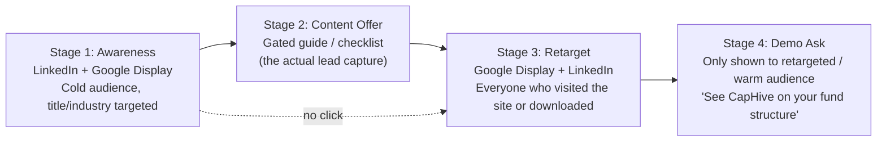

# Paid Ads Plan: LinkedIn + Google Ads (US Only)

**Audience:** CapHive founders / marketing owner (in-house, no agency)
**Goal:** Get the CapHive brand in front of CFOs, Fund Managers/COOs, and Fund Administrators at US private fund managers, using LinkedIn Ads and Google Ads (search + retargeting), on a **$10K–$15K/month** budget.
**Targeting basis:** Broad by job title / industry (no named account list yet — see [`docs/features/us_gtm.md`](../features/us_gtm.md) §2.1 for the ICP this plan targets: $500M–$10B AUM GPs).
**Status:** Plan only. No campaigns have been created yet.

---

## 1. Why the Funnel Isn't Just "Book a Demo"

A single cold LinkedIn or Google ad that says "Book a demo" will underperform with this audience. CFOs and fund COOs do not click an ad from a brand they've never heard of and hand over their calendar. B2B financial-services LinkedIn CPLs run **$148–$200 per lead** even with a soft offer ([source](https://www.get-ryze.ai/blog/linkedin-ads-cpc-and-cpl-benchmarks-by-industry-2026)) — asking for a demo directly on first touch multiplies that cost several times over, because you're asking for the highest-commitment action from someone who has zero trust in you yet.

Instead, this plan runs a **three-stage funnel**, and each stage gets a different ad and a different budget share:

- **Stage 1 (cold):** job-title/industry-targeted ads on LinkedIn and Google, driving to a content offer — not a demo page.
- **Stage 2 (capture):** a gated operational guide (e.g. "Building a Compliance Evidence Binder That Survives an SEC Exam" — this doc's content strategy already calls for one per month, see `us_gtm.md` §4.3). This is the actual lead — an email + company + title, captured because they got something useful, not because they were sold to.
- **Stage 3 (retarget):** every site visitor and every content downloader gets added to a retargeting audience and followed with a second wave of ads — this is the "follow around the internet" mechanic you asked about, and it's cheap (display CPMs are $0.50–$5 vs. $8–$40 LinkedIn CPCs).
- **Stage 4 (convert):** only the warm, retargeted audience sees the "book a demo" ad. By this point they've seen the brand 2–3 times and read something useful — the ask lands.

This is not "too wide" — it's the standard shape for any B2B buyer with a multi-week consideration cycle, and it's cheaper per qualified lead than skipping straight to demo asks. You can simplify to a two-stage version (skip the content offer, retarget straight to demo) once you have real performance data telling you cold-to-demo conversion is acceptable — but start with the three-stage version.

---

## 2. Who We're Targeting

Pulled directly from the ICP in [`docs/features/us_gtm.md`](../features/us_gtm.md) §2.1–2.2. US only.

| Persona | Job titles to target | What the ad/offer should say |
|---|---|---|
| CFO / Head of Finance | CFO, Managing Director – Finance, Head of Fund Finance, Fund Controller | Compliance evidence, audit readiness, bank-fraud controls |
| COO / Head of Operations | COO, VP Operations, Head of Fund Operations | Operational complexity handled without simplifying fund structure |
| Director of Investor Relations | IR Director, Head of IR, VP Investor Relations | LP servicing burden reduction, side letter obligation tracking |
| Fund Administrator staff (secondary, Year 2 ICP) | Fund Accountant, Fund Controller, Client Services Director (at mid-market admin firms) | Scale GP clients without headcount |

**Company filters (proxy for $500M–$10B AUM since AUM isn't a native ad-platform filter):**
- Industry: Investment Management; Venture Capital & Private Equity
- Company size: 11–500 employees (most GPs at this AUM band run lean back offices — this is the standard proxy)
- Location: United States only

---

## 3. Platform Plan

### 3.A LinkedIn Ads — primary channel (~60% of budget)

LinkedIn is the only platform that lets you filter directly by job title, seniority, and industry — which is exactly what this audience needs since there's no account list yet. It's also the most expensive channel here, which is why it gets the content-offer stage rather than the direct demo ask.

**Campaign types to run:**
| Format | Use for |
|---|---|
| Single Image / Carousel Sponsored Content | Stage 1 awareness, driving to the content offer |
| Document Ads (native PDF preview) | Promoting the gated guide directly in-feed — LinkedIn's best-performing format for content offers |
| Message/Conversation Ads | Stage 4 retargeting — direct, personal-feeling "book a demo" ask to warm audience |
| Lead Gen Forms | Optional alternative to a landing page — pre-fills LinkedIn profile data, higher conversion, lower-quality data (no company-owned email verification) |

**Targeting setup:**
- Job title OR job function (Finance + Operations + Legal) + Seniority (Director, VP, CXO, Owner)
- Industry: Investment Management, Venture Capital & Private Equity Principals
- Company size 11–500
- Location: United States
- Exclude: students, job seekers (LinkedIn default exclusions — leave on)
- For Stage 3/4: build a **Website Retargeting** Matched Audience (requires the LinkedIn Insight Tag on the CapHive site) and a **Lead Gen Form retargeting** audience for anyone who submitted the content offer but hasn't been retargeted with a demo ask yet

**Cost benchmarks (financial services / C-suite, US, 2026):**
- CPC: $8.50–$15 median for financial services; C-suite/competitive targeting can push $15–$25+ ([source](https://www.get-ryze.ai/blog/linkedin-ads-cpc-and-cpl-benchmarks-by-industry-2026), [source](https://www.stackmatix.com/blog/linkedin-ads-cost))
- CPL: $148–$200 for financial services with a standard offer ([source](https://www.get-ryze.ai/blog/linkedin-ads-cpc-and-cpl-benchmarks-by-industry-2026))
- Narrowing to specific job titles (vs. broad "Finance Executive") has been shown to cut CPL by ~25–47% — reason to start narrow, not broad, on Stage 1
- Minimum viable test budget: $5,000–$10,000/month before LinkedIn's delivery algorithm has enough data to optimize ([source](https://www.stackmatix.com/blog/linkedin-ads-cost-budget-guide-2026)) — this plan's $6K–$9K LinkedIn allocation clears that bar

### 3.B Google Ads — secondary channel (~40% of budget)

Google does two different jobs here and should be split into two campaign types, not blended:

**Search (intent capture) — catches people already looking:**
Bid on category and competitor terms. This is the cheapest, highest-intent traffic available, because the person is already searching, not being interrupted.

Starter keyword list (expand from actual Search Console/GA data once live):
- `fund administration software`, `LP portal software`, `private fund investor portal`, `capital call software`, `K-1 delivery software private equity`, `side letter tracking software`, `fund compliance evidence software`, `investor KYC software private funds`
- Competitor/alternative terms: `juniper square alternative`, `passthrough alternative`, `anduin alternative`, `carta alternative for private equity`

**Display remarketing (the "follow around the internet" piece):**
- Build a remarketing list from all CapHive site visitors (Google tag) and layer a second list for content-offer downloaders
- Run standard Display remarketing to that list — this is genuinely cheap: CPMs of $0.50–$2 generically, though expect the higher end (or a premium placement surcharge) when you manually add finance-publisher placements, since GDN's algorithmic placements will otherwise waste spend on irrelevant sites for a niche B2B audience ([source](https://www.storegrowers.com/google-ads-benchmarks/), [source](https://terrahq.com/en/blog/google-ads-benchmarks-2025/))
- **Add manual placement targeting** on finance-industry publishers your audience actually reads: Institutional Investor, PitchBook News, Private Equity International, PE Hub, Buyouts, Chief Investment Officer, Pensions & Investments. Manual placements cost more per impression than algorithmic GDN but avoid paying for irrelevant inventory (mommy blogs, mobile games) that a broad remarketing campaign otherwise serves against.
- YouTube retargeting (same audience, video bumper/skippable ad) is a cheap optional add if you have or can cut a 15–30 second brand clip — skip for the pilot unless creative already exists

**Cost benchmarks:**
- B2B Search CPC: ~$3.33–$6.29 average, but competitive finance/software keywords in this niche should be modeled at $6–$12 ([source](https://intel.42agency.com/b2b-benchmarks/google-ads-benchmarks/))
- Display CPC: $0.50–$1; Display CPM: $0.50–$2 generic, expect $2–$5 with manual finance-publisher placements ([source](https://www.storegrowers.com/google-ads-benchmarks/))
- B2B Google Ads conversion rate: ~0.31%; fintech specifically converts around 1.23% on more qualified traffic ([source](https://www.leverdigital.co.uk/post/google-ads-conversion-benchmarks-in-2025-b2b-saas-fintech-vs-b2c-e-commerce-finance-more))

### 3.C Deferred for now: ABM ad platforms

Demandbase, 6sense, and RollWorks run "follow this specific list of 30 companies everywhere on the internet" far more precisely than generic Google Display — but they cost $13K–$100K+/year in platform fees alone on top of ad spend ([source](https://salesmotion.io/blog/abm-platform-cost)), which doesn't fit a $10K–$15K/month all-in ad budget. **Revisit this once a named target account list exists** (see `us_gtm.md` §4.1 Step 1 — the 30-account list) — at that point RollWorks ($13K–$30K/year, the cheapest tier) becomes worth evaluating as a Phase 2 upgrade.

---

## 4. Budget Breakdown ($12.5K/month midpoint of your $10K–$15K range)

| Channel | Stage | Monthly spend | Est. CPC/CPM | Est. monthly volume |
|---|---|---|---|---|
| LinkedIn | Stage 1 (awareness → content offer) | $4,500 | ~$14 CPC | ~320 clicks |
| LinkedIn | Stage 3/4 (retargeting → demo ask) | $2,500 | ~$14 CPC | ~180 clicks |
| Google Search | Intent capture | $3,000 | ~$8 CPC | ~375 clicks |
| Google Display | Retargeting (incl. finance placements) | $2,500 | ~$3 CPM | ~800K impressions |
| **Total** | | **$12,500** | | |

**What this should produce, at benchmark conversion rates:**
- ~695 LinkedIn clicks/month → at a landing page conversion rate of 10–20% for a gated guide offer, roughly **70–140 content-offer leads/month**
- ~375 Google Search clicks/month, higher intent → roughly **15–30 direct inquiries/month** at a 4–8% conversion rate for bottom-funnel search traffic
- Display retargeting doesn't convert directly — its job is frequency/recall, measured by watching retargeted-audience conversion rates on Search/LinkedIn rise over time, not by its own click-through

**Treat these as planning estimates, not guarantees** — this is a narrow, low-volume B2B audience (a few thousand people fit the title/industry/company-size filters in the whole US), so actual numbers will swing more than a mass-market campaign would. Recalibrate after 4–6 weeks of real spend data.

**Annual cost if sustained:** ~$150,000/year at the $12.5K/month midpoint, ~$120,000/year at the low end ($10K), ~$180,000/year at the high end ($15K). This is pure media spend — no agency fee, since execution is in-house.

---

## 5. What You Need Before Launch (In-House Setup Checklist)

Since you're running this yourself with no agency, do these in order — each step blocks the next:

1. **Write the content offer.** One gated PDF guide (5–8 pages), e.g. "Building a Compliance Evidence Binder That Survives an SEC Exam" — reuse the topics `us_gtm.md` §4.3 already calls for. This is the single most important asset; the ads only work if this is genuinely useful, not a thinly-veiled brochure.
2. **Build a simple landing page** with a form (email, name, company, title) gating the guide. A basic page is enough — don't over-invest here for the pilot.
3. **Install tracking tags** before any ad spend: LinkedIn Insight Tag + Google Ads tag (conversion tracking) + Google Analytics, all on the CapHive marketing site. Retargeting cannot start until these have been live for at least a few days collecting visitors.
4. **Set up conversion actions** in both platforms: "content offer submitted" and (later) "demo booked" as distinct conversion events, so you can see which stage is working.
5. **Create LinkedIn Campaign Manager account** (business.linkedin.com/marketing-solutions) → verify the CapHive Page → set up billing.
6. **Create Google Ads account** (ads.google.com) → link to Google Analytics → set up billing.
7. **Launch Stage 1 only first** (LinkedIn awareness + Google Search) for 2–3 weeks before turning on retargeting, so there's a real visitor pool to retarget against.
8. **Turn on Stage 3/4 retargeting** once you have enough site visitors (LinkedIn requires a minimum matched-audience size, typically 300+, before a retargeting campaign will serve).

---

## 6. Compliance Note

Both platforms run additional review for financial-services advertisers:
- **LinkedIn** may request business verification and can restrict certain financial-services claims in ad copy (avoid performance guarantees, ROI claims, or anything implying regulatory endorsement).
- **Google Ads** requires financial-services advertisers to sometimes complete an identity/certification process depending on ad content — CapHive is a software vendor to funds, not a financial product itself, which should place it outside the strictest certification tiers, but budget a few extra days for ad review on the first campaign in case of a manual review flag.

---

## 7. Timeline

| Weeks | Activity |
|---|---|
| 1–2 | Build content offer, landing page, install tracking tags |
| 3 | Launch Stage 1 (LinkedIn awareness + Google Search) only |
| 4–5 | Let Stage 1 run, accumulate site-visitor retargeting pool |
| 6 | Turn on Stage 3/4 retargeting (Google Display + LinkedIn Matched Audiences) |
| 8 | First real performance review — check CPL, content-offer conversion rate, and search intent-to-inquiry rate against the benchmarks above; reallocate budget toward whichever channel is beating its benchmark |
| 12 | Full quarter review — decide whether to hold at $12.5K/month, scale up, or (if a named target account list exists by then) shift part of the budget toward RollWorks-style ABM |

---

## Sources

- [LinkedIn Ads CPC & CPL Benchmarks by Industry (2026)](https://www.get-ryze.ai/blog/linkedin-ads-cpc-and-cpl-benchmarks-by-industry-2026)
- [LinkedIn Ads Cost in 2026: Complete CPC Pricing Guide](https://www.stackmatix.com/blog/linkedin-ads-cost)
- [LinkedIn Ads Cost and Budget Guide for 2026](https://www.stackmatix.com/blog/linkedin-ads-cost-budget-guide-2026)
- [Google Ads Benchmarks 2026 (Store Growers)](https://www.storegrowers.com/google-ads-benchmarks/)
- [Google Ads Benchmarks for 2026 (Terra)](https://terrahq.com/en/blog/google-ads-benchmarks-2025/)
- [B2B Google Ads Benchmarks 2026 (42 Agency)](https://intel.42agency.com/b2b-benchmarks/google-ads-benchmarks/)
- [Google Ads Conversion Benchmarks 2026: B2B SaaS/Fintech vs B2C (Lever Digital)](https://www.leverdigital.co.uk/post/google-ads-conversion-benchmarks-in-2025-b2b-saas-fintech-vs-b2c-e-commerce-finance-more)
- [How Much Do ABM Platforms Cost? 2026 Pricing Comparison (Salesmotion)](https://salesmotion.io/blog/abm-platform-cost)
