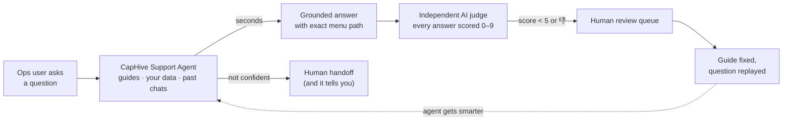

# LinkedIn Post #1 — Customer Support Agent

```yaml
series: "Fund Ops, Unstacked #1"
feature: Customer Support Agent (AI chat + CS Feedback Review Dashboard)
persona: COO / Head of Fund Operations
hook_rationale: >
  Leads with the counterintuitive claim (the judge matters more than the agent)
  rather than "we have a chatbot", which is table stakes in 2026. Survives the
  3-line fold with pain (support wait) implied and payoff (audited AI) explicit.
impact_used: >
  Seconds vs next-business-day ticket; 100% of answers scored (not a sample);
  hard numbers from code: 0–9 judge scale, <5 auto-review threshold, 6-tool-call
  cap, mandatory tenant-scope placeholder on every SQL query.
status: spare draft — not posted; renumber series label ("Fund Ops, Unstacked #1" in text) before posting
```

---

## Paste-ready post text

```
We put an AI support agent inside our fund platform.

Then we built a second AI whose only job is to grade the first one — every answer, scored 0–9.

Here's why the second AI matters more than the first. 👇

It's quarter-end. Your ops manager needs to reissue a capital call notice and can't remember where the setting lives.

So they email the vendor's support desk. And wait.

That "quick question" just cost a day.

CapHive ships a support agent inside the platform itself. It answers from three sources:

→ the product guides (for "how do I…" questions)
→ your firm's live data (for "how many LPs have signed?" questions)
→ your past conversations (for "what did we ask last month?" follow-ups)

Answers arrive in seconds, with the exact menu path to follow. And when it isn't confident, it doesn't improvise — it hands you to a human, and says so.

⚙️ Under the hood

This is where the engineering effort actually went:

→ Every database query the agent writes is validated before it runs: read-only, an explicit allowlist of tables, and rejected outright unless it carries your firm's tenant scope. The agent is 𝘂𝗻𝗮𝗯𝗹𝗲 to see another firm's data — not just instructed not to.

→ A hard cap of 6 tool calls per question. If it can't reach a grounded answer, it escalates to our team instead of guessing.

→ Every response is scored asynchronously by an independent LLM judge on completeness, grounding, and actionability. 𝟭𝟬𝟬% 𝗼𝗳 𝗮𝗻𝘀𝘄𝗲𝗿𝘀 𝗮𝗿𝗲 𝘀𝗰𝗼𝗿𝗲𝗱 — not a sample.

→ Any answer below 5/9 — or any thumbs-down from a user — lands in a human review queue. Our team fixes the underlying guide, then replays the exact question side-by-side to prove the fix worked.

That last loop is the product. The agent isn't static — every bad answer makes the next one better.

📊 The impact

A "how do I" question: answered in seconds instead of a next-business-day ticket.
Quality control: every single answer audited, automatically, in the background.

———

✅ Takeaways for anyone deploying AI agents

1. Ship the judge with the agent. An unscored answer is unknown quality at scale.

2. Make the agent unable to do the wrong thing — read-only access, table allowlists, enforced tenant scoping — don't just prompt it to behave.

3. Escalation is a feature, not a failure. "I don't know — here's a human" builds more trust than a confident guess.

4. Let bad answers file their own tickets: user thumbs-downs and low judge scores should feed one review queue.

Evaluating AI support tools this year? Ask every vendor one question: "How do you know when your bot is wrong?"

What would it take for you to trust an AI agent with questions about your fund data? 👇

— Fund Ops, Unstacked #1: one CapHive feature, properly explained, each week.

#PrivateEquity #FundOperations #AIAgents #FundAdministration #CFO
```

---

## First-comment text

```
Full walkthrough of the support agent and the review dashboard behind it (judge scores, escalation queues, re-testing) is in our product guide — link below.

If you'd like to see it running on your own fund structure, my DMs are open.

<link>
```

---

## Diagram (attach as image — export from the preview artifact)



---

## Carousel variant (optional, 7 slides)

1. **Hook** — "We built an AI to grade our AI. Every answer, 0–9."
2. **Problem** — Quarter-end. A 'quick question' to a support desk costs a day.
3. **How it works** — 3 sources: guides, your live data, past conversations. Seconds, not tickets.
4. **Guardrails** — Read-only. Table allowlist. Tenant scope enforced on every query. Unable, not just instructed.
5. **The judge** — 100% of answers scored on completeness, grounding, actionability. Below 5/9 → human review.
6. **The loop** — Thumbs-down → review → guide fixed → question replayed → agent improves.
7. **Takeaways + CTA** — Ship the judge with the agent. Ask your vendor: "How do you know when your bot is wrong?"
```
