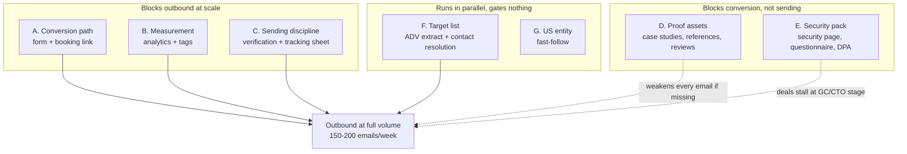

# US GTM Prerequisites — What Must Exist Before Outreach Scales

**Purpose:** The setup work that gates the channels in [`us_gtm_zero_budget_notes.md`](us_gtm_zero_budget_notes.md). Most of it is not marketing work, and none of it is optional — outreach into a broken conversion path burns the target list, which is the one asset that cannot be re-bought.
**How to use this:** Fill in owner and target date for every row. Review weekly. A row is not done until its "done when" test passes.
**Status:** Live checklist. Update in place.

> **Working notes, drafts and evidence:** [`gtm_prerequisites_work/`](gtm_prerequisites_work/) — start at [`PROGRESS.md`](gtm_prerequisites_work/PROGRESS.md).
>
> ✅ **Security claims confirmed by the founders (2026-08-16).** SOC 2 and ISO 27001:2022 are held; the audit in [`E_SECURITY_CLAIMS_AUDIT.md`](gtm_prerequisites_work/E_SECURITY_CLAIMS_AUDIT.md) found "no evidence in the repository", which is not the same as absent. **This is no longer a blocker.** Two follow-ups that are housekeeping rather than gates: obtain the certificate and SOC 2 report as files for the diligence pack, since the security page offers to share both on request; and note that the **TLS 1.3** and **AES-256** claims are infrastructure configuration rather than certifications — any prospect can test the TLS one from outside in seconds, so it is worth confirming `IRM-Infra/alb.py` pins an `ssl_policy` that matches what the page says.
>
> ✅ **F3 is answered: 1,354 US GPs match the §1.1 profile** against a 400–600 requirement — the funnel's volume assumption holds. See [`F_form_adv_findings.md`](gtm_prerequisites_work/F_form_adv_findings.md).
>
> Groups A and B are on `main`. Lead capture is built and covered by Cucumber — see [`docs/technical/website_lead_capture.md`](../technical/website_lead_capture.md). GA4 runs behind a consent banner; no ad tag is loaded, and the `ad_*` consent signals are permanently denied in `website_src/_partials/analytics.html`. Remaining blanks: the LinkedIn Partner ID, and a decision on Google Ads conversion tracking (the account and label exist but adding the tag would reverse the "no ad tags" position and require a cookie-policy change).

---

## 1. Critical Path

Not everything blocks equally. Three groups, in order:

**The one hard rule:** low-volume outbound (~10 accounts/week, message testing) may start once **C** is done — which is now days of work rather than weeks, since the domain warm-up was removed. Full volume waits for **A**, **B** and **C** together.

---

## 2. Group A — Conversion Path ✅ COMPLETE (2026-08-16)

Outreach drives traffic to the site. If the site cannot capture an address or book a call, the traffic is wasted and there is no way to tell that it was.

**Complete.** The demo form POSTs to our own `/website_leads` endpoint on the app host, resolved in the browser from `location.hostname` so each stack writes to its own database. Submissions notify a monitored inbox. Both the contact-page block and the header CTA are driven by `CAPHIVE.bookingUrl` and degrade to the contact form while it is empty, so retiring the Calendly account cannot leave a dead link behind.

**The one standing obligation:** the Calendly availability published is a commitment. The GTM plan sells US-hours coverage, and declining a booking after offering the slot does more damage than never offering it. If the ET window stops being honourable, narrow it in Calendly the same day.

| # | Item | Done when | Owner | Target | Status |
|---|---|---|---|---|---|
| A1 | Demo form POSTs to something we control (our own `/website_leads` endpoint on the app host) | A test submission from an incognito window lands somewhere we can see, with no mail client involved | | | ☑ Done |
| A2 | Submission notification routed to a monitored inbox | Test submission produces an alert within 5 minutes | | | ☑ Done |
| A3 | Booking link live (Calendly free tier or equivalent), with US-hours availability that reflects reality | A prospect in ET can book a slot without emailing first | | | ☑ Done — account created 2026-08-16 |
| A4 | Booking link placed on the contact page, in the site header CTA, and in the email signature used for outbound | All three carry the same link | | | ☑ Done — contact page and header CTA both driven by `CAPHIVE.bookingUrl`; email signature set by hand |
| A5 | Distinct thank-you / confirmation page after submission | Loads at a unique URL, so it can be used as a conversion trigger in B4 | | | ☑ Done |

**Note on A3:** availability must be genuinely bookable during US business hours. Publishing slots we cannot honour is worse than publishing none.

---

## 3. Group B — Measurement (Blocks Outbound at Scale)

Without tags there is no retargeting audience, no attribution, and no way to know which channel produced a meeting. The paid tests in the GTM doc §3.6 are entirely dependent on this group.

**Current state:** the site layout (`website_src/_layout.html.erb`) contains no analytics or tag scripts.

| # | Item | Done when | Owner | Target | Status |
|---|---|---|---|---|---|
| B1 | Web analytics installed sitewide (GA4, or a lightweight paid alternative) | Real-time view shows a visit from a phone on mobile data | | | 🟡 Account created 2026-08-16 — awaiting Measurement ID in site config + deploy |
| B2 | LinkedIn Insight Tag installed sitewide | LinkedIn Campaign Manager reports the tag as active | | | 📝 Drafted — slot built, needs Partner ID |
| B3 | Google Ads tag installed sitewide | Google Ads reports the tag as receiving traffic | | | 🟡 Account created 2026-08-16 — awaiting Conversion ID + Label in site config + deploy |
| B4 | Conversion events defined: `demo_form_submitted`, `booking_completed` | Both fire on a test run and appear in the analytics property | | | 🟡 Ads conversion action created 2026-08-16 — GA4 side needs the deploy, then mark as key events |
| B5 | UTM convention agreed and documented for outbound links | One convention used across email, LinkedIn, and blog links, written down somewhere both founders can find | | | ☑ Done |

**Sequencing note:** tags must be live and collecting for at least a few days before any retargeting audience can be built, and LinkedIn will not serve a Matched Audience below roughly 300 members. That lag is why B sits on the critical path rather than being done later.

---

## 4. Group C — Sending Infrastructure (Blocks Outbound Entirely)

**Design decision (supersedes the earlier version of this group).** Cold outreach is sent **by the CEO, by hand, from his own `caphive.com` mailbox** — no secondary domain, no mailbox fleet, no DNS work, no sequencer, no 2–3 week warm-up. At ~25 accounts/week that infrastructure is over-built: it exists for agencies sending thousands per week, it would have put a lookalike domain in front of buyers specifically drilled to spot lookalike domains, and it delays the plan by three weeks for no gain. This group shrank from six rows to four, and **left the critical path entirely.**

| # | Item | Done when | Owner | Target | Status |
|---|---|---|---|---|---|
| C1 | ~~Address verification tooling~~ — **not needed.** Addresses are already held, and manual sending surfaces a bounce immediately rather than in aggregate | Bounce rate stays under ~5% | | | ☑ Closed — no tooling purchased |
| C2 | Sending discipline agreed and written down: CEO's own mailbox, 20–30 sends/day, ~25 accounts/week, never a bulk ESP | Both founders can state the daily cap from memory | | | 🔴 Needs human (decision) |
| C3 | CAN-SPAM compliance in the template: real postal address, plain opt-out line, honest subject lines | A test send shows all three present | | | 📝 Drafted |
| C4 | Outbound tracking sheet in place **before the first send** | Sheet exists with one row per account and the next-touch date populated | | | ☐ |

**On C1 — closed, and the reasoning holds.** Verification tooling exists to catch bounces *before* a bulk send, when you cannot see them one at a time. Sending by hand at ~25 accounts/week removes that need: the CEO sees each bounce as it arrives and simply stops using that address. A handful of bounces a week from a two-year-old domain with real sending history is nowhere near the level that damages reputation.

**The guard that replaces it, at zero cost:** watch the bounce rate rather than each address. If it passes roughly **5%**, stop and check where the list came from before sending more — that is a list-quality signal, not a deliverability accident. It matters because `caphive.com` also carries all transactional mail (`SUPPORT_EMAIL_FROM=support@caphive.com`, via SES), so degraded deliverability would land on customers' capital call notices, not just on outreach. Watch SES bounce and complaint rates too, since SES throttles independently of Gmail.

**On C4 — the failure mode of manual sending.** It is not the sending; it is the state-keeping. Emails 2–4 produce most replies, and by week four the CEO is tracking ~100 accounts across four touches. Without a sheet the sequence quietly degrades into one-and-done emails, which is the version that does not work. The sheet must exist before the first send, not after it starts hurting.

**Boundary rule:** never import the cold list into Mailchimp or any bulk ESP. Mailchimp requires permission-based lists, and cold sending is a common cause of account suspension — which would take down the existing-client communications already running through it. Mailchimp keeps the opted-in audience; cold outreach stays one-to-one.

---

## 5. Group D — Proof Assets (Weakens Every Email if Missing)

Does not block sending, but a cold email that can cite a named case study converts several times better than one that cannot. Scaling outbound before these exist spends the best accounts on the weakest version of the message.

**Current state:** six case studies are already published on the site (`case-capital-drawdowns`, `case-investor-onboarding`, `case-investor-statements`, `case-multi-currency-close`, `case-multi-party-transactions`, `case-portfolio-reports`). They are strong content-marketing assets and should keep being linked from outbound — but they do not satisfy D1. Client names are withheld by design, there is no named quote or attributed individual, the figures are scale metrics ("200+ LPs onboarded") rather than before/after outcome metrics, and the onboarding case is built on an Indian AIF with SEBI and GIFT/IFSC specifics that signal exactly the thing we are trying to pre-empt with a US buyer. **D1 is therefore an asking problem, not a writing problem** — the work is securing attribution, a quote and one outcome number per case, not producing new prose.

Measured India-specific references (SEBI/AIF/GIFT/IFSC/India/INR/crore/lakh) per page:

| Case study | India references | Verdict |
|---|---|---|
| `case-capital-drawdowns` | 0 | Travels to a US buyer unchanged — upgrade first |
| `case-investor-statements` | 0 | Travels unchanged; also holds the best latent metric (see below) |
| `case-portfolio-reports` | 0 | Travels unchanged |
| `case-multi-currency-close` | 0 (was 1) | ✅ Reference removed 2026-08-16 — now usable |
| `case-multi-party-transactions` | 2 | Needs rework before US use |
| `case-investor-onboarding` | 8 | Unusable with a US buyer as written |

Across all six there was exactly **one** improvement claim ("over 5× more efficient") carrying no baseline, and two pages had literal `Before:`/`After:` headings with no numbers under them.

**Changed 2026-08-16.** Three pages — `case-investor-statements`, `case-multi-currency-close`, `case-portfolio-reports` — now carry before/after figures, and both empty `Before:`/`After:` blocks are filled. **Those figures are modelled, not measured**, and each sits inside an on-page *"On these figures"* block saying so. The 5× now has a stated baseline (20 person-days → 3.5) and the dangling *"used to take a fortnight"* sentence has its after half. Every assumption is recorded in [`D1_case_study_gap_analysis.md`](gtm_prerequisites_work/D1_case_study_gap_analysis.md) §7. No customer quote was written or published — a quote is testimony and cannot be modelled; proposed quotes for customer approval sit in §7.3 of that document. **This does not close D1**, whose done-when is written customer approval.

| # | Item | Done when | Owner | Target | Status |
|---|---|---|---|---|---|
| D1 | 2–3 written case studies with hard numbers (e.g. "quarter-close from 15 days to 4") | Customer has approved the wording in writing | | | 🟡 Three pages now carry **modelled, on-page-labelled** numbers — still 🔴 for the done-when, which needs a customer's written sign-off |
| D2 | Reference-call commitment from at least 2 customers | Each has agreed to take a 15-minute call with a prospect | | | 🟡 **1 of 2 — a US client will vouch on a call.** Needs a second, and the first one's agreement on frequency and wording |
| D3 | G2 profile claimed and 3+ reviews live | Profile is public and searchable | | | 🔴 Needs human (vendor account) |
| D4 | Capterra profile claimed and 3+ reviews live | Profile is public and searchable | | | 🔴 Needs human (vendor account) |
| D5 | Case studies published on the site and linkable from outbound | Each has its own URL | | | ☑ Done structurally — upgrades pending D1 |

**What G2 and Capterra are, and why they are on this list (D3, D4).** Both are third-party B2B software review sites — G2 (g2.com) and Capterra (capterra.com, owned by Gartner). Each runs category pages such as "fund administration software" and "investor portal software", where buyers read verified reviews and compare vendors side by side.

They earn a place here for one reason: **they are the only proof asset we cannot write ourselves.** Reviews are tied to a verified reviewer identity (work email or LinkedIn), and both platforms police vendors writing their own reviews or incentivising positive-only ones. That independence is exactly what our existing case studies lack — those are anonymised and authored by CapHive, so a sceptical buyer discounts them as vendor claims.

The mechanic that makes them a prerequisite rather than a nice-to-have: US buyers check these sites as a routine due-diligence step, usually right after the first call. An absent or empty profile reads as "no real customers". Three or four genuine reviews read as a real company.

- **Cost:** free to claim a listing and collect reviews. Both sell enhanced profiles and lead data running into thousands per year — not needed, do not buy them.
- **Effort:** real. Getting to 3–5 reviews means personally asking 8–10 customers; each review takes them 10–15 minutes. Budget the asks, not the money.
- **Caveat to expect:** with a customer base concentrated in India, reviewer profiles will show that. Still substantially better than an empty listing, and it is consistent with the honest positioning everywhere else in this plan.

**Open dependency — partly resolved 2026-08-16.** The customer base is mostly India-based, **but one US client will vouch for CapHive on a call.** That answers the worst version of GTM doc §11: outbound does not have to fall back entirely on structured pilots. Two consequences — send that client the D1 ask first (a US firm's number and quote outweighs the other five for a US buyer), and note that "a US client will take a fifteen-minute call before you sign" is a stronger line in a cold email than any case study on the site. Confirm frequency and wording with them before it appears in one.

---

## 6. Group E — Security Pack (Deals Stall at GC/CTO Stage Without It)

For the mid-market profile in GTM doc §1.1, this is usually a questionnaire rather than a formal InfoSec review — which means the pack below is sufficient and SOC 2 is not required to close the first 5. Volunteering these before they are requested is free and directly attacks the "unknown offshore vendor" objection.

| # | Item | Done when | Owner | Target | Status |
|---|---|---|---|---|---|
| E1 | Security page on the site: hosting, encryption at rest and in transit, access control, backup and retention, incident response | Published and linkable | | | 📝 Drafted — claims confirmed 2026-08-16, ready to publish |
| E2 | Pre-completed standard security questionnaire (SIG Lite or CAIQ) | A PDF that can be sent within an hour of a request | | | 📝 Drafted — claims confirmed; needs the certificate/report files attached |
| E3 | DPA template ready for counter-signature | Reviewed by counsel | | | 🔴 Needs human (counsel) |
| E4 | Subprocessor list published | Current and dated | | | 📝 Drafted — 3 entries need a decision |
| E5 | Stated US-hours support commitment, honestly scoped | Published on the site and consistent with what we will actually staff | | | 🔴 Needs human (staffing decision) |

**SOC 2 Type I** is deliberately *not* in this table. It is the gate for the $3–10B segment, not this one — fund it from the first closes and set the trigger explicitly (e.g. start the engagement after customer #2 signs).

---

## 7. Group F — Target List (Runs in Parallel)

| # | Item | Done when | Owner | Target | Status |
|---|---|---|---|---|---|
| F1 | Form ADV bulk data downloaded | Raw files on disk | | | ☑ Done |
| F2 | Filter applied for GTM doc §1.1: $300M–$2B AUM, 3+ private fund vehicles | Qualifying account count known | | | ☑ Done — script + CSV |
| F3 | **Sanity check the pool size against the plan's 400–600 account requirement** | If materially short, decide deliberately whether to drop the AUM floor or loosen the complexity qualifier | | | ☑ Done — 1,354 US firms match |
| F4 | First 100 accounts researched with a named CFO/COO/controller and a verified email | 100 rows complete at roughly 10–15 min each | | | ⬜ Not started (17–25 hrs human research) |

F3 is the one worth doing early. It is cheap, it is answerable from data we can download today, and it validates or breaks the volume assumptions the whole funnel rests on.

---

## 8. Group G — Legal and Admin (Fast-Follow, Gates Nothing Yet)

| # | Item | Done when | Owner | Target | Status |
|---|---|---|---|---|---|
| G1 | US entity (Delaware LLC or C-corp) | Formed, with a bank account | | | 🔴 Needs human (entity formation) |

Do not block outreach on this. Start it when the first deal reaches legal review — that is the point at which procurement friction becomes real, and it is cheap enough (~$500–1K) that it need not be planned around.

---

## 9. Weekly Review

Three questions each week:

1. Which rows moved, and which have been "in progress" for more than two weeks?
2. Are we sending at a volume our completed prerequisites actually support — or ahead of them?
3. Has anything in Group A or B silently broken? Submit a test form and complete a test booking monthly; a conversion path that fails quietly looks identical to a channel that is not working.
