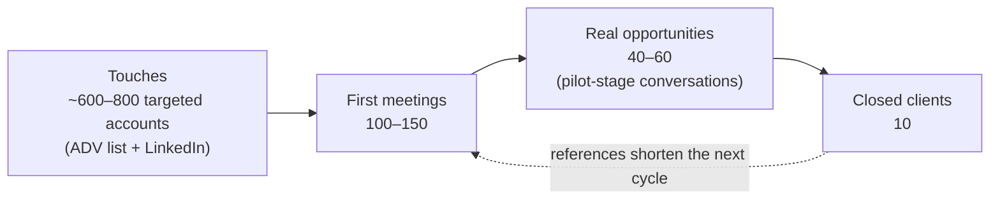

# US GTM Notes: 10 Clients on a Near-Zero Budget

**Audience:** CapHive founders
**Goal:** Land the first 10 US clients from India — no travel, minimal ad/marketing spend.
**Relationship to other docs:** The strategy, ICP, personas, pricing, and sales playbook live in [`docs/features/us_gtm.md`](../features/us_gtm.md). The paid-ads plan ([`linkedin_google_ads_plan.md`](linkedin_google_ads_plan.md)) assumes a $10–15K/month budget — treat it as a later-stage option, not the starting motion. This doc is the **constrained-budget operating plan**: what we actually do week to week with ~$100–200/month of tooling spend and founder time.
**Status:** Working notes. Update as channels prove or fail.

---

## 1. The Real Constraint Is Trust, Not Money

The buyer is a CFO / COO / controller at a $500M–$10B GP (see `us_gtm.md` §2.1). Software that touches capital calls, allocations, and LP money is a risk decision before it is a feature decision. The default objection to an unknown vendor based in India with no US presence is not "too expensive" — it is "too risky."

So every channel and every deliverable gets judged by one question: **does this manufacture trust at zero cost?** Trust can be built remotely through four mechanisms, and the whole plan is organized around them:

1. **Proof** — case studies, reference calls, G2/Capterra reviews, live product depth in demos
2. **Specificity** — content and outreach that could only come from someone who deeply knows fund ops
3. **Borrowed credibility** — partners, podcasts, communities, co-authored content
4. **De-risked offers** — structured pilots, white-glove service, SOC 2, US-hours support

---

## 2. Channel Stack, Ranked by Expected Yield per Dollar

### 2.1 Founder-led LinkedIn (in motion — make it a system, not a hobby)

The content engine has started (`linkedin_posts/`). Content alone does not convert; the engine has three parts and the second two are where meetings come from:

| Part | Cadence | What it does |
|---|---|---|
| **Publish** | 2–3 posts/week | Deep, specific fund-ops content (allocation edge cases, capital call timing, LP reporting pain). Signals "this person clearly knows fund ops." |
| **Engage** | 30 min/day | Substantive comments on posts by fund CFOs, fund admins, PE ops voices. Free distribution into the ICP's feed. Most people skip this part. |
| **Connect + soft DM** | Ongoing | Everyone who likes/comments gets a connection request. No pitch — "saw you engaged with my allocation post, what's your setup today?" Converts lurkers into conversations. |

Expected yield: 2–4 qualified conversations/month once it compounds (3–4 months in).

### 2.2 Cold email outbound — highest-volume channel, nearly free

Works fine from India, and the ICP is unusually identifiable because the regulator publishes the list:

- **SEC Form ADV** filings are a free, public, complete registry of every US registered investment adviser — AUM, strategy, fund count, headcount, office locations. Bulk-downloadable. Filter to $500M–$10B private fund managers and the 30-account target list from `us_gtm.md` §4.4 builds itself, plus a long tail of hundreds more.
- Find the CFO / controller / VP Finance on LinkedIn; resolve emails with a cheap finder tool (~$30–50/month — one of the only real spends). Send from a **separate domain** (e.g. caphive.io) to protect the main domain's reputation; warm it up for 2–3 weeks first.
- Sequences of 3–4 short emails, hyper-personalized from ADV data: their fund count, strategy, a real pain ("managing deal-by-deal carry across 3 vintages in Excel"). Link to published content as proof, not a deck.
- **150–200 highly personalized emails/week beats 2,000 sprayed.** Fund CFOs are a small community that talks; a spammy reputation is permanent. Comply with CAN-SPAM (real address, working unsubscribe, no deceptive subject lines).
- Send during US business hours (India evenings — a natural fit).

Expected yield: 1–2% meeting rate on a well-targeted list → 6–15 meetings/month at full volume.

### 2.3 Borrowed trust: partners and references

- **Fund administrators, outsourced-CFO firms, audit/tax firms** serving mid-market GPs are a channel, not competition (see `us_gtm.md` §4.1 Phase 2 — but start the first 2–3 conversations now, not in month 10). They watch clients drown in Excel daily and take Zoom meetings happily. Offer a referral arrangement (rev share or reciprocal referrals).
- **Existing customers are the only real asset today.** Before scaling outbound: (a) 2–3 written case studies with hard numbers ("quarter-close from 15 days to 4"), (b) one warm introduction to a US peer from each, (c) G2/Capterra reviews — US buyers check these.
- **Podcasts:** PE ops / fund-CFO podcasts constantly need guests. Free borrowed credibility that every cold email can link to. Pitch 2/month.
- **Communities:** fund-ops and PE-CFO communities, virtual events, LinkedIn groups. Participate as a practitioner, not a vendor.

### 2.4 Lead magnets from product depth (near-zero cost, compounds)

CapHive's domain logic *is* the content. Ship free, ungated-or-lightly-gated tools and guides that only a real fund-ops platform could produce:

- Interactive calculators (allocation formulas, capital call schedules, waterfall/carry scenarios)
- The monthly operational guides already planned in `us_gtm.md` §4.3 — each one doubles as an outbound email asset
- These become the Stage-2 content offers in the ads plan if/when paid spend turns on later

---

## 3. De-risk the Deal Itself (Where India-Based Vendors Lose)

Pre-empt the objections instead of answering them defensively:

| Objection (usually unspoken) | Pre-emptive move |
|---|---|
| "Are they secure enough to touch LP data?" | **SOC 2 Type I** — often a hard gate for this buyer. Compliance-automation platforms have made this affordable; likely the single best "marketing" spend available. Until then: serious security page, completed questionnaire, DPA ready (`us_gtm.md` §4.3). |
| "Will anyone answer when I have a capital call at 9am ET?" | State US-hours coverage explicitly: "support until 2pm ET" is India evening — a real, honest offer. |
| "What if this fails mid-adoption?" | Structured 60-day paid pilot tied to a real milestone (per `us_gtm.md` §4.4 Step 5), founding-US-customer pricing, white-glove migration included. Service intensity is the one thing US competitors won't match. |
| "Can we even contract with an Indian entity?" | Eventually a US entity (Delaware LLC/C-corp is cheap, removes procurement friction). Don't block on it; note it as a fast-follow once deals are in legal. |

---

## 4. Funnel Math and Timeline (Honest Version)

Sales cycles at this ICP run 8–24 weeks (`us_gtm.md` §4.1). Working backwards from 10 closed clients:

- Expect **12–18 months** of consistent execution at this cadence. That is the honest number.
- The way to compress it: warm paths close 3–5× better than cold — which is why case studies and partner conversations come **first**, before outbound scales.
- Track weekly: emails sent, reply rate, meetings booked, pilots proposed. If reply rate < 1% after 300 sends, the list or the message is wrong — fix before adding volume.

---

## 5. Weekly Operating Cadence (Founder Time Budget)

| Activity | Time/week | Notes |
|---|---|---|
| LinkedIn: publish + engage + DM | ~5 hrs | 2–3 posts, daily 30-min engagement block |
| Outbound: list build + personalization + sends | ~6 hrs | 150–200 emails once domain is warm |
| Meetings + demos (US hours = India evenings) | variable | Configure demo to mirror their structure (`us_gtm.md` §4.4 Step 4) |
| Partner/podcast/community outreach | ~2 hrs | 2 podcast pitches + 1–2 partner conversations/month |
| Case-study and reference work | ~1 hr | Front-loaded in the first month |

Total: roughly 15 hrs/week of founder GTM time, sustained.

---

## 6. Total Cash Budget

| Item | Monthly | One-time |
|---|---|---|
| Email finder + sequencer tooling | $50–100 | — |
| Secondary sending domain + mailbox | ~$10 | ~$15 |
| G2/Capterra listings | free | — |
| SOC 2 Type I (when affordable) | — | ~$5–15K (the one meaningful spend; treat as sales infrastructure, not marketing) |
| US entity (fast-follow) | — | ~$500–1K |

Everything else in this plan costs founder time, not cash.

---

## 7. Open Questions

- **ACV confirmation:** pricing bands in `us_gtm.md` §4.2 imply $60K+ ACV — this justifies heavy per-account personalization (10–15 min per account is fine). Confirm against what current customers actually pay.
- **Reference geography:** are current happy customers usable as US references, or India-only? Determines how hard to lean on case studies vs. pilots in early messaging.
- **Who owns the daily LinkedIn engagement block** — this fails silently when nobody owns it.
- **When does paid spend turn on?** Proposed trigger: after 2 published case studies + reply-rate-validated messaging, revisit `linkedin_google_ads_plan.md` — the funnel there reuses the same content assets.
