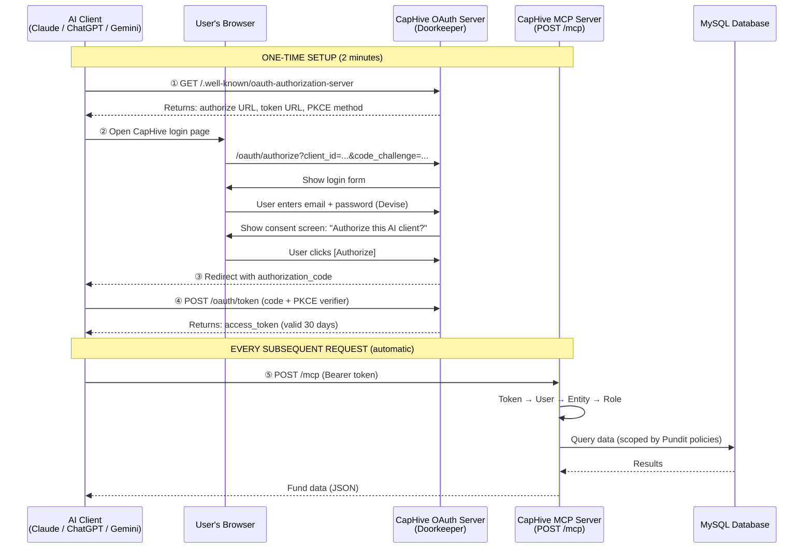
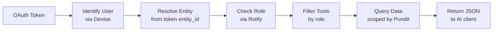
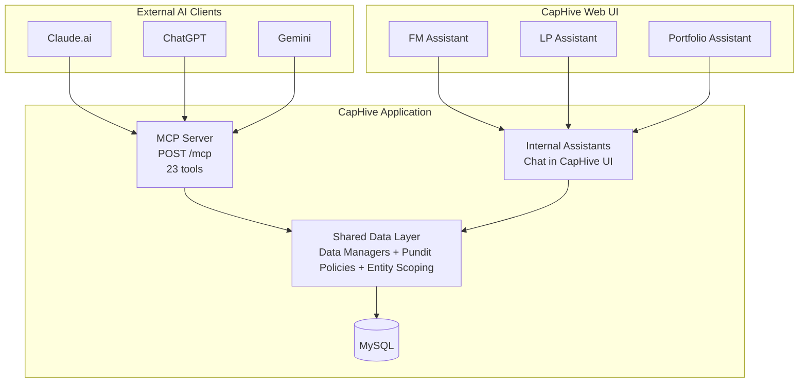

# CapHive MCP Server — Implementation Plan

---

## 1. How CapHive is Deployed (Multi-Tenancy)

Before explaining the MCP server, it helps to understand how CapHive serves multiple fund management firms from a single platform.

### Single Application, Multiple Subdomains

CapHive runs as a **single shared Rails application** with a **single shared MySQL database**. Every entity (fund management firm) runs on the same application, the same server, and the same database. There are no separate deployments per entity.

What makes each entity appear as its own environment is the **subdomain**:

```
fmalpha.caphive.com    →  Entity: FM Alpha Capital
fmbeta.caphive.com     →  Entity: FM Beta Ventures
demofund.caphive.com   →  Entity: Demo Fund
```

When a request comes in, CapHive reads the subdomain from the URL, looks up the matching Entity record in the database, and sets the current entity context. All data queries, authorization checks, and UI rendering are then scoped to that entity. This is handled automatically by the application middleware — no manual configuration per entity.

Some entities also use **custom domains** (white-label mode), where their own domain (e.g., `app.tenant.com`) maps to their CapHive entity. The resolution logic handles both patterns.

### Regional Deployments

CapHive has two production regions:

| Region | Base Domain | Example |
|---|---|---|
| India | `caphive.com` | `fmalpha.caphive.com` |
| US | `caphive.us` | `fmbeta.caphive.us` |

Each region is a separate deployment, but the architecture is identical. The MCP server works the same way in both regions.

### Why This Matters for MCP

Because all entities share one application:

- **OAuth applications (Claude.ai, ChatGPT, Gemini) are registered once, globally** — not per entity
- **The MCP endpoint (`/mcp`) is the same for all entities** — entity scoping comes from the authenticated user's token, not from the URL
- **No per-entity infrastructure setup** — enabling MCP for a new entity is a configuration toggle, not a deployment

---

## 2. How the MCP Server Works

### What We Built

CapHive now has a **single MCP (Model Context Protocol) endpoint** that allows any AI client — Claude, ChatGPT, Gemini — to connect and query fund management data. The MCP server lives inside the existing CapHive Rails application. It is not a separate service, not a separate process, and does not run on a separate port. It is simply a new route (`/mcp`) that speaks the MCP protocol — the industry standard for AI-to-data connectivity.

When a fund manager opens Claude.ai and asks *"What are my top 5 funds by committed amount?"*, Claude calls CapHive's MCP endpoint, fetches the authorized data, and presents the answer. The same works with ChatGPT and Gemini.

### How Authentication Works (OAuth 2.1 + PKCE)

CapHive uses **OAuth 2.1 with PKCE** — the same secure authorization pattern used by "Sign in with Google" or "Login with GitHub." The user's password is never shared with the AI client. Instead, the AI client receives a time-limited access token that grants read-only access to the user's data.

**Key components:**

| Component | Role |
|---|---|
| **Doorkeeper** (Ruby gem) | Acts as the OAuth 2.1 provider — manages OAuth applications, authorization codes, and access tokens |
| **Devise** | Handles user authentication (email/password login on the consent screen) |
| **PKCE (S256)** | Cryptographic proof that the AI client requesting the token is the same one that started the authorization — prevents token interception |
| **RFC 8414 / RFC 9728** | Standard discovery endpoints (`/.well-known/oauth-authorization-server` and `/.well-known/oauth-protected-resource`) that let AI clients auto-discover how to connect |

**The complete OAuth flow:**



**How data access is resolved on each MCP request:**



**How MCP tools share the data layer with internal assistants:**



**After the one-time setup,** the token is saved by the AI client. The user doesn't log in again for 30 days. Every subsequent MCP request simply sends the token in the `Authorization` header.

### How OAuth Applications Are Registered

Because CapHive is a single shared deployment (see Section 1), OAuth applications for AI clients are registered **once, globally** — not per entity. The CapHive engineering team creates one Doorkeeper OAuth application record for each AI platform:

```
┌───────────────────────────────────────────────────────────────────────┐
│  oauth_applications table (GLOBAL — registered once by CapHive team) │
│                                                                       │
│  id=1  name="Claude.ai"   client_id=xxx   redirect_uri=https://...   │
│  id=2  name="ChatGPT"     client_id=yyy   redirect_uri=https://...   │
│  id=3  name="Gemini"      client_id=zzz   redirect_uri=https://...   │
└───────────────────────────────────────────────────────────────────────┘
```

When users from different entities authorize the same AI client, each gets their own access token stamped with their `entity_id`:

```
┌───────────────────────────────────────────────────────────────────────┐
│  oauth_access_tokens table (PER USER — created during OAuth flow)    │
│                                                                       │
│  user_id=42  app_id=1 (Claude)   entity_id=157 (FM Alpha)  token=abc  │
│  user_id=88  app_id=1 (Claude)   entity_id=203 (FM Beta)   token=def  │
│  user_id=15  app_id=2 (ChatGPT)  entity_id=157 (FM Alpha)  token=ghi  │
└───────────────────────────────────────────────────────────────────────┘
```

**What happens when a new entity buys the MCP feature:**

1. The OAuth applications (Claude, ChatGPT, Gemini) already exist — no new registration needed
2. CapHive ops or the entity admin enables `mcp_enabled = true` in that entity's settings
3. The entity admin chooses which roles (FM, LP) and which AI clients to allow
4. Individual users at that entity can now connect their AI client via OAuth — self-service, no setup per user

**Who does what:**

| Action | Who | When |
|---|---|---|
| Register OAuth apps (Claude, ChatGPT, Gemini) | CapHive engineering team | Once, globally |
| Enable MCP for an entity | CapHive ops or Entity Admin | When entity purchases the feature |
| Configure allowed roles and clients | Entity Admin | After enablement |
| Connect an AI client (authorize via OAuth) | Individual FM or LP user | Self-service, anytime |

### How Data Access is Controlled

Once the MCP server receives a request with a valid token, it resolves:

1. **Who is the user?** — The access token maps to a Devise user account
2. **Which entity (firm) do they belong to?** — The token carries an `entity_id`
3. **What is their role?** — Rolify determines if they are a Fund Manager, LP, Admin, etc.
4. **What data can they see?** — Pundit authorization policies (the same ones used in the CapHive web UI) enforce what records the user can access

This means **MCP access is identical to web UI access** — a user sees exactly the same data through Claude.ai as they would on the CapHive dashboard. No special permissions, no extra configuration per user.

### What Tools Are Exposed

The MCP server exposes **tools** — structured data operations that AI clients can call. When an AI client connects, it first asks *"What tools do you have?"* (the `tools/list` request). CapHive responds with a list of available tools filtered by the user's role:

- A **Fund Manager** connecting sees tools for funds, capital activity, portfolio companies, documents, KPIs, cap tables
- An **LP (Investor)** connecting sees a smaller set — their funds, commitments, distributions, and documents

The AI client then decides which tool to call based on the user's natural language question. For example, if a user asks *"Show me all capital calls for Fund Alpha"*, the AI client calls the `list_capital_calls` tool with the appropriate parameters.

### How MCP Tools Relate to Existing AI Assistants

CapHive already has internal AI assistants (FM Assistant, LP Assistant, Portfolio Assistant) that serve users inside the CapHive UI. The MCP server does **not** duplicate this logic. Instead, both the internal assistants and MCP tools share the same underlying data layer:

The internal assistants use CapHive's own LLM to reason and respond. The MCP server provides raw data — the external AI client (Claude, ChatGPT, Gemini) does its own reasoning. Both paths enforce the same authorization rules and query the same database. See the "How MCP tools share the data layer" diagram above.

### Current Status

- **Live:** OAuth 2.1 + PKCE authentication, MCP endpoint, one tool (`list_funds`)
- **Validated:** Successfully connected Claude.ai to CapHive via OAuth, queried real fund data
- **Pending:** 22 additional tools, entity-level governance settings, production deployment

---

## 3. Entity-Level Governance (How CapHive Sells This)

### Selling Model

| Aspect | Answer |
|---|---|
| **Who buys it?** | Entity (firm-level add-on / premium feature) |
| **Who configures?** | Entity Admin (role-based, not per-user) |
| **Who uses it?** | Individual FMs/LPs (self-service OAuth connect) |
| **What limits access?** | Existing Pundit policies (same as web app) |
| **What's new to build?** | Entity settings fields + admin UI section |

### Entity Settings (EntitySetting Model)

Add the following fields to `EntitySetting`:

| Field | Type | Default | Purpose |
|---|---|---|---|
| `mcp_enabled` | boolean | false | Master switch — is MCP available for this entity? |
| `mcp_allowed_roles` | string (JSON array) | `["employee"]` | Which roles can use MCP: `employee`, `investor`, `company_admin` |
| `mcp_allowed_clients` | string (JSON array) | `[]` (all) | Restrict to specific OAuth apps, or empty = allow all |
| `mcp_tool_blocklist` | string (JSON array) | `[]` | Specific tools to disable for this entity |

### Access Check Flow

```
OAuth token arrives at POST /mcp
  → McpAuthService resolves user + entity
  → Check: entity.entity_setting.mcp_enabled?                    → 403 if false
  → Check: user role in entity.entity_setting.mcp_allowed_roles?  → 403 if false
  → Check: OAuth app in entity.entity_setting.mcp_allowed_clients? → 403 if blocked
  → Filter tools: remove any in entity.entity_setting.mcp_tool_blocklist
  → Filter tools: remove any not visible to user's role
  → Serve remaining tools
```

### Admin UI — Entity Settings Page

Add an "AI Integrations" section to the entity edit form (`/entities/{id}/edit`):

```
┌─────────────────────────────────────────────────────┐
│  AI Client Integration (MCP)                        │
│                                                     │
│  [✓] Enable AI Client Integration                   │
│                                                     │
│  Allow access for:                                  │
│    [✓] Fund Managers                                │
│    [ ] Investors (LPs)                              │
│                                                     │
│  Allowed AI Clients:                                │
│    (●) All clients                                  │
│    ( ) Specific clients only:                       │
│        [ ] Claude    [ ] ChatGPT    [ ] Gemini      │
│                                                     │
│  [Save]                                             │
└─────────────────────────────────────────────────────┘
```

### User Profile — Connected Clients

Add a section in user profile showing active OAuth connections:

```
┌─────────────────────────────────────────────────────┐
│  Connected AI Clients                               │
│                                                     │
│  Claude.ai    ● Connected (since 13 May 2026)       │
│  ChatGPT      ○ Not connected                       │
│                                                     │
│  Your AI clients can access the same data you see   │
│  in CapHive — funds, documents, portfolio companies │
│  based on your role and permissions.                │
│                                                     │
│  [Revoke All Connections]                           │
└─────────────────────────────────────────────────────┘
```

Connected status is derived from active Doorkeeper `AccessToken` records for the user.

---

## 4. Complete MCP Tool Plan

### Existing Data Managers → MCP Tools Mapping

All tools below reuse existing DataManager methods. No new query logic.

### Domain 1: Funds (FundAssistantDataManager)

| # | MCP Tool | DataManager Method | FM | LP | Description |
|---|---|---|---|---|---|
| 1 | `list_funds` | `list_funds()` | ✓ | ✓ | List funds with committed/collected/distribution amounts |
| 2 | `get_fund_details` | `get_fund_details()` | ✓ | ✓ | Full fund snapshot (terms, dates, currency, category) |
| 3 | `list_fund_ratios` | `list_fund_ratios()` | ✓ | ✓ | TVPI, RVPI, DPI, IRR ratios |

**Status:** Tool #1 is live. Tools #2-3 pending.

### Domain 2: Capital Activity (FundAssistantDataManager)

| # | MCP Tool | DataManager Method | FM | LP | Description |
|---|---|---|---|---|---|
| 4 | `list_capital_calls` | `list_capital_calls()` | ✓ | ✓ | Capital calls with amounts, due dates, status |
| 5 | `list_capital_commitments` | `list_capital_commitments()` | ✓ | ✓ | Investor commitments per fund (folios) |
| 6 | `list_capital_remittances` | `list_capital_remittances()` | ✓ | – | Payments received, verification status |
| 7 | `list_capital_distributions` | `list_capital_distributions()` | ✓ | ✓ | Gross distribution amounts, dates |
| 8 | `list_capital_remittance_payments` | `list_capital_remittance_payments()` | ✓ | – | Individual remittance payment details |
| 9 | `list_capital_distribution_payments` | `list_capital_distribution_payments()` | ✓ | ✓ | Individual distribution payment details |

### Domain 3: Portfolio Companies (PortfolioAssistantDataManager)

| # | MCP Tool | DataManager Method | FM | LP | Description |
|---|---|---|---|---|---|
| 10 | `list_portfolio_companies` | `list_portfolio_companies()` | ✓ | – | Portfolio companies with filtering |
| 11 | `get_portfolio_company_details` | `get_portfolio_company_details()` | ✓ | – | Company snapshot (name, tags, investment amount) |
| 12 | `list_portfolio_investments` | `list_portfolio_investments()` | ✓ | – | Buys, sells, conversions, FMV, gains |
| 13 | `list_valuations` | `list_valuations()` | ✓ | – | Per-share values, dates, synthetic flags |
| 14 | `get_portfolio_company_snapshot` | `get_portfolio_company_snapshot()` | ✓ | – | High-level summary of a company |

### Domain 4: KPIs & Analytics (PortfolioAssistantDataManager)

| # | MCP Tool | DataManager Method | FM | LP | Description |
|---|---|---|---|---|---|
| 15 | `list_portfolio_kpis` | `list_portfolio_kpis()` | ✓ | – | KPI actuals/budgets (monthly/quarterly/yearly) |

### Domain 5: Cap Table (PortfolioAssistantDataManager)

| # | MCP Tool | DataManager Method | FM | LP | Description |
|---|---|---|---|---|---|
| 16 | `get_cap_table` | `get_cap_table()` | ✓ | – | Capitalization table by portfolio company |
| 17 | `get_investments_in_cap_table` | `get_investments_in_cap_table()` | ✓ | – | Investments grouped by investor/round/category |

### Domain 6: Documents (PortfolioAssistant / CapitalCommitmentAssistant DataManagers)

| # | MCP Tool | DataManager Method | FM | LP | Description |
|---|---|---|---|---|---|
| 18 | `list_documents` | `list_documents()` | ✓ | ✓ | Documents by owner, folder, tags |
| 19 | `get_document` | `get_document()` | ✓ | ✓ | Single document details + text content |
| 20 | `analyze_documents` | `analyze_documents()` | ✓ | – | LLM-powered document Q&A and extraction |

### Domain 7: Account Entries (FundAssistantDataManager)

| # | MCP Tool | DataManager Method | FM | LP | Description |
|---|---|---|---|---|---|
| 21 | `list_account_entries` | `list_account_entries()` | ✓ | – | Account entries (requires aggregation: count/sum/group_by) |

### Domain 8: Commitment Context (CapitalCommitmentAssistantDataManager)

| # | MCP Tool | DataManager Method | FM | LP | Description |
|---|---|---|---|---|---|
| 22 | `get_commitment_details` | `get_commitment_details()` | ✓ | ✓ | Single commitment financials and status |
| 23 | `list_fund_units` | `list_fund_units()` | ✓ | – | Fund units for a commitment |

---

### Tool Count Summary

| Role | Tools Available |
|---|---|
| **Fund Manager** | 23 tools (all) |
| **LP / Investor** | 10 tools (funds, ratios, calls, commitments, distributions, distribution payments, documents, commitment details) |

---

## 5. Implementation Phases

### Phase 3A: Entity Governance (1-2 days)

1. **Migration:** Add `mcp_enabled`, `mcp_allowed_roles`, `mcp_allowed_clients`, `mcp_tool_blocklist` to `entity_settings` table
2. **Model:** Add validations and accessors to `EntitySetting`
3. **Controller gate:** Update `McpController` to check entity settings before serving tools
4. **Tool filtering:** Update `ApplicationMcpTool` base class with `visible_to?(user)` role check
5. **Entity edit form:** Add "AI Integrations" section to `_form_fields.html.erb`

### Phase 3B: Fund Domain Tools (2-3 days)

6. `GetFundDetailsTool` — wraps `FundAssistantDataManager#get_fund_details`
7. `ListFundRatiosTool` — wraps `FundAssistantDataManager#list_fund_ratios`
8. `ListCapitalCallsTool` — wraps `FundAssistantDataManager#list_capital_calls`
9. `ListCapitalCommitmentsTool` — wraps `FundAssistantDataManager#list_capital_commitments`
10. `ListCapitalRemittancesTool` — wraps `FundAssistantDataManager#list_capital_remittances`
11. `ListCapitalDistributionsTool` — wraps `FundAssistantDataManager#list_capital_distributions`
12. `ListCapitalRemittancePaymentsTool` — wraps `FundAssistantDataManager#list_capital_remittance_payments`
13. `ListCapitalDistributionPaymentsTool` — wraps `FundAssistantDataManager#list_capital_distribution_payments`

### Phase 3C: Portfolio Domain Tools (2-3 days)

14. `ListPortfolioCompaniesTool` — wraps `PortfolioAssistantDataManager#list_portfolio_companies`
15. `GetPortfolioCompanyDetailsTool` — wraps `PortfolioAssistantDataManager#get_portfolio_company_details`
16. `ListPortfolioInvestmentsTool` — wraps `PortfolioAssistantDataManager#list_portfolio_investments`
17. `ListValuationsTool` — wraps `PortfolioAssistantDataManager#list_valuations`
18. `GetPortfolioCompanySnapshotTool` — wraps `PortfolioAssistantDataManager#get_portfolio_company_snapshot`
19. `ListPortfolioKpisTool` — wraps `PortfolioAssistantDataManager#list_portfolio_kpis`
20. `GetCapTableTool` — wraps `PortfolioAssistantDataManager#get_cap_table`
21. `GetInvestmentsInCapTableTool` — wraps `PortfolioAssistantDataManager#get_investments_in_cap_table`

### Phase 3D: Documents + Remaining Tools (1-2 days)

22. `ListDocumentsTool` — wraps document listing from DataManagers
23. `GetDocumentTool` — wraps single document fetch
24. `AnalyzeDocumentsTool` — wraps LLM document analysis
25. `ListAccountEntriesTool` — wraps `FundAssistantDataManager#list_account_entries`
26. `GetCommitmentDetailsTool` — wraps `CapitalCommitmentAssistantDataManager#get_commitment_details`
27. `ListFundUnitsTool` — wraps `CapitalCommitmentAssistantDataManager#list_fund_units`

### Phase 4: Production Readiness (1 week)

28. User profile — "Connected AI Clients" section (read from Doorkeeper tokens)
29. Token revocation UI
30. Audit logging for MCP tool calls
31. Rate limiting per token
32. End-user connection guides (Claude, ChatGPT, Gemini)
33. Deploy to production

---

## 6. Implementation Pattern

Every MCP tool follows the same pattern established by `ListFundsTool`:

```
app/packs/ai/mcp_server/tools/
  ├── application_mcp_tool.rb          # Base class (auth, entity scoping)
  ├── list_funds_tool.rb               # ✅ Live
  ├── get_fund_details_tool.rb         # Pending
  ├── list_capital_calls_tool.rb       # Pending
  ├── list_portfolio_companies_tool.rb # Pending
  ├── list_documents_tool.rb           # Pending
  └── ...
```

Each tool:
1. Inherits from `ApplicationMcpTool`
2. Declares a JSON input schema (parameters the AI client can pass)
3. Declares `visible_to?(user)` for role-based filtering
4. Instantiates the appropriate DataManager with the current user/entity
5. Calls the DataManager method with parsed parameters
6. Returns JSON response

---

## 7. Open Decisions

<!-- To be filled as discussions progress -->

1. **LP tool scoping** — Should LP tools show data across all their commitments, or should they pick a fund first? Current leaning: across all commitments (same as LP portal).
2. **Document analysis via MCP** — Should we expose `analyze_documents` (which calls our LLM internally)? This means an external AI calling our AI. Could be useful but adds cost and latency. Current leaning: include it, but as a separate "premium" tool that entities can disable.
3. **Write operations** — Deferred to Phase 5. Read-only for now.
4. **OAuth scopes** — Single "read" scope for now vs. fine-grained per domain. Current leaning: single scope, simpler.
5. **Rate limiting** — Per-token? Per-entity? Per-tool? Current leaning: per-token with entity-level override.
