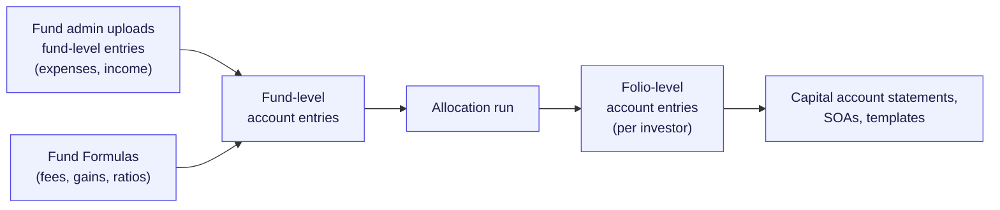
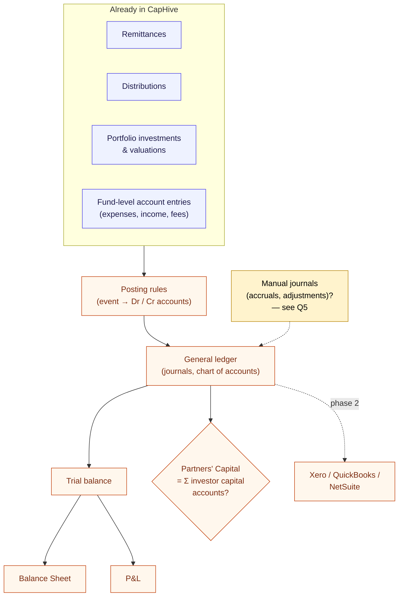
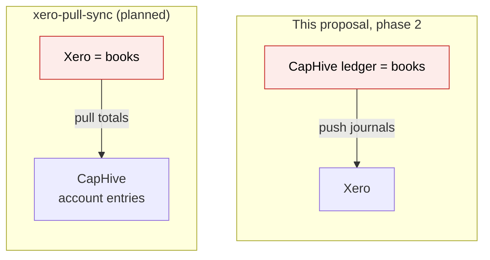
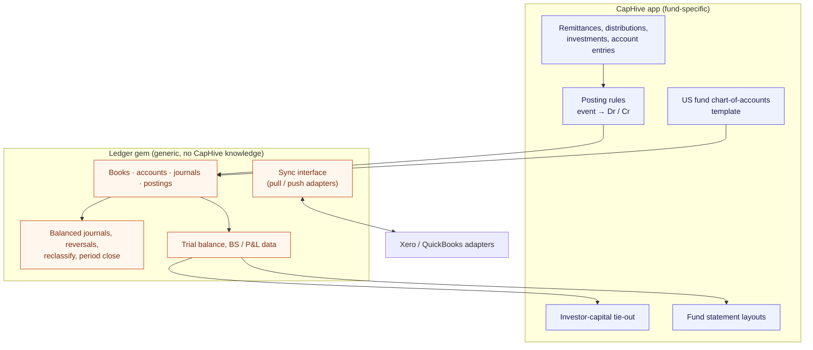
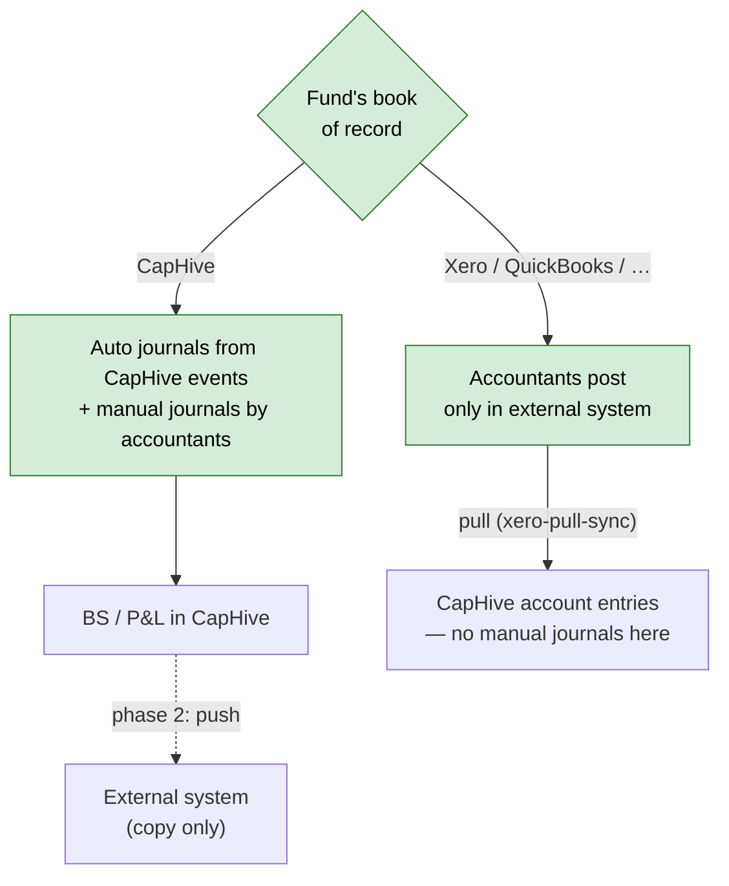

# Fund accounting (Balance Sheet & P&L): questions for the business

Requirements questionnaire, written 2026-10-04. This is a scoping document, not a design. The
answers will feed an OpenSpec change proposal in `openspec/changes/`.

**How to use this:** read the context (about a 5-minute read), then answer inline under each
question. Short answers are fine. "Don't know" or "doesn't matter" are useful answers too.
Where a question lists options, pick one or describe your own.

---

## 1. Context

### 1.1 What we want to build

An accounting sub-system inside CapHive that can produce a fund's **financial statements**:
at minimum a **Balance Sheet** and a **Profit & Loss**. In **phase 2**, the same sub-system will
**sync entries with external accounting systems** (Xero, QuickBooks, NetSuite …).

### 1.2 What CapHive has today: `AccountEntry`, which is not a ledger

CapHive already stores a lot of fund numbers as **account entries**. Each entry is a single
named amount:

| Field | Example | Meaning |
|---|---|---|
| Fund | Alpha Fund I | Every entry belongs to one fund |
| Folio / investor | `F-102` or *blank* | Blank = fund-level; filled = that investor's share |
| Name | "Audit Fees" | What the number is |
| Entry type | "Expense" | A free-text grouping |
| Reporting date | 31 Mar 2026 | When it applies |
| Cumulative | yes / no | A balance-to-date, or the movement for the period |
| Amount | 1,50,000 | Signed number in fund currency (folio/tracking currency copies too) |

Fund admins upload **fund-level** entries (e.g. expenses), and **Fund Formulas** compute more
(fees, gains, ratios). An **allocation run** then splits the fund-level amounts across investors
into **folio-level** entries. Those feed capital account statements, SOAs and report templates.

What CapHive **does not** have:

- no **debits and credits**, so nothing forces the books to balance
- no **chart of accounts** ("Audit Fees" is just a label, not an account with a type)
- no **journals** (one transaction touching several accounts)
- no **trial balance, balance sheet or P&L**. Anything that looks like one today is a Word
  template summing named entries.
- no **period close** (locking a month/quarter so nobody changes it)

### 1.3 What a real ledger adds

Most money events in a fund **already exist in CapHive** as records. A ledger would turn each
one into a balanced journal:

| Event already in CapHive | Journal it would create |
|---|---|
| Capital call paid (remittance) | Dr Bank · Cr Partners' Capital |
| Distribution paid | Dr Partners' Capital · Cr Bank |
| Portfolio investment bought | Dr Investments · Cr Bank |
| Portfolio investment sold | Dr Bank · Cr Investments · Cr/Dr Realised Gain |
| Valuation change | Dr Investments · Cr Unrealised Gain (or reverse) |
| Fund expense entry | Dr Audit Fees · Cr Payables / Bank |
| Management fee (formula output) | Dr Management Fee Expense · Cr Payable to Manager |

There's also a bonus: CapHive already tracks each investor's capital account. With a ledger,
the **sum of all investor capital accounts must equal the Partners' Capital line on the Balance
Sheet**. Today nothing checks that.

### 1.4 The Xero integration in progress, and why it conflicts

A separate change, **`xero-pull-sync`** (planned, not built), assumes the opposite direction.
**Xero is the fund's book of record**, and CapHive pulls from it each night:

- The fund admin maps each Xero account once to a CapHive entry type and name, or to "ignore".
- Each night, P&L accounts come in as that period's movement and Balance Sheet accounts as
  their period-end balance, both as **fund-level account entries**. Allocation runs then split
  them as usual.
- If a figure changes after an allocation run already covers that period, the change waits for
  admin review.
- Portfolio companies' Xero figures flow into their KPI reports.
- Nothing is written back to Xero.

The two can't both be true **for the same fund**. If CapHive pushes journals to Xero and also
pulls Xero's totals back, it re-imports its own numbers. Section 3 asks how to resolve this.

### 1.5 Build vs gem

We looked at **keepr** (github.com/ledermann/keepr), a small Rails double-entry gem. Its basic
shape is right (accounts, journals, postings, balance sheet/P&L), but it has no per-book
separation, no currency, amounts capped at 999,999.99, and German (DATEV) reporting. A fork
would end up rewritten, so we'll **borrow its design and build our own**.

We'll build it as a **separate, general-purpose gem**: a double-entry ledger that knows nothing
about funds, investors or CapHive. CapHive is just its first user. Everything fund-specific
stays in the app:
- which CapHive event posts which journal
- the starting chart of accounts for a US fund
- the investor-capital tie-out
- fund statement layouts

You don't need to answer anything on this. It's here so you know the ledger is new work, not a
plugin.

### 1.6 Already decided

| # | Decision | Consequence |
|---|---|---|
| D1 | The **book of record is chosen per fund**: CapHive, or an external system (Xero, QuickBooks, …) | Each fund carries a "books kept in" setting. `xero-pull-sync` becomes the "external" mode, not a competing design. |
| D2 | **CapHive-books fund:** accountants post journals (incl. manual ones) **in CapHive**. **External-books fund:** accountants work **only in that system**, with no manual journals in CapHive. | Manual journal entry is enabled only for CapHive-books funds. For external-books funds, CapHive's ledger is read-only or derived. |
| D3 | **Build order:** CapHive-books mode first. Design it with **extension points for pull and push** to Xero (and later others), but don't build them yet. | `xero-pull-sync` waits. Its pull becomes an extension of the ledger, not a separate path into `account_entries`. |
| D4 | **External-books fund:** CapHive **pushes** its own events (remittances, distributions, formula fees) to the external system as journals. | The ledger is built for every fund, even external-books ones, so there is something to push. Accountants don't retype CapHive events. |
| D5 | **Primary market is US funds.** | Default to US GAAP (ASC 946 investment-company accounting), USD, calendar year, partnership capital accounts. Xero/QuickBooks are more relevant than Tally. Indian AIF needs come later. |
| D6 | **Auto-posted journals are never edited.** Amount wrong → fix the source record (e.g. the remittance) and CapHive reverses and re-posts. Wrong account → **reclassify** (amount locked, posted as reversal + new entry). Otherwise use manual adjusting journals or a **Reverse** action. | Posted journals stay unchanged, so source records, the ledger, the investor-capital tie-out and pushed copies in Xero/QuickBooks always agree. Audit trail is preserved. |
| D7 | The ledger is a **separate gem, independent of CapHive**, even though we build it. | The gem has no idea what a fund is. All fund logic (posting rules, chart template, tie-out, statement layouts) lives in the app. External-system sync is an interface in the gem, with adapters plugged in. |
| D8 | **US GAAP (ASC 946) for v1**, designed so other standards can be added later. | The gem stays standard-neutral (account types, journals, balances). Anything standard-specific lives in swappable per-standard sets in the app: chart template, posting rules, statement layout. A fund could later carry a second book under another standard (or tax basis) next to its US GAAP book. |
| — | *Deferred:* switching a fund's book of record mid-life (old Q3.1) is an edge case and is left for later. | |

---

## 2. Customers and purpose

**Q2.1** US funds are the target (D5). Which kind first: VC, PE, real estate, fund of funds,
SPVs / syndicates? Is there a **pilot customer** asking for it?

> _Answer:_ US funds, yes. A US fund customer is asking for it. *(Fund type still open: VC / PE / RE / FoF / SPV?)*
> The pilot's ask: **CapHive's fund events should land in their Xero/Tally without retyping** (push). Not financial statements out of CapHive.

**Q2.2** Who keeps these funds' books **today**: an external fund administrator, a CPA firm, the
manager's in-house team? Which software (QuickBooks, Xero, NetSuite, an admin platform, Excel)?

> _Answer:_ An external party, on **Xero or Tally**.

**Q2.3** What is the main goal?
(a) CapHive **becomes** the fund's books and replaces QuickBooks/Xero.
(b) CapHive produces **management / investor-facing** financials while the statutory books stay
elsewhere.
(c) CapHive does the **fund-specific** accounting (capital, allocations, fair value) and hands a
clean feed to the accountant's system.

> _Answer:_ **(b) and (c).** CapHive produces management / investor-facing financials and does the fund-specific accounting, then feeds the accountant's system. It does **not** replace Xero/Tally as the statutory books.

**Q2.4** Who **reads** the Balance Sheet and P&L: the fund team, LPs (in the investor portal),
auditors, regulators (e.g. SEC Form PF / ADV figures)?

> _Answer:_ The **fund team** for now. **LP-specific financial statements** (each LP's share) have been asked for, in a later phase.

**Q2.5** Is the output expected to be **audit-ready** (statutory financial statements with notes),
or management accounts?

> _Answer:_ **Yes, audit-ready.**

---

## 3. Book of record and the Xero work

Book of record, build order and push direction are **decided** (D1–D4 in §1.6). What's left:

**Q3.3** If a fund keeps its books in Xero, should CapHive still show a Balance Sheet and P&L for
it, built from the pulled figures?

> _Answer:_ **No.** For an external-books fund the financial statements come from Xero/Tally. CapHive pushes its events there (D4) and doesn't produce a BS/P&L itself.

**Q3.4** The portfolio-company KPI pull (portco Xero → KPI reports) is separate from fund
accounting. Can it continue on its own track regardless of the answers above?

> _Answer:_ **Yes.** It's a completely separate feature. The portco KPI part of `xero-pull-sync` can go ahead on its own.

---

## 4. Accounting standards and statements

**Q4.1** We'll assume **US GAAP, ASC 946** (investment-company accounting, fair value) (D5). Is
that right for every v1 customer? Any offshore (e.g. Cayman) feeders needing IFRS?

> _Answer:_ **US GAAP for now**, but leave room to support other standards later.

**Q4.2** Which statements are needed in v1, and which later?

| Statement | v1 | Later | Not needed |
|---|---|---|---|
| Balance Sheet / Statement of Net Assets | ✓ | | |
| P&L / Statement of Operations | ✓ | | |
| Trial Balance | ✓ | | |
| Statement of Changes in Net Assets / Partners' Capital | ✓ | | |
| Cash Flow Statement | ✓ | | |
| Schedule of Investments | ✓ | | |
| General ledger detail / account drill-down | ✓ | | |
| Notes to accounts | ✓ | | |
| Financial Highlights (ASC 946: total return, expense ratios, IRR) *(added: required in ASC 946 audited statements)* | ? | | |

> _Answer:_ **All of them in v1.**

**Q4.3** Which **periods**: monthly, quarterly, annual? With **comparatives** (prior period / prior
year columns)? What is the financial year (calendar year assumed; any fiscal-year funds?)?

> _Answer:_ Left to us. Proposal:
> - **Ledger:** any date range (balances are computed, so this costs nothing). **Monthly** period close.
> - **Statements:** **quarterly and annual**, with monthly available on request.
> - **Comparatives:** Balance Sheet vs **prior year-end**. Operations and Changes in Partners' Capital show **QTD and YTD**, vs the same periods last year (annual: current vs prior year).
> - **Fiscal year:** set per fund, **default calendar year** (the US norm).

**Q4.4** Output format: on screen, Excel, PDF, Word templates (like SOAs today)? Should they be
generated in bulk like investor statements?

> _Answer:_ **Excel and PDF.** *(Bulk generation across funds: still open.)*

**Q4.5** Can you share **sample financial statements** from one or two real funds (anonymised is
fine)? They're the best spec for layout and line items.

> _Answer:_

---

## 5. Chart of accounts and journals

**Q5.1** Should CapHive ship a **standard chart of accounts** for each fund type, that funds then
customise? Or does each fund bring its own, or copy it from their accountant's system?

> _Answer:_

**Q5.2** Who maintains the chart of accounts: CapHive support, the fund admin, the customer's
accountant?

> _Answer:_

**Q5.3** Auto-posted journals can't be edited (D6). Is **reclassify** (change the account, amount
locked) enough for correcting them, or are there other corrections accountants routinely need?

> _Answer:_

**Q5.4** For manual journals: is **maker-checker approval** needed? Supporting
**attachments** (invoices)? **Reversing** journals (auto-reverse an accrual next period)?

> _Answer:_

**Q5.5** Today expenses are uploaded as account entries named e.g. "Audit Fees". Should those
uploads **keep working as-is** (and auto-post to the ledger)? Or should users move to entering
journals / bills instead?

> _Answer:_

**Q5.6** Do we need **sub-ledgers**: accounts payable (vendors, bills), receivables, bank accounts
per fund? Or is a GL with control accounts enough for v1?

> _Answer:_

---

## 6. Recognition rules (what posts when)

For each event, when should the journal hit the books, and against which accounts? Fill in what
you know. Your accountant may answer this table better.

| Event | Recognise on… | Notes |
|---|---|---|
| Capital call | call notice date (receivable) or payment receipt? | |
| Capital remittance paid | | |
| Unpaid / overdue call | | |
| Distribution | approval date or payment date? | |
| Portfolio investment | agreement date, payment date, allotment date? | |
| Exit / sale | | |
| Valuation (fair value) | each valuation date? quarterly? | |
| Management fee | accrued monthly / quarterly / on billing? | |
| Fund expenses | when uploaded, invoice date, payment date? | |
| Carried interest | accrued (hypothetical) or on crystallisation? | |
| Set-up / organisation costs | expensed or amortised? | |
| Interest / dividend income | | |

**Q6.1** Are any of these different between Indian and non-Indian funds?

> _Answer:_

---

## 7. Periods, close and corrections

**Q7.1** Must periods be **closed / locked** so nobody can change them? Who can reopen?

> _Answer:_

**Q7.2** If someone corrects data in a closed period (e.g. a remittance amount), should CapHive
(a) block it, (b) post an adjusting journal in the **current** period, or (c) reopen and restate?

> _Answer:_

**Q7.3** How should the ledger relate to **allocation runs**? E.g. must the books be closed before
an allocation run, or does the allocation run produce journals?

> _Answer:_

**Q7.4** Do auditors post **audit adjustments** after year-end? Should those be in CapHive?

> _Answer:_

---

## 8. Investor capital accounts

**Q8.1** CapHive's per-investor capital accounts (commitments, calls, distributions, allocated
income/expense) should tie out to the ledger's Partners' Capital. When they **don't match**,
which is right, and what should happen? Block, warn, or a report only?

> _Answer:_

**Q8.2** Should the Balance Sheet show capital **by class / unit series**, or one Partners'
Capital line?

> _Answer:_

**Q8.3** Should investors see **fund-level** financials in the portal, or only their own capital
account statement (as today)?

> _Answer:_

---

## 9. Currency, structures and tax

**Q9.1** Do funds hold assets or pay expenses in **foreign currency**? Is FX revaluation (period-end
unrealised FX gain/loss) needed?

> _Answer:_

**Q9.2** Master / feeder funds, SPVs, parallel funds: separate books each, or **consolidated**
statements too?

> _Answer:_

**Q9.3** Should the **manager / GP entity's** own books be in scope (fee income, salaries), or
only the funds?

> _Answer:_

**Q9.4** Partnership tax: must CapHive keep **tax-basis capital accounts** alongside GAAP
(book) ones, feed **K-1** preparation, or handle withholding for foreign LPs? Or does the
tax preparer do all of that outside CapHive?

> _Answer:_

**Q9.5** **Bank reconciliation**: in scope for v1? (CapHive already matches bank narrations for
remittances.)

> _Answer:_

---

## 10. Phase 2: syncing with external systems

**Q10.1** Which systems, in priority order? (QuickBooks Online, Xero, NetSuite,
Sage Intacct, …) Is there a customer behind each?

> _Answer:_

**Q10.2** Direction per system: **push** CapHive journals out, **pull** in, or **both**?

> _Answer:_

**Q10.3** Granularity of what we push: every journal line, or **daily / monthly summary
journals** per account?

> _Answer:_

**Q10.4** If someone edits a synced journal **in the external system**, what should happen in
CapHive? (ignore, flag, overwrite)

> _Answer:_

**Q10.5** Does the customer's accountant expect CapHive's accounts to **map onto their existing
chart** in QuickBooks/Xero, or to create CapHive's accounts there?

> _Answer:_

---

## 11. Getting started and priorities

**Q11.1** Existing funds: should we load **opening balances** (a trial balance as at a go-live
date), or **rebuild history** from CapHive's existing records?

> _Answer:_

**Q11.2** Audit trail and auditor access: is read-only **auditor login** with ledger drill-down
needed?

> _Answer:_

**Q11.3** What is the **smallest v1** a pilot customer would pay for or use? (e.g. "auto-posted
GL + Trial Balance + BS + P&L for one Indian AIF, quarterly, Excel export")

> _Answer:_

**Q11.4** Timeline or commercial constraints: a deal, a fundraise, an audit season?

> _Answer:_

**Q11.5** Anything we haven't asked that your accountant or customers would expect from fund
accounting software?

> _Answer:_
