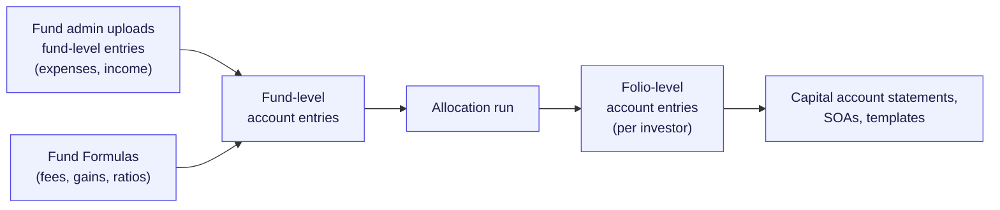
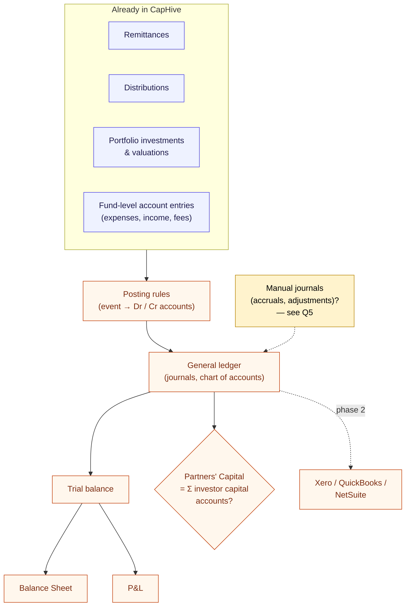
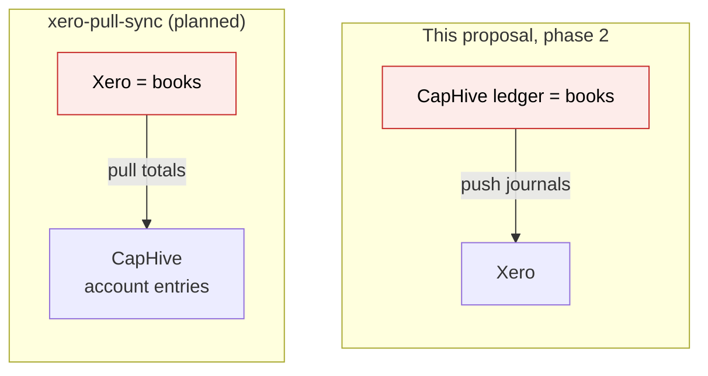
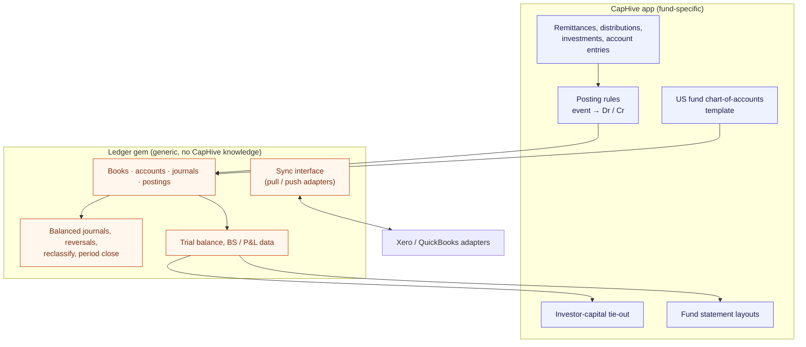
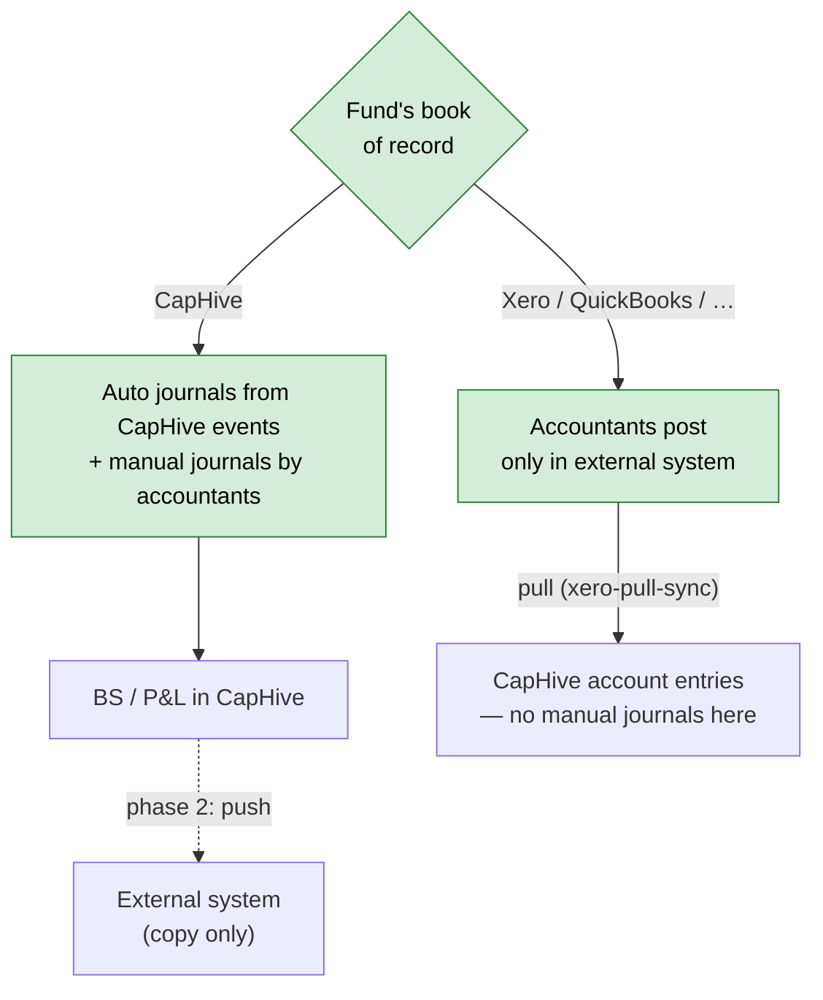
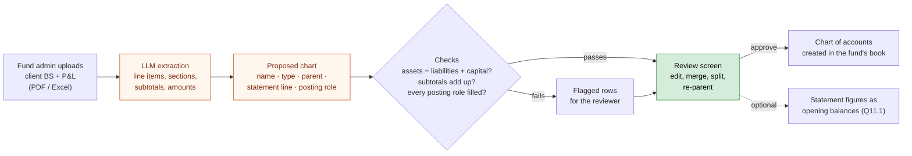
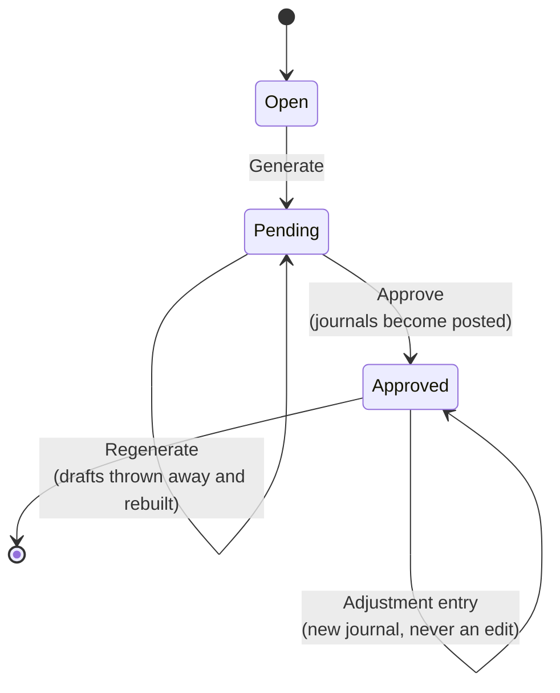
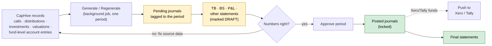
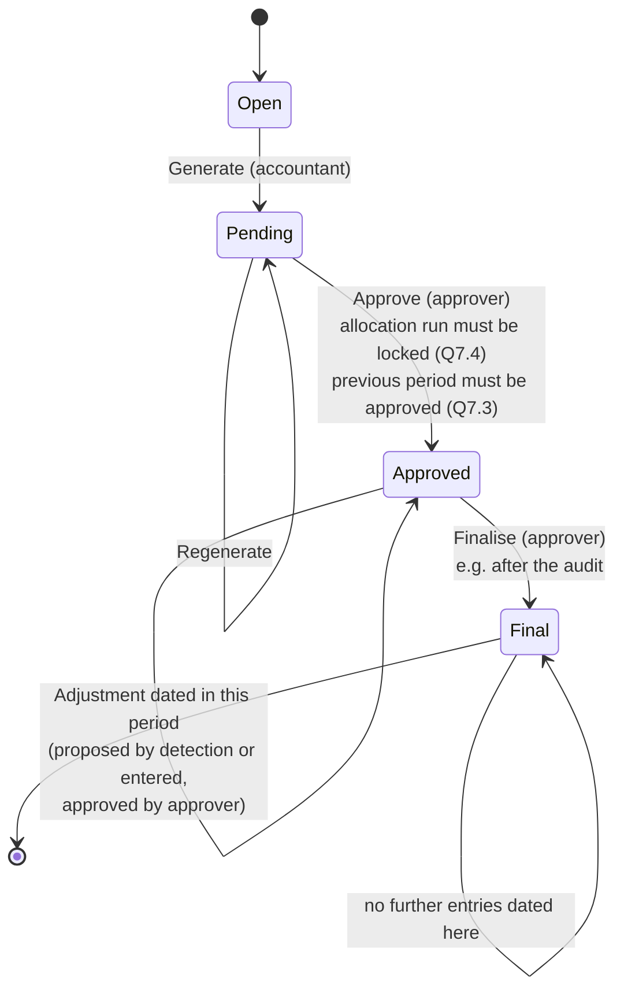

# Fund accounting (Balance Sheet & P&L): questions for the business

Requirements questionnaire, written 2026-10-04. This is a scoping document, not a design. The
answers will feed an OpenSpec change proposal in `openspec/changes/`.

**How to use this:** read the context (about a 5-minute read), then answer inline under each
question. Short answers are fine. "Don't know" or "doesn't matter" are useful answers too.
Where a question lists options, pick one or describe your own.

**Suggested answers:** questions the product owner hasn't answered yet carry a **💡 Suggested (for review)** line: a reasonable, deliberately simple default. Confirm it, change it, or cross it out. Lines starting **Answer:** are already decided.

---

## 1. Context

### 1.1 What we want to build

An accounting sub-system inside CapHive that can produce a fund's **financial statements**:
at minimum a **Balance Sheet** and a **Profit & Loss**. In **phase 2**, the same sub-system will
**sync entries with external accounting systems** (Xero, QuickBooks, NetSuite …).

### 1.2 What CapHive has today: `AccountEntry`, which is not a ledger

CapHive already stores a lot of fund numbers as **account entries**. Each entry is a single
named amount:

| Field | Example | Meaning |
|---|---|---|
| Fund | Alpha Fund I | Every entry belongs to one fund |
| Folio / investor | `F-102` or *blank* | Blank = fund-level; filled = that investor's share |
| Name | "Audit Fees" | What the number is |
| Entry type | "Expense" | A free-text grouping |
| Reporting date | 31 Mar 2026 | When it applies |
| Cumulative | yes / no | A balance-to-date, or the movement for the period |
| Amount | 1,50,000 | Signed number in fund currency (folio/tracking currency copies too) |

Fund admins upload **fund-level** entries (e.g. expenses), and **Fund Formulas** compute more
(fees, gains, ratios). An **allocation run** then splits the fund-level amounts across investors
into **folio-level** entries. Those feed capital account statements, SOAs and report templates.

What CapHive **does not** have:

- no **debits and credits**, so nothing forces the books to balance
- no **chart of accounts** ("Audit Fees" is just a label, not an account with a type)
- no **journals** (one transaction touching several accounts)
- no **trial balance, balance sheet or P&L**. Anything that looks like one today is a Word
  template summing named entries.
- no **period close** (locking a month/quarter so nobody changes it)

### 1.3 What a real ledger adds

Most money events in a fund **already exist in CapHive** as records. A ledger would turn each
one into a balanced journal:

| Event already in CapHive | Journal it would create |
|---|---|
| Capital call paid (remittance) | Dr Bank · Cr Partners' Capital |
| Distribution paid | Dr Partners' Capital · Cr Bank |
| Portfolio investment bought | Dr Investments · Cr Bank |
| Portfolio investment sold | Dr Bank · Cr Investments · Cr/Dr Realised Gain |
| Valuation change | Dr Investments · Cr Unrealised Gain (or reverse) |
| Fund expense entry | Dr Audit Fees · Cr Payables / Bank |
| Management fee (formula output) | Dr Management Fee Expense · Cr Payable to Manager |

There's also a bonus: CapHive already tracks each investor's capital account. With a ledger,
the **sum of all investor capital accounts must equal the Partners' Capital line on the Balance
Sheet**. Today nothing checks that.

### 1.4 The Xero integration in progress, and why it conflicts

A separate change, **`xero-pull-sync`** (planned, not built), assumes the opposite direction.
**Xero is the fund's book of record**, and CapHive pulls from it each night:

- The fund admin maps each Xero account once to a CapHive entry type and name, or to "ignore".
- Each night, P&L accounts come in as that period's movement and Balance Sheet accounts as
  their period-end balance, both as **fund-level account entries**. Allocation runs then split
  them as usual.
- If a figure changes after an allocation run already covers that period, the change waits for
  admin review.
- Portfolio companies' Xero figures flow into their KPI reports.
- Nothing is written back to Xero.

The two can't both be true **for the same fund**. If CapHive pushes journals to Xero and also
pulls Xero's totals back, it re-imports its own numbers. Section 3 asks how to resolve this.

### 1.5 Build vs gem

We looked at **keepr** (github.com/ledermann/keepr), a small Rails double-entry gem. Its basic
shape is right (accounts, journals, postings, balance sheet/P&L), but it has no per-book
separation, no currency, amounts capped at 999,999.99, and German (DATEV) reporting. A fork
would end up rewritten, so we'll **borrow its design and build our own**.

We'll build it as a **separate, general-purpose gem**: a double-entry ledger that knows nothing
about funds, investors or CapHive. CapHive is just its first user. Everything fund-specific
stays in the app:
- which CapHive event posts which journal
- the starting chart of accounts for a US fund
- the investor-capital tie-out
- fund statement layouts

You don't need to answer anything on this. It's here so you know the ledger is new work, not a
plugin.

### 1.6 Already decided

| # | Decision | Consequence |
|---|---|---|
| D1 | The **book of record is chosen per fund**: CapHive, or an external system (Xero, QuickBooks, …) | Each fund carries a "books kept in" setting. `xero-pull-sync` becomes the "external" mode, not a competing design. |
| D2 | **CapHive-books fund:** accountants post journals (incl. manual ones) **in CapHive**. **External-books fund:** accountants work **only in that system**, with no manual journals in CapHive. | Manual journal entry is enabled only for CapHive-books funds. For external-books funds, CapHive's ledger is read-only or derived. |
| D3 | **Build order:** CapHive-books mode first. Design it with **extension points for pull and push** to Xero (and later others), but don't build them yet. | `xero-pull-sync` waits. Its pull becomes an extension of the ledger, not a separate path into `account_entries`. |
| D4 | **External-books fund:** CapHive **pushes** its own events (remittances, distributions, formula fees) to the external system as journals. | The ledger is built for every fund, even external-books ones, so there is something to push. Accountants don't retype CapHive events. |
| D5 | **Primary market is US funds.** | Default to US GAAP (ASC 946 investment-company accounting), USD, calendar year, partnership capital accounts. Xero/QuickBooks are more relevant than Tally. Indian AIF needs come later. |
| D6 | **Auto-posted journals are never edited.** Amount wrong → fix the source record (e.g. the remittance) and CapHive reverses and re-posts. Wrong account → **reclassify** (amount locked, posted as reversal + new entry). Otherwise use manual adjusting journals or a **Reverse** action. | Posted journals stay unchanged, so source records, the ledger, the investor-capital tie-out and pushed copies in Xero/QuickBooks always agree. Audit trail is preserved. |
| D7 | The ledger is a **separate gem, independent of CapHive**, even though we build it. | The gem has no idea what a fund is. All fund logic (posting rules, chart template, tie-out, statement layouts) lives in the app. External-system sync is an interface in the gem, with adapters plugged in. |
| D8 | **US GAAP (ASC 946) for v1**, designed so other standards can be added later. | The gem stays standard-neutral (account types, journals, balances). Anything standard-specific lives in swappable per-standard sets in the app: chart template, posting rules, statement layout. A fund could later carry a second book under another standard (or tax basis) next to its US GAAP book. |
| D9 | **The chart of accounts can be generated by an LLM from the client's own BS and P&L** (and trial balance if available), then reviewed and approved by a person. For Xero/Tally funds, the LLM instead matches the client's existing accounts to posting roles. | Lives in the app, not the gem. Balance and subtotal checks guard against misreads. Every posting role must be filled before approval. See §5A. |
| D10 | **Period lifecycle: generate → pending → approve → locked.** A button runs a job that builds **pending** journals for a chosen month/quarter/year from calls, distributions, account entries etc. Users run the TB/BS/P&L from pending numbers to check them and can **regenerate** as often as needed. Once **approved**, the period is locked: changes only by **adjustment entry**. | Refines D6: before approval, fix the source and regenerate; after approval, adjust. Only approved periods are pushed to Xero/Tally. Same pattern as allocation runs. See §7.1. |
| D11 | **The ledger is additive. Existing CapHive models (`AccountEntry`, remittances, distributions, …) and their uploads stay as they are.** Any change to them must be raised with the product owner first. | The generate job only *reads* existing records. Anything the ledger needs to store lives in its own tables. |
| — | *Deferred:* switching a fund's book of record mid-life (old Q3.1) is an edge case and is left for later. | |

---

## 2. Customers and purpose

**Q2.1** US funds are the target (D5). Which kind first: VC, PE, real estate, fund of funds,
SPVs / syndicates? Is there a **pilot customer** asking for it?

> _Answer:_ US funds, yes. A US fund customer is asking for it. *(Fund type still open: VC / PE / RE / FoF / SPV?)*
> 💡 **Suggested (for review):** Start with **closed-end VC and PE funds** (and their SPVs). Real estate and fund of funds later.
> The pilot's ask: **CapHive's fund events should land in their Xero/Tally without retyping** (push). Not financial statements out of CapHive.

**Q2.2** Who keeps these funds' books **today**: an external fund administrator, a CPA firm, the
manager's in-house team? Which software (QuickBooks, Xero, NetSuite, an admin platform, Excel)?

> _Answer:_ An external party, on **Xero or Tally**.

**Q2.3** What is the main goal?
(a) CapHive **becomes** the fund's books and replaces QuickBooks/Xero.
(b) CapHive produces **management / investor-facing** financials while the statutory books stay
elsewhere.
(c) CapHive does the **fund-specific** accounting (capital, allocations, fair value) and hands a
clean feed to the accountant's system.

> _Answer:_ **(b) and (c).** CapHive produces management / investor-facing financials and does the fund-specific accounting, then feeds the accountant's system. It does **not** replace Xero/Tally as the statutory books.

**Q2.4** Who **reads** the Balance Sheet and P&L: the fund team, LPs (in the investor portal),
auditors, regulators (e.g. SEC Form PF / ADV figures)?

> _Answer:_ The **fund team** for now. **LP-specific financial statements** (each LP's share) have been asked for, in a later phase.

**Q2.5** Is the output expected to be **audit-ready** (statutory financial statements with notes),
or management accounts?

> _Answer:_ **Yes, audit-ready.**

---

## 3. Book of record and the Xero work

Book of record, build order and push direction are **decided** (D1–D4 in §1.6). What's left:

**Q3.3** If a fund keeps its books in Xero, should CapHive still show a Balance Sheet and P&L for
it, built from the pulled figures?

> _Answer:_ **No.** For an external-books fund the financial statements come from Xero/Tally. CapHive pushes its events there (D4) and doesn't produce a BS/P&L itself.

**Q3.4** The portfolio-company KPI pull (portco Xero → KPI reports) is separate from fund
accounting. Can it continue on its own track regardless of the answers above?

> _Answer:_ **Yes.** It's a completely separate feature. The portco KPI part of `xero-pull-sync` can go ahead on its own.

---

## 4. Accounting standards and statements

**Q4.1** We'll assume **US GAAP, ASC 946** (investment-company accounting, fair value) (D5). Is
that right for every v1 customer? Any offshore (e.g. Cayman) feeders needing IFRS?

> _Answer:_ **US GAAP for now**, but leave room to support other standards later.

**Q4.2** Which statements are needed in v1, and which later?

| Statement | v1 | Later | Not needed |
|---|---|---|---|
| Balance Sheet / Statement of Net Assets | ✓ | | |
| P&L / Statement of Operations | ✓ | | |
| Trial Balance | ✓ | | |
| Statement of Changes in Net Assets / Partners' Capital | ✓ | | |
| Cash Flow Statement | ✓ | | |
| Schedule of Investments | ✓ | | |
| General ledger detail / account drill-down | ✓ | | |
| Notes to accounts | ✓ | | |
| Financial Highlights (ASC 946: total return, expense ratios, IRR) *(added: required in ASC 946 audited statements)* | ? | | |

> _Answer:_ **All of them in v1.**
> 💡 **Suggested (for review):** Include **Financial Highlights** in v1. CapHive already computes IRR and the ratios it needs. Treat the **Cash Flow Statement** as optional per fund (many US funds are exempt; ask the auditor). **Notes**: generate the numeric schedules only (fair-value hierarchy, Level 3 roll-forward, unfunded commitments, fees). The text is written by the accountant in an editable template.

**Q4.3** Which **periods**: monthly, quarterly, annual? With **comparatives** (prior period / prior
year columns)? What is the financial year (calendar year assumed; any fiscal-year funds?)?

> _Answer:_ Left to us. Proposal:
> - **Ledger:** any date range (balances are computed, so this costs nothing). **Monthly** period close.
> - **Statements:** **quarterly and annual**, with monthly available on request.
> - **Comparatives:** Balance Sheet vs **prior year-end**. Operations and Changes in Partners' Capital show **QTD and YTD**, vs the same periods last year (annual: current vs prior year).
> - **Fiscal year:** set per fund, **default calendar year** (the US norm).

**Q4.4** Output format: on screen, Excel, PDF, Word templates (like SOAs today)? Should they be
generated in bulk like investor statements?

> _Answer:_ **Excel and PDF.** *(Bulk generation across funds: still open.)*
> 💡 **Suggested (for review):** v1: one fund at a time. Bulk generation across funds later, reusing the investor-statement bulk pattern.

**Q4.5** Can you share **sample financial statements** from one or two real funds (anonymised is
fine)? They're the best spec for layout and line items.

> 💡 **Suggested (for review):** *No default possible.* Please share the pilot fund's last audited statements (and a trial balance if available). They settle line items and notes.

---

## 5. Chart of accounts and journals

**Q5.1** Should CapHive ship a **standard chart of accounts** for each fund type, that funds then
customise? Or does each fund bring its own, or copy it from their accountant's system?

> 💡 **Suggested (for review):** Ship **one standard US GAAP (ASC 946) chart** for closed-end funds. Each new fund gets its own copy and can rename, add or hide accounts. Alternatively, build it from the client's statements (§5A). Xero/Tally funds don't use the template: they map to the client's existing chart.

**Q5.2** Who maintains the chart of accounts: CapHive support, the fund admin, the customer's
accountant?

> 💡 **Suggested (for review):** The fund's **`:accountant`** maintains its chart. CapHive support maintains the standard template.

### 5A. Building the chart of accounts from the client's own statements (LLM)

**The idea:** the fund admin uploads the client's latest **Balance Sheet and P&L** (PDF or
Excel). An LLM reads them and **proposes a chart of accounts and hierarchy** that mirrors how the
client already reports. A person reviews and approves it before anything is created.

**What the LLM proposes for each line:**

| Field | Example |
|---|---|
| Account name | "Investments at fair value (cost $12.4M)" → *Investments at fair value* |
| Type | asset / liability / equity (partners' capital) / income / expense |
| Parent (hierarchy) | *Assets › Investments* |
| Statement line | where it prints on the BS / Statement of Operations |
| Posting role | which CapHive event posts here, e.g. *Investments at fair value* ← portfolio investments and valuations; *Partners' Capital – Contributions* ← remittances; *Management fees* ← fee formula |
| Account code | suggested number, or the client's code if the statement shows one |

**Is it doable?** Yes. Reading a financial statement into structured line items is a task LLMs do
well, and CapHive already calls LLMs on documents (`LlmService.ruby_llm_chat`,
`DocLlmContext`). Things to know:

- **A statement is a summary, not the full chart.** "Professional fees" on the P&L may be audit,
  legal and tax accounts in the books. The result is a **statement-level skeleton** that the
  reviewer splits where needed. Uploading the **trial balance** too (if the client has one)
  gives the full account list.
- **The posting role is the valuable part.** Names and hierarchy are easy. Knowing that
  "Contributed capital" is where remittances post is what makes auto-posting work. The LLM
  proposes it, and the **review screen must require every role to be filled** before approval.
- **The checks catch misreads.** The extracted figures must satisfy assets = liabilities +
  capital, and subtotals must add up. A misread number or a line dropped by the LLM shows up as
  a failed check, not a silently wrong chart.
- **Nothing is created without approval.** The LLM output is a proposal only.
- **For Xero/Tally funds (the pilot)** the exact account list and codes come from the client's
  system, so pushed journals land on real codes. There the LLM's job is to **match each existing
  account to a posting role**, not to invent a chart. Same review screen, different input.
- **It lives in the app, not the gem** (D7). The gem just receives the approved accounts.

**Q5A.1** Can the client usually provide a **trial balance** as well as the BS and P&L? It turns a
skeleton into the full account list.

> 💡 **Suggested (for review):** Ask for it, but don't require it. Without a trial balance the result is a statement-level skeleton the reviewer refines.

**Q5A.2** Should the approved statement figures also become the fund's **opening balances**
(see Q11.1), or is the chart all we take from the upload?

> _Answer:_ **No.** Only the chart of accounts is taken from the upload.

**Q5A.3** Who does the review: the fund admin, CapHive support during onboarding, or the client's
accountant?

> _Answer:_ **Any of the three.** We can add an **Accountant role** for this (and other ledger work).

**Q5.3** Auto-posted journals can't be edited (D6). Is **reclassify** (change the account, amount
locked) enough for correcting them, or are there other corrections accountants routinely need?

> _Answer:_ **Both types of correction are needed**: reclassify (account change) and amount corrections (by adjustment entry after approval, D10).

**Q5.4** For manual journals: is **maker-checker approval** needed? Supporting
**attachments** (invoices)? **Reversing** journals (auto-reverse an accrual next period)?

> _Answer:_ **Yes to all three**: maker-checker approval, supporting attachments, and auto-reversing journals.

**Q5.5** Today expenses are uploaded as account entries named e.g. "Audit Fees". Should those
uploads **keep working as-is** (and auto-post to the ledger)? Or should users move to entering
journals / bills instead?

> _Answer:_ **Yes, uploads keep working as-is.** `AccountEntry` and other existing parts of CapHive must **not** be changed without telling the product owner first. The ledger reads from them.

**Q5.6** Do we need **sub-ledgers**: accounts payable (vendors, bills), receivables, bank accounts
per fund? Or is a GL with control accounts enough for v1?

> _Answer:_ **Yes, sub-ledgers are required.** *(Which ones: see Q5.7.)*

**Q5.7** Which sub-ledgers, and in v1 or later? Each one is a sizeable feature (accounts payable
alone means vendors, bills, due dates, payments).

| Sub-ledger | What it tracks | v1 | Later |
|---|---|---|---|
| Partners' capital (per investor) | Each LP's contributions, distributions, allocations. CapHive **already has this** in capital commitments + folio account entries; the ledger ties out to it. | | |
| Accounts payable | Vendors, bills (audit, legal, admin), what's owed and paid | | |
| Accounts receivable | Amounts owed to the fund (called-not-received capital, interest, dividends) | | |
| Investments | Each portfolio holding's cost and fair value. CapHive **already has this** in portfolio investments and valuations. | | |
| Bank / cash | Per-account balances, reconciliation | | |

> 💡 **Suggested (for review):** **v1:** Partners' capital and Investments (both are tie-outs to data CapHive already has), and Accounts receivable for **called-but-unpaid capital** only (built from calls and remittances). **Later:** Accounts payable and Bank. The pilot runs those in Xero/Tally today, so v1 doesn't need them.

---

## 6. Recognition rules (what posts when)

For each event, when should the journal hit the books, and against which accounts? Fill in what
you know. Your accountant may answer this table better.

| Event | Recognise on… | Notes |
|---|---|---|
| Capital call | call notice date (receivable) or payment receipt? | |
| Capital remittance paid | | |
| Unpaid / overdue call | | |
| Distribution | approval date or payment date? | |
| Portfolio investment | agreement date, payment date, allotment date? | |
| Exit / sale | | |
| Valuation (fair value) | each valuation date? quarterly? | |
| Management fee | accrued monthly / quarterly / on billing? | |
| Fund expenses | when uploaded, invoice date, payment date? | |
| Carried interest | accrued (hypothetical) or on crystallisation? | |
| Set-up / organisation costs | expensed or amortised? | |
| Interest / dividend income | | |

> 💡 **Suggested (for review):** simple US GAAP defaults, using dates CapHive already stores:
>
> | Event | Recognise on | Journal |
> |---|---|---|
> | Capital call | **call due date** | Dr Capital Call Receivable · Cr Partners' Capital |
> | Remittance paid | **payment date** | Dr Bank · Cr Capital Call Receivable |
> | Unpaid / overdue call | no extra entry | stays in the receivable; defaults handled by manual adjustment |
> | Distribution | **payment date** | Dr Partners' Capital · Cr Bank |
> | Portfolio investment | **investment date** | Dr Investments (cost) · Cr Bank |
> | Exit / sale | **sale date** | Dr Bank · Cr Investments (cost) · Cr/Dr Realised Gain |
> | Valuation | **each valuation date** | Dr/Cr Investments · Cr/Dr Change in Unrealised Gain |
> | Management fee | **each period**, as computed by the allocation run | Dr Management Fee Expense · Cr Management Fee Payable |
> | Fund expenses | **reporting date** of the uploaded entry | Dr Expense · Cr Accrued Expenses |
> | Carried interest | **each period**, hypothetical, from the allocation run | Dr LP Capital · Cr GP Capital (moves capital between partners; not an expense) |
> | Organisation costs | **expensed as incurred** (US GAAP) | Dr Organisation Expense · Cr Accrued Expenses |
> | Interest / dividend income | **reporting date** of the entry | Dr Interest/Dividend Receivable · Cr Income |
>
> Payments of fees and expenses (clearing the payable against Bank) are posted in Xero/Tally for
> the pilot, and by the accountant for CapHive-books funds.

**Q6.1** Are any of these different between Indian and non-Indian funds?

> 💡 **Suggested (for review):** v1 is US only (D5). Indian rules are handled when Indian funds are taken on, as a separate posting-rule set (D8).

---

## 7. Periods, close and corrections

### 7.1 How it works (decided, D10)

The ledger is filled by a **Generate** button, not posted live as events happen.

1. A user picks a **period** (month, quarter or year) and presses **Generate ledger**.
2. A background job turns everything in CapHive for that period into **pending journals**:
   remittances, distributions, portfolio investments and valuations, fund-level account entries,
   formula fees.
3. Users run the **Trial Balance, BS, P&L etc. from the pending numbers** to check them.
4. If something is wrong, they fix the **source data** in CapHive and press **Regenerate**. The
   pending journals are thrown away and rebuilt. Nothing is reversed, because nothing was final.
5. When the numbers are right, the period is **approved**. Its journals become **posted** and
   can't be changed.
6. After approval, any change is an **adjustment entry**, never an edit or a regenerate.

This is the same pattern as **allocation runs** today: generated rows are wiped and rebuilt on
every run until the run is locked. Users already know it.

**What follows from it:**

- **Regenerate only replaces generated journals.** Manual journals in a pending period (for
  CapHive-books funds) are kept.
- **Only approved periods are pushed** to Xero/Tally. Pending numbers never leave CapHive, so the
  push never has to un-send anything. An adjustment is pushed as one more journal.
- **This refines D6.** Before approval there's nothing to reverse: fix the source and regenerate.
  After approval, a fix is an adjustment entry.
- **Only fund-level account entries are posted**, not folio-level ones. Folio entries are the
  same amounts split across investors, so posting both would double count. The investor split
  belongs in the Partners' Capital sub-ledger and tie-out (§8).

**Q7.1** Who can **approve** a period: any fund admin, or maker-checker (one prepares, another
approves)? Can an approved period ever be **reopened**, and by whom?

> _Answer:_ Two roles: **`:accountant`** prepares (generate, regenerate, manual journals, reclassify, propose adjustments), and **`:approver`** approves periods, manual journals and adjustments. The same person can't prepare and approve the same item.
> 💡 **Suggested (for review):** **Reuse the existing `:approver`** (simplest). Give the role only to people who should approve both ledger periods and documents/KPIs. Add `:accountant` as a new role (raised under D11 since it touches `User`).
> *Note:* `:approver` **already exists** (rolify, `User::UPDATABLE_ROLES`) and today lets a user approve KPIs, documents and shareholder positions. Reusing it means every existing approver can approve ledger periods, and anyone made a ledger approver can approve documents too. `:accountant` is new, and adding it touches `User` (see D11). *Open: reuse `:approver` or add a separate `:ledger_approver`?*

**Q7.2** A source record in an **approved** period changes later (e.g. a remittance amount is
corrected). Should CapHive:
(a) **detect the difference** on the next Generate and propose the adjustment entry
automatically, for a user to approve, or
(b) leave it to the accountant to spot and post the adjustment by hand?
And should the adjustment be dated in the **original period** (as a post-close adjustment) or in
the **current open period**?

> _Answer:_ **(a) Detect and propose.** The next Generate compares source records with the posted journals of approved periods and proposes adjustment entries for an approver.
> *Dating (proposed, see §7.2):* into the **original period** while it is *approved but not final*, and into the **current open period** once the original period is *final*.

**Q7.3** Must periods be approved **in order** (no approving Q2 while Q1 is still pending)? We
recommend yes: Q2's opening balances are Q1's closing balances.

> _Answer:_ **Yes, in order.**

**Q7.4** Must the **allocation run** for a period be locked before that period's ledger can be
generated or approved? (Fees and allocated figures come from the run.)

> _Answer:_ **Not for generation, yes for approval.** A period can be generated and checked before its allocation run is locked, but can't be approved until it is.

**Q7.5** Monthly periods inside a quarter: if a fund generates monthly, is the quarter just the
three months added up, or is a quarter also generated and approved on its own?

> _Answer:_ Not sure. Proposal in §7.2.

**Q7.6** Do auditors post **audit adjustments** after year-end? Should those be entered in CapHive
as adjustment entries?

> _Answer:_ **Yes.** Audit adjustments are entered in CapHive as adjustment entries dated at year-end, which needs the approved-but-not-final stage in §7.2.

### 7.2 Proposal: period frequency and the two-stage lock (answers Q7.5, shapes Q7.2 and Q7.6)

**Frequency is a per-fund setting: monthly or quarterly.**

- **Monthly fund:** the **month** is the unit that's generated and approved. A quarter is its three
  months added up and is never generated on its own. "Quarter approved" just means all three
  months are approved.
- **Quarterly fund:** the **quarter** is the unit. No monthly figures.
- **Year (both):** the sum of its months or quarters, **plus** the year-end audit adjustments.
- Things that only happen quarterly (valuations, fees from a quarterly allocation run) post into
  the **last month** of the quarter for a monthly fund.

This keeps one source of truth: quarter and year statements are always sums of approved units,
so they can never disagree with the months underneath them.

**The lock has two stages: Approved, then Final.**

| | Approved | Final |
|---|---|---|
| Existing journals | locked, never edited | locked, never edited |
| New adjustment **dated in this period** | allowed (accountant proposes, approver approves) | not allowed |
| Where a later correction goes | this period | the **current open** period, referencing the original |
| Typical use | month/quarter signed off, audit not done | year audited and signed |
| Pushed to Xero/Tally | yes, and each adjustment is pushed as a new journal | nothing new to push |

**Why two stages:** audit adjustments (Q7.6) are dated **31 Dec** but entered in **February**, after
December was approved. With one hard lock they'd have to go into February and the audited
year-end figures would be wrong. "Approved" lets dated adjustments in; "Final" shuts the door
once the auditor signs.

**Worked example (monthly fund, calendar year):**

| When | What happens | Dated | Lands in |
|---|---|---|---|
| 10 Jan | Dec generated, checked, approved | 31 Dec | Dec (Approved) |
| 15 Jan | A Dec remittance is corrected in CapHive; the next Generate proposes a $5k adjustment; approver approves | 31 Dec | Dec, still Approved |
| 20 Feb | Auditor's fair-value adjustment entered | 31 Dec | Dec, still Approved |
| 1 Mar | Audit signed; approver finalises Dec (and so the year) | | Dec → **Final** |
| 10 Mar | Another Dec remittance correction found; Generate proposes an adjustment | 10 Mar | **Mar** (Dec is Final), with a note "relates to Dec 2026" |

**Q7.7** Does this two-stage lock (Approved → Final) match how the pilot's accountant works? Who
finalises: the approver, or only after an auditor sign-off is recorded?

> 💡 **Suggested (for review):** The **approver** finalises, entering the audit sign-off date as a note. No separate auditor sign-off workflow in v1.

---

## 8. Investor capital accounts

**Q8.1** CapHive's per-investor capital accounts (commitments, calls, distributions, allocated
income/expense) should tie out to the ledger's Partners' Capital. When they **don't match**,
which is right, and what should happen? Block, warn, or a report only?

> 💡 **Suggested (for review):** Show a **tie-out panel** on the period page: Partners' Capital in the ledger vs the sum of investor capital accounts. A difference over **$1** **blocks approval**, unless the approver overrides it with a written reason (kept in the audit trail).

**Q8.2** Should the Balance Sheet show capital **by class / unit series**, or one Partners'
Capital line?

> 💡 **Suggested (for review):** **One Partners' Capital line** on the Balance Sheet. The Statement of Changes in Partners' Capital splits it **LP vs GP** (and by class only if the fund has classes).

**Q8.3** Should investors see **fund-level** financials in the portal, or only their own capital
account statement (as today)?

> 💡 **Suggested (for review):** Fund team only in v1. LP-specific statements are a later phase (Q2.4).

---

## 9. Currency, structures and tax

**Q9.1** Do funds hold assets or pay expenses in **foreign currency**? Is FX revaluation (period-end
unrealised FX gain/loss) needed?

> 💡 **Suggested (for review):** v1: everything in the **fund currency**. Foreign-currency investments and expenses are converted at the CapHive exchange rate on the transaction date. **FX revaluation later.**

**Q9.2** Master / feeder funds, SPVs, parallel funds: separate books each, or **consolidated**
statements too?

> 💡 **Suggested (for review):** **Separate book per fund / SPV.** No consolidation in v1.

**Q9.3** Should the **manager / GP entity's** own books be in scope (fee income, salaries), or
only the funds?

> 💡 **Suggested (for review):** Funds only. Manager / GP books are out of scope.

**Q9.4** Partnership tax: must CapHive keep **tax-basis capital accounts** alongside GAAP
(book) ones, feed **K-1** preparation, or handle withholding for foreign LPs? Or does the
tax preparer do all of that outside CapHive?

> 💡 **Suggested (for review):** Out of CapHive in v1: the tax preparer handles tax basis and K-1s. Later, a tax-basis book can sit next to the US GAAP book (D8).

**Q9.5** **Bank reconciliation**: in scope for v1? (CapHive already matches bank narrations for
remittances.)

> 💡 **Suggested (for review):** Not in v1.

---

## 10. Phase 2: syncing with external systems

**Q10.1** Which systems, in priority order? (QuickBooks Online, Xero, NetSuite,
Sage Intacct, …) Is there a customer behind each?

> 💡 **Suggested (for review):** **Xero first** (cloud API, and the pilot may use it), **QuickBooks Online** second. **Tally only if the pilot requires it.** It's a desktop product needing a connector on the accountant's machine, so it gets its own design.

**Q10.2** Direction per system: **push** CapHive journals out, **pull** in, or **both**?

> 💡 **Suggested (for review):** **Push only** (D4), plus a read-only fetch of the client's **chart of accounts** for mapping.

**Q10.3** Granularity of what we push: every journal line, or **daily / monthly summary
journals** per account?

> 💡 **Suggested (for review):** Push **one journal per CapHive event**: per capital call, distribution, investment, exit and valuation date. Plus **one journal per period** for fund expenses and fees. Each carries a CapHive reference. That keeps Xero readable (not one journal per investor) and every line traceable back to CapHive.

**Q10.4** If someone edits a synced journal **in the external system**, what should happen in
CapHive? (ignore, flag, overwrite)

> 💡 **Suggested (for review):** Not detected in v1. Rule for accountants: **don't edit CapHive-pushed journals in Xero/Tally; correct the source in CapHive** and the adjustment is pushed. A mismatch check can come later.

**Q10.5** Does the customer's accountant expect CapHive's accounts to **map onto their existing
chart** in QuickBooks/Xero, or to create CapHive's accounts there?

> 💡 **Suggested (for review):** **Map onto their existing chart** (D9): each CapHive posting role points at one of the client's account codes.

---

## 11. Getting started and priorities

**Q11.1** Existing funds: should we load **opening balances** (a trial balance as at a go-live
date), or **rebuild history** from CapHive's existing records?

> 💡 **Suggested (for review):** **Opening balances, not history.** The accountant enters a trial balance as at a go-live date as one opening journal, which is approved like any other. No rebuilding of past periods. (Not needed for push-only funds like the pilot.)

**Q11.2** Audit trail and auditor access: is read-only **auditor login** with ledger drill-down
needed?

> 💡 **Suggested (for review):** v1: **Excel export** of the trial balance and GL detail for auditors. Auditor login later.

**Q11.3** What is the **smallest v1** a pilot customer would pay for or use? (e.g. "auto-posted
GL + Trial Balance + BS + P&L for one Indian AIF, quarterly, Excel export")

> 💡 **Suggested (for review):** v1 = **what the pilot needs**, for one US fund:
> - Posting rules for calls, remittances, distributions, investments, exits, valuations, fees and expenses
> - Generate → pending → approve (D10), with **draft TB, BS and P&L** to check the numbers
> - Account mapping to the client's chart
> - **Push to Xero**
>
> Full statements (Q4.2), manual journals and sub-ledgers come in **v2**, for funds whose books are in CapHive.

**Q11.4** Timeline or commercial constraints: a deal, a fundraise, an audit season?

> 💡 **Suggested (for review):** *No default possible.* Pilot go-live date, and any audit-season deadline.

**Q11.5** Anything we haven't asked that your accountant or customers would expect from fund
accounting software?

> 💡 **Suggested (for review):** Two things worth adding: a **full audit trail** (who generated, approved, adjusted, and when) and an **"explain this number"** drill-down from any statement line to the CapHive records behind it.
