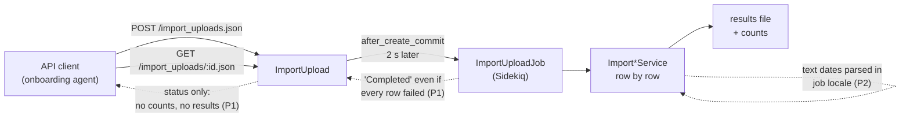
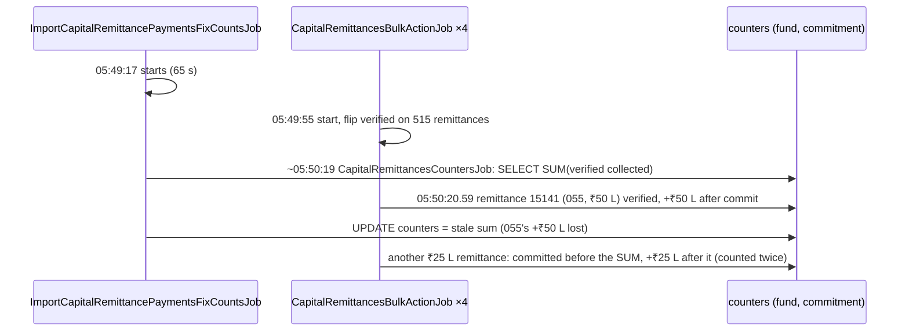

# API improvements from the Orios onboarding trial

**From:** the client-onboarding agent trial, 2026-10-18 (dev DB, entity 1629 "Orios Venture Partners", fund 375).
**For:** the agent or engineer improving CapHive's JSON APIs and import pipeline.
**Supersedes:** [api_requests_for_funds_api.md](api_requests_for_funds_api.md) (G8–G10 are repeated here with
what the trial showed).

The trial onboarded a real fund (128 investors, ₹300 Cr, 515 drawdowns) **only through the website's `.json`
endpoints** with a devise-api bearer token, the way an API client or the onboarding agent must. Every item below
is something that failed, misled the client, or forced a workaround. Each has evidence, the root cause in the
code, a suggested fix and how to prove it (a Cucumber scenario).

## Priority summary

| # | Problem | Severity | Area |
|---|---|---|---|
| P1 | Import outcome invisible over the API (no counts, no errors; "Completed" when every row failed) | **Blocking** | Import uploads |
| P2 | Text dates parsed in the job's locale: `05/04/2021` stored as 4 May | **Data corruption** | Import pipeline |
| P3 | Fund import always fails (`wrong number of arguments`) | **Broken feature** | Fund import |
| P4 | `GET/POST /funds.json` returns 500 | **Broken endpoint** | Funds API |
| P5 | Entity settings unreadable; PATCH creates a duplicate settings row | **Safety** (sandbox) | Entities API |
| P6 | Rolled-up totals drift after payment import + bulk verify | **Wrong totals on screens** | Capital remittances |
| P7 | Fresh entity cannot import commitments until a form type is created; error doesn't say how | Usability | Commitment import |
| P8 | Optional template columns and sheets are mandatory | Usability | Import pipeline |
| P9 | `delete_data` and `bulk_actions` answer JSON clients with 302 | Minor | Import uploads, remittances |
| P10 | Possible cross-tenant form type creation | **Security — verify** | Form types |
| P11 | Capital distribution JSON 500s, so `approve` and `update` look failed although they succeeded | **Broken endpoint** | Capital distributions |

---

## P1 — Import outcome invisible over the API (blocking)

**What happened:** the Fund upload (2662) and the FundUnitSetting upload (2663) both returned `status:
"Completed"` from `GET /import_uploads/:id.json`. In the database every row had failed (1/1 and 4/4). The
commitments upload (2666) also said "Completed" with 128/128 rows failed ("Form Tag not specified"). An API
client cannot tell success from total failure, nor see why rows failed — the only place the reason was
visible was `log/development.log`.

**Root cause:**
- `app/packs/misc/import_uploads/views/import_uploads/_import_upload.json.jbuilder` exposes only `id, name,
  entity_id, owner_*, user_id, import_type, status, error_text, timestamps`.
- `ImportUploadJob#perform` sets `status = "Completed"` whenever the service operation succeeds; per-row failures
  don't fail the operation, so a 0% success upload is "Completed".
- For uploads 2662/2663 the stored results file contained only the header row (observed; not yet traced —
  `ImportUtil` appends each row with its outcome, so check what is uploaded as `import_results`).

**Suggested fix:**
1. Add to the JSON: `total_rows_count`, `processed_row_count`, `failed_row_count`, `custom_fields_created`,
   `results_url` (`import_upload.import_results&.url`) — the HTML show page already links the results file to
   anyone who can see the upload, so nothing new is exposed.
2. Add a derived `outcome`: `"succeeded" | "partially_failed" | "failed" | "running"`, and set `status` to
   `"Completed with errors (N of M rows failed)"` when `failed_row_count > 0`.
3. Optionally include the first ~20 failed rows inline: `errors: [{ row: 7, message: "Form Tag not specified" }]`.
4. Trace why the results file of a fully-failed upload had no data rows.

**Prove it:** upload a file whose every row fails → JSON shows `failed_row_count = total_rows_count`,
`outcome: "failed"`, a working `results_url`, and the first error message.

---

## P2 — Text dates parsed in the job's locale (data corruption)

**What happened:** commitment dates and call due dates written as text `dd/mm/yyyy` were stored day/month swapped
whenever the day was ≤ 12: `05/04/2021` → 2021-05-04. 41 of 128 commitments and 4 of 6 calls were wrong, with no
error or warning. Dates like `20/12/2013` were right, which hides the problem.

**Root cause:** `ImportUtil#parse_date_cell` (import_util.rb:384) sends text to `Date.local_parse`
(`config/initializers/date_localized_parse.rb:10`), which uses `I18n.locale` — the **Sidekiq thread's** locale, not
the uploader's. `en-US` formats are `%m/%d/%Y`, so `05/04/2021` parses as 4 May. Real Excel date cells are not
affected (`raw.to_date`, line 395).

**Suggested fix (any one, in order of preference):**
1. Parse with the **uploader's** locale: `Date.local_parse(raw, locale: import_upload.user.locale || I18n.default_locale)`.
2. Reject ambiguous text dates (both parts ≤ 12) unless they are ISO `yyyy-mm-dd`, with a row error naming the
   expected format.
3. Always accept ISO `yyyy-mm-dd` unambiguously, and say so in the templates.

**Prove it:** as an `en` user, import a commitment with text date `05/04/2021` → stored 2021-04-05, or the row is
refused with a format message; never 2021-05-04.

---

## P3 — Fund import always fails

**What happened:** every Fund import row fails with "Error wrong number of arguments (given 4, expected 3)"; no fund
can be created by import from the UI or the API.

**Root cause:** `ImportFund#save_row(row_data, import_upload, _custom_field_headers)`
(`app/packs/funds/funds/services/import_fund.rb:8`) takes 3 arguments; `ImportUtil#process_row`
(import_util.rb:225) calls `save_row` with 4 (`…, ctx`). The other importers take `_ctx`.

**Suggested fix:** add the fourth parameter (`_ctx`) to `ImportFund#save_row`. Then check every `Import*`
subclass's `save_row` arity (a one-line test over `ImportUtil.descendants`).

**Prove it:** import `public/sample_uploads/funds.xlsx` into a fresh entity → 1 fund created, 0 failed.

---

## P4 — `GET/POST /funds.json` returns 500

**What happened:** `POST /funds.json` created fund 375 but answered **HTTP 500**; `GET /funds.json` returned nothing
usable. Any API client reading funds is blocked.

**Root cause:** `app/packs/funds/funds/views/funds/_fund.json.jbuilder:11` calls
`fund.tracking_co_invest_call_amount`, which `Fund` does not define.

**Suggested fix:** remove the line, or define the attribute if it was meant to exist. Add a feature that renders
`/funds.json` and `/funds/:id.json` for a fund with and without a tracking currency.

**Prove it:** `GET /funds.json` and `POST /funds.json` with a bearer token → 200/201 with the fund JSON.

---

## P5 — Entity settings unreadable; PATCH creates a duplicate row (safety)

**What happened:**
1. `GET /entities/:id.json` has no `entity_setting`, so an API client cannot confirm `sandbox` is on — the only
   guard that keeps investor emails from going out during onboarding.
2. `PATCH /entities/1629.json` with `entity_setting_attributes: { sandbox: true, … }` (no `id`, because the JSON
   never exposes it) created a **second** `entity_settings` row (1630) beside the empty one created with the
   entity (1629). `has_one :entity_setting` has no order, so which row the app reads — sandbox on or off — is
   not guaranteed. Patching row 1629 by id then returned **403** (the nested id no longer belongs to the
   association).

**Root cause:** `_entity.json.jbuilder` omits settings; `Entity` builds an `EntitySetting` on initialize
(entity.rb:204), and nested attributes without an id build a new `has_one` record instead of updating.

**Suggested fix:**
1. Add an `entity_setting` object to the entity JSON (`id`, `sandbox`, `sandbox_emails`, KYC doc lists,
   `mcp_enabled`), shown only when `policy(entity).update?`.
2. Add `update_only: true` to `accepts_nested_attributes_for :entity_setting`, so a PATCH without an id updates
   the existing row.
3. Add a unique index on `entity_settings.entity_id` (after removing duplicates) so this can't recur.

**Prove it:** PATCH sandbox without an id on an entity that has settings → still exactly one row, `sandbox`
true, and the GET shows it.

---

## P6 — Rolled-up totals drift: a recount races with bulk verify (root cause confirmed)

**What happened:** after importing 515 payments and bulk-verifying, every remittance, payment and call matched the
source exactly (₹300.00 Cr), but fund 375 `collected_amount` = **₹300.25 Cr** and commitment 2548 (folio 055)
`collected_amount` = **₹1.5 Cr** while its 4 remittances total ₹2.0 Cr. No screen or API action recomputes them.

**Root cause (confirmed from the log, audits and a rolled-back recount):** two jobs wrote the same counters at once.

- Remittance → commitment/fund counters are `counter_culture` deltas with `execute_after_commit: true`, applied only
  while `verified` (`capital_remittance_counters.rb`).
- `CapitalRemittancesCountersJob` recomputes the same columns with `counter_culture_fix_counts` (SELECT sum, then
  UPDATE) — last writer wins, not atomic with concurrent deltas.
- `ImportCapitalRemittancePaymentsFixCountsJob` (Sidekiq `default`) runs that recount ~60 s after the payment import,
  while the bulk-verify jobs (also `default`) are flipping `verified`. It also writes `verified` on the same remittances
  (from the import's "Verified" column) — a second source of conflicting writes.
- **Lost update** (folio 055, −₹50 L): 15141 committed after the recount's SELECT, its increment landed before the
  recount's UPDATE and was overwritten. **Double count** (fund, +₹25 L): a remittance committed before the SELECT
  (included in the sum) and its after-commit increment landed after the UPDATE.
- Proof: running the same two `counter_culture_fix_counts` calls with nothing else running gives fund ₹300.00 Cr and
  folio 055 ₹2.0 Cr (rolled back; stored values unchanged).

**Why the existing guard doesn't work:** `CapitalRemittancesCountersJob` is `queue_as :serial`, and the
"single-threaded" Sidekiq capsule (`config/initializers/sidekiq.rb`, queues `serial doc_gen ai_checks`) runs that queue
one job at a time — exactly the protection needed. But both import fix jobs call it with **`perform_now`**, which runs
it inline inside the calling job on the 5-thread `default` queue, so it never goes through the serial capsule:

| Caller | Call | Runs on |
|---|---|---|
| `import_capital_remittance_payments_fix_counts_job.rb:39` | `perform_now` | `default`, inline — intentional (ordering, #630), but unprotected from concurrent writers |
| `import_capital_remittances_fix_counts_job.rb:10` | `perform_now` | `default`, inline — intentional (ordering, #630), but unprotected from concurrent writers |
| `capital_call_job.rb:84`, `evergreen_accept_received.rb:44`, `dealing_roll.rb:44` | `perform_later` | `serial` (one at a time) |

And `CapitalRemittancesBulkActionJob` (verify) changes counters but never recounts afterwards.

**Why `perform_now` is there — keep it.** PR #630 (`b8863d510`, Dec 2024) moved these steps out of
`post_process`, where they were two independent `perform_later` jobs, into one job chained with `perform_now`, because
order matters and nothing ordered the two jobs ("calling multiple jobs with perform later leads to bug in rollups",
`ImportUtil#post_process`):

1. `ImportFixCountsJob.perform_now` — roll payments into each remittance's `collected_amount` (deferred counters);
2. set `verified` on each remittance (`CapitalRemittanceUpdate`) — its verified rollup uses the amount from step 1;
3. `CapitalRemittancesCountersJob.perform_now` — recount call / commitment / fund totals from the remittances;
4. `CapitalCall.journey_progress_for` (added in #1756) — reads remittance amounts and statuses from steps 1–3.

With `perform_later` for step 3, steps 1–2 would still be committed before it runs, but step 4 would evaluate
before the recount's `update_all(status: "Paid")`. So the ordering reason still holds; **the fix is not to undo #630
but to stop other writers overlapping step 3.**

**Suggested fix (in order of value):**

1. **Per-fund lock around the recount and the counter-changing bulk action** — reuse the existing MySQL lock pattern
   `UpdateInvestor#with_entity_email_lock` (`SELECT GET_LOCK(?, 10)` / `RELEASE_LOCK`, no-op on sqlite), lock name
   `"remittance_counters:fund:#{fund_id}"`:
   - wrap the body of `CapitalRemittancesCountersJob#perform` (per fund);
   - wrap the record loop of `CapitalRemittancesBulkActionJob` for `verify` (per fund of the selected remittances).
   The recount then never runs while a bulk verify is flipping `verified` for the same fund, and #630's
   `perform_now` ordering is untouched. Use a timeout long enough for a large fund's recount (the job took ~4 s for
   515 rows; production funds are far larger — size it from `CapitalRemittancesCountersJob` timings).
2. **Recount after every counter-changing bulk action** — at the end of `CapitalRemittancesBulkActionJob#perform`
   for `verify`: `CapitalRemittancesCountersJob.perform_later(fund_ids, user_id)`. Recounts are absolute and
   idempotent, so this converges even for overlaps the lock does not cover (a single verify from the UI).
3. **Keep the payments fix job from re-writing `verified`** on remittances whose call was unapproved at import time
   (the importer already warned and requested `false`); today it is a second writer to `verified` racing with bulk
   verify.
4. **Repair path:** `PATCH /funds/:id/recompute_totals.json` (+ a button for ops) that enqueues
   `CapitalRemittancesCountersJob.perform_later([fund.id], current_user.id)` — today drift cannot be repaired by
   anyone without a console.
5. Make the payments fix job stop re-writing `verified` on remittances whose call was unapproved at import time (the
   importer already warned); it is a second writer racing with bulk verify.

**Existing data — production may already have drift.** The same import + bulk-verify sequence is what ops do by hand.
Add a read-only check (rake task, dry-run by default) that, per fund, compares `funds.collected_amount_cents`,
`capital_commitments.collected_amount_cents` and `capital_calls.collected_amount_cents` with the sum of their verified
remittances' `collected_amount_cents`, lists mismatches, and with `EXECUTE=1` enqueues `CapitalRemittancesCountersJob`
for the affected funds. Run it on production IN and US separately.

**Prove it:** import remittances + payments for a call, approve it, start bulk verify immediately (while the fix job
runs) → fund, commitment and call collected totals equal the sums of their verified remittances.

---

## P7 — Commitment import on a fresh entity needs an undocumented form type

**What happened:** all 128 commitment rows failed "Form Tag not specified". The template marks Form Tag optional;
after filling it, rows would fail "Form Type not found" until a `CapitalCommitment` form type with that tag was
created (`POST /form_types.json`).

**Root cause:** `ImportUtil#get_form_type` (import_util.rb:437) requires a tag and an existing form type for
`MULTIPLE_FORM_TYPES_ALLOWED` imports; a fresh entity has none.

**Suggested fix:** when exactly one form type of that name exists, or none, use/create a `"Default"` one; otherwise
the error should say *"Create a CapitalCommitment form type with tag X (Settings › Forms), or set Form Tag to one of:
…"*. Mark the column required in the template if it stays required.

---

## P8 — "Optional" template columns and sheets are mandatory

**What happened:**
- Investor upload rejected: "Column(s) not found: Tags, Sector" — both optional in the template.
- Capital call upload failed: "sheet 'Exchange Rates' not found", for a single-currency INR fund.

**Root cause:** `validate_headers` requires every standard header; `ImportCapitalCall` always opens the
"Exchange Rates" sheet.

- Investor import requires `Primary Email`: investors whose details arrive later (Orios' were redacted) cannot be
  imported without inventing addresses (the trial used `orios.<folio>@example.com`).
- Fund import has no `Start Date` column (the JSON `POST /funds.json` accepts `first_close_date` but not every date).

**Suggested fix:** require only the `*` columns; treat a missing optional column as blank. Open "Exchange Rates" only
if present (or only for multi-currency funds). Allow an investor without an email (no login is created until access
is granted), and add `Start Date` to the Fund import.

---

## P9 — `delete_data` and `bulk_actions` answer JSON clients with 302

`DELETE /import_uploads/:id/delete_data` and `POST /capital_remittances/bulk_actions.json` both `redirect_to`, so a
bearer-token client gets 302 and no confirmation. **Fix:** `format.json { render json: { id:, status:
"queued" }, status: :accepted }` alongside the HTML redirect.

---

## P10 — Possible cross-tenant form type creation (verify)

`FormTypesController#form_type_params` permits `:entity_id`, and `create` only defaults it
(`@form_type.entity_id ||= current_user.entity_id`). If `FormTypePolicy#create?` does not check the record's
`entity_id` against the user's, a user could create form types in another entity. **Check** the policy; if open,
drop `:entity_id` from the permitted params (as `FundsController#fund_params` does, finding H6).

Related, also to verify: `EntitiesController#entity_params` permits `permissions: []` and `EntityPolicy#update?` lets
the entity's own company admin update — a client admin may be able to switch on chargeable feature flags via
`PATCH /entities/:id.json`.

---

## P11 — Capital distribution JSON 500s (actions succeed, response says they failed)

**What happened:** `PATCH /capital_distributions/466.json` (correcting Face Value For Redemption) and
`POST /capital_distributions/:id/approve.json` for all 15 distributions answered **HTTP 500** — yet the update was
saved and all 15 were approved. An API client sees 15 failures and may retry or give up.

**Root cause:** `app/packs/funds/capital_distributions/views/capital_distributions/_capital_distribution.json.jbuilder:9`
calls `capital_distribution.carry`, which `CapitalDistribution` does not define (same class of bug as P4).

**Suggested fix:** remove or define `carry`; add a feature rendering `/capital_distributions/:id.json` and the
approve JSON response. Worth a sweep: render every `_*.json.jbuilder` partial against a factory record in one feature,
so a removed attribute fails a test instead of production API clients.

Related: `CapitalDistributionsController#capital_distribution_params` permits `:entity_id` and `:fund_id` on update —
check with P10.

---

## Not API defects, for context

- Entities cannot be deleted (`entities.root_folder_id` ↔ `folders.entity_id` foreign keys); a failed onboarding
  leaves a shell. Acceptable if intended — but then onboarding needs a clean "archive" path.
- Payment import does not verify remittances of unapproved calls; the message says so. Correct behaviour; the
  client approves each call (`POST /capital_calls/:id/approve.json`) and then bulk-verifies.

---

## Production-style re-run on funds-json-api-hardening (2026-10-18, entity 1630, fund 376)

The whole Orios fund was rebuilt with **the JSON API only** — writes and every check — on the
`funds-json-api-hardening` build; only the entity and ops user were created by hand. Every figure matched the MIS
(128 commitments, ₹300 Cr; 515 remittances and payments; 15 distributions, 1,795 payments, TDS ₹32.5559 Cr, net
₹351.4399 Cr; 12,93,178.8577 balance units, all 128 folios). Verified fixed through the API: P1 (outcome, counts,
row errors; the warning case now "succeeded"), P3, P4, P5, P6 (no drift although bulk verify followed the payment
import immediately), P9, P11. Remaining items found:

| # | Problem | Evidence | Suggested fix |
|---|---|---|---|
| P12 | **No bulk actions for calls and distributions** — approve, allocate units, approve distribution and redeem units are one request per record (≈34 for Orios; 160 for a fund with 40 calls) | `POST /capital_calls/:id/approve.json` ×6, `PATCH …/allocate_units` ×6, distributions ×15 + ×7 | `WithBulkActions` on `CapitalCallsController` and `CapitalDistributionsController` (approve, allocate_units / redeem_units), answering 202 JSON like remittances |
| P13 | **Distribution template columns become junk custom fields**: "From Currency, To Currency, Exchange Rate, As Of" are in the template and read by `ImportCapitalDistribution`, but not in its `STANDARD_HEADERS`, so the import also creates them as TextField custom fields | upload 2685 `custom_fields_created` | Add them to `STANDARD_HEADERS` (and `optional_standard_headers`) |
| G16 | Fund JSON has no `start_date` / `first_close_date`: a `PATCH` of them answers 200 but cannot be confirmed | `GET /funds/376.json` | Add the dates to `_fund.json.jbuilder` |
| G17 | Call and distribution JSON have no `approved` (nor approver / approved_at): approval cannot be confirmed by a read | `GET /capital_calls.json`, `/capital_distributions.json` | Add `approved`, `approved_by`, `approved_at` |
| G18 | `allocate_units` and `redeem_units` answer 302, and no API says when FundUnitsJob has finished | 13 calls answered 302; completion inferred by polling `units_quantity` | JSON 202 `{status: "queued"}` (as P9), and a job/status read |
