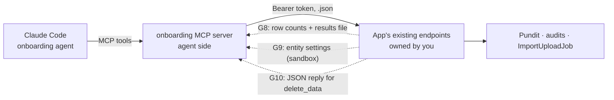
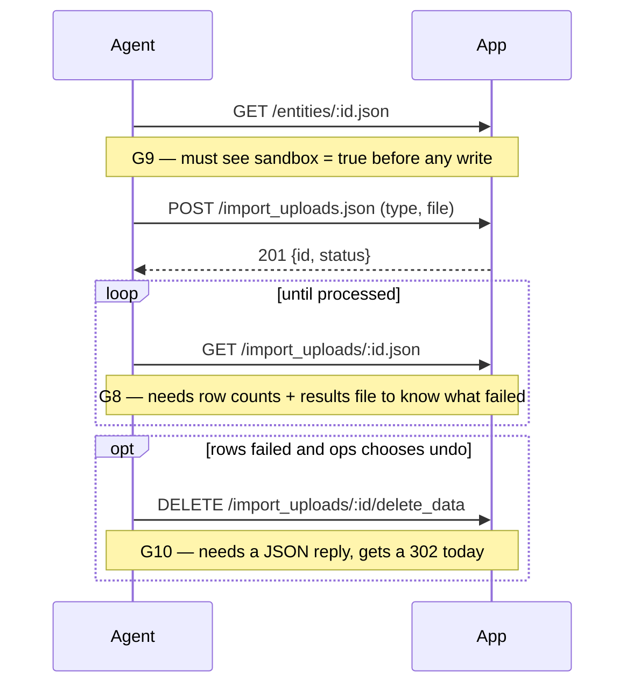

# API requests from the client-onboarding agent

> **Superseded** by [api_improvements_from_orios_trial.md](api_improvements_from_orios_trial.md) (P1–P11),
> which repeats G8–G10 with what the Orios trial showed. Kept for history.

**From:** the client-onboarding agent design (branch `client-onboarding-agent`,
`.claude/skills/client-onboarding/`), 2026-10-18.
**To:** the agent upgrading the app's JSON APIs.
**Ask:** three additions to existing `.json` responses. No new endpoints, no new permissions, no
change to who can call what. The onboarding agent will not touch the APIs itself.

## Context

The onboarding agent is a Claude Code session that onboards a fresh client entity by uploading
files through the app's existing import pipeline. It never writes to the DB; every write is an
HTTP call to the website's `.json` endpoints with the ops user's devise-api bearer token
(`WithAuthentication#authenticate_user!`). Its MCP tools are thin wrappers over those endpoints.



Two loops depend on data the JSON does not return today:



## G8 — import upload JSON lacks outcome data (blocking)

**File:** `app/packs/misc/import_uploads/views/import_uploads/_import_upload.json.jbuilder`
(used by `index.json` and `show.json`).

**Today:**

```ruby
json.extract! import_upload, :id, :name, :entity_id, :owner_id, :owner_type, :user_id, :import_type, :status, :error_text, :created_at, :updated_at
json.url import_upload_url(import_upload, format: :json)
```

**Needed — add:**

| Field | Source | Why the agent needs it |
|---|---|---|
| `total_rows_count` | column | Reconcile: rows in the file vs rows the importer saw |
| `processed_row_count` | column | Rows that imported |
| `failed_row_count` | column | Whether to stop and diagnose |
| `custom_fields_created` | column (`;`-joined) | Detect fields the importer auto-created as `TextField` (`FormType.save_cf_from_import`) |
| `results_url` | `import_upload.import_results&.url` | The per-row error file. The agent's main job is turning failed rows into fixes; the counts alone don't say *which* rows or *why* |

**Authorization:** no change. The HTML `_show.html.erb` (lines 9, 71, 110) and `_stats.html.erb`
(line 51) already link `import_upload.import_results.url` to anyone who can see the upload, so
the JSON exposes nothing the page doesn't.

## G9 — entity JSON lacks entity settings (blocking for safety)

**File:** `app/packs/core/entities/views/entities/_entity.json.jbuilder`.

**Today:** id, name, url, category, founded, entity_type, logo_url, timestamps; `pan` only when
`policy(entity).full_details?`.

**Needed — add an `entity_setting` object:**

| Field | Why |
|---|---|
| `sandbox` | The agent refuses every write unless sandbox is on (notifications go to `sandbox_emails`, see `ApplicationMailer` line 100). It can *set* sandbox today via `PATCH /entities/:id.json` (`entity_setting_attributes` is permitted), but cannot *read* it back |
| `sandbox_emails`, `sandbox_numbers` | Confirm notifications route to the ops inbox |
| `individual_kyc_doc_list`, `non_individual_kyc_doc_list` | Set during onboarding; read back to verify |
| `mcp_enabled` | Reconcile uses the app's read-only MCP tools, which need it |

**Authorization suggestion:** gate the object the way `pan` is gated, e.g. only when
`policy(entity).update?` (the entity's company_admin or support) — the same users who can
already change these settings through `PATCH`.

## G10 — `delete_data` has no JSON reply (minor)

**File:** `app/packs/misc/import_uploads/controllers/import_uploads_controller.rb`,
`#delete_data` (line 86), route `DELETE /import_uploads/:id/delete_data`.

**Today:** enqueues `ImportUploadDeleteAllJob` and `redirect_to import_upload_path(...)`, so a
bearer-token caller gets a 302.

**Needed:** a `respond_to` with `format.json { render json: { id:, status: "deletion_started" }, status: :accepted }`,
keeping the HTML redirect as is.

## Not in scope for you

These are on the onboarding side's list but are not API-shape changes; they are raised
separately: no validate-only/dry-run import (G1); whether a company admin can set feature flags
through `PATCH /entities/:id.json` via the permitted `permissions: []` (G3, a security check);
agent-vs-human attribution in `audits` (G6); `login_as` impersonation being session-only (G7).
