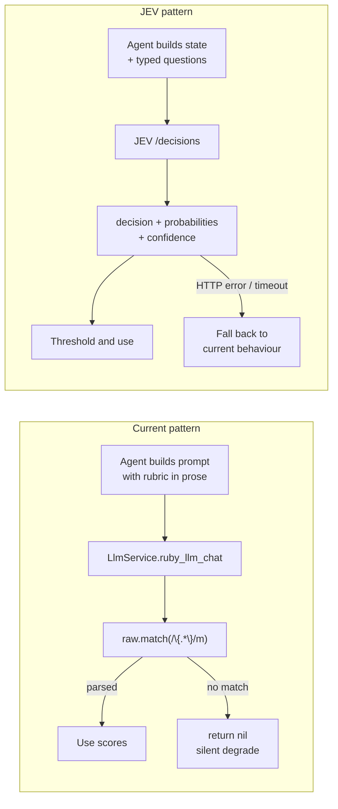
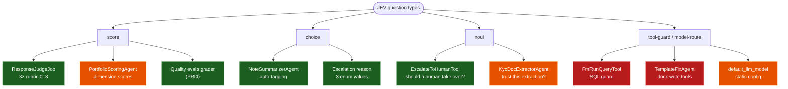
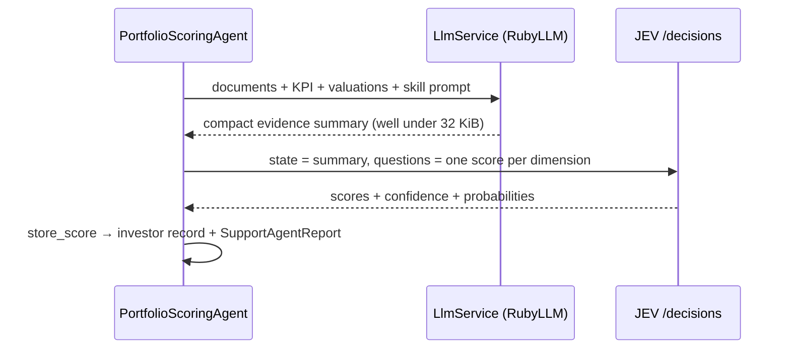
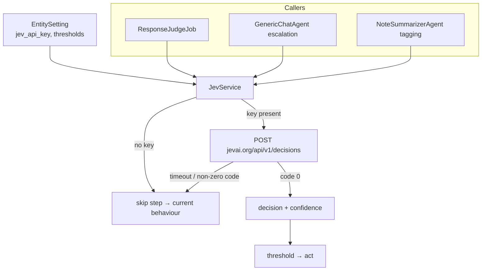

# Evaluation: JEV Decision Model for Support Agents

**Status:** Evaluation / not adopted
**Date:** 2026-09-26
**Source reviewed:** [jevai.info](https://jevai.info/) (community hub), [jevai.org/docs](https://www.jevai.org/docs) (API reference), [typesafe.ai](https://typesafe.ai/) (vendor)

---

## Contents

1. [What JEV Is](#1-what-jev-is)
2. [The API Surface](#2-the-api-surface)
3. [Why It Is Interesting For Us](#3-why-it-is-interesting-for-us)
4. [Fit Assessment Per Call Site](#4-fit-assessment-per-call-site)
5. [Where It Does Not Fit](#5-where-it-does-not-fit)
6. [Integration Seam](#6-integration-seam)
7. [Risks & Open Questions](#7-risks--open-questions)
8. [Recommendation](#8-recommendation)

---

## 1. What JEV Is

JEV is a **decision model** from a vendor called TypeSafe AI. It does not generate prose
and it does not call tools. You POST a `state` (the facts a decision rests on) plus named
`questions`, and it returns typed answers with probabilities and a confidence value.

```json
{
  "model": "typesafe/jev-1.13",
  "state": "…the facts the decision rests on…",
  "questions": {
    "intent": {
      "type": "choice",
      "instructions": "What is the user asking about?",
      "criteria": { "billing": null, "technical": null }
    }
  }
}
```

Response envelope:

```json
{ "code": 0, "message": "ok",
  "data": { "decision": "...", "confidence": 0.0, "probabilities": {}, "guidance": "..." } }
```

Three question types:

| Type | Criteria shape | Returns |
|---|---|---|
| `choice` | object of 2–255 named options → description | one option + probabilities across all options |
| `score` | array of 2–10 level descriptions, ordered low → high | a score (may fall *between* levels) |
| `noul` | optional `true`/`false` descriptions | probability of yes, `0.0`–`1.0` — **not** a boolean |

**Important provenance note:** `jevai.info` states plainly that it is an *independent*
learning hub, not the vendor. The API documented at `jevai.org/api/v1` is the community
site's API, not `typesafe.ai`'s. Which of the two we would actually be sending data to is
an open question (§7), not a settled one.

## 2. The API Surface

Base: `POST https://www.jevai.org/api/v1/…`, `Authorization: Bearer $JEV_API_KEY`,
**body limit 32 KiB**.

| Endpoint | Purpose |
|---|---|
| `/decisions` | native — your own `state` + `questions` |
| `/decisions/tool-guard` | evaluate a consequential tool call before it runs |
| `/decisions/model-route` | pick among available models |
| `/decisions/route` | choose task pace / strategy |
| `/decisions/research` | validate evidence against claims |
| `/decisions/completion` | verify an objective was actually met |

The vendor's own framing, quoted: *"Treat probabilities as signals, not authorization."*

## 3. Why It Is Interesting For Us

Most LLM calls in `app/packs/ai/support_agents/` are **generation** — summaries, emails,
reports — and JEV has nothing to offer there. But a handful are **judgement calls
hand-rolled as "return ONLY this JSON" plus a regex parse**. Those are the JEV-shaped ones,
and they share a failure mode: when the model returns something unparseable we silently
degrade.



Two properties matter concretely:

1. **The answer space is closed.** A `choice` can only return a key we supplied, so
   hallucinated ids and unparseable payloads stop being a class of bug.
2. **Confidence is a number we own.** Today, "low confidence" is the answering model's
   self-report — the one thing LLMs are reliably bad at. A probability can be thresholded
   per entity.

## 4. Fit Assessment Per Call Site

Ranked best fit first.



### 4.1 `ResponseJudgeJob` — strongest fit

`app/packs/ai/customer_support_agent/jobs/response_judge_job.rb:45` scores each CS
assistant reply on Completeness / Grounding / Actionability, 0–3 each, then extracts the
result with `raw.match(/\{.*\}/m)` at `:116` and returns `nil` on failure.

The rubric already in that file **is** an ordered set of level descriptions — it maps onto
three `score` questions with no rewriting. What we gain: calibrated scores plus confidence
instead of an LLM guessing at its own integer, and the JSON-extraction path disappears.

Why it is the right pilot: already async on the `low` queue, already gated on
`EntitySetting#cs_judge_enabled?`, payload is a support Q&A pair rather than investor data,
and existing `AgentChatMessageFeedback` rows give us an old-vs-new comparison set.

### 4.2 Escalation confidence

`app/packs/ai/customer_support_agent/tools/escalate_to_human_tool.rb:20` accepts
`customer_requested | low_confidence | complex_issue`, chosen by the answering model
itself. `generic_chat_agent.rb:186` only auto-escalates when the tool-iteration cap is
blown.

A `noul` question ("should a human take this over?") plus a `choice` over the three reasons
gives a tunable threshold per entity, and covers the gap between "user asked for a human"
and "agent ran out of tool calls".

### 4.3 `NoteSummarizerAgent` auto-tagging

`app/packs/ai/support_agents/services/note_summarizer_agent.rb:218` asks for a JSON array
of `{id, tags}`, tries three regexes to find it, then filters hallucinated note ids with
`untagged_notes.find { |n| n.id == note_id }`. A `choice` per note over the entity's tag
list (well inside the 2–255 option range) removes all three defences because they stop
being necessary.

### 4.4 `PortfolioScoringAgent` — two-stage only

`app/packs/ai/support_agents/services/portfolio_scoring_agent.rb:248` sends documents, KPI
JSON, valuations and a sector skill prompt, and expects
`overall_score / grade / summary / dimensions` back in a fenced block.

**The 32 KiB body limit rules out sending the source material.** The only workable shape is
two-stage: keep the current LLM call for reading PDF/XLSX/PPTX and producing a compact
evidence summary, then have JEV score each dimension from that summary.



### 4.5 `KycDocExtractorAgent` — right shape, wrong data

There is currently no confidence gate before extracted values are written into
`InvestorKyc` columns (`overwrite_mode: "blank_only"` is a blankness check, not a trust
check). A `noul` "is this extraction trustworthy enough to write?" fits the shape exactly.

But the `state` would contain PAN numbers and identity document contents. This is the
**last** place to send data to a vendor we have not vetted, not the first.

### 4.6 Model routing

`entity_setting.default_llm_model` and `cs_judge_model_name` are static per-entity config.
`/decisions/model-route` could pick cheap-vs-capable per request. Real, but low value
relative to the effort and the added dependency.

## 5. Where It Does Not Fit

Naming these explicitly so the tool does not get adopted broadly on enthusiasm.

| Call site | Why not |
|---|---|
| `DataQualityAgent` | Deterministic SQL checks; the health score is arithmetic. Nothing is being decided. |
| `FmRunQueryTool` / `RunQueryTool` | The existing guard is **strictly better** than a probabilistic one: table allowlist, mandatory `{ENTITY_ID}` placeholder, read-only, 100-row cap. A model saying "probably fine" cannot beat a structural check that makes cross-entity leakage impossible. |
| `TemplateFixAgent` docx write tools | Every edit lands on a private working copy and the result is always a **new draft** Document. There is no consequential action to guard. |
| Any generation step (summaries, emails, reports, extraction of values) | JEV returns decisions, not text or field values. |

The general rule: **JEV is a candidate only where we are currently asking an LLM to
classify, rate, or gate — never where a deterministic check already exists, and never for
generation.**

## 6. Integration Seam

`app/packs/ai/llm_service.rb` is the single LLM abstraction, and per-entity keys already
follow a clear pattern (`entity_setting.openai_api_key`, `gemini_api_key`,
`anthropic_api_key`, `openrouter_api_key`). A sibling `JevService` plus
`entity_setting.jev_api_key` matches both.

`SupportAgentService`'s step pipeline gives the gate a natural home: its own `step :`, with
`mark_step_skipped` when no key is configured, so an entity without JEV configured behaves
exactly as it does today.



Non-negotiable for any caller: a timeout and a fall-back to today's behaviour, the way
`note_summarizer`'s tagging already soft-fails rather than blocking the summary.

## 7. Risks & Open Questions

1. **Who are we actually contracting with?** `jevai.info` is explicitly a community hub;
   the API is on `jevai.org`; the vendor is `typesafe.ai`. Terms, SLA and data handling
   need to be pinned to one of them before any key is issued.
2. **Data residency and PII.** For most candidate call sites the `state` would contain
   investor names, commitments, or KYC fields. This is a DPA question, not an engineering
   one. No self-host or regional hosting option is mentioned anywhere on the site.
3. **New vendor on the critical path.** Every integration needs the timeout + fall-back
   described above.
4. **32 KiB body cap** shapes the design wherever documents are involved (§4.4).
5. **"Signals, not authorization"** is the vendor's own caveat. A JEV probability should
   never be the only thing standing between a request and a consequential write.
6. **Calibration is unproven for our domain.** Whether the scores track our reviewers'
   judgement is exactly what the pilot has to measure.

## 8. Recommendation

Do not adopt broadly. Run **one** pilot on `ResponseJudgeJob`: smallest payload, no
investor data, already feature-gated and async, and a ready-made comparison set in
`AgentChatMessageFeedback`. Measure agreement between JEV scores and the existing judge
against human reviews in `cs_feedback_reviews` before touching anything in the escalation
or KYC paths.

Resolve §7.1 and §7.2 before the first request leaves our network.

---

## Related

- `docs/modules/ai/framework/domain_support_agent_quality_evals_prd.md` — the eval loop a
  calibrated grader would serve
- `docs/modules/ai/framework/agent_scheduler_framework.md` — how agent steps are scheduled
  and reported
- `docs/user_guides/support_agents_user_guide.md`
