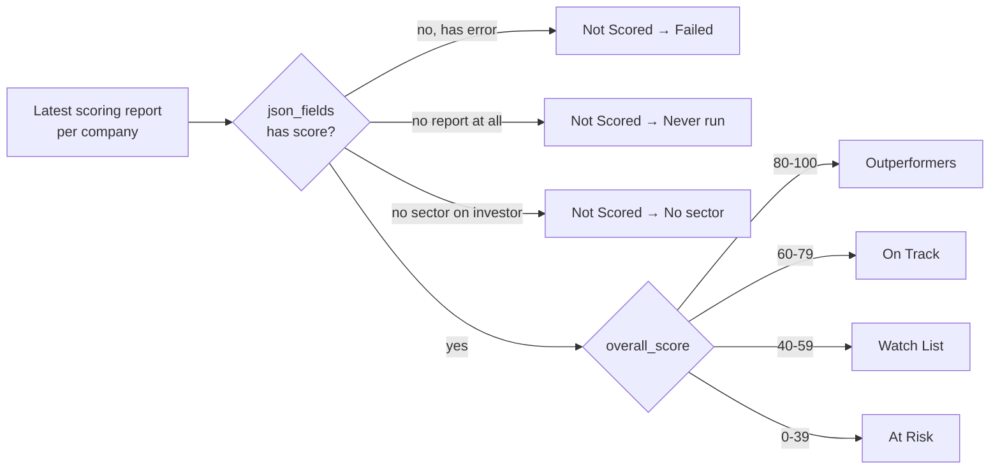
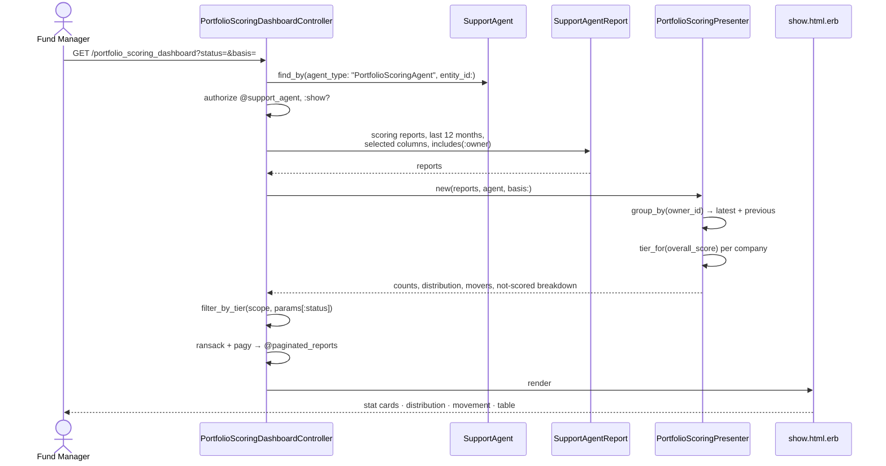
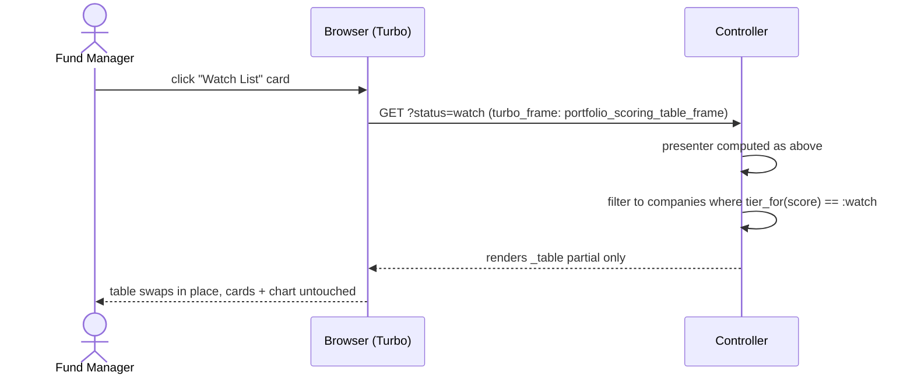
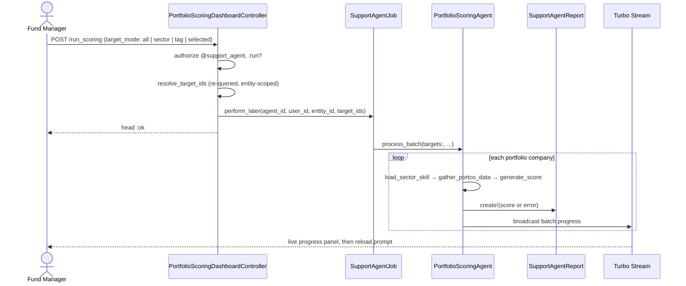

# Portfolio Scoring Dashboard — Design (for review)

**Status:** Implemented — see `app/packs/ai/portfolio_scoring_dashboard/`. Demo data for entity 157 via `db/seeds/portfolio_scoring_reports_157.rb`.
**Agent:** `PortfolioScoringAgent` (`app/packs/ai/support_agents/services/portfolio_scoring_agent.rb`)
**Precedent:** `PortfolioCompanyDashboardController` + `PortfolioDashboardPresenter` (the Portfolio Company Agent dashboard). This design deliberately mirrors that pack so the two dashboards feel like siblings.

---

## 1. What problem this solves

Today a scoring run produces one `SupportAgentReport` per portfolio company, and the only ways to see them are:

- **Per-company** — the `_scoring_report` / `_score_display` widget on the Investor page (one company, deep detail).
- **Flat list** — the "Scoring Reports" tab on the agent page (`_scoring_reports_tab.html.erb`): every report ever, newest first, one row each.

Neither answers the portfolio-level question a GP actually asks:

> *"Of my 40 companies, how many are A/B and how many are C/D — and which ones moved?"*

The mini dashboard buckets companies into grade bands and makes each band a one-click drill-down.

---

## 2. The core design decision: bucket on **score**, label with **grade**

`grade` is a free-text string produced by the LLM (`"B+"`), sourced from whichever sector skill file was matched. Different sector skills can — and over time will — use different letter conventions. `overall_score` is validated in code (`validate_score_keys!` enforces integer 0–100), `grade` is not validated at all.

**So: the bucket is always derived from `overall_score`. The LLM's `grade` string is displayed as a label next to it, never used to bucket.**

This makes the dashboard deterministic and immune to skill-file drift, while still showing the FM the grade the analyst-agent assigned.

The canonical bands come from the shipped skill file (`docs/modules/ai/portfolio_scoring_agent/generic_portfolio_scoring_skill.md`):

| Score | Grade | Tier (dashboard bucket) | Displayed as | Slug | Colour |
|---|---|---|---|---|---|
| 90–100 | A+ | **Outperformers** | Outperformers (A+ / A) | `outperform` | green |
| 80–89 | A | **Outperformers** | Outperformers (A+ / A) | `outperform` | green |
| 70–79 | B+ | **On Track** | On Track (B+ / B) | `on_track` | blue |
| 60–69 | B | **On Track** | On Track (B+ / B) | `on_track` | blue |
| 50–59 | C+ | **Watch List** | Watch List (C+ / C) | `watch` | amber |
| 40–49 | C | **Watch List** | Watch List (C+ / C) | `watch` | amber |
| 0–39 | D | **At Risk** | At Risk (D) | `at_risk` | red |
| — | — | **Not Scored** | Not Scored | `not_scored` | grey |

Four tiers for the stat cards (a "mini" dashboard shouldn't have seven top-level numbers), seven bands in the distribution chart underneath. Same colour thresholds already used by `_score_display.html.erb` (`bg-success` / `bg-primary` / `bg-warning` / `bg-danger`) — no new palette.

### Labelling convention (decided)

**The tier name leads; the grades ride in parentheses.** Cards, filter pills, chart legend and table headers all read `Outperformers (A+ / A)`, `On Track (B+ / B)`, `Watch List (C+ / C)`, `At Risk (D)`. The tier name is what the FM scans for; the grade letters are present so the dashboard reconciles visually against the letter shown on each company's individual score card.

Two consequences for implementation:

- The parenthesised grades are **presentation only**, generated from the band table — they are never parsed and never used to select rows.
- **URLs carry the tier slug, not the letters**: `?status=watch`, not `?status=C%2B`. Stat-card links, chart-bar links and saved/bookmarked filters stay stable if the letters in a sector skill file ever change. The presenter exposes `TIERS` as slug → `{ label:, grades:, range:, colour: }` so the label and the slug can never drift apart.



### Why "Not Scored" is split three ways

A dashboard that quietly drops companies it couldn't score is worse than no dashboard. The `PortfolioScoringAgent` has three distinct silent-skip paths that all currently end up invisible at the portfolio level:

1. **No sector** — `targets` filters out `sector: [nil, ""]` entirely; the company is never even attempted.
2. **No skill file for the sector** — `load_sector_skill` writes `ctx[:skill_error]` and stores a `failed` report.
3. **LLM/parse failure** — `generate_score` rescues and stores a `failed` report with `json_fields["error"]`.

All three roll up into the single **Not Scored** card, with the breakdown shown in the card body and as separate table filters. #1 and #2 are configuration problems the FM can actually fix, so they get an inline "Fix configuration" link to the agent edit page (reusing the existing `config_issues` output and `_config_issues_banner` partial).

---

## 3. Layout

Standalone page at `/portfolio_scoring_dashboard`, same shell as the Portfolio Company Dashboard (`FormCard` wrapper, stat cards → chart+actions → table → footer).

```
┌──────────────────────────────────────────────────────────────────────────────┐
│ Portfolio Scoring Dashboard              Last run: 12 Aug 2026 · 38/40 scored │
├──────────────────────────────────────────────────────────────────────────────┤
│  [ Count ▓ | Value ]   ← toggle: by company count or by portfolio FMV        │
│                                                                              │
│ ┌Outperformers──┐ ┌─On Track───┐ ┌─Watch List─┐ ┌──At Risk──┐ ┌─Not Scored─┐ │
│ │   (A+ / A)    │ │  (B+ / B)  │ │  (C+ / C)  │ │    (D)    │ │            │ │
│ │      9        │ │     18     │ │      8     │ │     3     │ │     2      │ │
│ │  score 80-100 │ │ score 60-79│ │ score 40-59│ │ score 0-39│ │ 1 failed   │ │
│ │  ▓▓▓▓ 23%     │ │ ▓▓▓▓▓▓ 45% │ │ ▓▓▓ 20%    │ │ ▓ 8%      │ │ 1 no sector│ │
│ └───────────────┘ └────────────┘ └────────────┘ └───────────┘ └────────────┘ │
│  each card is a link → filters the table below via Turbo Frame               │
├───────────────────────────────────┬──────────────────────────────────────────┤
│  Grade Distribution (7 bands)     │  Score Movement — since previous run     │
│  ▁▃█▆▄▂▁  A+ A B+ B C+ C D        │  ↑ Improved   6   ↓ Declined  4          │
│  (Chart.js bar, colour = tier)    │  → Unchanged 28   ⚑ Stale     3          │
│                                   │  ── biggest movers ──                    │
│                                   │  Acme Health   B  → A   +11              │
│                                   │  Northwind     B+ → C+  −14              │
│                                   │  [ Run Scoring ▾ ] on all / sector / tag │
├───────────────────────────────────┴──────────────────────────────────────────┤
│  Companies (filtered: Watch List)                    [search] [sector ▾] [⇅] │
│  Company      Sector    Score              Grade  Δ    Weakest dim  Scored    │
│  ─────────────────────────────────────────────────────────────────────────── │
│  Northwind    SaaS      ▓▓▓▓▓░░░░░ 52      C+     ▼14  Cash Runway  12 Aug    │
│  Belmont Bio  Health    ▓▓▓▓▓▓░░░░ 58      C+     ▲3   Growth       12 Aug    │
│  ...                                                        « 1 2 3 »        │
├──────────────────────────────────────────────────────────────────────────────┤
│  Next steps: 3 companies At Risk · 2 unscored (fix config) · 3 scores stale   │
└──────────────────────────────────────────────────────────────────────────────┘
```

### Row-by-row rationale

**Stat cards (5).** Clickable, each sets `?status=` and re-renders only the table inside a Turbo Frame — identical mechanism to `_stats.html.erb` on the portco dashboard. Percentage + mini progress bar in each card so relative weight reads at a glance.

**Count / Value toggle.** The single highest-value addition over a plain count dashboard. "8 companies on the Watch List" is very different from "8 companies on the Watch List holding 40% of portfolio FMV". Value comes from `PortfolioInvestment#fmv` (falling back to `cost` when FMV is nil), which the agent already loads. The toggle is a URL param (`?basis=value`), not JS state, so it survives filter clicks and is shareable.

**Grade Distribution chart.** All seven bands, bar colour inherited from the tier. Uses the existing `portfolio_dashboard_chart_controller.js` pattern (Chart.js, already bundled) — a near-copy with a fixed 7-label axis and per-bar colours. Bars are clickable to filter to a single grade band.

**Score Movement panel.** Compares each company's latest score to its previous scoring report. This is what makes the dashboard worth revisiting rather than reading once. Also carries the **Stale** count (scores older than the configured threshold) and the **Run Scoring** action.

**Company table.** Sortable, searchable (Ransack on investor name, same as the portco table), paginated with Pagy at 10 rows. Columns: Company · Sector · Score bar · Grade badge · Δ vs previous · Weakest dimension · Scored at · row-expand for the full `_score_display` panel (reused verbatim — no new detail view).

**Weakest dimension** is `dimensions.min_by { score }[:name]` — a free, high-signal column that turns the table into a triage list instead of a leaderboard.

**Footer.** "Recommended next steps" block, same shape as `_footer.html.erb` on the portco dashboard.

---

## 4. Where it lives

```
app/packs/ai/portfolio_scoring_dashboard/
├── controllers/portfolio_scoring_dashboard_controller.rb
├── services/portfolio_scoring_presenter.rb
├── helpers/portfolio_scoring_dashboard_helper.rb   # sticky-filter link builder
└── views/portfolio_scoring_dashboard/
    ├── show.html.erb
    ├── _stats.html.erb          # scope toolbar (sector/tag/basis) + 5 tier cards
    ├── _distribution.html.erb   # 7-band Chart.js bar
    ├── _movement.html.erb       # movement filters + movers + Run Scoring
    ├── _run_modal.html.erb      # run targets: all / unscored / companies / sector / tag
    ├── _table.html.erb          # Turbo Frame: scoring_table_frame
    └── _footer.html.erb
app/javascript/controllers/scoring_distribution_chart_controller.js
app/javascript/controllers/scoring_run_target_controller.js
app/javascript/controllers/scoring_scope_filter_controller.js
app/assets/stylesheets/custom/scoring_dashboard.scss
```

**Note:** `config/application.rb` is not reloadable — adding the pack to `ai_view_paths` requires a server restart before the route, views and helper resolve.

Wiring, all mirroring the portco dashboard exactly:

- `config/routes/ai.rb` — `resource :portfolio_scoring_dashboard, only: [:show] do post :run_scoring end`
- `config/application.rb` — add `portfolio_scoring_dashboard` to `ai_view_paths`
- `app/packs/core/investors/views/investors/_index.html.erb` — dropdown link, gated on `SupportAgent.find_by(entity_id:, agent_type: "PortfolioScoringAgent")`, next to the existing "Portfolio Company Agent Dashboard" link
- `app/packs/ai/support_agents/views/support_agents/show.html.erb` — a "View Dashboard" button on the Scoring Reports tab header (link, not a duplicate tab)

**Authorization:** reuses `SupportAgentPolicy#show?` and `#run?`, which the portco dashboard already calls. No new policy methods needed — but if the run action is split out (e.g. `run_scoring?`), the policy method must be added at the same time or Pundit raises `NoMethodError`.

---

## 5. Data access

### The scope

```ruby
SupportAgentReport
  .where(support_agent: @support_agent, owner_type: "Investor", latest: true)
  .where("json_fields LIKE '%\"score\":%' OR json_fields LIKE '%\"error\":%'")
  .where("json_fields NOT LIKE '%\"steps\":%'")
```

Same predicate as `AgentReportsQuery#scoring_reports`, plus `latest: true`.

**Resolved during build — option (b) was taken.** `SupportAgentReport#mark_as_latest!` scopes `latest` to the `(owner, support_agent)` pair, and `PortfolioScoringAgent` writes *two* rows per run for that same pair when run with steps: the step-tracking report (created first, in `initialize_agent`) and the scoring report (created last, in `store_score`). Creation order means the scoring report wins `latest: true` today — but that's an ordering coincidence, not a guarantee. Two options:

- **(a) Belt and braces (recommended)** — keep `latest: true` *and* the `json_fields` predicate above, so a step row can never leak into the dashboard even if ordering changes.
- **(b) Don't use `latest`** — group all scoring reports by `owner_id` in Ruby and take the newest. Needed anyway for the Δ column (see below), so this is nearly free.

Recommendation: **(b) for the presenter's data load, with (a)'s predicate as the filter.** One query, gives both "latest" and "previous" in one pass. This is what shipped — the controller does not use `latest` at all.

**One bug this surfaced in practice:** the table scope joins `investors`, and that table has its own `id`, `json_fields` and `created_at` columns. Every column in `scoring_reports_scope` (select list, predicate, order) has to be table-qualified or MySQL raises `Column 'json_fields' in where clause is ambiguous`.

### The Δ (movement) query

Per-company we need the latest **two** scoring reports. Rather than N+1 or a window function (the test env is SQLite, prod is MySQL — keep SQL dialect-portable), load the scoring reports for this agent from the last N months, `group_by(&:owner_id)`, and `take(2)` per group.

Guardrails, per `CLAUDE.md`:

- **Select only the columns needed** — `json_fields` is wide and every report carries the full dimension/rationale payload. The presenter needs `id, owner_id, status, created_at, json_fields`; everything else is dropped.
- **Cap the window** — `created_at > 12.months.ago` so the load is bounded by companies × runs-per-year, not by all history.
- **No `blank?` / `present?` on relations** — use `none?` / `exists?` (enforced by the `IRM/RelationBlankPresent` cop).
- Portfolio-company counts are in the tens–low hundreds per entity, so the in-memory presenter approach used by `PortfolioDashboardPresenter` is appropriate here too. If an entity ever exceeds ~1,000 companies this needs revisiting.

### Presenter surface

`PortfolioScoringPresenter.new(reports, support_agent, basis: :count | :value)`

| Method | Returns |
|---|---|
| `TIERS`, `GRADE_BANDS` | frozen band definitions — slug → `{ label:, grades:, range:, colour: }`; `label_for(:watch)` renders `"Watch List (C+ / C)"` so the display string is generated, never hand-typed per view |
| `tier_for(score)` | `:outperform` / `:on_track` / `:watch` / `:at_risk` |
| `counts_by_tier` / `value_by_tier` | Hash tier → Integer / Money |
| `grade_distribution` | Hash of all 7 bands → count (zeros included, so the chart axis is stable) |
| `not_scored_breakdown` | `{ failed:, no_sector:, never_run: }` |
| `movers(limit:)` | biggest ± deltas, `{ investor, from, to, delta }` |
| `stale_count` | scored before `staleness_days` ago |
| `total_companies` | all portfolio companies in the entity, scored or not |
| `score_for(report)` / `grade_for` / `delta_for` / `weakest_dimension_for` | per-row helpers for the table |

`staleness_days` reads from `support_agent.json_fields["score_staleness_days"]`, defaulting to 90 — one new optional config field on the agent, same pattern as the existing `kpi_frequency` / `docs_from_last_n_reports` fields.

---

## 6. Flows

### Page load



### Drill-down (stat card click)



### Run scoring from the dashboard



`run_scoring` re-resolves target ids against `entity_id` server-side (copying `resolve_target_ids` from the portco dashboard) so a tampered form can't target another entity's companies.

---

## 7. Empty and edge states

| Situation | What the dashboard shows |
|---|---|
| No `PortfolioScoringAgent` for the entity | 404 via `find_by!` — matches portco dashboard; nav link is hidden anyway |
| Agent exists, zero runs | Cards all zero, empty-state panel: "No companies scored yet" + Run Scoring button |
| All companies missing a sector | Not Scored = total, with "N companies have no sector set — the agent can't match a skill file" and a link to the investor list |
| Skill files misconfigured | `config_issues` banner at the top of the page, reusing `_config_issues_banner.html.erb` |
| Only one run so far | Δ column shows "—", Movement panel shows "First run — no comparison yet" |
| Score manually edited | `json_fields["manually_edited"]` already set by the score editor — show the existing pencil marker on the row so an edited score isn't mistaken for an agent output |
| Company scored, then sector changed | Row flagged stale; the stale reason is surfaced in the tooltip |

---

## 8. What I'd deliberately leave out of v1

- **Sector × tier heatmap.** Attractive, but with typical portfolio sizes most cells are 0–2 companies and it reads as noise. The sector filter on the table covers the need.
- **Score history sparkline per row.** Needs the full multi-run payload per company in the table query — meaningful memory cost for a column most users won't read. The Δ column carries most of the signal.
- **Cross-entity / fund-level rollup.** Out of scope; the agent is entity-scoped.
- **Editing scores from the dashboard.** The existing `score-editor` Stimulus controller works inside the expanded `_score_display` panel — reuse it there rather than building an inline grid edit.

---

## 9. Testing

Cucumber only (no RSpec), following `features/ai/support_agents/portfolio_scoring_agent_config.feature`:

`features/ai/support_agents/portfolio_scoring_dashboard.feature`

- Bucketing is derived from score, not from the grade string (seed a report with `overall_score: 85` and a nonsense `grade: "Z"` → lands in Outperformers, card still reads "Outperformers (A+ / A)", the company's own badge shows "Z")
- Card and filter labels render as `Tier (grades)` from the presenter's band table, not hard-coded per view
- Filter links use the tier slug (`?status=watch`), and a bookmarked slug URL still resolves after a grade-letter change
- Boundary scores land in the right tier (39/40/59/60/79/80)
- Each stat card filters the table to the right companies
- Not Scored splits correctly across failed / no-sector / never-run
- Δ column computes from the previous scoring report and shows "—" on first run
- Value basis toggle changes the card numbers and preserves the active filter
- A user without `show?` permission cannot reach the page

Note for the run action: Cucumber uses the `:inline` ActiveJob adapter, so assert on the created `SupportAgentReport` rows directly rather than on `enqueued_jobs`.

---

## 10. Open questions for you

**Decided and built:**
- Tier names lead, grades in parentheses — see §2. URLs carry the tier slug.
- Every Score Movement figure (improved / declined / unchanged / stale) is a filter link, resolved by `PortfolioScoringPresenter#reports_for_movement` so the figure and the filtered rows come from one selector. A figure of zero renders as plain text rather than a link to an empty table.
- **Sector and tag filters scope the entire dashboard**, not just the table. They are applied before the presenter runs, so the cards, chart, movement figures and percentages all describe the filtered subset. An info banner states the active scope and company count, because otherwise filtered cards read as whole-portfolio figures. The dropdowns are built from the *whole* portfolio (with counts) so selecting a sector never empties the dropdown that got you there.
- Filter composition is handled by `PortfolioScoringDashboardHelper#scoring_dashboard_path_with`, which merges the sticky filters into every link — tier cards, chart bars, movement figures, footer actions, search submit and pagination — so no click silently drops another filter.

**Still open:**

1. **Count vs Value default.** Default to count (simpler, always available) with value as a toggle — or lead with value?
3. **Standalone page vs a tab on the agent page.** I've proposed standalone with a cross-link, mirroring the portco dashboard. A tab is less discoverable but zero new routes.
4. **Staleness threshold** — 90 days a sensible default, or should it key off the agent's schedule instead?
5. **Should the Δ column compare to the previous run, or to the same period last quarter?** Previous run is simpler and matches how the agent is actually invoked ad hoc.
