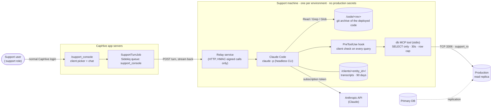
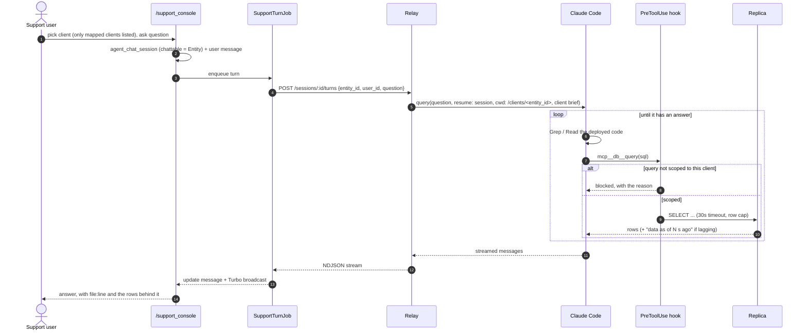
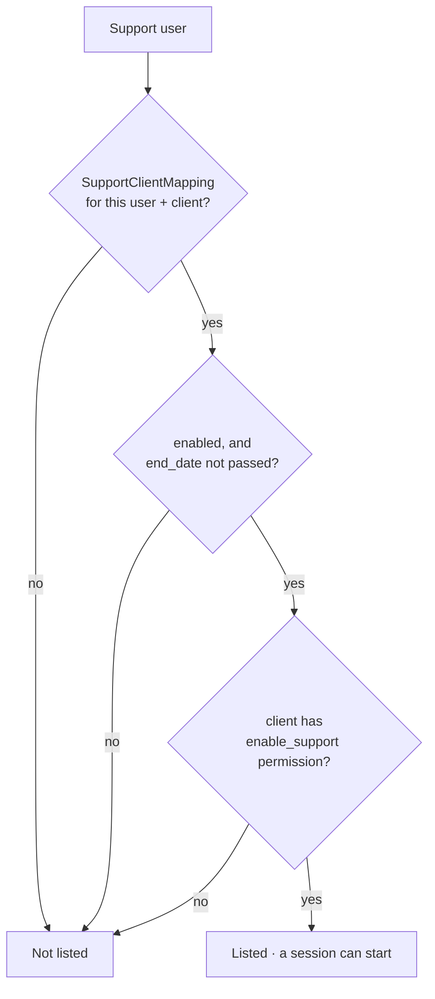
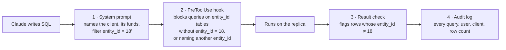
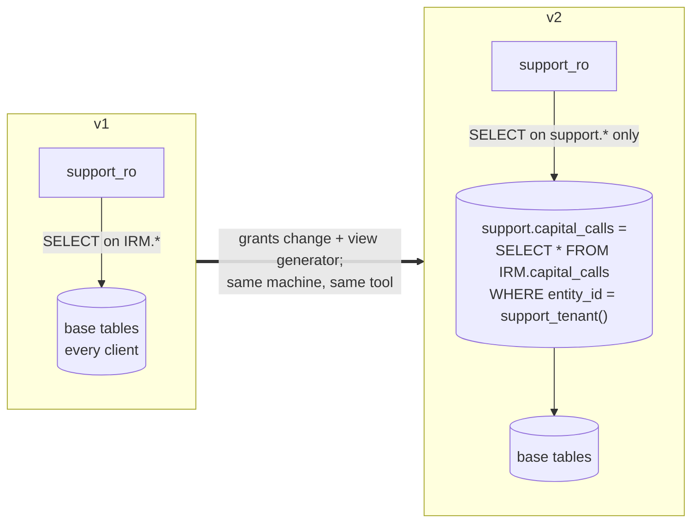
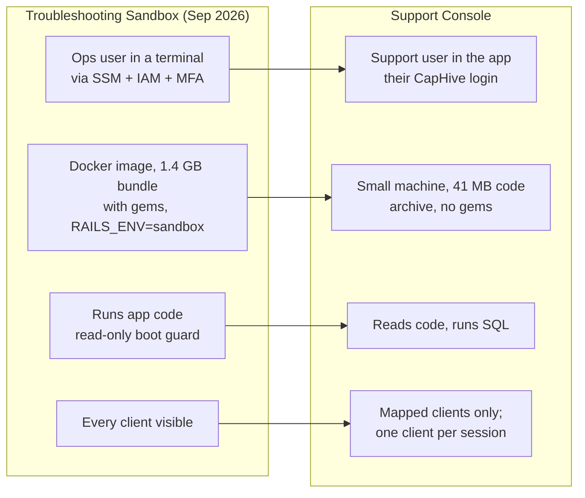

# Support Console — Claude Code for the support team

**Status:** built (2026-10-16) as the OpenSpec change [`support-console`](../../../../openspec/changes/archive/2026-10-22-support-console/design.md), which supersedes this brainstorm where they differ (Claude Code CLI rather than an SDK, local mode, the staging writer rule). User guide: [Support Console](../../../user_guides/support_console_user_guide.md). This replaces the Troubleshooting Sandbox
design on the `troubleshooting-sandbox` branch (`docs/modules/ai/framework/troubleshooting_sandbox.md`
there), keeping what it proved and dropping most of its machinery.

**Branch:** `support-assistant-brainstorm`

## The idea in one paragraph

A user with the `:support` role opens **Support Console** in the CapHive app, picks one of the clients
they are mapped to, and asks a question such as *"why is Investor Y's closing balance zero in Fund X?"*.
The question goes to **Claude Code** running on a small, separate machine. Claude reads **the code of
the deployed revision** and queries **the production read replica** through a read-only account, then
answers in business terms, citing `file:line` and the rows behind the answer. The support user never
logs into the machine, and the machine never sees a production secret.

## The picture

What reaches what:

| From | To | How | Why only this |
|---|---|---|---|
| App servers | Support machine | One inbound port, from the app servers' security group, HMAC-signed requests | Rails has already decided *who* may ask about *which* client before anything is sent |
| Support machine | Replica | TCP 3306 to the replica's security group, account `'support_ro'@'<machine IP>'` | The login is read-only and works only from the machine's own address. On production the task refuses to open the rule if the writer shares the replica's group. Staging has no replica, so there writer and replica are one server (E24) |
| Support machine | Anthropic API | A Claude subscription token (`claude setup-token`) from Parameter Store, in the relay's environment only | Claude's read tools are denied `/etc` and `/proc`, so it cannot read the token back. Client rows go to Anthropic, not just AWS. `SUPPORT_CONSOLE_AUTH=bedrock` switches back to Bedrock (instance role, the two Claude models) |
| Support user | Support machine | **Nothing** | No SSM, no shell, so no human can bypass the controls below |

## How a question is answered

**Worked example.** A support user mapped to *Golden Angels* (entity 18) asks why investor *Ravi K* shows a
zero closing balance in *Fund I*. Claude greps for how the closing balance is computed, reads that method,
sees it sums `account_entries` of a given name for the commitment, queries
`SELECT name, SUM(amount_cents) FROM account_entries WHERE entity_id = 18 AND capital_commitment_id = …
GROUP BY name`, finds the closing-balance entry missing for the latest `reporting_date`, and answers:
*"The closing balance is zero because the Q3 account entries were never generated for this commitment —
the fund's Q3 allocation run excluded it (`file:line`). Re-running the allocation for Q3 would fix it."*
It explains the fix; it can't apply it.

## Who can ask about which client

The client picker uses the same rule as every admin page for a support user
(`app/packs/core/base/policies/base_scope.rb`, `EntityPolicy::Scope#resolve_admin`):

A session belongs to exactly one (support user, client) pair. Switching client starts a new session.

## Keeping a session to one client

The account itself reads **every** client — MySQL has no row-level security. In v1, keeping Claude on
the chosen client is **best effort**, in layers:

| Layer | Stops an honest model drifting | Stops a model steered by data it read (prompt injection) |
|---|---|---|
| 1 · System prompt | mostly | no |
| 2 · Hook | yes, for simple queries | partly — `... entity_id = 18 OR 1=1` contains the filter |
| 3 · Result check | detects afterwards | detects afterwards |
| 4 · Audit log | detects afterwards | detects afterwards |
| **v2 · Tenant views** | yes | **yes** |

The realistic v1 failure is an answer that mixes two clients' figures; layers 1–2 prevent it, and 3–4
make any cross-client read findable. Tables without `entity_id` (`audits`, `versions`, `workflow_*`, …)
are scoped only by the prompt (through their parent row), so for them the audit log is the safeguard.

### v2: tenant views, a real boundary

The db tool runs `SET @support_tenant = <client>` before each query and rejects any SQL containing `@`
or `:=`. Whatever SQL Claude writes, it can only reach views already filtered to one client. Costs: views
are DDL, so they are created on the primary and replicate; they must be regenerated after migrations
(MySQL fixes a view's column list at creation); and `entity_id = support_tenant()` must still use the
index on large tables — **spike with `EXPLAIN` on `account_entries` first**.

## The replica, not the primary

- **The app barely uses the replica.** `ApplicationRecord` reads and writes the primary
  (`connects_to … reading: :primary`); only `UserReplica` reads the replica, for
  `ReplicationHealthJob`. Support queries don't compete with app users.
- **The account exists on both, the route does not.** MySQL replicates accounts from the primary, so
  `support_ro` is created there — as `'support_ro'@'<machine IP>'` with `SELECT, SHOW VIEW` only — but
  the security group rule is on the replica's group, and on production the task refuses it when the
  writer is in that group too.
- **The tool refuses to run off a replica.** On connect it checks `@@read_only = 1` and
  `@@super_read_only = 1`; if either is off, it is pointed at the wrong host and answers nothing.
- **Lag is shown, not hidden.** It reads `Seconds_Behind_Source`; above ~60 s, results carry "data as of
  N seconds ago".
- **Load is capped.** `MAX_USER_CONNECTIONS 4`, `MAX_QUERIES_PER_HOUR 20000`, 30 s `max_execution_time`,
  and the Sidekiq queue's concurrency of 3.

## The machine

| On it | Not on it |
|---|---|
| Claude Code (the `claude` CLI, run headless), the relay, the db MCP tool and hook | Production credentials, master keys, `.env` |
| `/code/<rev>`: `git archive` of the deployed revision, ~41 MB, no gems | Gems, Ruby app runtime — the code is read, never run |
| `support_ro` password, readable only by the tool's user | A shell for humans; Bash for Claude |
| `/clients/<entity_id>/` transcripts, encrypted volume, 90-day retention | Elasticsearch, document files, Redis, jobs |

Claude Code's settings for the session:

| Allowed | Denied |
|---|---|
| `Read`, `Grep`, `Glob` over `/code/<rev>` and the client folder | `Bash`, `Write`, `Edit`, `WebFetch`, `WebSearch` |
| `mcp__db__query`, `mcp__db__describe_tables` | anything outside those two folders |

The code bundle is built from an allow-list (`SupportConsoleCodeArchive::INCLUDED`): `app/`, `lib/`,
`config/` without credentials, keys or deploy files, the schema and migrations, the product docs
(`docs/user_guides`, `docs/modules`, `docs/technical`, `docs/release_notes`) and the repo's `CLAUDE.md`.
Ops docs, incident write-ups, skills and anything not listed stay out. A generated support brief (what this is, read-only, cite
`file:line` and rows, aggregate in SQL rather than pulling thousands of rows) is added to the system
prompt with the client.

**One machine per environment.** `production.in` and `production.us` get separate machines, replicas,
parameters, relay secrets and budgets. They are in **one AWS account** (`825199636520`), so each
environment's Bedrock budget would see the combined IN + US spend. On the default subscription token both
use the same Claude plan and its usage limit; with Bedrock's global inference profiles, neither would be
pinned to its own region either.

## Inside the app

| Piece | Built from |
|---|---|
| `/support_console` page: client picker + chat | The existing agent chat UI; picker from `resolve_admin` |
| Session and messages | `agent_chat_sessions` (`chattable` = the `Entity`) and `agent_chat_messages`. `support_agent_id` is `NOT NULL`, so a "Support Console" `SupportAgent` record owns these sessions |
| `SupportTurnJob` | Same shape as `ChatStreamJob`: stream chunks into the message, broadcast with Turbo. Own queue, concurrency 3 |
| Stop button | `DELETE /sessions/:id/turns/current` → relay aborts the query |
| Previous investigations | Listed per client from `agent_chat_sessions`; Claude can also read them from the client folder |

The relay accepts one turn per session at a time, so a resumed session is never written by two turns.

## What it can and cannot answer

| Can | Cannot |
|---|---|
| "Why does this screen show X?" — reads the code that computes it, queries its inputs | "Does this fix work?" — nothing can write |
| "Who changed this, and when?" — `audits`, `versions` | Run app code (`rails runner`, a report builder, an allocation) |
| "Why did this email not go out?" — flags, workflow state, `noticed_notifications` | Search (no Elasticsearch), open document files |
| "What will happen if the GP does Y?" — from the code path | Anything about another client |

Where an answer needs logic it can't run (waterfalls, allocations), it shows the formula from
`file:line`, its inputs from the replica, and the result, so the support user can check it.

## What changed from the Troubleshooting Sandbox

Kept from that branch: the SELECT-only account and its provisioning rake task
(`sandbox:provision_db_access`, already applied on staging as `sandbox_ro`), the replica checks, the
code archive published on deploy, the Bedrock decision and the "cite `file:line` and rows" brief.

Dropped: SSM access and per-person IAM, the Docker image with gems, `RAILS_ENV=sandbox` and the boot
guard, `rails runner`, Bash.

## Open items

- **Subscription terms.** The machine signs in with one person's Claude subscription and serves the whole
  support team (decided 2026-10-19, owner's call). Its usage limit is shared with that person's own use.
- **Token renewal.** A `setup-token` token lasts a year; `machine_check` warns 30 days ahead.
- **Is the replica also the DR standby?** If so, heavy support queries could delay failover; the caps
  above keep it small, but it changes the stakes.
- **v2 spike:** does `entity_id = support_tenant()` use the index on `account_entries`?
- **Prompt-injection review** of the result check and audit log before rollout.
- **Code archive on `main`:** the publish-on-deploy hook lives on `troubleshooting-sandbox`; it needs
  porting, trimmed to `git archive` only (no `vendor/cache`).
