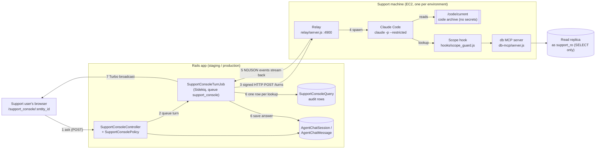
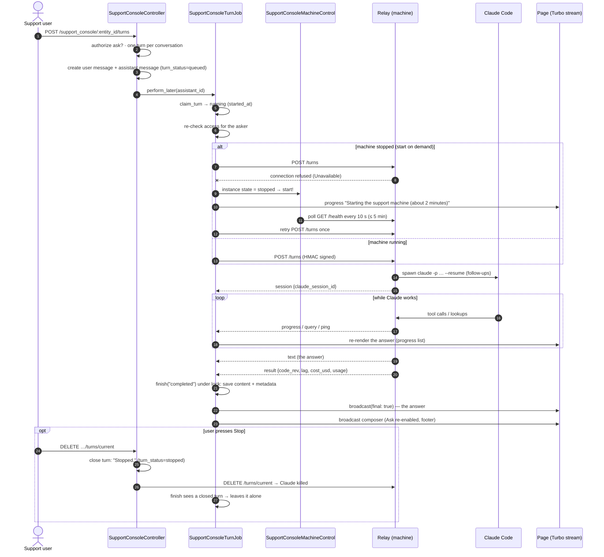
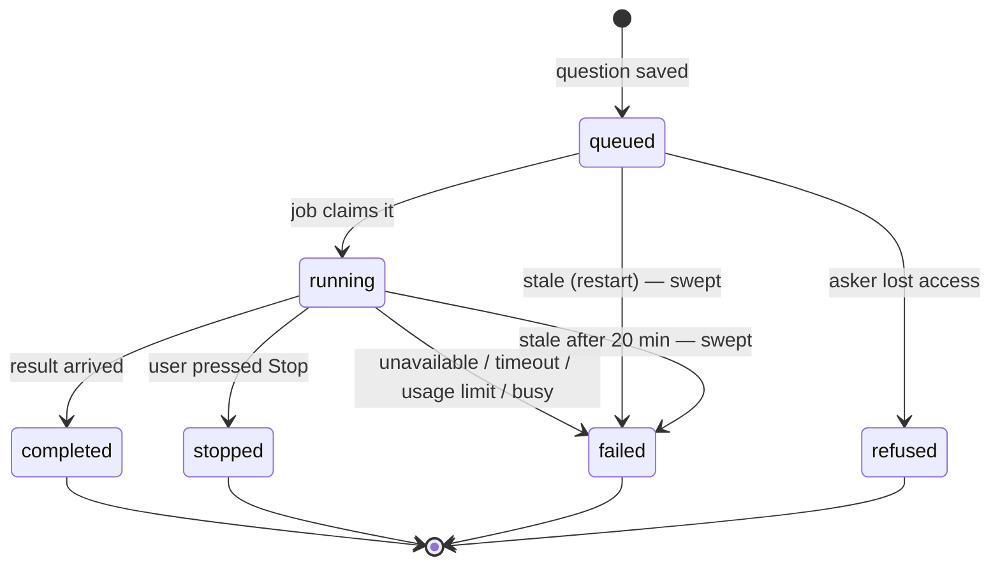
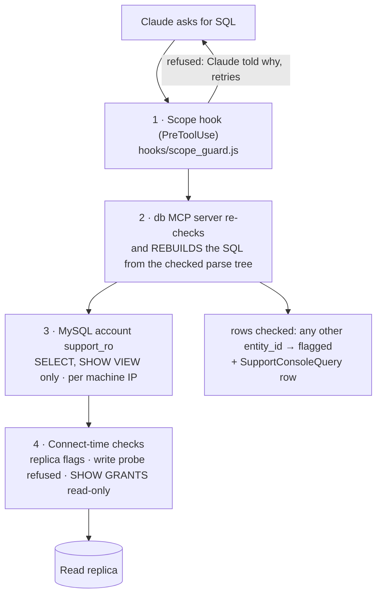
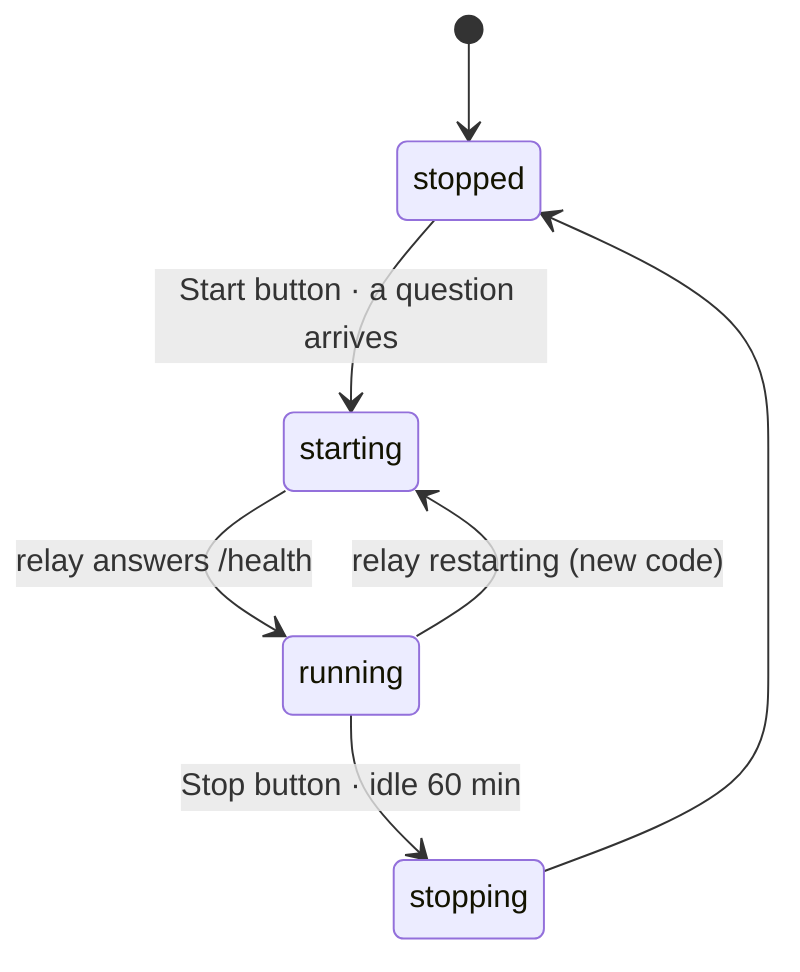

# Support Console — technical guide

How the Support Console works, from the big picture down to the files. For the full design (every
rule, worked example and test), see `openspec/changes/support-console/design.md`; this guide is the
readable tour.

---

## 1. What it is

The Support Console lets a CapHive **support user** ask plain-English questions about **one client**
("Why is TSTF2 marked Overpaid on Call 2?") and get an answer that cites the code and the data rows
behind it. The answer is worked out by **Claude Code** (Anthropic's coding agent, run without a
screen — "headless") on a dedicated **support machine**: a small EC2 server per environment that holds
a copy of the code CapHive is running and a **read-only** login to the database replica. Claude can
read code and run `SELECT`s for that one client — it cannot change anything, see secrets, or read
another client's rows. Every lookup it makes is recorded.

**In one sentence per step:** the browser posts the question → Rails checks access and queues a job →
the job sends the question, signed, to the relay → the relay starts Claude Code → Claude reads code and
runs checked `SELECT`s → the relay streams progress and the answer back line by line → the job saves
the answer, records each lookup and pushes live updates to the page.

---

## 2. One question, end to end

### Turn status lifecycle

Stored in the assistant message's `metadata["turn_status"]`.

---

## 3. The parts in detail

### 3.1 Who may use it — access

**Why:** support users must only see the clients the admin pages already let them support.

| Rule | Where |
|---|---|
| Only users with the `:support` role see the console (`:super` alone is not enough) | `SupportConsolePolicy#index?` |
| A client is pickable only with an **enabled** `SupportClientMapping` for this user, the client's `enable_support` permission on, and the mapping's `end_date` today or later | `SupportConsolePolicy::Scope#resolve` |
| Every request re-checks the client from the URL | `SupportConsolePolicy#ask?` |
| The job re-checks the **asker** (not the conversation's starter) before running | `SupportConsoleTurnJob#perform` (E8, X23) |
| Start / Stop the machine: any `:support` user | `SupportConsolePolicy#machine?` |
| The old AI-agent chat routes cannot reach the console's agent | `SupportAgentPolicy#show?` (X30, X31) |

Files: `app/packs/ai/support_console/policies/support_console_policy.rb`,
`app/packs/ai/support_console/controllers/support_console_controller.rb`.

### 3.2 The page and live updates

**Why:** an investigation takes 30 s – several minutes; the user should see what Claude is doing.

- A conversation is an `AgentChatSession` owned by the `SupportConsoleAgent` record, with the client
  as its `chattable`. Each question is a `user` message; each answer an `assistant` message.
- The page subscribes to a **Turbo stream** (`turbo_stream_from session, :support_console`). The job
  re-renders `support_console/_message` into it on each progress event and every 5 text chunks, and
  `support_console/_composer` when the turn ends.
- **X33 fix:** `finish` saves the final status first, then broadcasts with `broadcast(final: true)`.
  Without `final:`, the Stop guard (`closed_elsewhere?`) read the just-saved "completed" as "someone
  else closed this turn" and skipped the final update — the page stayed on "Working…" until reload.
- The composer footer shows data freshness ("Data as of N seconds ago"), the code version, and the
  conversation's token total and approximate cost (§3.9).

Views: `app/packs/ai/support_console/views/support_console/` (`_chat`, `_message`, `_composer`,
`_machine`, `_picker`, `show`, `index`).

### 3.3 The turn job

**Why:** the HTTP request must return at once; the slow work happens in Sidekiq.

`app/packs/ai/support_console/jobs/support_console_turn_job.rb`, queue `support_console`
(its own Sidekiq capsule), **no retries** (a retry would re-run the whole investigation).

| Step | Method |
|---|---|
| Take ownership: `queued` → `running`, stamp `started_at` | `claim_turn` |
| Build the request: session key `"<entity_id>:<session_id>"`, question, `resume_id` (previous Claude session, for follow-ups), client brief, model | `run_turn` |
| Machine stopped? start it, wait for `/health`, retry once (only if nothing streamed yet) | `wake_machine` |
| Apply each event: progress, text, session, query, error, result | `handle` |
| Close the turn under the message lock and broadcast | `finish` |

Error messages the user sees: `UNAVAILABLE`, `BUSY`, `TOO_LONG`, `USAGE_LIMIT` (constants at the top of
the job). A dead subscription token raises `Unavailable` with a "renew the Claude token" error report.

**Stale turns and retention** — `SupportConsoleRetentionJob` (nightly, sidekiq-cron `0 21 * * *`):
a turn running more than **20 minutes** (`STALE_TURN`, measured from `started_at`) is closed as
interrupted; conversations untouched for **90 days** are deleted together with their transcripts on the
machine (`DELETE /transcripts`). A stale turn is also closed immediately when the next question arrives.

### 3.4 The relay

**Why:** a tiny, signed door into the machine, so Rails never needs SSH or AWS access to ask a question.

`support_console/machine/relay/server.js`, a Node HTTP server on `<machine private IP>:4900`.

| Endpoint | Signed? | Does |
|---|---|---|
| `GET /health` | no | 200 when the relay is up (used by machine control) |
| `POST /turns` | yes | starts Claude for a conversation, streams events back |
| `DELETE /turns/current` | yes | kills the running Claude for a session key (Stop) |
| `DELETE /transcripts` | yes | deletes a conversation's saved Claude transcript (retention) |

**Signing:** `X-Signature = hex(HMAC-SHA256(secret, "<ts>.<METHOD>.<path>.<body>"))`,
`X-Timestamp = <unix seconds>`; more than 60 s skew is refused. The secret lives in Parameter Store
(`/irm/support-console/<env>/relay-secret`) and in the app's credentials
(`SUPPORT_CONSOLE_RELAY_SECRET`). Rails side: `app/packs/ai/support_console/services/support_console_relay_client.rb`.

**Events** — NDJSON (one JSON object per line):

| type | carries |
|---|---|
| `session` | `claude_session_id` as soon as Claude starts |
| `progress` | plain-words description of a tool call ("Reading app/…", "Looking up data") |
| `query` | one per lookup: sql, outcome (ran/blocked/error), rows, duration |
| `ping` | heartbeat every 30 s so a slow turn is not mistaken for a dead one |
| `text` | the final answer |
| `result` | `claude_session_id`, `code_rev`, `lag_seconds`, `cost_usd`, `usage` `{input, output, cache_read, cache_write}` |
| `error` | `not_a_replica`, `db_unavailable`, `usage_limit`, `auth_failed`, `claude_failed` |

### 3.5 Claude Code on the machine

**Why:** Claude must read code and data, nothing else — and nothing from another client.

Built in `support_console/machine/relay/claude_command.js`:

| Control | What it does |
|---|---|
| `claude -p --restricted --permission-mode dontAsk` | non-interactive; only the settings we pass apply; anything not allowed is refused, not asked |
| `--allowedTools Read Grep Glob mcp__db__query mcp__db__describe_tables` | read code, run lookups — no Bash, no Write, no web |
| deny rules (`Read(//etc/**)`, `//proc`, `//sys`, `//root`, `//var`, secret folders, other clients' folders) | deny beats allow, so the read tools reach the code but not secrets (X22) |
| `PASS_ENV` allow-list | only PATH/HOME/locale/AWS region/`CLAUDE_CODE_*`/`ANTHROPIC_*` reach Claude — no DB password, no relay secret |
| per-client `CLAUDE_CONFIG_DIR` (`$HOME/claude-clients/<entity_id>`) | each client's transcripts in its own folder; `--resume` only finds this client's history |
| `--max-turns 40` | bounds one investigation |
| `--model sonnet` / `opus` | chosen per question in the composer; Sonnet by default |
| `--strict-mcp-config --mcp-config` | only our db MCP server, with `SUPPORT_ENTITY_ID` set to this client |

**How Claude signs in** — `SUPPORT_CONSOLE_AUTH`, fixed when the machine is launched:

| Mode | How |
|---|---|
| `subscription` (default) | a Claude subscription token from `claude setup-token`, stored in `/irm/support-console/<env>/claude-token` (expiry in `…/claude-token-expires-at`); the machine gets `CLAUDE_CODE_OAUTH_TOKEN` |
| `bedrock` | `CLAUDE_CODE_USE_BEDROCK=1` and the instance role; Bedrock model ids and a budget alarm |

### 3.6 Data access safety

**Why:** a mistake here would leak one client's data to another conversation, or worse.

Four layers, each enough on its own for its job:

1. **SQL rules** — `support_console/machine/lib/sql_rules.js` (shared by the hook and the MCP server).
   The statement is parsed as MySQL (`node-sql-parser`). In **every** `SELECT` (each UNION arm,
   subquery, derived table, CTE):
   - a table with `entity_id` must be filtered `entity_id = <client>`;
   - `entities` must be `id = <client>` or joined through an `*entity_id` column;
   - any other table must be joined to an anchored table, or `IN (<anchored subquery>)`;
   - `DENIED_TABLES` (`lib/tables.js`: API/OAuth tokens, OTPs, admin users, audits, versions, website
     leads, …) are refused outright; so are other schemas, RIGHT/FULL joins and functions like
     `sleep` / `load_file`.
   The SQL that actually runs is **rebuilt from the checked tree** and checked again, so quoting tricks
   cannot show the checker one statement and MySQL another (X16). Anything the parser can't read is
   refused. Results are capped at 200 rows.
2. **Account** — `'support_ro'@'<machine private IP>'` with `SELECT, SHOW VIEW` on the app database
   (created by `support_console:provision_db_access`). The old `10.%` account is dropped.
3. **Connect checks** — `support_console/machine/lib/db.js`: on production the server must have
   `read_only` and `super_read_only` on; a `CREATE TEMPORARY TABLE` probe must be refused; `SHOW GRANTS`
   must hold only USAGE / SELECT / SHOW VIEW / REPLICATION CLIENT (X21). Otherwise: `not_a_replica`.
4. **After the fact** — returned rows carrying another client's `entity_id` are flagged, recorded, and
   super users are alerted (§3.10).

### 3.7 The code archive

**Why:** Claude explains behaviour from the code that is **actually deployed**, without ever seeing
credentials.

- Built by `lib/support_console_code_archive.rb` from one git revision:
  **included** `app lib config db/schema.rb db/migrate docs/… Gemfile Gemfile.lock CLAUDE.md`;
  **removed again** `config/credentials`, `master.key`, `config/deploy*`, nginx, S3, `config/support_console`,
  `*.pem`, `*.key`, `*id_rsa*`, `.env*`. Plus `REVISION` and `tables_with_entity_id.json`.
- Published to S3 by `support_console:publish_code[env]` — automatically after every deploy
  (`lib/capistrano/tasks/support_console.rake`, `after 'deploy:finished'`; non-fatal).
- On the machine, `support-console-sync` (systemd timer, **every 5 minutes**) fetches the newest
  `code/current` and `machine/current`, swaps the `/code/current` and `/opt/support-console/current`
  symlinks, refreshes secrets, and **restarts the relay** when anything changed. A question running at
  that moment is cut off — publish when nobody is asking.
- `machine_check` confirms the archive holds no credentials or key files.

### 3.8 Machine control (Start / Stop, start on demand, idle stop)

**Why:** the machine costs money while running; support users should be able to start it themselves
and it should stop itself when unused — without anyone touching AWS.

| Piece | What it does | File |
|---|---|---|
| `SupportConsoleMachineControl` | finds the machine by the relay URL's IP + `Name=irm-support-console-*` tag, using the app's own AWS keys and `AWS_REGION` (same set-up as `DbRestoreService`); status = **EC2 state first**, then `/health` (a stopped machine's IP doesn't answer, so asking EC2 first avoids a timeout); `start!` / `stop!` / `wait_until_healthy` / `broadcast_status` | `services/support_console_machine_control.rb` |
| Header badge | Running / Starting… / Stopping… / Stopped / Unavailable, loaded lazily (`GET /support_console/machine`) and updated live on stream `:support_console_machine`; Start / Stop buttons with confirm popups — Stop says how many answers in progress would be cut off | `views/support_console/_machine.html.erb` |
| `SupportConsoleMachineJob` | runs the button's start or stop, waits (up to 5 min for health, 3 min for stopped) and refreshes the badge; no retries | `jobs/support_console_machine_job.rb` |
| Start on demand | a question that finds the relay down and the machine stopped starts it and waits | `SupportConsoleTurnJob#wake_machine` |
| `SupportConsoleIdleStopJob` | every 10 minutes (sidekiq-cron): if running, no turn in progress, and no question since the later of the last question and the last start for `SUPPORT_CONSOLE_IDLE_STOP_MINUTES` (default **60**; `0` = off) → stop | `jobs/support_console_idle_stop_job.rb` |

**Stop keeps the IP.** EC2 keeps a stopped instance's private IP, so `SUPPORT_CONSOLE_RELAY_URL` and
the `support_ro`@IP account stay valid. Only **terminating** releases it — which is why
`support_console:machine_down` needs `TERMINATE=1` as well as `EXECUTE=1`.

Before production, run `support_console:app_machine_check[env]`: it confirms that environment's app
keys can describe/start/stop its machine using EC2 **DryRun** calls (nothing changes) and that the
relay URL points at it.

### 3.9 Usage and cost

When Claude Code finishes it reports `total_cost_usd` (what the run would cost at Claude API prices)
and token `usage`. The relay forwards both in the `result` event; the job stores `cost_usd` and
`usage` on the answer. The composer footer shows the **whole conversation's** total, e.g.
`Conversation: 64k tokens · ≈ $0.41`. On the subscription token the real charge is the flat plan, so
treat it as "what this would have cost on the API" — a guide to heavy conversations and to what Bedrock
would cost.

### 3.10 Audit

- **`SupportConsoleQuery`** — one row per lookup (ran / blocked / error): user, client, conversation,
  message, SQL, row count, duration, code revision. Rows are write-once (`readonly?`). Admin page:
  `/admin/support_console_queries`.
- **`SupportConsoleQueryFlaggedNotifier`** — in-app bell alert to super users when a lookup returned
  rows of another client (E15, X10).
- Machine start/stop is logged with who did it and why (`button`, `question`, `idle N min`).

---

## 4. Operations

All provisioning is rake tasks in `lib/tasks/support_console/` (`machine.rake`, `db_access.rake`).
Every task is a **dry run** unless `EXECUTE=1`, asserts it is talking to the right AWS account
(STS) before doing anything, and asks you to type `production` before changing production.

| Task | Does |
|---|---|
| `support_console:machine[env]` | create or converge the machine: bucket, role, security group, launch (sign-in mode fixed here) |
| `support_console:publish_code[env]` | build and upload the code archive (also run after every deploy) |
| `support_console:provision_db_access[env]` | create `support_ro`@machine-IP, store its details in Parameter Store, open port 3306 from the machine. Needs a route to the DB and an admin who can GRANT; otherwise prints SQL for an admin and `SKIP_ACCOUNT=1` finishes |
| `support_console:claude_token[env]` | store or rotate the subscription token (typed hidden) and its expiry |
| `support_console:machine_check[env]` | run the checks **on** the machine: code, scope rules, archive clean, DB login, read-only, token signs in |
| `support_console:app_machine_check[env]` | the app's keys can start/stop the machine (DryRun) |
| `support_console:machine_stop` / `machine_start[env]` | stop / start (keeps the IP) |
| `support_console:machine_down[env]` | terminate and remove role + security group — needs `TERMINATE=1` |
| `support_console:db_access_check[env]` | verify replica access, changing nothing (from inside the VPC) |

**India and US are separate.** production.in and production.us share one AWS account, so the **region**
is all that separates them: a `REGION` override is refused on production (X32). Each environment has its
own machine, bucket, parameters, token, relay URL and secret — never copy one to the other.

**Bringing up a new machine** (what staging went through on 2026-10-20):
`claude setup-token` → `claude_token` → `machine` → `provision_db_access` (DB account for the new IP)
→ `publish_code` → set `SUPPORT_CONSOLE_RELAY_URL=http://<private IP>:4900` in the environment's
credentials and deploy → `machine_check` all ✓.

---

## 5. Troubleshooting

| Symptom | Where to look | Likely cause |
|---|---|---|
| Answer streams half-way then hangs on "Working…"; reload shows the full answer | app log for `SupportConsoleTurnJob` (is there a `_message` render after `finish`'s COMMIT?) | the final broadcast was skipped — fixed by X33 (`broadcast(final: true)`) |
| "The Support Console is unavailable right now" | badge state; `machine_check`; relay journal (`journalctl -u support-console-relay`) | machine stopped / starting, relay restarting after a code sync, wrong `SUPPORT_CONSOLE_RELAY_URL` (old IP after a relaunch), DB `not_a_replica` |
| Error report "renew the Claude token" | `claude_token[env]` dry run shows expiry | subscription token expired or revoked — `claude setup-token`, then `EXECUTE=1 claude_token[env]` |
| "has reached its usage limit" | — | the Claude subscription's usage limit; wait for its reset |
| `claude_token` aborts with `ssm:ListTagsForResource` denied | — | old version stored the expiry as a tag; now a plain parameter (`claude-token-expires-at`) |
| `provision_db_access`: "cannot reach <host> as …" | — | run from a laptop: the DB is private. Have an admin run the printed SQL on the DB, then `SKIP_ACCOUNT=1 EXECUTE=1 provision_db_access` |
| `CREATE USER … ERROR 1819 password policy` | — | a placeholder was pasted instead of the stored password |
| Badge says "Machine unavailable" | `app_machine_check[env]` | the app's AWS keys cannot see the machine, `AWS_REGION` unset, or the relay URL points elsewhere |
| Machine code version lags the deploy | deploy output for "Support Console publish FAILED"; `machine_check` Code line | the after-deploy publish failed (non-fatal) or the sync hasn't run yet (≤ 5 min) — run `publish_code[env]` |
| Lookups refused "add filter" / "other client" | `SupportConsoleQuery` rows with outcome `blocked` | Claude's SQL lacked the client filter — it retries with it; persistent refusals mean a table missing from `tables_with_entity_id.json` or a join the rules can't follow |
