# Allocation Engine Speed-ups (Rails, no formula changes)

Status: **implemented on branch `allocation-engine-speedups` (uncommitted), verified against the
production dump (MySQL `127.0.0.1:33066`) and the allocation Cucumber features.** Nothing a run
calculates changes: every generated row — amount, folio amount, names, parents, explanation — is
identical to what `main` produces.

Everything here is Ruby/Rails plus one change to the bash load script. No Rust was written; the
Rust option is analysed in `rust_allocation_engine_proposal.md`, whose own plan (section 10) says
to do this Ruby step first.

Measured on fund **317, True North Fund V Trust** (feeder of 316), period 1 Jul – 31 Aug 2026 —
the same period as production allocation run 3314, which generated the same 85,655 entries.
Other funds of the same entity are in [Other True North funds](#other-true-north-funds).

---

## In short

| | Before | After | Change |
|---|---|---|---|
| Scratch SQLite file | 8.4 GB | 2.6 GB | −69% |
| Loading the scratch DB | 749 s | 156 s | −79% |
| Running all 345 formulas | 579 s | 401 s | −31% |
| **Load + formulas** | **1,328 s (22 min)** | **557 s (9 min)** | **−58%** |
| Generated entries | 85,655 | 85,655 | identical, column for column |

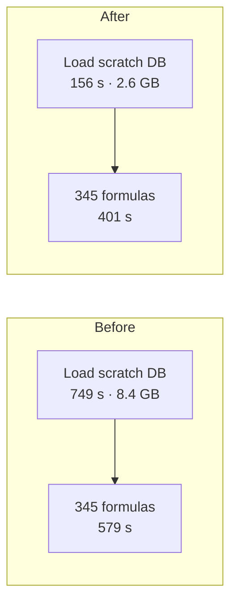

Both columns were measured on the same machine, one at a time, with nothing else running and the
scratch file freshly written (so mostly in the OS page cache — the favourable case for "before").
A production worker that cannot keep an 8.4 GB file in memory pays more for "before"; see
[change 2](#2-an-index-for-entry-type-sums). The copy back to MySQL
(`migrate_entries_to_primary`) was not measured and is unchanged.

---

## How a run works, and where each change lands

A run loads the fund's data into a scratch SQLite file, runs every formula against it for every
commitment, and copies the generated entries back to MySQL (background: `sqlite_approach.md`).
The seven changes, numbered, and where they sit:

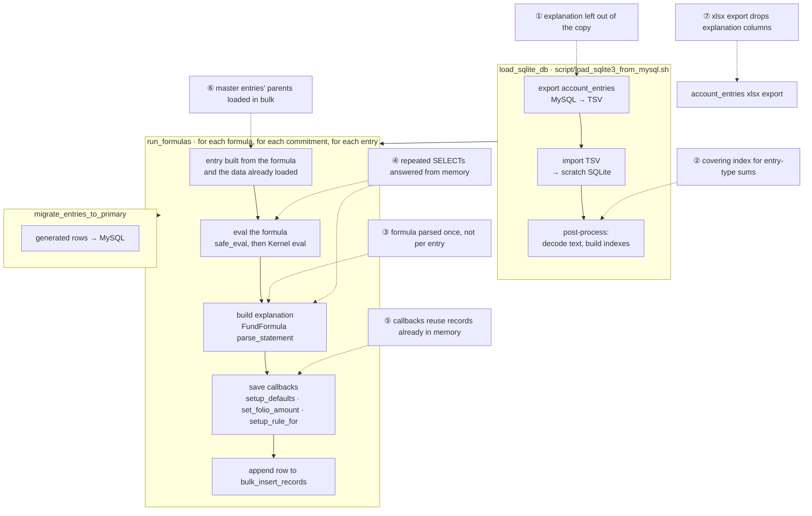

The circled numbers on the dotted arrows are the change numbers used in the rest of this document.

---

## Where the time went — what was measured

| Where | Cost (fund 317, before) | Cause |
|---|---|---|
| Load | 749 s, 8.4 GB file | `account_entries.explanation` is ~2.7 GB of the ~3.5 GB of row text for funds 316+317 (about 1.4 KB per row), and was exported, imported, then rewritten by the post-import marker decode, though nothing in a run reads it |
| Explain | one third of a formula's time | `FundFormula#parse_statement` re-parsed the formula text with `Parser::CurrentRuby` for **every entry** — 72% of explain's cost on Portfolio FMV |
| Repeated lookups | 15,194 SQLite + 2,338 MySQL queries for 3 commitments of Portfolio FMV | the same SELECT re-run for each (master entry × feeder commitment) pair; each master entry's `parent` loaded one at a time |
| Save callbacks | ~10% of a master-fund formula | `setup_defaults`, `set_folio_amount`, `setup_rule_for` loaded `capital_commitment`, `fund`, `fund_formula` again per entry |
| Entry-type sums | up to 3.1 s per commitment on a cold file | no scratch index covered `(capital_commitment_id, entry_type)` |

How: the load script's per-table timings; `ruby-prof` (wall time) on Portfolio FMV with one and
three commitments; per-query timing and counts split by database; `EXPLAIN QUERY PLAN` in SQLite.
Profiler timings are inflated by instrumentation, so only proportions are quoted from them.

---

## What changed, and how each change works

### 1. The scratch copy leaves out `explanation`

**File:** `script/load_sqlite3_from_mysql.sh`

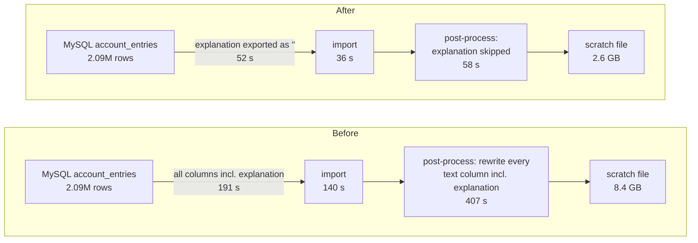

The export builds one `SELECT` list per table. For `account_entries.explanation` it now selects
the constant `''`, which the post-import step turns into NULL like any other empty text column.

**Why this is safe — three facts, each checked:**

| Fact | Where it comes from |
|---|---|
| No formula reads `explanation` | 0 of 6,520 formulas in the dump contain the word |
| Every entry a run generates writes its own explanation | `CreateAccountEntry#eval_formula` assigns `account_entry.explanation = []` then fills it, for every non-Percentage rule |
| Copied rows never go back to MySQL | `migrate_entries_to_primary` selects `AccountEntrySqlite.generated.where(allocation_run_id: this run, migrated: false)` |

**Worked example:** 316+317 hold 2,085,711 live entries. Explanation averages 1.4 KB per row, so
leaving it out removes ~2.7 GB from every export, import and rewrite — the file drops to 31% of
its size and the load to 21% of its time (the extra index in change 2 adds ~16 s, already inside
the 156 s).

### 2. An index for entry-type sums

**File:** same script.

```sql
CREATE INDEX idx_ae_cc_type_cum_date
  ON account_entries(capital_commitment_id, entry_type, cumulative, reporting_date, amount_cents);
```

**Who asks the question.** Two callers sum a folio's entries by entry type with no name:
`capital_commitment.since_inception(nil, "Deal Income", …)` (and `year_to_date`, `quarterly`), and
`CommitmentCache#computed_fields_cache`, which sums `Income` and `Expense` before the start date
for every commitment at the start of a run. The SQL is:

```sql
SELECT SUM(amount_cents) FROM account_entries
 WHERE capital_commitment_id = 13861 AND entry_type = 'Income'
   AND cumulative = 0 AND reporting_date <= '2026-07-01'
```

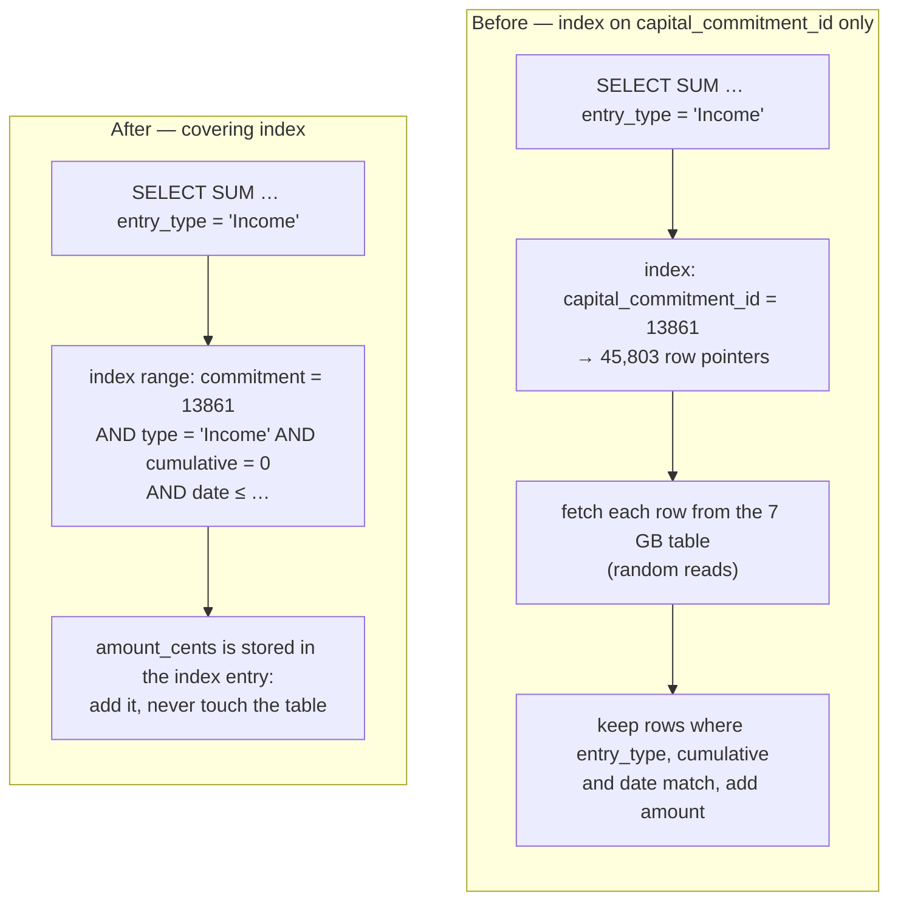

The last column of the index is `amount_cents`, so SQLite reads the answer from the index alone
("COVERING INDEX" in `EXPLAIN QUERY PLAN`).

**Worked example (measured):** folio 13831 holds 45,803 entries. Plan before: `SEARCH … USING
INDEX index_account_entries_on_capital_commitment_id (capital_commitment_id=?)`; 5.2 s with the
file not in memory. Plan after: `SEARCH … USING COVERING INDEX idx_ae_cc_type_cum_date
(capital_commitment_id=? AND entry_type=? AND cumulative=? AND reporting_date<?)`; 3 ms. The slow
query log of a real run showed the Income sum for another folio taking 3,100 ms before the index.

**What you see depends on memory.** On the measurement machine (30 GB RAM, file just written)
"Since Inception Deal Income" went 1.6 s → 0.1 s; in an earlier run that read the 8.4 GB file from
disk it took 82 s. A worker that cannot keep an 8.4 GB file cached sees the cold figure — another
reason change 1 matters.

### 3. Explain parses each formula once

**File:** `app/packs/funds/funds/models/fund_formula.rb`

`parse_statement(binding)` builds the breakdown stored in `explanation[2]`: for a formula it
evaluates a list of sub-expressions against the entry's own binding and records each value. *Which*
expressions are on the list depends **only on the formula text**, but the old code rebuilt that
list for every entry by parsing the text with `Parser::CurrentRuby`.

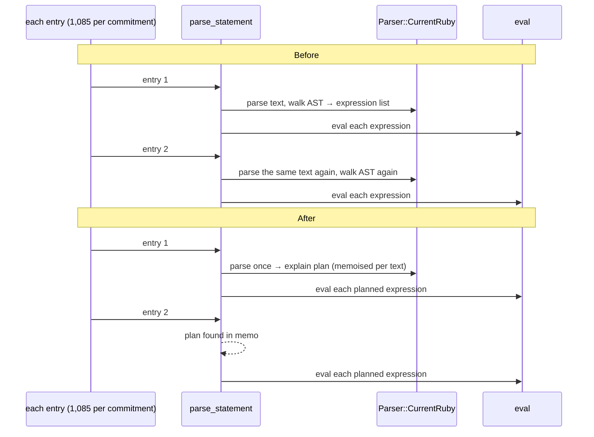

**The explain plan** is an ordered list of `[expression, kind]` pairs. Here is the real plan for
fund 317's *Non Deal Expense* (formula 4247):

```ruby
custom_field_key = account_entry.json_fields['domestic_udr_code']&.downcase.gsub("-","").parameterize(separator: "_");
(account_entry.amount_cents) * (capital_commitment.json_fields[custom_field_key.to_s].to_d / 100)
```

| # | kind | expression evaluated per entry |
|---|---|---|
| 1 | log | `custom_field_key` |
| 2–3 | log | `account_entry`, `account_entry.amount_cents` |
| 4–5 | log | `capital_commitment`, `capital_commitment.json_fields` |
| 6–8 | log | `custom_field_key`, `custom_field_key.to_s`, `capital_commitment.json_fields[custom_field_key.to_s]` |
| 9–10 | log | `….to_d`, `….to_d / 100` |
| 11 | log | the whole product |

Portfolio FMV (4404) has 18 entries, including one `ivar` (`@end_date`). After the change an entry
costs the 11 (or 18) `eval`s and nothing else; before, it also paid for lexing and building the AST.

**Kinds** keep the old error handling exactly — `ivar`: any failure skipped silently (the ivar may
not be set in this binding); `addend`: only a failing `eval` is skipped silently; `log`: any
failure is logged and skipped.

**Worked example (profiler):** Portfolio FMV, 1,085 entries per commitment: `parse_statement`
14.3 s, of which `Parser::Base#parse` was 10.3 s — about 9.5 ms to re-parse a text that never
changes. The memo holds at most 500 texts per `FundFormula` instance (a run keeps one instance per
formula, and `GenerateAccountEntryMultiple` / the YTD, Quarterly and Since Inception rollups add
only a few texts each).

### 4. Repeated SELECTs are answered from memory

**Files:** `AllocationBaseOperation#with_scratch_query_cache`, used in
`CreateAccountEntry#eval_formula` and `AllocateMasterFundAccountEntries`.

**In one sentence:** when the engine asks the scratch SQLite the *exact same question* twice within
one short stretch of code that only reads, the second time it is answered from a small table in
memory instead of going back to SQLite.

#### What "the same question" means

ActiveRecord's query cache is a small table: **key** = the SQL text plus its bound values, **value**
= the rows that came back. It holds at most 100 entries (the oldest is dropped first), and the engine
empties it every time a cached stretch of code starts and ends.

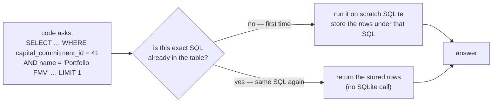

A different commitment id, name or date is a different SQL text, so it is a different question and
runs normally. The cache can only ever return what SQLite would have returned a moment ago, because
nothing was written in between (see "Why it is switched on and off" below).

#### Where it is switched on

| # | Where | The cache lives for | What repeats inside it |
|---|---|---|---|
| A | around **one entry's** formula + explanation (`CreateAccountEntry#eval_formula`, only when explain is on for that formula) | that one entry | explain re-evaluates sub-expressions of the formula, re-asking SQLite what the formula just asked |
| B | around the **whole commitment loop** of a master-fund "Individual" formula (`AllocateMasterFundAccountEntries`) | the loop, i.e. one formula | every master entry is evaluated once per feeder commitment, re-asking the same question about the master entry |

#### Case A — explain re-asking, before and after, for one entry

Formula *Apportioned Expenses Fund Administrative Costs* (5624) ends with a chain of lookups, for example:

```ruby
capital_commitment.account_entries.for_portfolio_investments.for_pi_portfolio_company(portfolio_company.id)
  .where(name: fund_formula.name).not_cumulative.where(reporting_date: @start_date..@end_date).sum(:amount_cents) + (…)
```

Explain evaluates every prefix of such a chain so it can show each step. This formula's explain plan
has 20 expressions; three of them run SQL: the `.sum(:amount_cents)` chain (1 query), the `.last`
chain (1 query) and the whole `sum + last` expression (2 queries — it asks both again).

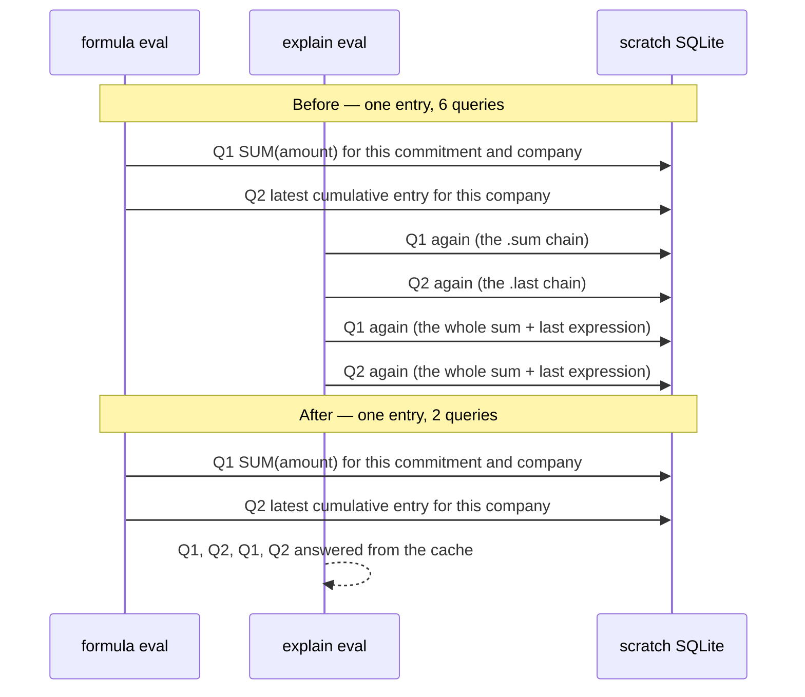

**Measured** (3 commitments, 48 entries of this formula): SQLite queries **290 → 98**, i.e. 192 fewer —
four per entry (6 → 2). (For reference, before any change in this document this formula ran 194 queries
with explain off and 386 with explain on: explain was doubling them.)

A formula that first assigns the lookup to a local variable — Portfolio FMV's
`last_account_entry_date = …` — does not have this repeat: explain reads the local by name. Case A is
for the chained kind.

#### Case B — the same question once per feeder commitment, before and after, for one formula

For a feeder fund, a master-fund formula is evaluated for every pair (feeder commitment × master
entry). Portfolio FMV's first line asks about the **master** entry's commitment:

```ruby
last_account_entry_date = account_entry.capital_commitment.account_entries
  .where(name: "Portfolio FMV", reporting_date: ..@end_date).order(:reporting_date).last.reporting_date
```

`account_entry` is a master entry, so `account_entry.capital_commitment` is a *master* commitment —
the same one no matter which feeder commitment is being allocated. The SQL text therefore contains the
master commitment's id and nothing about the feeder commitment. A small illustration (ids made up;
3 feeder commitments F1–F3, 3 master entries e1–e3, where e1 and e2 belong to master commitment M1
and e3 to M2):

| Evaluation | Feeder commitment | Master entry | Master commitment in the SQL | Before | After |
|---|---|---|---|---|---|
| 1 | F1 | e1 | M1 | runs SQLite | runs SQLite, **stores** it |
| 2 | F1 | e2 | M1 | runs SQLite | **from memory** |
| 3 | F1 | e3 | M2 | runs SQLite | runs SQLite, **stores** it |
| 4 | F2 | e1 | M1 | runs SQLite | **from memory** |
| 5 | F2 | e2 | M1 | runs SQLite | **from memory** |
| 6 | F2 | e3 | M2 | runs SQLite | **from memory** |
| 7 – 9 | F3 | e1, e2, e3 | M1, M1, M2 | 3 × runs SQLite | 3 × **from memory** |
| **Total** | | | | **9 SELECTs** | **2 SELECTs** |

Real fund 317: 40 feeder commitments × 1,085 master entries = 43,400 evaluations of that one
line, with only as many distinct questions as there are master commitments.

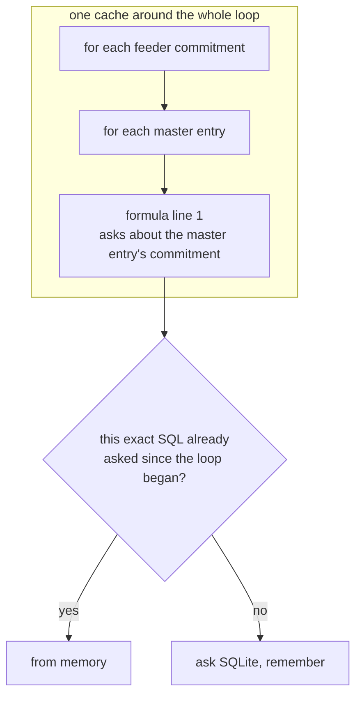

**Measured** (3 feeder commitments = 3,255 evaluations; only this change differs between the two runs):
SQLite queries for the whole formula **6,539 → 12**.

#### What it saves — plainly

| | Queries | Time |
|---|---|---|
| Case A (5624, 3 commitments) | 290 → 98 | a fraction of a second — the formula takes 0.4 s in total on that sample |
| Case B (Portfolio FMV, 3 commitments) | 6,539 → 12 | about 1 s of 14 s (14.1 s → 13.0 s), within run-to-run noise on a sample this small |

The lookups it removes are indexed and cheap (a fraction of a millisecond each when the file is in
memory), so this change removes a lot of *queries* but little *time* on a warm machine. It earns more
when the scratch file is not in the OS page cache — each avoided query is then a potential disk read —
and it keeps the formulas from hammering SQLite. The bigger wins in this document are changes 1, 3, 5
and 6.

#### Why it is switched on and off inside the code, never left on — a bug found during development

The scratch connection is a hand-built pool (`WithScratchSqlite`) that is not registered with
ActiveRecord's connection handler, so Rails' rule "a write clears the query cache" never reaches it.
A first version left the cache on for the whole run:

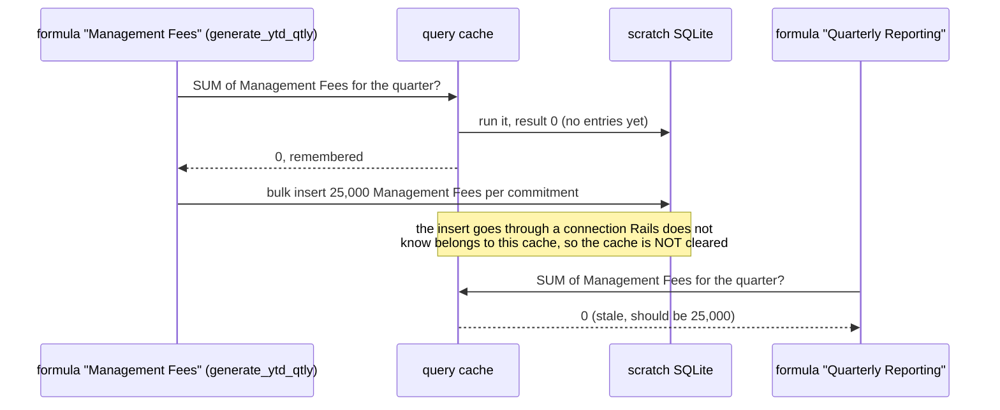

`fund_formula_multiple.feature` ("Multiple formulas see entries generated earlier in the same run…")
failed on exactly this: the Quarterly entry came out 0 instead of 25,000 and the Since Inception
entry 40,000 instead of 65,000. The fix: `with_scratch_query_cache` empties the cache when it starts and
again when it ends, so nothing cached can survive into code that writes, and the two places that use it
contain reads only (formulas cannot write — see FAQ). Inside an already-cached block it simply runs.

### 5. Save callbacks reuse records the engine already holds

**File:** `CreateAccountEntry#preload_associations`

`setup_defaults` reads `capital_commitment` (for `commitment_name`), `set_folio_amount` reads `fund`
(for its currency), `setup_rule_for` reads `fund_formula`. Each is a `belongs_to`, loaded on first
use per *new* entry. Under the profiler, for 3,255 entries of Portfolio FMV: the `capital_commitment`
reader was called 16,275 times (7.8 s inclusive), and `set_folio_amount` and `setup_rule_for`
each cost about 3.9 s inclusive, almost all of it loading `fund` and `fund_formula`.

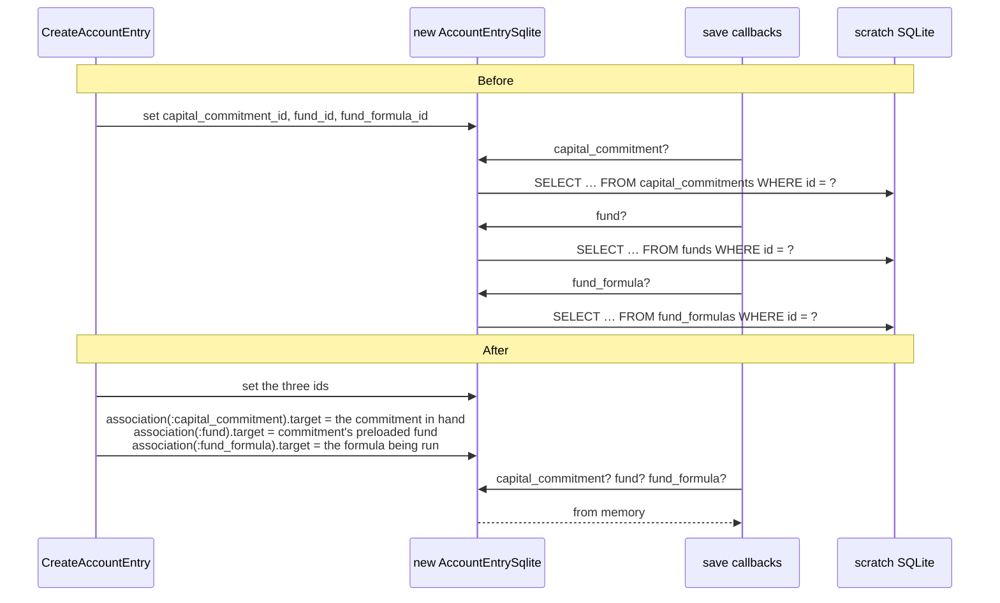

Each target is set only when it is **exactly the record the foreign key points at** (same id and the
same model class — the scratch models are `CapitalCommitmentSqlite`, `FundSqlite`), so a lookup
through the association returns what it would have loaded. No column changes; no existing model file
was edited for this.

### 6. Master entries' parents and commitments load in bulk

**File:** `AllocateMasterFundAccountEntries#preload_parents`

Formulas of this rule type and `setup_defaults` read `account_entry.parent` and
`account_entry.capital_commitment` for each master entry; `parent` is polymorphic
(`PortfolioInvestment`, a MySQL model), so each first use was one MySQL query.

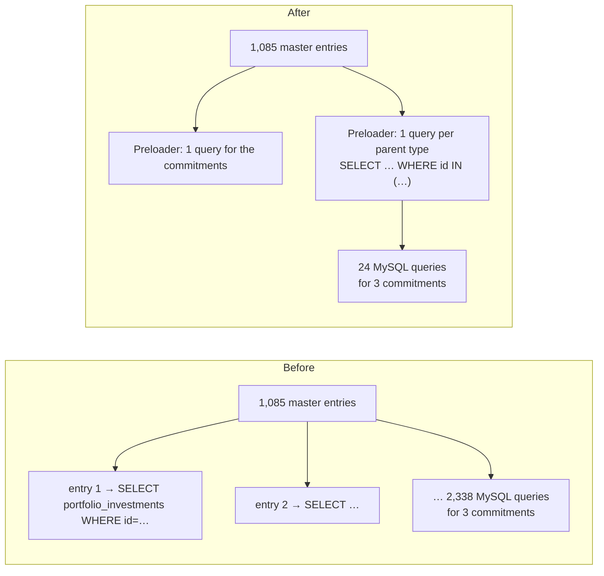

`ActiveRecord::Associations::Preloader` loads each distinct parent once and hands the same object to
every entry that points at it, so a parent's own lookups (e.g. `PortfolioInvestment#to_s` reading
`investment_instrument`) also happen once, not 40 times. Parent types whose class cannot be
resolved, or whose primary key is composite (`AccountEntry` is `[id, reporting_date]`), are skipped
and load lazily as before; a preload failure is only logged — it is an optimisation, never a
correctness step. It runs only for the non-grouped rule types, the ones that loop over master
entries.

### 7. The account-entry xlsx export no longer appends explanation columns

**File:** `app/packs/funds/capital_commitments/views/account_entries/index.xlsx.axlsx`

Removed `values += ae.explanation if params[:explanation].present?`. Nothing in the app linked with
`?explanation=` — it was reachable only by a hand-typed URL. The breakdown is rendered on the entry's
show page (`AccountEntryExplanation`), which reads the stored `explanation` itself.

---

## One entry, before and after

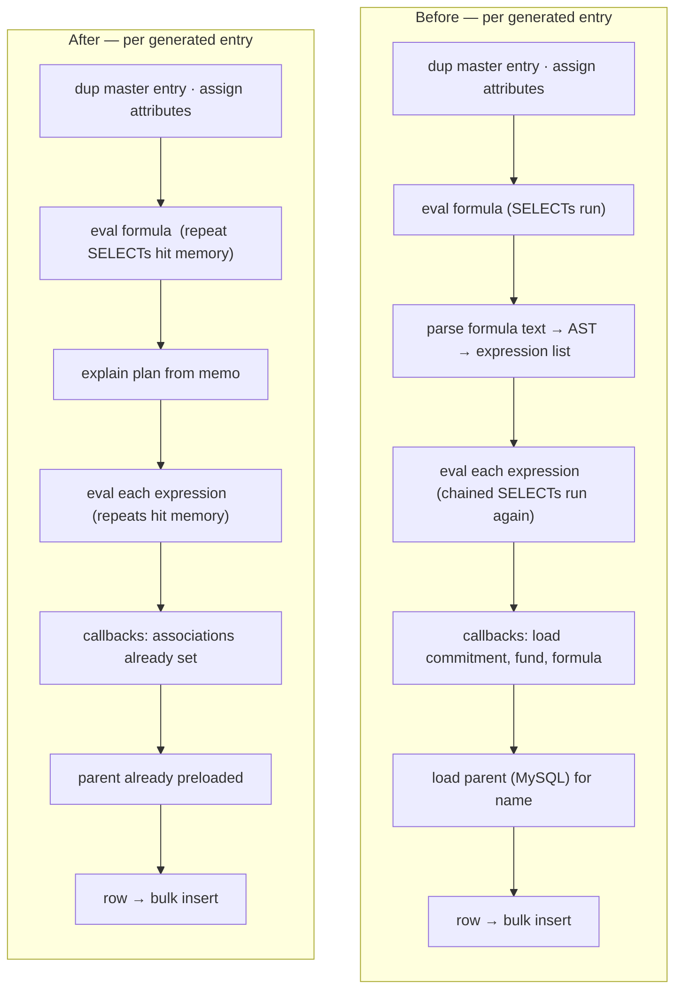

---

## Per-formula effect (fund 317)

| Formula | Rule type | Before | After |
|---|---|---|---|
| Portfolio FMV (4404) | AllocateMasterFundAccountEntryIndividual-Name | 338 s | 215 s |
| Since Inception Deal Income (4350) | GenerateAccountEntry | 1.6 s | 0.1 s |
| Non Deal Expense (4247) | AllocateMasterFundAccountEntryIndividual-EntryType | 47 s | 24 s |
| Apportioned Expenses Feeder to Master PIs (5567) | AllocateForPortfolioCompany-Folio | 7.5 s | 5.9 s |
| All 49 AllocateForPortfolioCompany-Folio formulas | | 115 s | 79 s |
| All 215 GenerateAccountEntry formulas | | 47 s | 28 s |

On a 3-commitment sample of Portfolio FMV (explain on, production-like logging): **27.0 s → 13.0 s;
SQLite queries 15,194 → 12; MySQL queries 2,338 → 24**.

### What is left

Portfolio FMV is still the largest formula: 215 s of the 401 s. It runs once for every
(master entry × feeder commitment) pair — 40 × 1,085 = 43,400 times in run 3314 — and 22,475 of
those rows (52%) have amount 0. What is left after these changes is Ruby work rather than waiting on
a database:

| Remaining cost (profile of Portfolio FMV, before the loop cache; inclusive times overlap) | Share | Why it was not changed |
|---|---|---|
| `Kernel#eval` of the formula and explain expressions | ~45% | it *is* the formula; only a different language would shrink it (see the Rust proposal) |
| `AccountEntrySqlite#dup` of each master entry (`initialize_dup`) | ~10% | ActiveRecord's own copy; replacing it with an attribute slice touches how rows are built |
| Building the bulk `INSERT` (`InsertAll#values_list`) | ~12% | one call per formula; ActiveRecord renders every value |
| The 52% of rows that are zero | — | not generating them would change the output |

Rewriting the formula itself (hoisting the lookup out of the per-commitment loop) is a fund-admin
change, out of scope here.

---

## How it was verified

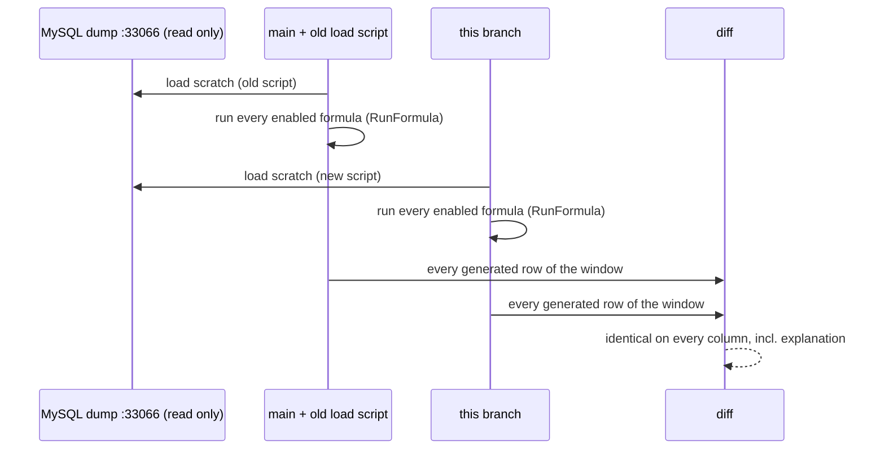

- **Same rows.** Both runs dump every generated entry of the window — formula, commitment, name,
  entry type, date, period, parent, amount, folio amount, rule_for, parent/commitment names,
  json_fields, **explanation** — sorted; the dumps are compared as strings. Fund 317: 85,655 of 85,655
  identical.
- **Old = a git archive of `main`** (its own load script and its own engine), not "the branch with a
  switch off", so the comparison cannot share code with the new path.
- **No MySQL writes.** The harness refuses any INSERT/UPDATE/DELETE on MySQL; it skips
  `resave_portfolio_investments` and the migration back, which are unchanged by this work.
- **Cucumber.** All 43 allocation-related feature files (700 scenarios), unchanged, pass. A few
  scenarios in each parallel run hit Playwright 30 s page-load timeouts (a different set each time,
  in features such as investors and investment opportunities); every one passed when re-run with
  fewer workers or alone.
- **A regression the tests caught.** The stale-cache bug in change 4 was found by
  `fund_formula_multiple.feature`, not by the fund comparison — a reminder that the feature suite
  and the real-data comparison catch different things.

---

## Other True North funds

Same entity as 317. Each ran on its own last successful allocation period, once on `main` and once
on this branch, comparing every generated row.

| Fund | Shape | Period | Rows (old / new) | Identical | Load old → new | Formulas old → new | File old → new |
|---|---|---|---|---|---|---|---|
| 327 Themis (Mauritius) | small, Q2 | 1 Apr – 30 Jun 2026 | 1,339 / 1,339 | 1,339 | 5 s → 3 s | 8.9 s → 6.3 s | 63 → 21 MB |
| 316 True North Fund V LLP | master, 554 formulas, aggregate-portfolio rule types | 1 – 31 Aug 2026 | 11,154 / 11,154 | 11,154 | 40 s → 14 s | 78.8 s → 57.1 s | 833 → 238 MB |
| 319 True North Fund VI LLP | master | 1 – 31 Aug 2026 | 12,756 / 12,756 | 12,756 | 70 s → 20 s | 88.8 s → 66.1 s | 1,199 → 325 MB |
| 318 Indium V (Mauritius) | USD feeder of an INR master | 1 Jul – 31 Aug 2026 | 56,303 / 56,303 | 56,303 | 493 s → 111 s | 429.7 s → 268.5 s | 4,999 → 1,332 MB |
| 321 Indium VI (Mauritius) | USD feeder of 319 | 8 – 31 Aug 2026 | 32,418 / 32,418 | 32,418 | 348 s → 78 s | 272.3 s → 204.5 s | 3,738 → 979 MB |

### Pravega Ventures and Artha Venture Partners funds

Two other entities, validated on the **final code** (including the query-cache write guard added
after code review) — each fund on its own last successful period. The True North runs above were done
before that guard; fund 316 was re-run afterwards and is identical again (11,154 rows, load 38 s → 18 s,
formulas 74.9 s → 56.2 s).

| Entity | Fund | Period | Rows (old / new) | Identical | Load old → new | Formulas old → new | File old → new |
|---|---|---|---|---|---|---|---|
| Pravega Ventures | 69 Pravega Fund II | 1 Apr – 30 Jun 2026 | 19,621 / 19,621 | 19,621 | 22 s → 11 s | 99.4 s → 64.9 s | 548 → 135 MB |
| Artha Venture Partners | 158 Artha Venture Fund I | 1 Oct – 31 Dec 2025 | 8,396 / 8,396 | 8,396 | 9 s → 6 s | 38.2 s → 28.3 s | 108 → 57 MB |
| Artha Venture Partners | 159 Artha Select Fund | 1 Apr – 30 Jun 2026 | 11,528 / 11,528 | 11,528 | 12 s → 7 s | 50.5 s → 36.3 s | 140 → 71 MB |
| Artha Venture Partners | 260 Artha Fund IV | 1 Apr – 30 Jun 2026 | 9,260 / 9,260 | 9,260 | 8 s → 3 s | 44.5 s → 29.8 s | 40 → 20 MB |
| Artha Venture Partners | 182 Demo Fund | 1 Apr – 30 Jun 2026 | 9 / 9 | 9 | 3 s → 2 s | 0.6 s → 0.5 s | 3 → 3 MB |

Not run: Pravega funds 41 (Test Fund II, 12 formulas, no entries) and 235 (Pravega Ventures Trust,
no formulas); the entity "Artha - defunct" has no funds.

In total **248,439 generated rows were compared across 11 fund-periods in 3 entities, all
identical**, no failures on either side.

### Memory

The change does not move the scratch database into memory: the file is still on disk (and shrank
from 8.4 GB to 2.6 GB on fund 317), read by SQLite through the OS page cache, which is not part of
the Ruby process. What was added *inside* the Ruby process is small — the query cache (at most 100
results, emptied at the end of every block that uses it), the explain plans (at most 500 short lists per
formula), and the preloaded master parents and commitments for one formula.

Peak resident memory of the formula-running Ruby process (`VmHWM`, sampled every 2 s, one run each):

| Fund | Old (`main`) | New (branch) | Difference |
|---|---|---|---|
| 318 Indium V (loads 318 + master 316) | 1,523 MB | 1,565 MB | +42 MB (+2.8%) |
| 321 Indium VI (loads 321 + master 319) | 1,221 MB | 1,262 MB | +41 MB (+3.4%) |
| 69 Pravega Fund II | 933 MB | 1,000 MB | +67 MB (+7.2%) |
| 260 Artha Fund IV | 531 MB | 537 MB | +6 MB (+1.1%) |
| 158 Artha Venture Fund I | 562 MB | 555 MB | −7 MB (−1.2%) |
| 159 Artha Select Fund | 680 MB | 674 MB | −6 MB (−0.9%) |
| 316 True North Fund V LLP | 748 MB | 718 MB | −30 MB (−4.0%) |
| 182 Artha Demo Fund | 501 MB | 368 MB | −133 MB (−26.5%) |
| 319 True North Fund VI LLP | not captured | 826 MB | — |

Peak memory is **about the same, not consistently higher**: four funds are slightly higher (largest
+67 MB, +7%, on fund 69), four are lower. With one run per side, differences of a few percent are within
what garbage-collection timing alone can produce, and the 182 figure (a 9-row run) mostly reflects how
much garbage had accumulated before the run, not the change. I did not attribute the increases to a
single structure; the preloaded master parents and commitments, held for the whole formula instead of
being loaded one at a time, are the largest candidate. Fund 317, the largest, was not sampled. These
are the formula-running process only; the load script runs `mysql` and `sqlite3` as separate processes
and was not sampled.

---

## FAQ

**Q: Do the generated numbers or explanations change?**
No. Before and after runs produce the same entries, compared column by column including the stored
explanation string. Every change either avoids repeating work (parsing, reloading a record,
re-running the same SELECT) or leaves out data nothing reads.

**Q: Why is `explanation` empty in the scratch file — will migrated entries lose it?**
No. Only the copied history has it blanked. The entries a run generates get their explanation
written in `CreateAccountEntry#eval_formula` and keep it on the way back to MySQL. The history rows in
MySQL are never touched.

**Q: Is the query cache safe if a formula writes to the database?**
Formulas cannot write: `ApplicationRecord::SAFE_EVAL_REGEX` blocks `insert`, `update`, `delete`,
`save`, `create`, `destroy` and more, and none of the enabled formulas in the dump call the writing
helpers I searched for (`rollup_account_entries`, `save_now`, `resave`, `touch`, `increment!`,
`toggle!`). The engine itself writes only after the loops (bulk insert, rollups). Each cached block
clears the cache when it starts and ends, so nothing cached survives into code that writes.

That safety used to rest on nothing in those loops writing, which was enforced only by a comment. A
code review pointed this out, and a test confirmed it: inside a cached block, `count(*)` → insert a row
→ `count(*)` returned 0 both times. `AllocationBaseOperation` now subscribes to SQL events and, after
any `INSERT`, `UPDATE`, `DELETE` or `REPLACE` on the current thread's scratch connection, empties that
thread's cache — the same test now returns 0 then 1. (`clear_query_cache` only touches the calling
thread's store, so the background migration thread's writes never disturb the formula thread's cache.)

**Q: Why not keep the query cache on for the whole run?**
Because the scratch pool never hears about writes (see the diagram in change 4). A whole-run cache
served a later formula a pre-insert total during development and failed
`fund_formula_multiple.feature`. Per-entry and per-loop scopes have no write inside them.

**Q: Why does the explain plan live on the `FundFormula` instance rather than a global cache?**
The plan depends only on the formula text, but a run holds one `FundFormula` per formula for its
whole duration, so an instance-level memo is enough, needs no locking and cannot leak across runs or
threads. It is capped at 500 texts (a `GenerateAccountEntryMultiple` formula adds one text per entry name) so a
long-lived instance cannot grow it without bound.

**Q: Does this help a fund without a master fund, or with few commitments?**
Partly. The load, explain and index savings apply to every fund; the master-entry preloading and the
per-loop cache apply to master/feeder funds only. Fund 327 (no master, 1,339 entries) went 8.9 s → 6.3 s.

**Q: Can explain be made lazy — built when someone opens the entry?**
It was considered and not done: a lazily built breakdown re-evaluates against *today's* data, so it
can disagree with the stored amount unless drift is detected, and `AccountEntryExplanation`
deliberately shows "what this was when the run happened". Parsing once removes most of explain's
cost without that trade-off.

**Q: What should be measured next?**
The copy back to MySQL (`migrate_entries_to_primary`) was not part of these measurements and is
unchanged. After that, Portfolio FMV (see "What is left").
