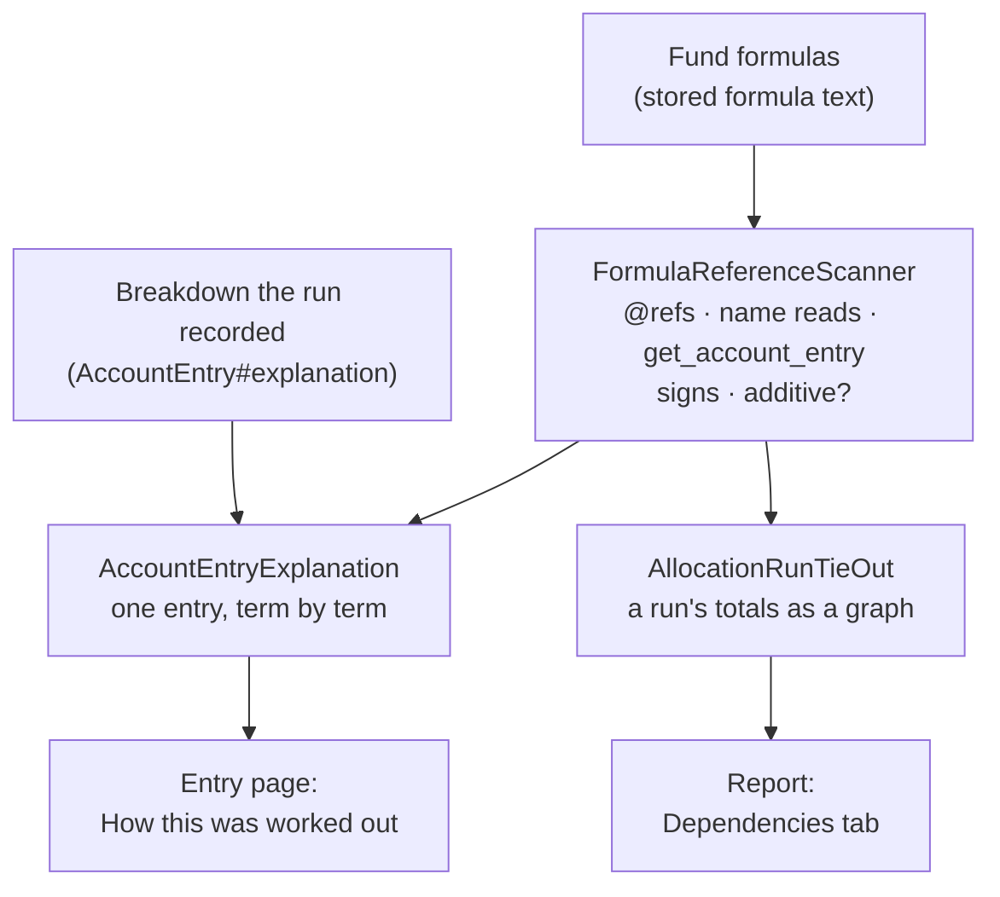

# Understanding an Allocation Run — Proposals

**Status:** Proposal 1 is **built and live**, on two screens. Proposal 3 (the tie-out sheet)
is **built but hidden** — its code and tests are kept, but it has no tab and no routes. Proposals
2 and 4 are brainstorm. Ideas considered and set aside are kept at the bottom.

What is live, and where:

| Screen | What it answers | Cost |
|---|---|---|
| **Entry page → "How this was worked out"** (replaces the old Explanation box) | This entry's rule broken into its terms, each opening into the entry it came from, recursively | 1 query to draw, 1 per line opened |
| **Account Entries report → Dependencies tab** | Which run totals each total is built from, recursively. Lists nothing until you search or ask for top-level numbers | 2 queries for the tab; 0 per level opened |



**Retired: the "Where this number came from" page** (`AccountEntryDerivationTree`, reached from
a button on the entry page). It drew one folio entry's whole chain at once, and it overlapped the
card: two screens that could disagree about where a number came from. They did — for a rule that
reads an entry through `get_account_entry_or_zero`, the page missed that term and listed one the
rule never read. The card opens each line into its own breakdown, so the whole chain is still
reachable a click at a time, at 1 query per line instead of 36–127 for the page.

Rules that hold on every screen:

- **Only real terms are lines** — the parts of a sum, the factors of a product, named steps, and
  other entries. Conditions and id lookups never are.
- **Values are what the run recorded**, never recalculated.
- **A tie-out is only offered where the rule adds up.** A rule that multiplies or divides has
  inputs, not addends.
- **Money is shown as money only when it is known to be** — another entry, a `*_cents` column,
  or arithmetic whose money-ness follows from its terms. A year is not formatted as currency.

Typing the fund's own figures (the tie-out) was set aside: a real run produces 289 entry names,
and a sheet of 289 boxes is not a review.

## Problem statement (agreed)

> A fund has to sign off on — and send to investors — numbers produced by a calculation it did
> not write and cannot see. What makes that calculation legible enough to earn the sign-off?

The goal is for a fund to **understand**, **easily traverse** and **validate** the results of an
allocation run.

## Why the problem is shaped this way

- A run's output is a **chain of derivations**, not a flat list. Across production, a fund has
  43 enabled formulas on average (427 at most), and about 90% of formulas reference another
  computed number (`@net_income`, `@nav`, …).
- The funds' users are new to the system and did not write the formulas. A number they cannot
  derive is a number they cannot judge.
- **Each fund is different**, so anything that depends on a shared meaning of entry names
  ("this name is the NAV") does not generalise. Anything proposed here has to work from the
  fund's own formulas and data.

## What already exists

| Need | What is there today |
|---|---|
| Traverse | The run row links to the account entries filtered to that run (table / ag-Grid / pivot / time series) and to the fund period report scoped to that run. Every checker finding links to its affected entries. This is traversal by **filter**. |
| Validate | The [Allocation Run Checker](allocation_run_checker_requirements.md) — sections 1 (did the run happen correctly) and 2 (do the numbers add up) are built; section 3 (do the numbers look reasonable) is not. Fund-specific [pre/post-run checks](allocation_run_checks.md) shipped on 2026-09-18; no fund had one configured as of 2026-09-19. |
| Understand | Little. An `AllocationRun` records dates, user, status and flags — nothing about what it produced. A formula dependency graph exists (`FundFormulaDependencyGraph`, `fund_formulas/dependencies`), but it shows **formulas**, not a run's **numbers**. Each generated entry stores the formula text and, when "Explain Formulas" is ticked (the default on the run form), a breakdown of the intermediate values. |

## How a fund reviews a run (as described)

1. **Fund totals first.** The reviewer checks the fund-level totals against the fund's own
   spreadsheet.
2. **Then a few folios.** Having satisfied themselves on the totals, they validate a handful of
   individual folios.

The proposals below are ordered to follow that path.

## Proposals

### 1. Derivation tree — walk a number down to the facts it came from

**Implementation plan:** [derivation_tree_plan.md](derivation_tree_plan.md) — **built.**

**As built, at two levels:**

- **Fund level — the Dependencies tab.** Each of the run's entry-name totals, searchable, with
  rows that open to show the other totals the formula is built from. Every dependency is
  another row of the same table (on a real fund: 289 rows, 150 of them with dependencies), so
  opening one costs no query and the arithmetic is checkable by eye — `Total Non Deal Expenses
  Master` 68,267,375.95 against its three parts summing to 68,267,375.94.
- **Folio level — the derivation page (since retired; see the status above).** `GET /account_entries/:id/derivation`, reached from a
  "Where this number came from" button on the account entry page, **shown only for an entry
  built from other entries** (`AccountEntryDerivationHelper#derivation_available?`).

  **The whole chain at once, not one level at a time.** `AccountEntryDerivationTree` builds it
  in one pass and the page renders it indented. Asking "where does this number come from" is
  answered by a shape; a row at a time does not answer it. Real output, fund 340:

  ```
  NAV                                              12,431,605.22
  ├─ Capital Collected as on Date                  12,500,000.00
  │    └─ 2 payments                               12,500,000.00   <- actual records
  ├─ − Since Inception Operating Cost                  68,394.78
  │    └─ Operating Cost since inception               68,394.78
  │         ├─ Legal & Professional Fees · 17/06/2026   2,038.85
  │         │    └─ Legal & Professional Fees (fund level)  68,750.00
  │         └─ Legal & Professional Fees · 05/06/2026   3,499.41
  ├─ − Since Inception Management Fees                      0.00
  │    └─ entries named Management Fees                     0.00
  │         └─ Management Fees · 30/06/2026                 0.00
  │              ├─ Total applicable Management Fee         0.00
  │              └─ − Management Fees since inception       0.00
  └─ − Since Inception Setup Fees                           0.00
  ```

  - **It bottoms out in real records.** `SOURCE_RELATIONS` recognises a short, explicit list of
    relations named in a formula — remittance payments, distributions, unit issues — so the
    chain ends at "2 payments", which is where a reviewer stops asking. Anything not on that
    list is reported as computed from the fund's records rather than guessed at.
  - **Signs come off the formula.** `FormulaReferenceScanner` reads whether each reference is
    added or subtracted, including `a - (b + c)`, so `NAV = collected − fees − costs` reads as
    deductions instead of a list.
  - **A tie-out is only offered where one means something.** `FormulaReferenceScanner#additive`
    reads whether a rule combines its terms by nothing but `+` and `−`. A rule that multiplies
    or divides has inputs, not addends, so the page says so plainly instead of totalling them:
    `@nav / total_units` would otherwise set ₹1.24 crore plus 50,000 *units* against ₹248.63 and
    call the gap a discrepancy. Where the rule does add up and the parts do not come back to it,
    that is a real finding and is shown as a Difference.
  - **Bars are read against the sum of the parts' sizes**, not their net, so one set of
    components comes to 100% and a deduction gets a bar of its own.

  **It is not a second Explanation box.** The entry page already shows the formula and what each
  of its expressions evaluated to. This follows references between entries, which that box
  cannot do, and links back to it for the formula's own steps. An earlier version rendered the
  raw breakdown here and produced pages of
  `7295==account_entry.parent.portfolio_company_id -> false` — unreadable, and a worse copy of
  a feature that already existed.

  **Cost**, measured on production data: a real NAV is 32 nodes and 36 queries in ~100ms; the
  worst entry found on a 421-formula fund reaches the 120-node cap at ~127 queries and ~1.4s.
  On a wide fund it does approach a query per node, which `MAX_DEPTH`, `MAX_CHILDREN` and
  `MAX_NODES` bound. It is a drill-down opened deliberately, never rendered per row.

### 2. Folio check — the fund's numbers for one investor, beside ours

Told as a story. Priya is the fund's accountant. She has her own Excel sheet, and she trusts it.

**Step 1 is proposal 3.** She checks the whole fund. The system says total Operating Cost is
8,40,000 and her Excel says 8,10,000, so something is off by 30,000.

**Step 2 is this proposal.** She picks one investor, Mr. Rao. Her Excel has a row for him with
the NAV, management fees and operating cost she expects. She opens Mr. Rao in the system and
types her numbers next to ours:

```
Mr. Rao                        Ours        Priya's     Difference
NAV                          9,41,500     9,45,000       −3,500
  Capital collected         10,00,000    10,00,000            0
  Management fees              23,500       20,000       +3,500   <- this one
  Operating cost               15,000       15,000            0
```

The system shows which numbers agree and which do not. That is all this proposal is: a place to
type the fund's numbers for one investor beside the system's.

- It sits on proposal 1's tree because the tree lists what NAV is made of. Priya can see that
  the NAV difference comes entirely from management fees, and then open management fees to see
  how the system calculated it.
- So proposal 3 compares the **fund's totals**, and this proposal compares **one investor's
  numbers** — both against the fund's own Excel.
- The figures would be stored in the same table the fund totals sheet introduces
  (`tie_out_figures`, which already has a folio column for this purpose).

Open points:

- **What do funds compare a folio against?** When they "validate a few folios", do they have
  per-investor numbers in their Excel, or do they recalculate a few by hand? If there are no
  per-investor numbers, this proposal has nothing to compare with and should come off the list.
- Typed per number, or filled from an uploaded workbook (proposal 4)?
- Are the figures kept as evidence of the sign-off?

### 3. Fund totals sheet — the starting screen of a review

**Implementation plan:** [fund_totals_sheet_plan.md](fund_totals_sheet_plan.md) — **built.**

**As built, then shelved.** A "Tie out to your figures" tab on the fund report, fetched lazily
when opened. The tab is no longer rendered — `AllocationRunTieOut`, `TieOutFiguresController`,
the `tie_out` partials, the `tie_out`/`tie_out_folios` routes and the `tie_out_figures` table
are all still in place and tested. `AllocationRunTieOut` also backs the live Dependencies tab,
so it is not dead code. To bring the tab back, render it again in `fund_report.html.erb`.

**Why shelved:** 289 entry names is too many boxes to fill in. If it returns it needs a way to
mark the handful of names a fund actually keeps in its spreadsheet. Rows come from `AllocationRunTieOut`, folded out of the report's own
first aggregate pass, so the sheet adds no scan of `account_entries`. Figures are stored in
`tie_out_figures`, keyed to (fund, date, folio, name) so they survive a re-run.

Step 1 of the review, so this is where a review opens. One row per entry name: the fund-level
total for the run, a column for the fund's own spreadsheet figure, and the difference.

```
Fund totals · quarter ending 30 Sep 2026          System        Yours       Diff
Capital Collected as on Date                  42,50,00,000  42,50,00,000        0
Management Fees                                  21,25,000     21,25,000        0
Operating Cost                                    8,40,000      8,10,000  +30,000   <- open
NAV                                           41,12,35,000  41,12,65,000  −30,000
```

- Opening a row that disagrees lists the folios that make up the total, so the reviewer can see
  whether the difference is spread across everyone or sits in a few folios — and from a folio,
  proposal 1's tree takes over.
- Step 2 ("validate a few folios") is then proposals 1 and 2 on folios the reviewer picks, or
  on the folios a disagreement pointed to.
- This looks like the rejected *number sheet* but differs where it matters: the comparison is
  the **fund's own figure**, not last period's, so it validates rather than merely displays.

What the data supports: fund totals already exist as stored entries. For formulas that generate
an entry per folio, the engine rolls the folios up into a fund-level entry
(`RollupAsFundAccountEntry`); for formulas that split a fund-level cost across folios, the
uploaded fund-level entry is the total. Checker finding 2.1 already verifies that the stored
fund total equals the sum of its folios, so the sheet can rely on it.

Open points:

- Which total does the fund's spreadsheet hold — the **period's** figure or the
  **since-inception** figure? The word "cumulative" does not settle it: in the data it marks
  a total **across folios** at fund level, and a total **across time** at folio level.
- Same questions as proposal 2 on how the fund's figures get in and whether they are kept.

### 4. Spreadsheet reconciliation — upload the fund's own workbook

Funds keep their figures in spreadsheets outside the system, generated from their accounting
systems. The fund uploads that workbook against a run, and the system fills the "Yours" column
of proposals 2 and 3 from it — this is the answer to "how do the fund's figures get in".

There is a working precedent: `RtaReconciliationAgent` has an LLM extract figures from an
uploaded registrar PDF, then reconciles them deterministically at summary level and at folio
level — the same two levels a fund reviews a run at.

How the work is split between AI and code:

- **AI does the mapping, never the arithmetic.** The hard part of someone else's workbook is
  knowing what is where: which sheet and columns hold the fund totals, which rows are folios,
  that their "Mgmt Fee" is our "Management Fees" and their investor code is our folio. The LLM
  proposes that mapping. Reading the numbers and computing differences is plain code.
- **The LLM sees the workbook's structure, not its contents** — sheet names, header rows, row
  labels and a few sample rows. Values are read by code (`roo` / `rubyXL`). That keeps investor
  data out of the prompt, keeps cost flat for large workbooks, and means no figure on the
  reconciliation was ever produced by a model.
- **A person confirms the mapping once; it is saved for that fund and reused.** The workbook
  comes out of the fund's accounting system, so its layout should be stable from quarter to
  quarter. Each fund has its own mapping, so "each fund is different" is respected. If a later
  workbook no longer fits the saved mapping, the system says so rather than guessing.

Reading the formulas in the workbook is a second, separate use:

- The cached **values** are enough to reconcile.
- The **formulas** matter when a difference needs explaining. With proposal 1's derivation on
  our side and their cell formulas on the other, an LLM can say *why* two numbers differ —
  "your sheet charges 2% on commitment for 90/365 days; the fund formula charges 2% on capital
  collected for 14/12 months". This is the step from "there is a difference" to "here is the
  cause", and it is the part that genuinely needs AI.
- It only works if the workbook has formulas. An export from an accounting system may well be
  values only.

Open points:

- Need a real (anonymised) workbook from one or two funds to see the layout, whether it holds
  folio-level detail or only fund totals, and whether it contains formulas.
- Workbook text reaches a prompt, so it is untrusted input — same precaution as
  `RunCheckSuggestions::AiSuggester`: nothing the model returns is acted on until validated
  and confirmed by a person.
- Is the uploaded workbook kept with the run as evidence of what was reconciled at sign-off?

## Considered and set aside

Offered during the brainstorm and rejected — all treat the output as a flat list to scan.

- **Run receipt** — stamp entries created / formulas run / folios touched / duration on the run.
- **Run-over-run deltas** on the runs list.
- **Number sheet** — every entry name with this period, last period and % change.
- **Seeded per-fund checks** proposed from commonly used entry names.
- **Persist the `sample` flag** on the run.
- **Universal period-family check** (YTD = sum of quarters, inferred from name prefixes) —
  withdrawn: funds differ, and `since_inception_matches_history` already covers the
  per-fund version as a post-run check.
