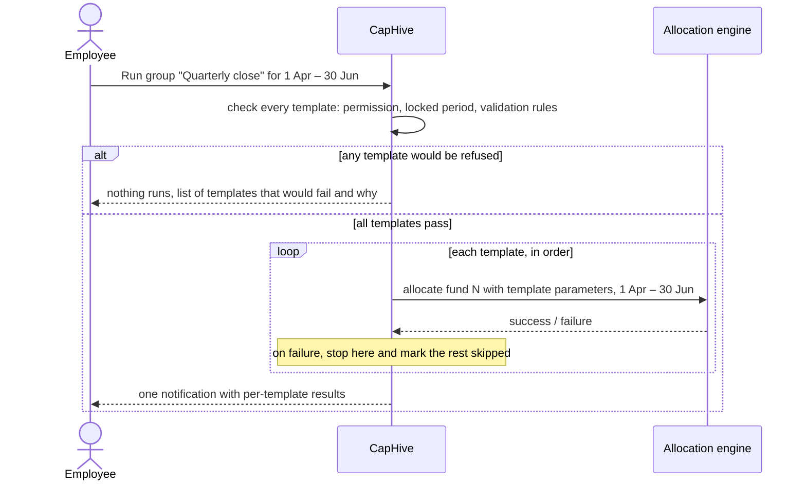

# Allocation Run Templates and Groups — problem formulation

**Status:** Decisions settled; first version implemented on branch `allocation_templates`
(technical notes in `docs/modules/allocation/allocation_run_templates.md`, user guide in
`docs/user_guides/allocation_run_templates_user_guide.md`).

## The problem today

An entity typically manages several funds, and each fund's allocation is run separately
from that fund's allocation screen. Every run needs the same handful of inputs typed in
again: the period (start and end date), which formulas to run (Accounting, Reporting, or
both), which formula tags to include, and whether to also generate investor statements
and fund ratios.

The runs are not independent. A feeder fund's formulas read entries produced by the
master fund, so the master must finish before the feeder starts. Some formula tags are
meant to run every quarter, others only at year end. Certain funds must always be run
together in a fixed order.

None of this ordering lives in the system. It lives in the head of the employee doing the
close, who has to:

- remember which funds to run and in what order,
- re-enter the same parameters for each fund every period,
- wait for one run to finish before starting the next,
- remember which tag set applies to a quarterly close versus an annual close.

The failure modes are predictable: a feeder run before its master, a fund missed
entirely, the wrong tag set for the period, or a run started while the previous one is
still going. Each mistake is only discovered when the numbers look wrong, and the fix
is to re-run everything in the right order. This is the same gap that Ratio Run
Templates closed for ratio calculations, and it is a larger problem here because
allocation runs are slower, ordered, and lock periods.

## What we want

Let an employee define the close once, then run it for any period with one action.

1. **An allocation run template.** One fund plus the parameters it is always run with:
   formula scope, formula tags, and whether to generate statements or ratios. The period
   is *not* saved; it is supplied when the template is run. A template is created in one
   of two ways:
   - **From an existing allocation run.** On the allocation screen, any past run gets a
     *Save as template* action that copies its fund and parameters. This is the expected
     path: the employee has already worked out the right settings by running them.
   - **From scratch.** A form with the same fields as the allocation screen, minus the
     period.
2. **A named group of templates.** A group such as *Quarterly close* or *Annual close*
   holds an ordered list of templates. Templates run strictly one after another in the
   listed order, so *Master* can be placed before *Feeder A* and *Feeder B*. A fund may
   appear in more than one group with different templates (quarterly tags in one, annual
   tags in another), and a template may belong to more than one group.
3. **Run the group.** Pick a group, enter a start date and an end date, and the system
   runs every template in order in the background with that same period. The employee is
   told when it finishes and which templates succeeded, failed, or were not reached.
4. **Check everything before running anything.** Before the first template starts, the
   system checks every template in the group for the requested period: is the period
   already locked for that fund, does any blocking validation rule fire, and does the
   person triggering have the right to run allocations on that fund. If any template
   would be refused, the group does not start, and the employee is shown which templates
   would fail and why. A close should never be left half done because of something the
   system could have known up front.
5. **Fail early.** If a template fails while the group is running, the group stops.
   Templates after it are not run and are reported as skipped. This is the only mode: a
   feeder run after a failed master produces wrong numbers that then have to be unwound,
   so carrying on is never useful. Once the cause is fixed, the employee re-runs the
   group for the same period. As with a manual run today, each template produces a new
   allocation run record; the earlier ones stay in the history.
6. **A history.** For each group, a list of every time it was run, the period, and the
   allocation run each template produced, so the close is auditable and repeatable.

## Decisions

These were settled with the business and are not open for the first version.

| # | Question | Decision |
|---|----------|----------|
| 1 | Period input | A start date and an end date are entered once when running a group and applied to every template in it. No per-template override. |
| 2 | A template fails mid-run | The group stops. Later templates are skipped and reported as such. |
| 3 | Something is known to fail before starting | Nothing runs. Every template is checked up front for a locked period, blocking validation rules, and permission, and the group only starts if all pass. |
| 4 | Who can run a group | Company admins, or employees permissioned on every fund in the group. Permission is checked on each template's fund before the group starts, not just on the group. Defining templates and groups follows the same rule. |
| 5 | Statement and ratio generation | Options on each template, carried across by *Save as template*, exactly as they are on a run today. |
| 6 | Scheduling | Manual trigger only. |

## Open questions

Each question lists the options we see and the one we recommend. The recommended option
is what gets built unless the business says otherwise.

### Running a group

| # | Question | Options | Recommended |
|---|----------|---------|-------------|
| 7 | **What counts as success for one template?** A run's status today is either *Success*, *Pending*, or an error message. | (a) Only *Success* counts. Anything else, including a run that ends still *Pending*, stops the group. (b) Only an explicit error stops the group; *Pending* is treated as done. | **(a)**. A run left at *Pending* means something did not finish, and a feeder should not build on it. |
| 8 | **Re-running after a fix.** Each run creates a new allocation run record, so re-running a group re-runs every template in full, including those that already succeeded. | (a) Always re-run the whole group. (b) Offer *Resume from failed template*, which skips the templates that succeeded in the previous run for the same period. (c) Both, with resume as the default when a previous run for the same period exists. | **(c)**. For a ten-fund close that failed at fund eight, re-running seven successful funds is slow and creates seven duplicate runs. Resume needs the group run to be recorded per template, which question 9 requires anyway. |
| 9 | **Surviving a restart.** A group of large funds runs for a long time in one background job. If the worker restarts mid-way, the job starts again from the first template. | (a) Accept it; the employee re-runs. (b) Record the group run as its own record with a status per template, so a restart continues from the template that was running. | **(b)**. This is the same record the progress view and question 8 need, so it costs little extra. |
| 10 | **Two things touching the same fund at once.** Two groups with overlapping funds, or a manual run started on a fund while a group is using it. | (a) No guard; rely on the employee. (b) One group run per entity at a time; refuse a second group while one is running. (c) Additionally refuse a manual run on a fund that a group is currently running or has yet to reach. | **(c)**. Overlapping runs on one fund produce entries in an undefined order, which is exactly the problem this feature exists to remove. |
| 11 | **Locking after success.** Locking a run is a manual click per run today. | (a) Leave locking manual. (b) A per-group option *Lock every run on success*. (c) Always lock on success. | **(a)** for the first version. Locking is the human review point that the allocation run checker relies on, and a wrong close that is auto-locked has to be unlocked fund by fund. Revisit once the checker is in use. |
| 12 | **Period gap check.** The checker proposes warning when a period does not start the day after the previous locked run ended. | (a) Not checked here. (b) Warn in the up-front check but allow the run. (c) Treat it as a blocker. | **(b)**. A gap or overlap is usually a typo in the dates and cheap to catch before a long run, but a genuine first period or a corrected re-run must still be possible. |
| 13 | **Group-level dry run.** The engine can run in *explain* mode without writing entries. | (a) Not offered. (b) An *Explain* button per group that runs every template in explain mode and stops nothing. | **(b)** if explain mode already produces a readable result per fund; otherwise defer. It lets a new employee rehearse a close. |

### Template contents

| # | Question | Options | Recommended |
|---|----------|---------|-------------|
| 14 | **Which run options a template carries.** A run today has formula scope, formula tags, run allocations, statements on or off, statement type, statement document, fund ratios, explain, and sample. | (a) Carry every option. (b) Carry all except *explain* and *sample*, which are debugging aids. | **(a)**. Every option is carried, so a template is a faithful copy of the run it was saved from. The pre-run check warns when a template in a group has *sample* on, since a close run on a few folios only is almost never intended. |
| 15 | **The statement document.** A run records the statement document by name only, and the engine needs the actual document. | (a) Store the name and look it up on the fund at run time. (b) Store a reference to the document itself, and fail the template in the up-front check if the document is gone. | **(b)**. A renamed document would otherwise make the template silently produce no statements. |
| 16 | **Formula tags that no longer exist.** Tags live in entity settings; a tag removed there leaves a template that silently runs fewer formulas. | (a) Ignore. (b) Flag unknown tags in the up-front check as a warning. (c) Treat as a blocker. | **(c)**. Fewer formulas than intended is a wrong close, not a cosmetic issue. |
| 17 | **Deleting things.** A template inside a group, a fund that has templates, a group that has history. | (a) Allow all deletes and cascade. (b) Refuse to delete a template that is in a group; removing it from the group first is explicit. Keep group run history and its links to allocation runs after the group is deleted. | **(b)**. History is an audit trail and should outlive the configuration that produced it. |

### Presentation

| # | Question | Options | Recommended |
|---|----------|---------|-------------|
| 18 | **Ordering templates in a group.** | (a) A numeric position per template, as Ratio Templates do. (b) Drag and drop. | **(a)** for the first version. Closes rarely change order, and numeric position is already a pattern users know. |
| 19 | **Who is told when a group finishes.** Ratio batches send an in-app alert to the person who triggered them. | (a) In-app alert to the triggering employee only. (b) Also email the triggering employee. (c) Also email a fixed finance mailbox on failure. | **(b)**. A close runs long enough that the employee will have moved on, and a failure needs to reach them even if they have logged out. Add (c) once the business names the mailbox. |
| 20 | **The word "template".** The allocation screen already uses *template* for the investor statement document, so an allocation template will contain a statement template. | (a) Accept the overlap. (b) Keep *template* for the new feature and relabel the document field *Statement document* wherever the new screens show it. | **(b)**, with the new feature always called an **allocation run template** (and a group of them an **allocation run group**) so the full term never collides with the statement document. The document field is labelled *Statement document* on the new screens. |

## Deliberately out of scope for the first version

- Working out the master/feeder order automatically from formulas. The order is set by
  the person arranging the group.
- Running templates in parallel. Sequential is the point.
- A continue-on-failure mode. Fail early is the only behaviour.
- Per-template period overrides within a group run.
- Calendar scheduling and automatic triggering.
- Groups that span entities.
- Editing the parameters of a run that has already started.

## How it would appear

- A **Save as template** action on each past run on a fund's allocation screen, which
  opens a form pre-filled from that run and asks only for a template name.
- An **Allocation Run Templates** page under Funds, alongside the existing Ratio Templates
  page, listing every template and every group, with the templates in each group shown
  in run order.
- A **Run** button per group, shown only to company admins and employees permissioned
  on every fund in the group. It asks for the start and end date, runs the up-front
  checks, and either lists the templates that would fail (and starts nothing) or shows
  the templates about to run and lets the employee confirm.
- A progress view while a group is running, showing which template is active, which are
  done, and, after a failure, which were skipped.
- A **Runs** view per group linking to the allocation run each template produced.
- Lock and unlock stay on the individual allocation run, exactly as today.
