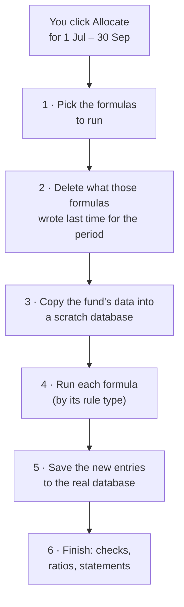
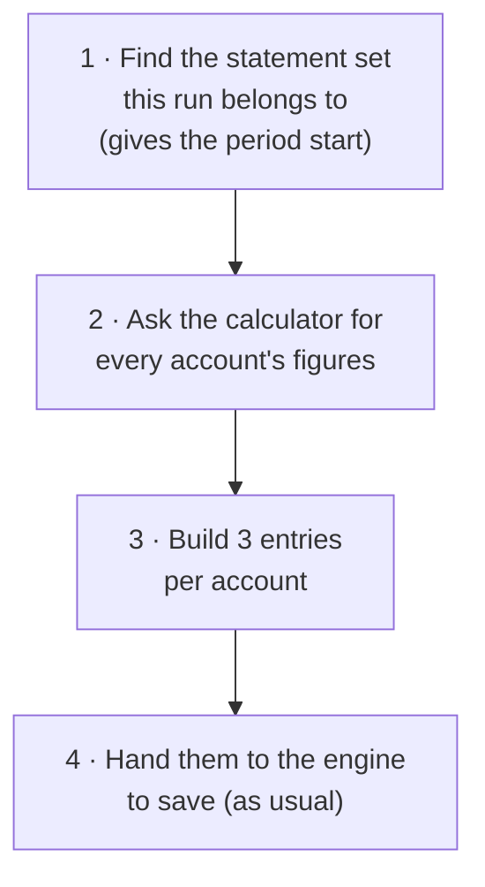
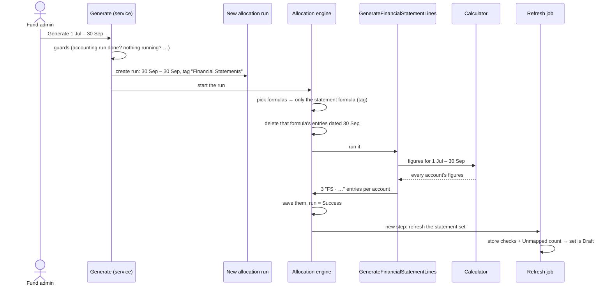
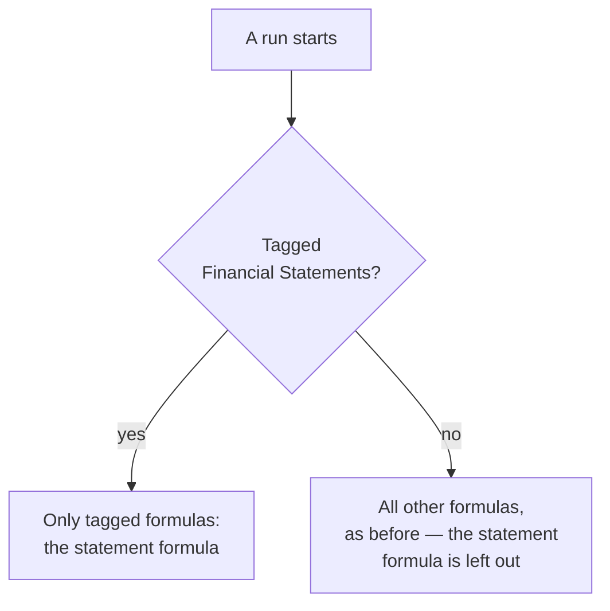

# The "Financial Statement Lines" rule type — how it works and why it exists

This document explains one new piece of the allocation engine: the fund formula rule type
**`GenerateFinancialStatementLines`** (shown on a fund's formulas page as **Financial Statement
Lines**). It starts from how an allocation run normally works, then explains what the new rule type
does, why each change to the engine was needed, and what would go wrong without it — using one real
example throughout.

Related: the user-facing guide is `docs/user_guides/financial_statements_user_guide.md`; the full
design is `openspec/changes/fund-financial-statements/design.md` (card ④).

---

## 1. First, how an allocation run normally works

A fund has **formulas** (Actions → Account Entries → Allocation Formulas). Each formula has a
**rule type** that says *what kind of calculation* it does — for example:

| Rule type | What it does |
|---|---|
| `AllocateAccountEntry-Name` | Takes a fund-level entry with a given name (e.g. *Audit Fees*) and splits it across the investors' folios |
| `GenerateAccountEntry` | Calculates a figure for **each investor** (e.g. a management fee per folio) |
| `GeneratePortfolioNumbersForFund` | Calculates figures **once for the whole fund** (e.g. each portfolio company's FMV) |

When you click **Allocate Account Entries** for a period, the engine starts an **allocation run**:



Three facts about this matter for everything below:

- **Step 1** picks *every enabled formula* — unless the run is given **tags**, in which case it
  picks only formulas with those tags.
- **Step 2** deletes, for the period, **all entries written by the formulas picked in step 1**. That
  is how re-running a period replaces its figures instead of duplicating them.
- **Step 4** looks at each formula's **rule type** to decide which piece of code runs it. The rule
  type must be in a fixed list (`FundFormula::TYPES`), so a mistyped rule type can't silently do
  nothing.

---

## 2. The problem the new rule type solves

Financial statements (Balance Sheet, P&L…) need each **statement line** — *Professional fees*,
*Cash*, *Management fees* — as a figure for the period. The fund's data is already in CapHive as
**account entries**, but under many different names:

| The fund's entries (examples) | …belong on the statement line |
|---|---|
| Non Deal Expense / *Audit Fees*, *Legal Fees*, *Director Fees* | Professional fees |
| Cash / *Bank Balance* | Cash |
| Fees / *Management Fee* | Management fees |

The **mapping** (set up on the Financial Statements page) records which entries feed which line. The
new rule type is the formula that **applies the mapping**: it adds up the right entries for every
line and saves the results — as account entries, like every other figure in CapHive.

**Why save the lines as account entries at all?** Because then they work everywhere entries already
work — the account entries pages, Excel exports, document templates, reports — and they live inside
an allocation run, so they are locked, unlocked and replaced exactly like every other generated
figure. (This was the design decision "everything is account entries".)

**Why not use an existing rule type?**

| Option | Why it doesn't work |
|---|---|
| `GenerateAccountEntry` | Runs once **per investor**. Statement lines are one figure **for the whole fund** |
| One hand-written formula per statement line | Each formula would have to name its entries. An entry uploaded with a new name (say *Director Fees*) would be in no formula and silently missing. The mapping exists precisely so new names show up as **Unmapped** instead |
| `GeneratePortfolioNumbersForFund` | Right shape (once per fund, fund-level results), wrong job — it calculates portfolio company figures |

So the new rule type copies the "once per fund" shape of `GeneratePortfolioNumbersForFund`, and
replaces "a formula" with "the fund's statement mapping". Its formula text is just `true` and is
never evaluated.

---

## 3. What the new rule type does, step by step

When the engine reaches a formula with rule type `GenerateFinancialStatementLines` (step 4 above):



| Step | What happens | Why |
|---|---|---|
| 1 | Looks up the statement set (`FinancialStatement`) whose statements run is this run, and takes its **start date** | The run itself only covers the end date (see section 5), so the real period comes from the statement set |
| 2 | Calls `FinancialStatementCalculator` for the period, reading the **live database** | One calculator produces every statement figure — the same one behind the preview and the checks — so the numbers can never disagree |
| 3 | For each statement account, builds **three** entries dated the **end date**: type *Financial Statement*, names starting **"FS · "**, fund level (no folio) | Three figures are enough to show every column (period, year to date, balance, opening balances) |
| 4 | Adds them to the run's list of entries to insert | The engine's normal insert-and-save path does the rest; nothing special is needed |

**The three entries per account**

| Account kind | Entry 1 | Entry 2 | Entry 3 |
|---|---|---|---|
| Movement (income, expense, gain) | "FS · *account*" = this period | "FS · YTD *account*" = year to date | "FS · Since Inception *account*" = since the fund started |
| Balance (asset, liability, capital) | "FS · *account*" = value at the end date | "FS · Opening *account*" = value at the start of the period | "FS · YTD Opening *account*" = value at the start of the year |

Each entry also stores, in its `json_fields`, **which account** and **which figure** it is
(`fs_account_id`, `column`). The statement page reads figures back by those, never by name — which
is why the statements print the plain line name while the stored entry is called "FS · …".

---

## 4. Worked example — the demo fund, Q3 2026

**Inputs (some of the fund's own entries):**

| Entry type / name | Date | Amount |
|---|---|---|
| Non Deal Expense / Legal Fees | 30 Sep 2026 | 15,200 |
| Non Deal Expense / Audit Fees | 30 Sep 2026 | 30,000 |
| Non Deal Expense / Director Fees | 30 Sep 2026 | 8,000 |
| (earlier in 2026) Audit Fees 30,000, Legal Fees 26,100 | Mar / Jun 2026 | |
| (in 2025) Audit Fees 60,000, Legal Fees 28,400 | Dec 2025 | |
| Fees / Management Fee | each quarter end | 250,000 |
| Cash / Bank Balance | many dates (movements) | … |

**Mapping:** *Non Deal Expense · Audit Fees / Legal Fees / Director Fees* → **Professional fees**
(expense, movement); *Fees · Management Fee* → **Management fees** (expense, movement);
*Cash · (any name)* → **Cash** (asset, balance).

**You click Generate statements for 01/07/2026 – 30/09/2026.** The rule type writes, among others:

| Entry name (stored) | Amount | What it is | How it was worked out |
|---|---|---|---|
| FS · Professional fees | 53,200 | Q3 | 15,200 + 30,000 + 8,000 |
| FS · YTD Professional fees | 109,300 | Jan–Sep 2026 | 30,000 + 26,100 + 15,200 + 30,000 + 8,000 |
| FS · Since Inception Professional fees | 197,700 | Since the fund started | 88,400 (2025) + 109,300 (2026) |
| FS · Management fees | 250,000 | Q3 | one quarter's fee |
| FS · YTD Management fees | 750,000 | Jan–Sep 2026 | three quarters |
| FS · Since Inception Management fees | 1,750,000 | Since the fund started | seven quarters |
| FS · Cash | 596,700 | Balance at 30 Sep | sum of every cash movement to 30 Sep |
| FS · Opening Cash | 1,253,800 | Balance at 30 Jun | sum to 30 Jun |
| FS · YTD Opening Cash | 1,783,600 | Balance at 31 Dec 2025 | sum to 31 Dec 2025 |

…three for every account — 30 entries for the demo fund's 10 accounts — all dated 30 Sep 2026,
type *Financial Statement*, no folio.

**What the P&L then shows** (read back from those entries by account, labelled by the layout):

| Profit & Loss | This period | Year to date |
|---|---|---|
| Management fees | (250,000) | (750,000) |
| Professional fees | (53,200) | (109,300) |

No "FS · " anywhere on the statement; expenses print in brackets.

---

## 5. One click, end to end



---

## 6. The four changes to the existing engine — and why each is needed

Everything else in the engine is unchanged. Each change is small; here is what it is, why it's
needed, and what would go wrong without it.

### Change 1 — the rule type is added to the allowed list

`FundFormula::TYPES` gains `GenerateFinancialStatementLines` (and a constant for the tag,
`FINANCIAL_STATEMENTS_TAG = "Financial Statements"`).

- **Why:** a formula's rule type must be in this list or the formula can't be saved.
- **Without it:** setting up a fund would fail to create the statement formula.

### Change 2 — the engine knows how to run it

`RunFormula` (which runs each formula by its rule type) gets one more branch:

```ruby
when "GenerateFinancialStatementLines"
  AccountEntryAllocation::GenerateFinancialStatementLines.call(ctx)
```

- **Why:** this is where step 4 of a run decides which code runs a formula.
- **Without it:** the formula would be picked but produce nothing.

### Change 3 — ordinary runs leave it out

`RunFormulas#formulas_in_scope` (step 1 of a run) now leaves out formulas of this rule type unless the
run is tagged **"Financial Statements"**.



- **Why:** an ordinary (untagged) run picks *every* enabled formula, and step 2 deletes what each
  picked formula wrote for the period.
- **Without it:** every ordinary accounting run would also rebuild the statement lines — or delete
  them — including under statements you had already locked and published.
- **Effect on funds without statements:** none. They have no such formula, so exactly the same
  formulas are picked as before.

### Change 4 — a final step refreshes the statement set

A new last step in `RunFormulas`, `refresh_financial_statements`: if a statement set uses this run,
it queues `FinancialStatementRefreshJob`, which stores the set's checks and Unmapped count (the set
changes from *Generating* to *Draft*).

- **Why:** the checks must be computed after the lines are saved, from the saved figures.
- **Safety:** the step always reports success and catches its own errors, so a statements problem can
  never make an allocation run fail. For a run with no statement set it does nothing but one quick
  lookup.

---

## 7. Four safeguards — what would go wrong without each

### Safeguard A — a new allocation run each time you click Generate

The engine already has "re-run this run" (`AllocationRun#rerun!`), but it refuses whenever a
**locked** run overlaps the period — and the period's accounting run is usually locked by the time
statements are prepared. So each Generate creates a fresh run, tagged "Financial Statements".

### Safeguard B — the statements run covers only the end date

Remember step 2: a run deletes its formulas' entries **across the run's dates**. Statement lines are
dated on the period's end date.

| If the run covered the whole period | Because it covers only the end date |
|---|---|
| Generating FY 2026 (1 Jan – 31 Dec) would delete the Q1, Q2 and Q3 statement lines (dated 31 Mar, 30 Jun, 30 Sep) — breaking those statement sets | Generating FY 2026 deletes only lines dated 31 Dec. Other periods' lines are safe |

The real period start comes from the statement set (section 3, step 1). The consequence: two
statement sets can't end on the same date — Generate refuses and points you to the existing set,
whose year-to-date column already covers the longer period.

### Safeguard C — the calculator reads the live database, not the scratch copy

For funds on **incremental allocation**, step 3 copies only *recent* entries into the scratch
database. Statement balances go back to the fund's start (cash since inception, the P&L result since
inception), so computing them from the scratch copy would give wrong numbers. The statements run
writes no other entries and has already deleted its own old lines, so reading the live database is
correct.

### Safeguard D — statement lines are output, never input

Statement lines are figures for people, never figures for formulas:

- **The scratch copy skips them.** An `AllocateAccountEntry-Name` formula finds fund entries **by
  name alone**. If a statement account were called *Professional fees* and a formula of the same name
  existed, that formula would otherwise split the statement line across the investors — counting the
  fees twice. (The allocation run checker's tie-out skips them too.)
- **They are named "FS · …".** Fund ratios and document templates also look entries up **by name**,
  in the live database. Without the prefix, an account named like one of the fund's own entries
  (e.g. *Cash In Hand*) would create a second entry with that name on the end date, and those lookups
  could pick the statement line instead of the real one. With the prefix, they can't clash — and the
  fund's own entries are never renamed.

---

## 8. What stays exactly the same

- Ordinary allocation runs pick the same formulas, in the same order, and delete and write the same
  entries.
- The allocate screen's "this period is locked" check is unchanged — a locked accounting run still
  blocks an ordinary re-run.
- Investor statements (SOA), fund ratios and run checks work as before.
- Funds that never set up financial statements see no difference at all: they have no statement
  formula and no "FS · " entries.

---

## 9. Frequently asked questions

**Do I need to create the statement formula myself?**
No. Setting up a fund's financial statements creates **Financial Statement Lines** automatically,
enabled, tagged "Financial Statements", last in the sequence. Leave it enabled — Generate refuses
while it is disabled.

**Can I run it from the Allocate screen?**
Only by choosing the "Financial Statements" tag. It then rewrites the statement lines for the run's
dates but doesn't update any statement set, and the allocate screen's lock check still applies. Use
**Generate statements** instead.

**What does its formula `true` mean?**
Nothing — it is never evaluated. A fund formula must have formula text; the real "formula" is the
fund's statement mapping.

**Why three entries per account and not one per column?**
Three independent figures are enough: the other two columns follow (opening = balance − period for a
movement account; period = balance − opening for a balance account). It keeps the number of entries
small — 30 for a fund with 10 accounts.

**What if the run fails?**
The statement set shows **Failed** with the run's error message, the run user gets the normal failure
notice, and **Regenerate** tries again. Nothing else is affected.

**Where is the code?**
`app/packs/allocation_engine/account_entry_allocation/generate_financial_statement_lines.rb` (the rule
type); the four changes in `run_formula.rb`, `run_formulas.rb` and
`app/packs/funds/funds/models/fund_formula.rb`; the scratch-copy filter in
`script/load_sqlite3_from_mysql.sh`; the calculator in
`app/packs/funds/financial_statements/services/financial_statement_calculator.rb`.
