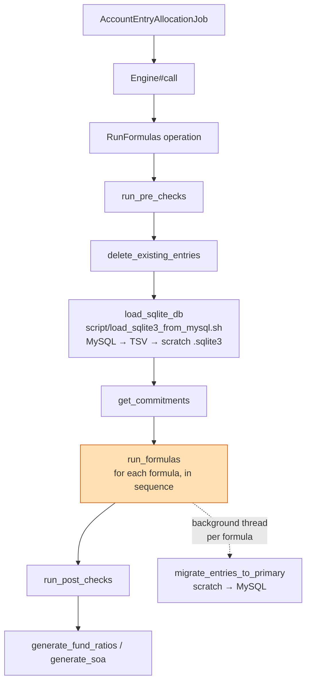
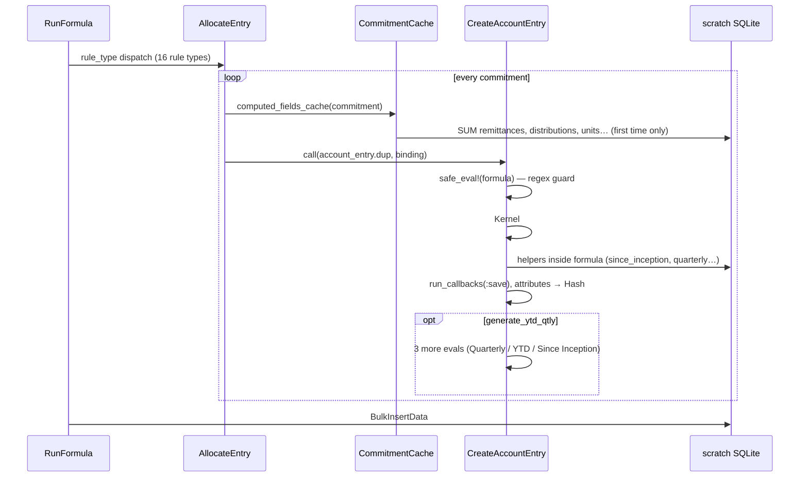
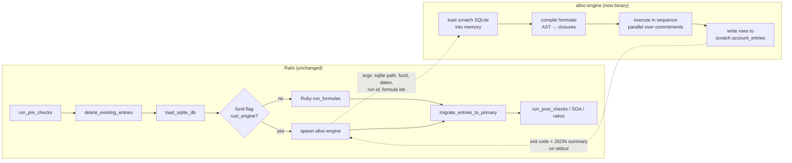
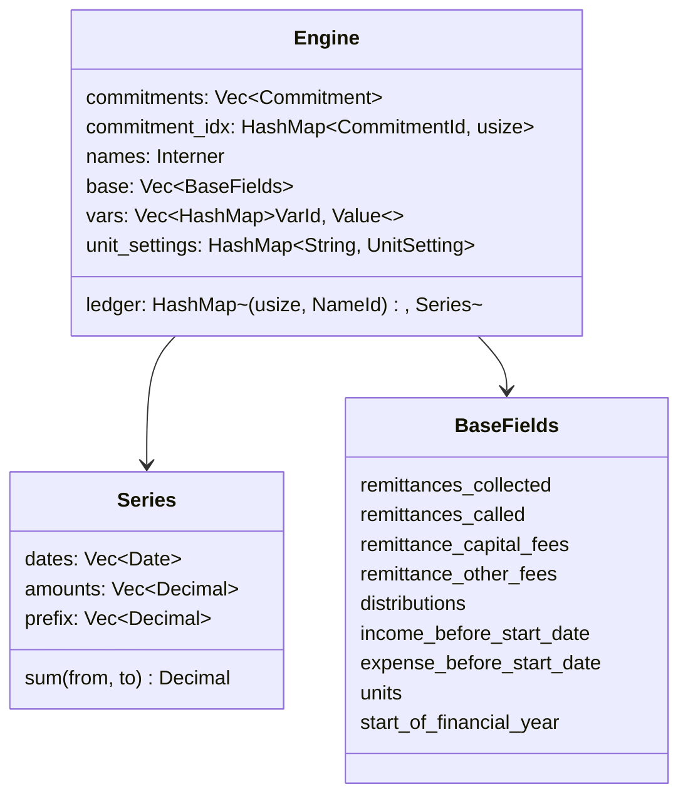
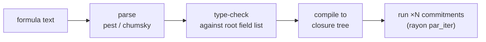
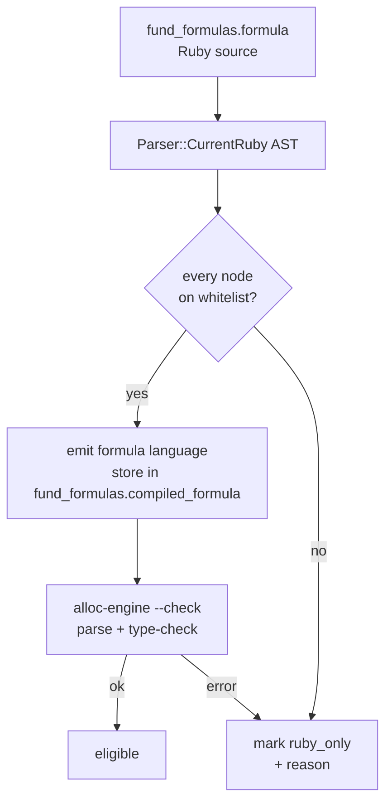
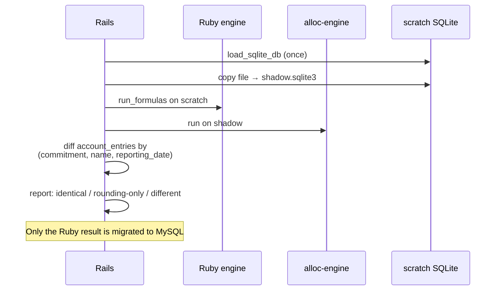

# Rewriting the Formula Runner in Rust — Proposal for Review

Status: **proposal, not approved.** No code has been written. This document is for deciding
whether to start, and if so, what to build first.

> **Update:** the Ruby-only step this proposal recommends first (section 10) has been done — see
> `allocation_engine_speedups.md`. On fund 317 it cut load + formulas from 1,328 s to 557 s (−58%)
> with identical output. Portfolio FMV is now the largest single formula (215 s of the 401 s).

Scope: the `run_formulas` step of `AccountEntryAllocation::RunFormulas`
(`app/packs/allocation_engine/account_entry_allocation/run_formulas.rb`). The other steps —
the pre-checks, the scratch SQLite load, the migration back to MySQL, the post-checks,
SOA generation and fund ratios — stay in Ruby.

---

## TL;DR

**The question.** The allocation engine runs fund formulas, which are flexible but slow. What
would a Rust version look like?

**The short answer.** Rust cannot run today's formulas, because they are arbitrary Ruby that
`eval` runs against live ActiveRecord objects. A Rust engine needs:

1. a **small formula language that we define**, which Rust parses once and runs as compiled code;
2. a **translator** that converts existing Ruby formulas into it, leaving any formula it cannot
   translate on the Ruby engine;
3. an **in-memory data model**, so the helpers (`since_inception`, `year_to_date`, …) become array
   lookups instead of SQL queries;
4. a **separate binary** that reads and writes the scratch SQLite file that the run already builds.

**The catch.** Earlier measurements (section 2) show that formula execution is **not always the
bottleneck**. On fund 321 the formulas took 342 s, and the copy into scratch SQLite was the
slow part. On feeder fund 317 the calculation dominated. So the first step is to **measure**,
and then try a cheap Ruby-only fix (section 10). Rust is worth it only if the formula step
still dominates after that.

**What reviewers need to decide** (section 13):

- whether we accept a closed formula language (formulas stop being "any Ruby");
- whether we do the Ruby-only fix first, as this document recommends;
- whether "rounding-only differences", the standard the incremental-allocation validation
  already used, is acceptable when comparing the two engines.

---

## 1. How a run works today



The highlighted box is what this proposal replaces. Inside it, for **each formula** and for
**each commitment**:



### Where the time per row goes

| # | Cost | Where | Why it is expensive |
|---|---|---|---|
| 1 | Ruby re-parses the formula string on every call | `AllocationBaseOperation#safe_eval` → `eval(…, bdg)` | Parsing is paid once per formula × commitment × (1 or 4), not once per formula |
| 2 | ActiveRecord object per generated entry | `CreateAccountEntry#eval_formula`: `dup`, `setup_defaults`, `run_callbacks(:save)`, `attributes.except` | Generic AR machinery for a row that is never saved through AR |
| 3 | SQL per commitment inside the formula | `CommitmentAccountEntry#since_inception`, `#year_to_date`, `#quarterly`, `cumulative_account_entry` | Each is a `SUM` against scratch SQLite, executed per commitment |
| 4 | Single thread | `AllocateEntry#allocate_entry` loops `ctx[:commitments].each_with_index` | Commitments within one formula are independent, but run one after another |

**Worked example.** A fund with 2,000 commitments and 150 formulas, of which 40 have
`generate_ytd_qtly`:

- evals = 2,000 × (110 × 1 + 40 × 4) = 2,000 × 270 = **540,000** parses and evaluations;
- every `Quarterly` / `YTD` / `Since Inception` eval is a helper that issues a SQL `SUM`, so
  that is 2,000 × 40 × 3 = **240,000** SQL queries from the derived entries alone, before
  counting any helper the formulas call themselves.

---

## 2. What we already know about the time budget

From existing measurements in this folder:

| Fund | Total run | What dominated | Source |
|---|---|---|---|
| 321 Indium VI (feeder of 319) | — | **The copy**: 946,646 entries copied; all 437 formulas together took **342 s**, the slowest single one **7.8 s** | `incremental_allocation_history.md` §1 |
| 317 True North Fund V Trust (feeder of 316) | 21 → 18 min after trimming the copy | **Calculation**: 85,000 entries generated in a two-month period; trimming the copy barely helped | `incremental_allocation_validation.md` |
| 318 Indium V | 16 → 13 min | Mixed | same |
| 320 True North Fund VI Trust | 10.4 → 8.9 min | Mixed | same |

> The split of each run between steps (load / formulas / migrate) has **not** been recorded
> for 317, 318 or 320. Only "calculation dominates" is known. Producing it is task 0 in section 12.

**Conclusion:** a Rust engine targets the 317-type fund (many generated entries per period).
It does nothing for the 321-type fund, where the copy and the migration dominate.

---

## 3. Why Rust cannot just run the existing formulas

Formulas are Ruby source stored in `fund_formulas.formula` and evaluated with `Kernel#eval`
against a `binding` that exposes AR objects. Examples from
`public/sample_uploads/fund_formulas.xlsx` and `features/`:

```ruby
# 1. Arithmetic over AR attributes (AllocateAccountEntry-Name)
capital_commitment.committed_amount_cents * ( fund_unit_setting.management_fee / 4 ) / 100

# 2. Hash access with a side effect (GenerateCustomField)
capital_commitment["properties"]["setup_fees"] ||= capital_commitment.committed_amount_cents * fund_unit_setting.setup_fee / 100

# 3. Navigating associations
capital_commitment.fund.total_units_premium_cents * capital_commitment.percentage / 100

# 4. Control flow + exceptions + helper calls, multiple statements
raise SkipRule.new("skip") unless ["active", "closed"].include?(capital_commitment.json_fields["status"]); capital_commitment.quarterly("Management Fees", nil, @start_date, @end_date)

# 5. Values produced by earlier formulas, via instance variables
fund_account_entry.amount_cents * @investable_capital_percentage / 100.0
```

None of these can run outside a Ruby VM with Rails loaded:

- `capital_commitment.fund` is an ActiveRecord association;
- `.quarterly(...)` is a Ruby method (`CommitmentAccountEntry#quarterly`) that builds a SQL query;
- `raise SkipRule` is a Ruby exception that `CreateAccountEntry` catches;
- `@investable_capital_percentage` is an instance variable injected by
  `AllocationBaseOperation#create_instance_variables`.

So "rewrite in Rust" really means **replacing Ruby as the formula language**. Everything else
in this document follows from that.

---

## 4. Proposed architecture



### 4.1 Why a separate binary, not a native extension

| | Separate binary | Native extension (`magnus` / `rb-sys`) |
|---|---|---|
| Interface | Scratch SQLite file + argv + JSON on stdout | Ruby ↔ Rust value conversion |
| Memory | Own process; a crash or OOM cannot take down Sidekiq | Shares the Sidekiq worker's heap |
| Global VM Lock | Not involved | Must release it explicitly for parallelism |
| Precedent here | `load_sqlite_db` already shells out to `script/load_sqlite3_from_mysql.sh` | None |
| Deploy | Ship one static binary per architecture | Compile at `bundle install` on every box |

**Recommendation: a separate binary.** The scratch SQLite file is already the boundary. The
Ruby engine already writes into it, and `migrate_entries_to_primary` already copies from it
to MySQL. The Rust engine writes the same rows to the same table.

### 4.2 What the binary owns

- Loading the scratch DB into memory (section 5).
- Compiling and running formulas of the rule types it supports (section 6).
- Writing generated `account_entries` rows to the scratch DB, with `fund_formula_id` and
  `allocation_run_id` set exactly as `CreateAccountEntry#eval_formula` sets them.
- Reporting progress, so the per-formula "Completed 3 of 150" notifications keep working.
  The binary prints JSON lines; Rails reads them and calls `notify`.

### 4.3 What stays in Ruby

- Run checks (`RunChecks`, `CheckHelpers`). They run before and after, and they write no entries.
- `migrate_entries_to_primary` and `relink_account_entry_parents`.
- SOA, fund ratios, reports.
- Any formula the translator cannot convert (section 7.2).

---

## 5. In-memory data model

The speed-up comes as much from this as from Rust itself. Today every helper call is a SQL
`SUM`. In Rust each one becomes a binary search over data already in memory.



- **`Series`**: the entries for one commitment and one name, sorted by `reporting_date`, plus a
  running total (`prefix`). `sum(from, to)` = `prefix[hi] − prefix[lo]`, two binary searches.
  - `since_inception(name, …, end)` → `sum(−∞, end)`
  - `year_to_date` → `sum(start_of_financial_year, end)`
  - `quarterly` → `sum(beginning_of_quarter, end)`
- **`BaseFields`**: exactly the keys of `CommitmentCache::BASE_FIELDS`, computed for all
  commitments in one `GROUP BY` query per source table, not one query per commitment.
- **`vars`**: the replacement for `@instance_variables`. When formula *N* produces "Net Income"
  for a commitment, the value is stored under `net_income` (same `FundFormula.to_varable_name`
  rule), and a new entry is appended to that commitment's `Series`, so later formulas that call
  `since_inception("Net Income")` see it.
- **Eviction**: the `last_consumer_index` that `configure_commitment_cache_dependencies` already
  computes carries over unchanged. A var is dropped once its last reader has run.

**Memory example.** 2,000 commitments × 300 distinct names × ~40 dates is 24M points in the
worst case. At 16 bytes per decimal, plus 4 bytes per date and 16 bytes per prefix, that is
about 860 MB. In practice most (commitment, name) pairs are sparse. This is still to be
measured on fund 316/317 (open question Q4).

### 5.1 Incremental funds

`since_inception_carried_forward` (in `commitment_account_entry.rb`) reads MySQL as well as
SQLite, for gaps before the trimmed window. The Rust engine never connects to MySQL. Rails
passes the extra data in instead: before spawning the binary, it computes the gap sums per
(commitment, carry-forward name) and writes them to a small table in the scratch DB.
`MissingCarryForward` becomes a Rust error with the same message.

---

## 6. The formula language

### 6.1 Requirements, taken from what formulas do today

| Need | Today (Ruby) | Proposed |
|---|---|---|
| Arithmetic, comparison, boolean | `a * (b / 4) / 100` | Same syntax |
| Conditionals | `x > 0 ? a : b`, `if … else … end` | `if c then a else b` (expression) |
| Attribute reads | `capital_commitment.committed_amount_cents` | Same — from a **whitelist** of roots and fields |
| JSON / properties reads | `capital_commitment["properties"]["x"]`, `.json_fields["status"]` | `capital_commitment.properties.x`, `capital_commitment.json_fields.status` |
| Writes (GenerateCustomField) | `…["properties"]["x"] ||= expr` | `set capital_commitment.properties.x ?= expr` |
| Earlier formula results | `@net_income` | `@net_income` (unchanged) |
| Ledger helpers | `capital_commitment.quarterly("X", nil, @start_date, @end_date)` | `quarterly("X")`, `ytd("X")`, `since_inception("X")`, `cumulative("X")` |
| Skip | `raise SkipRule.new("msg") unless cond` | `skip "msg" unless cond` |
| Multiple statements | `stmt; stmt` | `let x = …;` then a final expression |
| Lists | `["active","closed"].include?(s)` | `s in ["active","closed"]` |

**Not supported, by design:** loops, blocks (`.each`, `.map`), defining methods, arbitrary
method calls, string building beyond comparison, and any database access. A formula that
needs one of these stays on Ruby (section 7.2).

### 6.2 Root objects and fields

The roots are the locals that the Ruby `binding` exposes today: `capital_commitment`,
`fund_account_entry`, `fund_unit_setting`, `fund`, `parent`, `@start_date`, `@end_date`, and the
`@vars`. Each root has a **declared field list**. A typo is a compile error at upload time,
not a `NoMethodError` halfway through a run.

This is the same "generate the surface from one declaration" approach the MCP ontology uses
(see `CLAUDE.md`, "MCP tool surfaces come from the ontology"). There, a silently ignored
attribute returned the wrong data. Here, an unknown field is rejected before the run starts.

### 6.3 Example translations

| Ruby (today) | Formula language |
|---|---|
| `capital_commitment.committed_amount_cents * ( fund_unit_setting.management_fee / 4 ) / 100` | `capital_commitment.committed_amount_cents * (fund_unit_setting.management_fee / 4) / 100` |
| `capital_commitment["properties"]["setup_fees"] \|\|= capital_commitment.committed_amount_cents * fund_unit_setting.setup_fee / 100` | `set capital_commitment.properties.setup_fees ?= capital_commitment.committed_amount_cents * fund_unit_setting.setup_fee / 100` |
| `raise SkipRule.new("skip") unless ["active", "closed"].include?(capital_commitment.json_fields["status"]); capital_commitment.quarterly("Management Fees", nil, @start_date, @end_date)` | `skip "skip" unless capital_commitment.json_fields.status in ["active", "closed"];`<br>`quarterly("Management Fees")` |
| `fund_account_entry.amount_cents * capital_commitment.properties['investable_capital_percentage'] / 100.0` | `fund_account_entry.amount_cents * capital_commitment.properties.investable_capital_percentage / 100.0` |

Most formulas stay character-for-character the same. The language is deliberately close to
the Ruby subset that fund admins already write.

### 6.4 Execution



- Parse, type-check and compile happen **once per formula per run**: 150 compiles instead of
  540,000 evals.
- A compiled formula is a tree of closures (`Box<dyn Fn(&Ctx) -> Result<Value>>`). There is no
  interpreter dispatch per node.
- **Why not embed Rhai or Lua?** Either would get us running faster, but we would lose
  control over number semantics (section 8), and explain output (section 9) would have to be
  reverse-engineered from a foreign AST. A purpose-built language is a few hundred lines
  of grammar plus a function library, and it is ours to version.

### 6.5 Rule types

Each of the 16 `rule_type`s dispatched in `RunFormula#run_formula_internal` becomes a Rust
"driver" around the compiled expression:

| Rule type family | Driver shape | Parallel? |
|---|---|---|
| `GenerateAccountEntry`, `GenerateAccountEntryMultiple` | map: commitment → entry | Yes |
| `AllocateAccountEntry*` (Name / EntryType, grouped / individual) | for each fund-level entry: map over commitments | Yes, per fund entry |
| `GenerateCustomField` | map: commitment → property write | Yes |
| `Percentage` | **two passes**: sum over commitments, then divide each | Pass 1 is a reduction, pass 2 a map |
| `CumulateAccountEntry` | reduce `Series` | Yes |
| `AllocateMasterFund*` | needs master fund rows — already in scratch when `master_fund_id` is set | Yes |
| `AllocatePortfolioInvestment*`, `AllocateAggregatePortfolios`, `GeneratePortfolioNumbersForFund`, `AllocateForPortfolioCompany*` | portfolio data model (not yet designed) | **Phase 3** |

---

## 7. Moving existing formulas across

### 7.1 Translator

The app already parses formulas with the `parser` gem: `FundFormula#formula_syntax_valid?`
and `#parse_statement` both call `Parser::CurrentRuby.parse`. A new Ruby class walks that AST
and emits the formula language. Every unknown node type (`:block`, `:send` to a method not on
the whitelist, `:while`, …) makes the formula **not translatable**, with the reason recorded.



The translated text is **stored next to** the Ruby (new column), not in place of it. The
Ruby formula stays the source of truth until a fund is cut over.

### 7.2 Mixed runs are not possible — a fund is all-Rust or all-Ruby

A tempting design is to run translatable formulas in Rust and the rest in Ruby, inside the
same run. **This proposal rejects that.** Formulas run in sequence and read each other's
results (`@vars` and the ledger), so every switch between engines would need a full sync of
state through SQLite. A fund moves to Rust only when **100% of its enabled formulas** translate.
The translator report (task 2) tells us how many funds qualify as things stand.

### 7.3 Shadow runs



This is the same standard the incremental-allocation work used ("all 85,655 entries
identical; 53 rounding-only differences", `incremental_allocation_validation.md`).
`AllocationRunTieOut` is the starting point for the diff. A fund is cut over only after its
shadow runs show **no differences beyond rounding** across at least two periods.

---

## 8. Matching Ruby's arithmetic

This is the highest-risk part. If the two engines round differently, the comparison never
comes out clean.

**What the columns are:** `account_entries.amount_cents` is `decimal(30,8)`;
`capital_commitments.committed_amount_cents` is `decimal(20,2)`; `percentage` is
`decimal(20,10)`; `fund_unit_settings.management_fee` is `decimal(24,8)`. In Ruby they are all
`BigDecimal`.

**Ruby's promotion rules (verified with `ruby -rbigdecimal`):**

| Expression | Ruby result | Consequence |
|---|---|---|
| `7 / 2` | `3` (Integer, floor) | A literal-only `1 / 4` in a formula is `0`. Rust must reproduce this, not "fix" it |
| `7 / 2.0` | `3.5` (Float) | |
| `BigDecimal("7") / 100.0` | `BigDecimal` | BigDecimal absorbs Float, so `/ 100.0` keeps decimal precision |
| `1.5 * BigDecimal("2")` | `BigDecimal` | Same, in either order |
| `BigDecimal("1") / 3` | `0.333…3e0` (**32** significant digits) | Division precision |
| `0.1 + 0.2` (pure Float) | `0.30000000000000004` | Only if no BigDecimal is involved |

**Proposed value type in Rust:**

```text
enum Value { Int(i64), Float(f64), Dec(BigDecimal), Bool, Str, Date, Nil }
```

- `Dec` uses the `bigdecimal` crate (arbitrary precision), **not** `rust_decimal`, whose
  28-digit limit is below Ruby's 32-digit division.
- The promotion table above is implemented once, and tested by a **generated** test suite:
  a Ruby script evaluates a few thousand random expressions over mixed types and writes the
  expected results to a fixture, and the Rust tests must match it exactly.
- The final value is rounded to 8 decimal places, as MySQL `decimal(30,8)` does on insert.

**Worked example** (formula 1, in section 3):

```text
committed_amount_cents = 1_000_000_000.00   (Dec — ₹1 crore in paise)
management_fee         = 2.0                (Dec)
2.0 / 4                = 0.5                (Dec / Int → Dec)
1_000_000_000.00 * 0.5 = 500_000_000.00     (Dec)
/ 100                  = 5_000_000.00       (Dec)  → ₹50,000 for the quarter
```

Both engines must produce `5000000.00000000`.

---

## 9. Explain, errors and skip

- **Explain**: `FundFormula#parse_statement` re-parses the Ruby and evaluates
  sub-expressions against the binding, to fill `account_entries.explanation`. In Rust the
  compiled tree already knows each node's value. With `--explain`, every node records
  `(source span, value)` and the same JSON shape is written. This is cheaper than today.
- **Errors**: today `safe_eval` rescues, re-evaluates each variable for the message, and
  raises `"Error in eval … Variables used: …"`. Rust returns a structured error
  `{formula_id, commitment_id, span, message, vars}`, and Rails turns it into the same
  message and the same `allocation_run.status`.
- **Infinity/NaN**: `safe_eval` raises when a Float result is not finite. Rust does the same,
  and division by zero on `Dec` is an error rather than an infinity.
- **Skip**: `skip "msg"` returns `Skipped(msg)`, and the driver produces no entry. This is
  what `CreateAccountEntry` does with `@skip_rule = true` today, including suppressing the
  Quarterly/YTD/SI entries.

---

## 10. The Ruby-only alternative (do this first)

Three of the four costs in section 1 can be removed without Rust and without changing a
single formula:

| Cost | Ruby fix | Effort |
|---|---|---|
| 1. Re-parsing | Compile each formula once into a lambda (`eval("->(capital_commitment, fund_account_entry, …) { #{formula} }")`), after the same `safe_eval!` guard, and call it per commitment | Small |
| 2. AR per row | Build the row hash directly instead of `dup` + `run_callbacks(:save)` + `attributes` (the callbacks to keep must be listed first) | Medium |
| 3. SQL per helper | Preload each commitment's entries for the referenced names into an in-memory sum index at the start of the formula, and make `since_inception`/`ytd`/`quarterly` read from it during a run | Medium |
| 4. Single thread | Not fixable in MRI (Global VM Lock); `Ractor` cannot share AR objects | — |

**Expected result:** 3–5× on calculation-dominated funds. This is an estimate, to be confirmed
by task 1. It is a fraction of what Rust would give (an estimated 50–100× including
parallelism), but it costs weeks rather than a quarter, and it keeps formulas as Ruby.

**Decision rule:** if, after this, calculation is still more than half of the run on the
largest funds, go ahead with Rust.

---

## 11. Risks

| Risk | Likelihood | Impact | Mitigation |
|---|---|---|---|
| Arithmetic differs from Ruby | High at first | Wrong figures in LP statements | Generated test fixtures (§8); shadow runs; cut over per fund |
| Too few funds translate fully | Medium | Little benefit | Translator report before any engine work (task 2) |
| Fund admins need a construct the language lacks | Medium | Pressure to add "escape hatches" | Keep Ruby as a supported per-fund path, permanently |
| Two engines to maintain | Certain | Every new rule type built twice | Freeze new rule types on Ruby once Rust starts, or accept the cost |
| Portfolio rule types are complex | High | Funds using them stay on Ruby | Phase 3, separately designed |
| Binary deployment | Low | Ops overhead | Static `musl` build, version-pinned, checked at boot |

---

## 12. Phased plan

```mermaid
gantt
    dateFormat  X
    axisFormat  %s
    section Measure
    0 Per-step timing on 5 largest funds      :t0, 0, 1
    section Ruby fix
    1 Compile-once lambdas + row hash + sum index :t1, after t0, 3
    section Feasibility
    2 Translator + coverage report             :t2, after t0, 2
    section Rust
    3 Engine core: load, Generate/Allocate/Percentage :t3, after t2, 6
    4 Shadow runs + diff tooling               :t4, after t3, 3
    5 Cut over first fund                      :t5, after t4, 1
    6 Portfolio rule types                     :t6, after t5, 6
```

(Units are relative weeks, indicative only.)

| # | Task | Exit criterion |
|---|---|---|
| 0 | Log the time of each `RunFormulas` step (and per formula, already in `fund_formulas.execution_time`) for the 5 largest funds | A table like section 2, filled in with real numbers |
| 1 | Ruby-only fix (§10) | Shadow diff identical; measured speed-up |
| 2 | Translator + report: per fund, % of enabled formulas translated, top reasons for failure | Go/no-go: are there enough fully translatable funds? |
| 3 | Rust core for the non-portfolio rule types | Matches the generated arithmetic fixtures; runs the Cucumber allocation features' funds |
| 4 | Shadow mode in `RunFormulas`, behind a per-fund `json_fields["rust_engine"] = "shadow"` | Two clean periods on one real fund |
| 5 | `json_fields["rust_engine"] = "on"` for that fund | Production run with the Ruby engine as fallback |
| 6 | Portfolio rule types | Separate design |

---

## 13. Decisions needed from reviewers

1. **Do we accept a closed formula language?** Formulas would stop being "any Ruby". Funds
   needing more stay on Ruby, so we keep two engines indefinitely.
2. **Ruby fix first (section 10)?** This document recommends yes. The Rust work only starts if
   task 0 + task 1 show calculation still dominates.
3. **Is "rounding-only differences" acceptable** as the cut-over bar, as it was for incremental
   allocation? Or must the two engines be identical to the 8th decimal?
4. **Separate binary** (recommended) **or native extension?**

## 14. Open questions

- **Q1.** What share of production formulas use blocks, loops or method calls outside a
  whitelist? (The prod dump on 33066 was not reachable when this was written. Task 2 answers it.)
- **Q2.** Which `before_save` callbacks run by `account_entry.run_callbacks(:save)` actually
  change generated rows? Both the Ruby fix and Rust must reproduce exactly those.
- **Q3.** `GenerateCustomField` writes to `capital_commitment.properties`. Are those writes
  persisted to MySQL today, or used only within the run? This decides whether Rust must write
  commitments back.
- **Q4.** Peak memory of the in-memory ledger on fund 316/317 (estimate in section 5).

---

## FAQ

**Q: Why not just make the Ruby faster and stop there?**
That may well be the answer. Section 10 removes the re-parsing, the per-row ActiveRecord work
and the per-helper SQL, which are three of the four costs. What Ruby cannot do is use more than one
core for a single run, because MRI's Global VM Lock serialises the commitment loop. If a fund
still takes too long after the Ruby fix, only a different runtime fixes that.

**Q: Why can't Rust call back into Ruby for the formulas it doesn't understand?**
It could technically, but formulas read each other's results. Engine B would need all of
engine A's `@vars` and ledger entries before every formula, and A would need B's after it.
That sync through SQLite would cost more than the speed-up. Section 7.2 therefore keeps each
fund wholly on one engine.

**Q: Will fund admins have to rewrite their formulas?**
Mostly no. The translator converts the Ruby automatically, and the examples in section 6.3
are almost unchanged. They would only see the new syntax if they edit a formula on a fund that
has been cut over, and the editor would validate it immediately through `alloc-engine --check`.

**Q: What happens to a run if the Rust binary crashes?**
It exits non-zero, and Rails records the error in `allocation_run.status`, the same as a failed
`load_sqlite_db` today (`RunFormulas#load_failed`). During the shadow phase the Ruby result
is the one that is used, so a crash costs nothing. After cut-over, the per-fund flag can be
switched back to Ruby.

**Q: Does this help funds like 321, where the copy is the slow part?**
No. There, the work in `incremental_allocation_history.md` (trimming the copy) is the right
lever. This proposal targets funds that generate many entries per period, like 317.

**Q: Why `bigdecimal` and not `rust_decimal`, which is faster?**
Ruby's `BigDecimal` division keeps 32 significant digits, while `rust_decimal` keeps at most
28. A different intermediate precision produces differences at the 8th decimal place, and the
comparison would report them as mismatches. Matching Ruby matters more than raw speed here, and
the arithmetic is not where the time goes.
