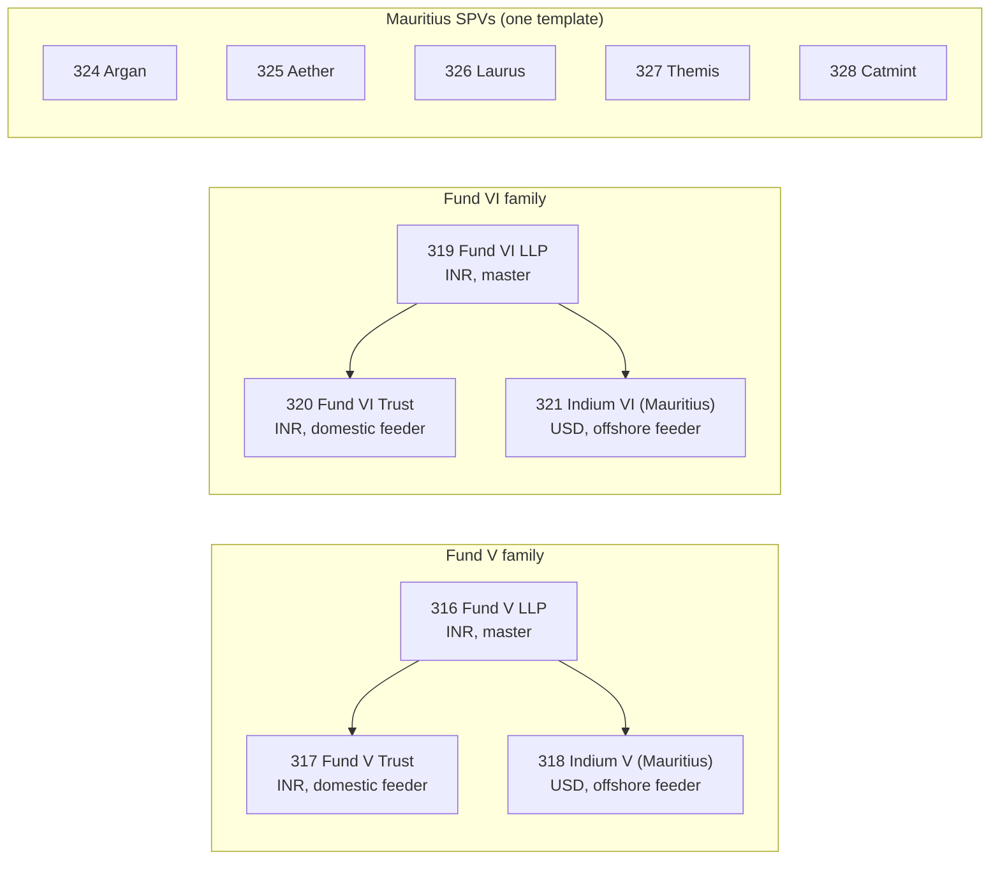
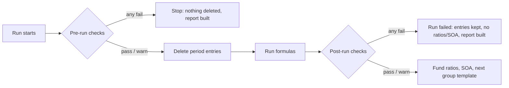
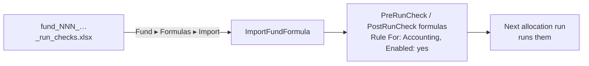

# True North: Pre-run and Post-run Checks

**Status:** Proposed, 2026-11-06. Nothing is loaded yet.
- **Ready to load:** one import sheet per fund in `tmp/true_north_run_checks/`.
- **Dry-run:** every check was run against the production copy (`mysql-restored`, port 33066).
- **Built on:** the checks feature in [Allocation Run Checks](allocation_run_checks.md).

## Key concepts

| Term | Meaning here |
|---|---|
| **Pre-run check** | A `PreRunCheck` fund formula. It runs before the allocation deletes anything. A fail stops the run and leaves the old entries untouched. |
| **Post-run check** | A `PostRunCheck` fund formula. It runs after every formula. A fail marks the run failed, so no fund ratios, statements or next group template follow. |
| **Upload** | An account entry with `generated: false`, dated in the run's period. |
| **UDR code** | A code such as `UDR - 16`, stored on an upload or portfolio investment in a custom field. The custom field is `fund_level_udr_code`, `domestic_udr_code` or `offshore_udr_code`. The formula turns the code into a folio field (`udr_16`) and multiplies the amount by that folio's percentage. |
| **Master / feeder** | Funds 316 and 319 are masters. Each has two feeders, a domestic trust and an offshore USD fund. A feeder allocates the master fund's entries for its own commitment in the master (`AllocateMasterFund*` rule types). |
| **Master-proxy company** | A portfolio company in a feeder that stands for the feeder's holding in the master, e.g. "True North Fund VI LLP" (8228). The feeder formulas allocate it by master investment ids or commitment ratios, not by UDR code. |
| **Helper** | A one-line check from `CheckHelpers` (e.g. `allowed_entry_names(...)`). |
| **Custom check** | Plain Ruby ending in `check!(condition, "message")`, used where no helper fits. |
| **Dry run** | Every check evaluated through the real `RunChecks` engine with `FORMULA_SANDBOX=enforce`, inside a transaction that was rolled back. |

## The funds



- **Not covered:**
  - Funds 284–286 belong to entity 5979 "True North demo".
  - Funds 346/349/391 have no formulas.
- **How runs are set up:** True North runs use a blank `rule_for` and no tags, so checks saved with `Rule For: Accounting` are in scope for every run.

## What the formulas depend on

These dependencies were read from the 2,961 formulas of the 11 funds (287 of them Accounting). Each can break allocation without an error.

| # | Dependency | Funds | What goes wrong if it is missing | Check |
|---|---|---|---|---|
| D1 | Every fund-level upload of the 9 allocated entry types (7 in Mauritius) carries a Fund Level Udr Code | all | That upload is allocated to no folio, silently | `required_custom_fields` |
| D2 | Each code maps to a folio field whose percentages total 100% | all | Part of the amount goes to nobody | `folio_shares_total`, or the custom code check |
| D3 | Expense heads are spelled exactly as the statement formulas list them (19 heads in 316/319, 22–23 in the feeders) | 316–321 | The amount drops out of its statement line | `allowed_entry_names` |
| D4 | Deal / exit / other cost entries are mapped to a portfolio investment | all | Apportioning and realised gain per tranche read entries by investment parent | `entries_mapped_to_portfolio_investment` |
| D5 | Master entries carry `domestic_udr_code` (317/320) or `offshore_udr_code` (318/321), and so do the master investments | feeders | Feeder allocation of master entries goes to nobody | custom "Master fund entries carry a … UDR code" |
| D6 | Folio fields named literally in formulas (`udr_194`, `udr_193`, `udr_fb_fund`, 13 × `udr_blended_*`) total 100% | 319, 320, 321 | Same as D2, for those formulas | custom "Folio fields named in formulas total 100%" |
| D7 | An INR → USD rate near the end date | 318, 321 | The engine raises "No exchange rate found"; the fallback formula raises on `nil.rate` | custom "INR to USD rate" (helper `fx_rates_present` does not ask for the master → feeder pair) |
| D8 | Sales of the master-proxy company carry `exchange_rate` and `portfolio_investment_ids_in_master_fund` | feeders | "Portfolio Sold" divides by `exchange_rate`: a blank gives 0 and the run raises. Blank master ids give 0 sold. | custom "Master holding sales have …" |
| D9 | Each unit type in use has a unit setting with `carry` and `catch_up` | 316, 319, 320, 321 | The waterfall formulas read `fund_unit_setting.carry` / `json_fields['catch_up']` and raise on nil | `unit_settings_present` |
| D10 | FX rates for instrument currencies, and valuations for held companies | all | FMV and conversions use stale or missing data | `fx_rates_present`, `valuations_present` (warning) |

## Findings

### F1: Fund 317 formula 6861 is named "Reinvestment Fee"; a fix file is ready

- **What:** formula 6861 is `AllocateAccountEntryIndividual-EntryType`, so it allocates fund-level uploads whose entry type equals its name, "Reinvestment Fee".
  - The uploads, its sibling formula 6859 and funds 316/318–321 all use "Reinvestment Fees".
- **Effect:** the first fund-level "Reinvestment Fees" upload in 317 would not be allocated.
  - The scratch SQLite matches case-insensitively (`COLLATE NOCASE`), but singular vs plural is not a case difference.
- **Today:** 317 has no entries with entry type "Reinvestment Fee" and none written by 6861, so renaming moves no existing number.
- **Fix:** `tmp/true_north_run_checks/fund_317_fix_reinvestment_fees_formula_6861.xlsx`.
  - One update-only row (`Id 6861`, `Update Only: Yes`) that sets Name and Entry Type to "Reinvestment Fees".
  - Every other column is copied from the record. A round trip through the import's own cleaning changes only those two fields, and the record stays valid.
  - Upload it against fund 317, or edit the two fields in the UI.

### F2: two "Portfolio Sold" formulas read entry type "Reinvestment Fee" (decision needed)

| Fund | Formula | Branch | Reads |
|---|---|---|---|
| 317 | 4387 "Portfolio Sold" | company 7705 (129 investments, last 2025-12-24) | `entry_type: "Reinvestment Fee"` |
| 320 | "Portfolio Sold" | company 8230 (42 investments, last 2025-01-15) | `entry_type: "Reinvestment Fee"` |
| 318, 321 | "Portfolio Sold" | 7705 / 8230 | `"Reinvestment Fees"` |

- **Today:** no entry has type "Reinvestment Fee", so this branch always sums 0.
- **Effect of switching to the plural:** it would change "Portfolio Sold" for those sales on the next run.
- **Not changed.** Finance should confirm that those sales are meant to pick up the reinvestment fee amounts.

### F3: upload quality the checks would have caught

| Fund | What | When | Check that flags it |
|---|---|---|---|
| 319 | Non Deal Expense named "Shree Digvijay Cements Company Limited" (2 entries, net 0.00) | Apr–Jun 2026 | Non Deal Expense heads: **verified failing** on 2026-04-01..06-30 |
| 318 | Entry type "Non Deal income" (lowercase i), 1 entry | since Apr 2025 | none (see note) |
| 326, 327 | "Bank charges" next to "Bank Charges" | since Apr 2025 | Non Deal Expense heads (warning in Mauritius) |

- **Note on case:**
  - **Engine:** matches `name`/`entry_type` case-insensitively, so "Non Deal income" *was* allocated.
  - **Helpers:** match exactly (design D11), so `allowed_entry_names("Non Deal Income", …)` never looks at that entry.
  - **When it surfaces:** if such an entry is uploaded at fund level, `fund_entries_allocated` would report it as unallocated, even though the folios received it.
  - **Fix:** correct the upload.

### F4: false positives found during the dry run, and how the checks avoid them

| Seen | Cause | Resolution |
|---|---|---|
| 319: code `UDR - 0` "shared 0%" | 4 PB Fintech investments from 2022 with quantity 0 and amount 0 carry it | The custom code check skips empty investments. Clearing the code on those 4 rows also works. |
| 317/318/320/321: 2–28 codes below 100% or with no folio field | All sit on master-proxy companies (7700/7704–7706 for V; 8228–8231/8233/8259 for VI). The formulas allocate those by master ids or commitment ratios. | The custom code check leaves those companies out, the same lists the FMV formulas exclude. |
| 320, 321: August 2026 sale of "True North Fund VI LLP" has no Fund Level Udr Code | Proxy company: the formula takes the master-ids branch | Covered by the same exclusion |
| 320: 2 Class C "buys" in company 8259 coded `UDR - 970` (no `udr_970` field) | Placeholder units worth 0.01 and 0.00 | Proxy company, excluded; nothing material |

### F5: helper gaps (no code changes made; each needs design approval)

- **Folio shares:** `folio_shares_total` reads codes from *every* investment held, with no way to leave out proxy companies or empty placeholders. That is why 319 and the feeders use a custom code check.
- **FX pairs:** `fx_rates_present` builds its currency pairs from instruments, feeder funds and the tracking currency, never from **this fund's master**. So 318/321 need the custom INR → USD check.
- **Feeders:** `fund_entries_allocated` / `fund_entries_tie_to_folios` only know the `AllocateAccountEntry*` rule types, so master → feeder allocation is invisible to them. The custom tie-out embeds the fund's 9 master-entry formula ids, which must be updated if those formulas are re-created.
- **Cost of sold:** `portfolio_allocations_tie` compares a column as stored, but sells store `cost_of_sold_cents` **negative** and the formulas multiply by −1. So "Portfolio cost of sold excluding expenses" cannot be tied with it, and the checks tie buys and sales only.
- **Exact matching:** helpers match exactly while the engine matches case-insensitively (F3).
- **Except lists:** the `except:` list of `fund_entries_allocated` contains "Cumulative tax till 31 March 2026". A new year's name needs adding.

## The checks



### Pre-run

| Check | 316 | 319 | 317 | 320 | 318 | 321 | 324–328 |
|---|---|---|---|---|---|---|---|
| Non Deal Expense heads: `allowed_entry_names` | 19 heads | 19 heads | 22 | 22 | 23 | 23 | 21, **warning** |
| Non Deal Income heads | ✓ | ✓ | ✓ | ✓ | ✓ | ✓ | warning |
| Fund-level uploads have a Fund Level Udr Code (`fund_level_only`, allocated types) | ✓ | ✓ | ✓ | ✓ | ✓ | ✓ | ✓ |
| Investments dated in the period have a code: `required_custom_fields` | ✓ | in custom | in custom | in custom | in custom | in custom | ✓ |
| Codes total 100%: `folio_shares_total` | ✓ | custom | custom | custom | custom | custom | ✓ |
| Deal entries mapped to a portfolio investment | ✓ | ✓ | ✓ | ✓ | ✓ | ✓ | ✓ |
| FX rates loaded (5 days) | ✓ | ✓ | ✓ | ✓ | ✓ | ✓ | ✓ |
| Valuations up to date (3 months, warning) | ✓ | ✓ | ✓ | ✓ | ✓ | ✓ | ✓ |
| Unit settings `carry`, `catch_up` | ✓ | ✓ | | ✓ | | ✓ | |
| Folio fields named in formulas total 100% | | `udr_fb_fund`, `udr_ig_fund_blended` | | `udr_194`, `udr_184`, 13 blended | | `udr_193`, `udr_192`, 13 blended | |
| Master entries carry the feeder's UDR code | | | domestic | domestic | offshore | offshore | |
| INR → USD rate (5 days) | | | | | ✓ | ✓ | |
| Master holding sales have the fields formulas read | | | ids (7700) | ids (8228, 8233) | ids + rate (7700) | ids + rate (8228, 8233) | |

- **Expense head lists:**
  - **316/319:** the 19-name array in "Since Inception Total Expenses tracking".
  - **Feeders:** the 22 `@quarterly_*` terms in "Quarterly Other Fund Expenses", plus "Early repayment fee MCB Loan" for 318/321.
  - **Mauritius:** no formula names a head, so the list is the heads uploaded since Apr 2025 and the check only warns.

### Post-run

| Check | 316, 319 | 317, 320 | 318, 321 | 324–326, 328 | 327 |
|---|---|---|---|---|---|
| Uploaded fund-level entries allocated: `fund_entries_allocated(except: […6 names])` | ✓ | ✓ | ✓ | ✓ (no except) | ✓ |
| Fund-level totals tie to folios (1.00) | ✓ | ✓ | ✓ | ✓ | ✓ |
| Portfolio buys and sales tie: `portfolio_allocations_tie` | bought + sold | bought | bought | bought + sold | bought (sales formulas disabled) |
| Master entries tie to folios (custom; 1.00 per entry type) | | ✓ | ✓, converted at entry rate | | |

- **except list:** "Adjusted Portfolio cost of sold including expenses", "Realized Carry GP share paid", "Realized Catch up paid", "Cumulative tax till 31 March 2026", "Tax", "TDS".
  - These are fund-level total lines uploaded next to their per-folio split. No allocation formula picks them up, by design.

### Custom check texts (fund 321 shown; the others differ only in field, company ids and keys)

**Fund Level UDR codes present and total 100% across folios** (pre):

```ruby
uploads = @fund.account_entries.where(capital_commitment_id: nil, generated: false, reporting_date: @start_date..@end_date, entry_type: ["Non Deal Expense", "Non Deal Income", "Deal Expense", "Deal Income", "Exit Cost", "Other Cost", "Deal Expense Capitalized", "Reinvestment", "Reinvestment Fees"]).pluck(:json_fields)
pis = @fund.portfolio_investments.where(investment_date: ..@end_date).where.not(portfolio_company_id: [8228, 8229, 8230, 8231, 8233, 8259]).pluck(:id, :investment_date, :quantity, :amount_cents, :json_fields)
pis = pis.reject { |_id, _d, q, a, _j| q.to_d.zero? && a.to_d.zero? }
pi_codes = pis.map { |_id, _d, _q, _a, j| j.to_h["fund_level_udr_code"] }
no_code = pis.filter_map { |id, d, _q, _a, j| "PI #{id}" if d >= @start_date && j.to_h["fund_level_udr_code"].to_s.strip.empty? }
codes = (uploads.map { |j| j.to_h["fund_level_udr_code"] } + pi_codes).map { |c| c.to_s.strip }.reject(&:empty?).uniq.sort
shares = @fund.capital_commitments.where(commitment_date: ..@end_date).pluck(:json_fields).map { |j| j.to_h }
bad = codes.filter_map { |c| k = c.downcase.gsub("-", "").parameterize(separator: "_"); t = shares.sum { |j| j[k].to_d }; "#{c} -> #{k} = #{t.to_f.round(4)}% over #{shares.count { |j| j[k].present? }} folios" if (t - 100).abs > 0.01 }
problems = []
problems += ["investments dated in the period with no code: #{no_code}"] if no_code.any?
problems += ["#{bad.size} of #{codes.size} codes not shared out 100% across the folios: #{bad}"] if bad.any?
check!(problems.empty?, "Fund Level UDR codes: #{problems}")
```

**Master fund entries carry an Offshore UDR code** (pre):

```ruby
master = @fund.master_fund
folios = master.capital_commitments.where(feeder_fund_id: @fund.id).pluck(:id)
entries = master.account_entries.where(capital_commitment_id: folios, cumulative: false, reporting_date: @start_date..@end_date, entry_type: ["Non Deal Expense", "Non Deal Income", "Deal Expense", "Deal Income", "Exit Cost", "Other Cost", "Deal Expense Capitalized", "Reinvestment", "Reinvestment Fees"]).pluck(:json_fields)
entry_codes = entries.map { |j| j.to_h["offshore_udr_code"].to_s.strip }
pi_codes = master.portfolio_investments.where(investment_date: ..@end_date).pluck(:investment_date, :json_fields).map { |d, j| [d, j.to_h["offshore_udr_code"].to_s.strip] }
no_code = entry_codes.count(&:empty?)
no_pi_code = pi_codes.count { |d, c| c.empty? && d >= @start_date }
shares = @fund.capital_commitments.where(commitment_date: ..@end_date).pluck(:json_fields).map { |j| j.to_h }
codes = (entry_codes + pi_codes.map(&:last)).reject(&:empty?).uniq.sort
bad = codes.filter_map { |c| k = c.downcase.gsub("-", "").parameterize(separator: "_"); t = shares.sum { |j| j[k].to_d }; "#{c} -> #{k} = #{t.to_f.round(4)}%" if (t - 100).abs > 0.01 }
problems = []
problems += ["#{no_code} of #{entry_codes.size} master fund entries for this feeder have no offshore_udr_code"] if no_code.positive?
problems += ["#{no_pi_code} master fund investments dated in the period have no offshore_udr_code"] if no_pi_code.positive?
problems += ["codes whose folio percentages do not total 100%: #{bad}"] if bad.any?
check!(problems.empty?, "Master fund offshore udr codes: #{problems}")
```

**Folio fields named in formulas total 100%** (pre):

```ruby
keys = ["udr_193", "udr_192", "udr_blended_accion_labs", "udr_blended_activ_pine", "udr_blended_castle_prime", "udr_blended_fedbank_financial", "udr_blended_fettle_tone", "udr_blended_hale_vital", "udr_blended_immuneel", "udr_blended_integrace", "udr_blended_pb_fintech", "udr_blended_quest_global", "udr_blended_shree_digvijay", "udr_blended_threpsi", "udr_blended_viridity"]
shares = @fund.capital_commitments.where(commitment_date: ..@end_date).pluck(:json_fields).map { |j| j.to_h }
bad = keys.filter_map { |k| t = shares.sum { |j| j[k].to_d }; "#{k} = #{t.to_f.round(4)}%" if (t - 100).abs > 0.01 }
check!(bad.empty?, "Folio fields the allocation formulas name directly do not total 100%: #{bad}")
```

**INR to USD rate for master fund entries** (pre):

```ruby
from = @fund.master_fund.currency
found = ExchangeRate.where(entity_id: @fund.entity_id, from: from, to: @fund.currency, as_of: (@end_date - 5)..@end_date).exists?
check!(found, "No #{from} to #{@fund.currency} exchange rate dated within 5 days before #{@end_date}; master fund entries are converted at it")
```

**Master holding sales have exchange rate and master ids** (pre):

```ruby
sells = @fund.portfolio_investments.sells.where(investment_date: @start_date..@end_date, portfolio_company_id: [8228, 8233]).pluck(:id, :json_fields)
missing = sells.filter_map { |id, j| gaps = ["exchange_rate", "portfolio_investment_ids_in_master_fund"].reject { |k| j.to_h[k].to_s.strip.present? }; "PI #{id}: #{gaps}" if gaps.any? }
check!(missing.empty?, "Sales of the master fund holding are missing fields the allocation formulas read: #{missing}")
```

**Master fund entries tie to folios** (post). The ids are 321's nine `AllocateMasterFundAccountEntryIndividual-EntryType` formulas. An entry without its own exchange rate is converted at the latest rate on or before its date, as the formulas do.

```ruby
master = @fund.master_fund
folios = master.capital_commitments.where(feeder_fund_id: @fund.id).pluck(:id)
src = master.account_entries.where(capital_commitment_id: folios, cumulative: false, reporting_date: @start_date..@end_date, entry_type: ["Non Deal Expense", "Non Deal Income", "Deal Expense", "Deal Income", "Exit Cost", "Other Cost", "Deal Expense Capitalized", "Reinvestment", "Reinvestment Fees"]).pluck(:entry_type, :amount_cents, :reporting_date, :json_fields)
expected = {}
src.each { |row| t = row[0]; amt = row[1]; d = row[2]; j = row[3]; expected[t] = expected[t].to_d + (rate = j.to_h["exchange_rate"].to_d; rate = ExchangeRate.where(entity_id: @fund.entity_id, from: master.currency, to: @fund.currency).where(as_of: ..d).order(:as_of).last&.rate.to_d if rate.zero?; amt * rate) }
run = AccountEntry.where(fund_id: @fund.id, allocation_run_id: @allocation_run.id, cumulative: false, fund_formula_id: [3671, 3672, 3673, 3674, 3675, 3676, 3677, 6815, 6816]).where.not(capital_commitment_id: nil).pluck(:entry_type, :amount_cents)
allocated = {}
run.each { |row| allocated[row[0]] = allocated[row[0]].to_d + row[1] }
off = (expected.keys + allocated.keys).uniq.filter_map { |t| diff = expected[t].to_d - allocated[t].to_d; "#{t}: master #{(expected[t].to_d / 100).round(2).to_f}, allocated #{(allocated[t].to_d / 100).round(2).to_f}" if diff.abs > 100 }
check!(off.empty?, "Master fund entries not fully allocated to this feeder's folios: #{off}")
```

**How the custom texts are written:**
- **Blocklist:** no word on the eval blocklist appears (`select`, `created_at`, `deleted_at`, …).
- **Sandbox:** they use only methods on the `run_check` sandbox allowlist. There is no `join`, `<<`, `Hash.new` or destructured block parameter.
- **Memory:** they pluck narrow columns from period- or folio-bounded scopes.

## Dry-run results (production copy, 2026-11-06)

Two modes, using the same formula texts that are in the import sheets:

1. **Latest run:**
   - **Pre-run checks:** over the period of each fund's busiest recent successful run.
   - **Post-run checks:** against that run.
   - **Run choice:** only runs whose entries are still in the ledger and that no later run partly re-ran.
2. **Quarter:** pre-run checks over 2026-07-01..2026-09-30.

| Mode | Pass | Warn | Fail | Invalid |
|---|---|---|---|---|
| Latest run (11 funds, 137 checks) | 131 | 6 | 0 | 0 |
| Q3 2026 pre-run (11 funds, 100 checks) | 94 | 6 | 0 | 0 |

- **Warnings:** all are `valuations_present`.
  - **Real stale valuations:** 316 (7 companies, e.g. Aster DM 2022-09-14) and 319 (PB Fintech, Threpsi Care, both 2025-03-31).
  - **Feeders:** the stale entries are master-proxy companies, e.g. "True North Fund V LLP" (2020-09-09). Their FMV formulas exclude those companies, so the warning is noise there.
- **The master tie-out compares real amounts:**

| Fund (run) | Entry type | Master | Allocated |
|---|---|---|---|
| 317 (3016, 2026-03-05..03-31) | Non Deal Expense | 892,733.85 | 892,733.85 |
| 317 | Exit Cost | −208,012.33 | −208,012.33 |
| 318 (3060, 2026-01-01..02-28) | Exit Cost (USD, converted) | 3,670,145.09 | 3,670,145.09 |
| 318 | Non Deal Expense (USD) | 43,854.48 | 43,854.48 |

- **Negative test:** fund 319 over 2026-04-01..06-30 **fails** "Non Deal Expense heads" with the row `Shree Digvijay Cements Company Limited, 2 entries, 0.00` (F3).
- **Why the harness skips partly re-run runs:** the first pass used run 3053 (318, Jan–Mar) and reported half of each expense unallocated.
  - Example: Custody Fees 500.00 at fund level, 250.00 allocated.
  - Run 3060 (Jan–Feb) had later re-written January. Its 250.00 for the 2026-01-25 entry sits under run 3060.
  - A post-run check runs straight after its own run, so this cannot happen in use.
- **Short periods:** 319, 320 and 321 run in short windows between distributions. Their latest runs (9–30 days) had few uploads, so the quarter mode is the better test of their pre-run checks.

## How to load



1. **(Optional) Fix F1 first:** upload `fund_317_fix_reinvestment_fees_formula_6861.xlsx` against fund 317.
2. **Upload each fund's sheet** against that fund. The sheets live in `tmp/true_north_run_checks/`:

   | Fund | Pre | Post |
   |---|---|---|
   | 316 | 9 | 3 |
   | 319 | 9 | 3 |
   | 317 | 9 | 4 |
   | 320 | 11 | 4 |
   | 318 | 10 | 4 |
   | 321 | 12 | 4 |
   | 324–328 | 8 each | 3 each |

   Sequence is blank, so each check is appended after the fund's existing formulas.
3. **Load masters before feeders:** the feeders' pre-run checks read master entries, so a master that fails its own checks should be fixed before the feeders run.
4. **Review warnings once:** the first runs will warn on stale valuations. Mark the proxy companies as valued, or accept the warning.

## FAQ

**Why are some checks custom Ruby instead of helpers?**
- **No helper fits:** the helpers read only the fund's own uploads and investments.
- **Feeders:** the feeder formulas also read the master fund's entries, its exchange rate and literal folio field names.
- **Proxy companies:** the feeders hold master-proxy companies the helpers cannot be told to skip.
- **Worked example:** in fund 317, code `UDR - 119` sits only on four 2020-09-08 sales of company 7700 ("True North Fund V LLP").
  - `folio_shares_total` reports it as 93.61% over 11 folios.
  - The "Portfolio Sold" formula allocates those sales by master investment ids and never reads the code.
  - The custom check skips company 7700 and passes.

**Will a check stop True North's runs on day one?**
- **No:** with today's data none fails, in either mode.
- **Valuations:** these only warn. A warning never stops a run.

**What if a feeder's master-entry formulas are re-created?**
- **Why it matters:** the post-run "Master fund entries tie to folios" check names their formula ids, e.g. 3671–3677, 6815, 6816 for 321.
- **What to do:** a re-created formula has a new id, so update the list.
- **Better long term:** a helper that finds them by rule type (F5) would remove that step.

**Why is "Cumulative tax till 31 March 2026" in the except list?**
- **What it is:** a fund-level total that is uploaded beside its per-folio split and is never allocated.
- **Upkeep:** the name carries the year, so add next year's name when it is first uploaded. Otherwise the post-run check reports it as unallocated.

**Does fixing F1 change any numbers?**
- **No:** formula 6861 has never written an entry, and no 317 entry has type "Reinvestment Fee".
- **F2 is the one that would change numbers** ("Portfolio Sold" in 317/320), which is why it is waiting for a decision.
