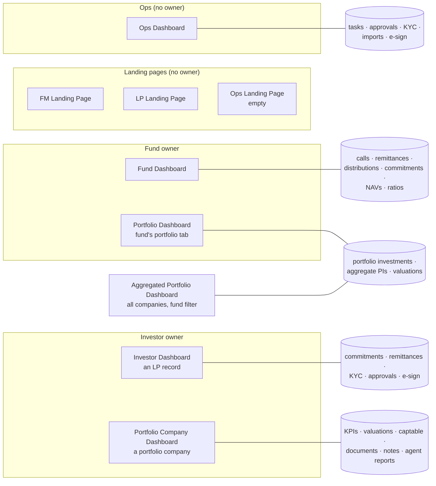
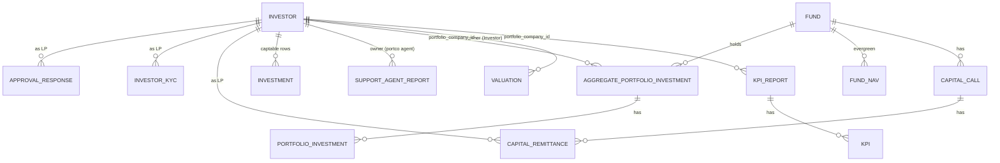
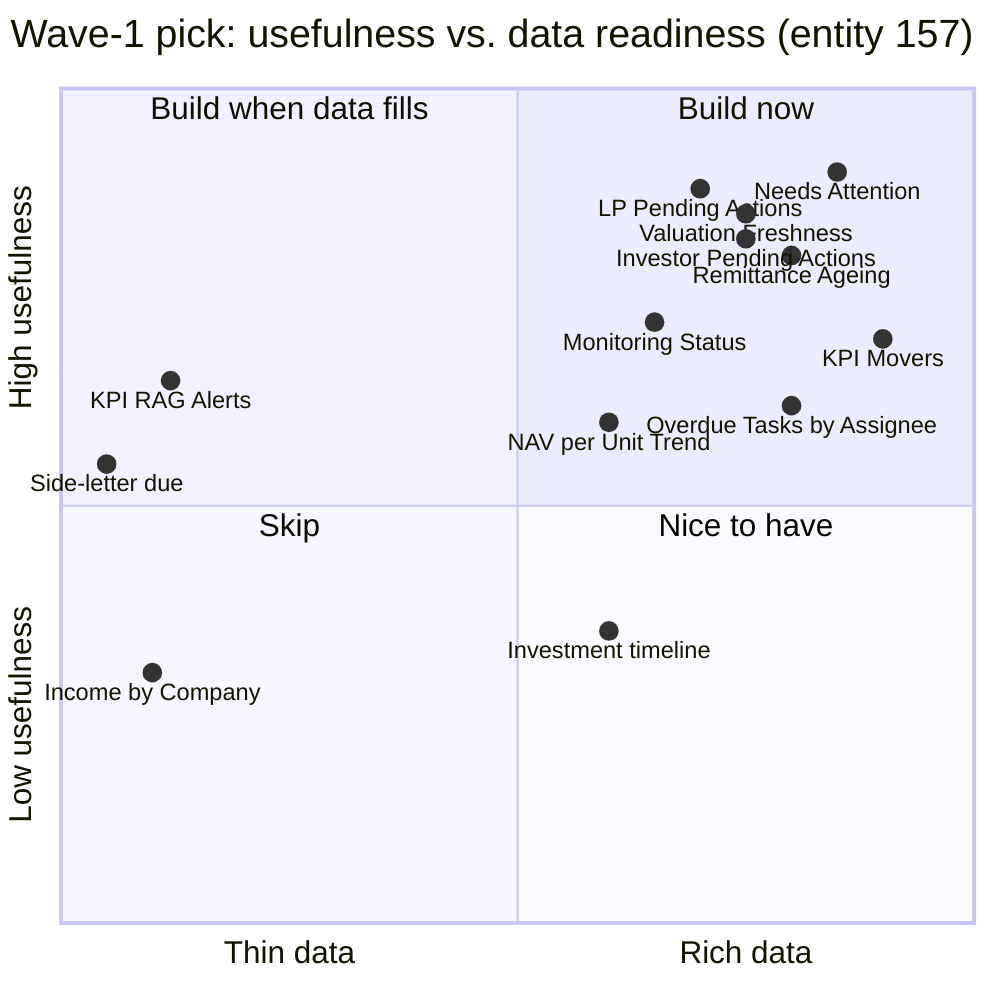
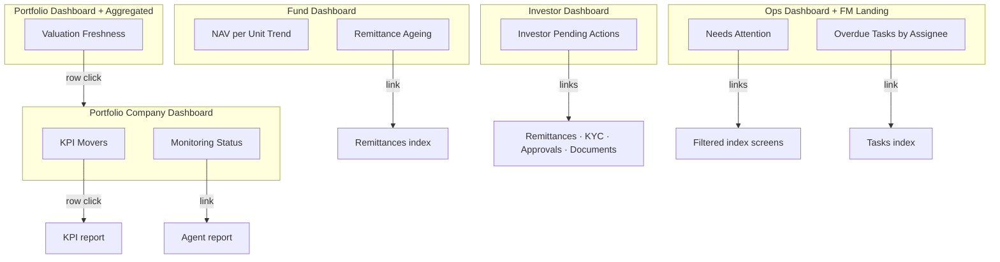

# Dashboard Widget Recommendations

Review of every configurable dashboard (`DashboardWidget::WIDGETS`), the data each one can reach, and the
widgets worth adding. Each candidate has been reviewed critically for usefulness. The shortlist at the end is what
is being built under the OpenSpec change `dashboard-insight-widgets` (wave 1 + wave 2).

- **Date:** 2026-11-07
- **Branch:** `docs/portco-widget-suggestions`
- **Data check:** entity 157 "Demo Fund" on the dev DB (37 funds, 102 portfolio companies, 464 investors)
- **Status:** written while the user was away. Every judgement call is listed under [Assumptions](#assumptions-for-review).

---

## Key concepts

- **Dashboard.** A named page whose cards (widgets) the fund manager configures at *Settings → Widgets*. Its
  name is a `DashboardWidget::*_DASHBOARD` constant.
- **Widget.** One card on a dashboard. It is registered once in a `*_WIDGETS` array (name, partial path, size,
  `metadata_help`) and then enabled per entity as a `dashboard_widgets` row.
- **Owner.** The record a dashboard is about: a Fund (Fund / Portfolio Dashboard), an Investor (Investor /
  Portfolio Company Dashboard), or nothing (Ops Dashboard, landing pages).
- **Metadata.** Per-widget settings written as a literal hash, e.g. `{top_n: 10}`. They reach the partial as `args`.
- **LP layout / LP-safe.** A Portfolio Company Dashboard layout tagged "LP" that is shown to LPs. Only the widgets
  in `LP_SAFE_WIDGET_NAMES` can be placed in one.
- **Portco agent.** `PortfolioCompanyAgent`. It checks each portfolio company once a period for KPI submission,
  document compliance and valuation currency, and stores the result as a `SupportAgentReport`.
- **Remittance ageing.** How long an unpaid capital-call amount has been overdue, grouped into day buckets
  (1–30, 31–60, …) counted from the call's due date.

---

## 1. Where the dashboards are

| Dashboard | Where users reach it | Owner | Widgets today |
|---|---|---|---|
| FM Landing Page | Fund manager home | — | 4 |
| LP Landing Page | LP home | — | 6 |
| Ops Landing Page | — | — | 0 (placeholder) |
| Ops Dashboard | Sidebar → Ops Dashboard | — | 4 |
| Fund Dashboard | Fund → Dashboard | Fund | 38 |
| Portfolio Dashboard | Fund → Portfolio tab | Fund | 7 |
| Aggregated Portfolio Dashboard | Portfolio Companies → Portfolio Dashboard | — (fund filter) | 5 |
| Investor Dashboard | Investor (non-portco) → Dashboard | Investor | 9 |
| Portfolio Company Dashboard | Portfolio company → Dashboard | Investor | 22 |

---

## 2. What exists today, by category

Every widget falls into one of seven categories. The same categories are used for the recommendations below.

| Category | Fund | Portfolio | Aggregated | Portfolio Co. | Investor | Ops | Landing |
|---|---|---|---|---|---|---|---|
| **Performance & returns** | Fund Ratios, Investment Performance, Realized vs Unrealized, Fund Portfolio Stats | Portfolio IRR, Portfolio Stats | Fund Ratios, Company Ratios, Stats | Fund Ratios, Value Bridge, Portfolio Stats | Fund Ratios | — | FM Stats |
| **Capital activity** | Fund Cashflows, Commitment Breakup/Deployment, Call History/Collection/Efficiency/Fees, Remittance Status/Progress/Timeline/Fees, Delinquent Investors, Investor Call Dues, Distribution ×5, Account Entries ×2 | — | — | — | Commitments | — | Funds |
| **Allocation & exposure** | Portfolio Allocation, Instrument Exposure, Currency Exposure, Investor Concentration, GP vs LP, Unit Type | FMV %, Holding Cost %, Bought %, Sold % | Company Charts | Captable | — | — | — |
| **Company monitoring** | — | — | — | Kpis, Key Kpis, Kpis Performance Table, Budget vs Actual, Valuations, Scoring Report, Presentation Analyst | — | — | — |
| **Holdings & records** | Fund Portfolios, Fund Card | Portfolio Investments | Aggre. Portfolio Investments | Portfolio Investments, Data Card | — | — | — |
| **Work & compliance** | Onboarding Status, Fundraising Timeline | — | — | My Tasks, Upcoming Events | KYCs, My Tasks, Upcoming Events | My Tasks, Upcoming Events, Investors No Interaction | FM Menus |
| **Content & AI** | Fund Report, Embed Document | — | — | Documents, Notes, Note Summaries, Embed Document, Portfolio (Co.) Report, Agent Chart | Documents, Notes, Note Summaries, Embed Document | Notes | Investment Opportunities, Offers, Interests, Deals, Entities |

**What the inventory shows**

- **The Fund Dashboard is saturated.** Its 38 widgets cover capital activity from almost every angle. Anything new
  there must answer a question none of them answers.
- **Company monitoring exists only per company.** No widget answers "which companies are behind on
  valuations or reporting?" across a fund or the whole book.
- **Work & compliance is thin.** The Ops Dashboard has 4 widgets, and none of them counts what is actually stuck
  (approvals, KYC, overdue remittances, e-sign). Failed imports were dropped on review (A21).
- **The Investor Dashboard has no "what's outstanding with this LP" view.** Dues, KYC gaps and unsigned documents
  sit on separate tabs.
- **Data the app stores but no widget surfaces:** `kpis.percentage_change` (computed on 6,176 of 6,213 KPIs
  in 157), `PortfolioCompanyAgent` reports (63 in 157), `fund_navs` (101 approved NAVs in 157), and remittance due
  dates combined with the unpaid amount.

---

## 3. Data available per owner

| Owner | Tables reachable | Used by today's widgets | Not used by any widget |
|---|---|---|---|
| Portfolio company | `kpis`, `kpi_reports`, `investor_kpi_mappings`, `valuations`, `portfolio_investments`, `aggregate_portfolio_investments`, `portfolio_cashflows`, `investments`, `shareholder_positions`, `fund_ratios`, `support_agent_reports`, `notes`, `tasks`, `documents` | KPI values, valuations, holdings, captable, ratios, notes, docs | `kpis.percentage_change`, `kpis.rag_status`, `kpi_reports.status/submitted_at`, portco-agent reports, `portfolio_cashflows` (income) |
| Fund | `capital_calls`, `capital_remittances`, `capital_distributions`, `capital_commitments`, `fund_units`, `fund_navs`, `fund_ratios`, `account_entries`, `derivative_contracts` | Almost all | Remittance due-date ageing, `fund_navs` |
| LP investor | `capital_commitments`, `capital_remittances`, `capital_distribution_payments`, `investor_kycs`, `approval_responses`, `documents` (e-sign), `nda_acceptances`, `deal_investors` | Commitments grid, KYC list | A combined "what's outstanding" view |
| Entity (Ops) | `tasks`, `approvals`, `investor_kycs`, `import_uploads`, `documents` (e-sign), `compliance_duties`, `workflow_instances` | Tasks, events, notes | Counts of stuck work |

**Data volume in entity 157** (this is how "has data" was judged):

| Signal | 157 |
|---|---|
| KPIs with a % change | 6,176 of 6,213 |
| KPIs with a RAG status | 78 (sparse) |
| Portfolio companies with a valuation | 67; last valuation > 180 days old for 41 |
| `PortfolioCompanyAgent` latest reports | 63 |
| Pending remittances | 1,997 |
| Approved fund NAVs | 101 across 10 evergreen funds |
| Open tasks / overdue | 84 / 78 |
| KYCs not verified | 434 |
| Documents sent for e-sign, not completed | 74 |
| Imports with failed rows | 105 |
| Portfolio cashflows | 12 (sparse) |
| Side-letter obligations | 0 |

---

## 4. Candidates by category, with critical review

How each candidate was judged:

1. **Question.** Does it answer a question a named user asks repeatedly?
2. **Data.** Is the data actually filled in on a real entity (157)?
3. **Duplicate.** Is it new, or does an existing widget or screen already answer it?
4. **Action.** Can the user act from it, via a link to the rows behind it?
5. **Cost.** Can it be built from SQL aggregates without loading large tables
   (`capital_remittances`, `documents`, `account_entries`)?

Verdicts: **Build** (wave 1) · **Later** (useful, but data is thin or effort is high) · **Cut** (duplicate, or low value).

### 4.1 Company monitoring

| Candidate | Dashboard | User question | Data | Review | Verdict |
|---|---|---|---|---|---|
| **KPI Movers** | Portfolio Company | "What moved most since the last report?" | `kpis.percentage_change`, already computed by `KpiPercentageChangeJob` between comparable reports (same period + tag) | Key Kpis shows levels, not change. The grid shows every number, but no ranking. This turns 6k computed changes into a 5-line answer. | **Build** |
| **Monitoring Status** | Portfolio Company | "Is this company up to date on KPIs, documents and valuation?" | Latest `PortfolioCompanyAgent` `SupportAgentReport` (`kpi_issues`, `document_issues`, `valuation_issues`, `final_status`) | The AI Portfolio Company Dashboard lists every company, but nothing shows the result on the company's own page, where the analyst works. | **Build** |
| **Valuation Freshness** | Portfolio + Aggregated | "Which holdings carry an old valuation into this quarter's NAV?" | `valuations.valuation_date` per held company | No widget shows this. 41 of 67 companies in 157 are > 180 days old, a real quarter-end risk. Works without the agent. | **Build** |
| KPI Threshold Alerts (RAG) | Portfolio Company | "Which KPIs breached their threshold?" | `kpis.rag_status`, `investor_kpi_mappings.rag_*` | Only 78 of 6,213 KPIs have a RAG status, so the widget would usually be empty. | Later |
| KPI Reporting Timeline | Portfolio Company | "Which periods did this company report, and when?" | `kpi_reports.status/submitted_at` | `submitted_at` is set on only 2 reports. Monitoring Status already says what is missing for the current period. | Cut |
| Valuation History chart | Portfolio Company | "How has the valuation moved?" | `valuations` | The existing **Valuations** widget already embeds the valuations charts frame. | Cut (duplicate) |
| Peer KPI Comparison | Aggregated | "How does revenue growth compare across companies?" | `kpis` across companies | KPI names differ by company unless mapped to standard names. Needs a mapping-quality check first. | Later |

### 4.2 Performance & returns

| Candidate | Dashboard | User question | Data | Review | Verdict |
|---|---|---|---|---|---|
| **NAV per Unit Trend** | Fund | "How has NAV per unit moved, by class?" | `fund_navs` (approved) `nav_per_unit_cents` by `unit_type` | The LP card has a NAV sparkline. The GP Fund Dashboard has none, and NAV per unit is the headline number for an evergreen fund. Shows an empty state on closed-end funds. | **Build** |
| Returns trend per company | Portfolio Company | "IRR/MOIC over time" | `fund_ratios` owner=Investor | The existing **Fund Ratios** widget already takes owner=Investor and has `timeseries`/`chart`. | Cut (duplicate) |
| Winners & Losers | Portfolio | "Biggest unrealised gains and losses?" | `aggregate_portfolio_investments.unrealized_gain_cents` | Portfolio IRR already ranks MOIC per company. A small gain over the existing view. | Later |
| Income by Company | Portfolio Company | "Dividends/interest received" | `portfolio_cashflows` | Only 12 rows in 157. The Fund Dashboard already has Portfolio Income. | Cut |

### 4.3 Capital activity

| Candidate | Dashboard | User question | Data | Review | Verdict |
|---|---|---|---|---|---|
| **Remittance Ageing** | Fund | "How much is overdue, and for how long?" | Unpaid amount (`call_amount_cents - collected_amount_cents`) on `capital_remittances`, joined to `capital_calls.due_date` | Delinquent Investors shows the top N amounts and Remittance Status shows counts. Neither shows *age*, which is what the follow-up decision depends on. Can be built as one SQL `GROUP BY`. | **Build** |
| Dry powder / uncalled | Fund | "How much can still be called?" | `capital_commitments` | Commitment Deployment covers it. | Cut |
| Upcoming distributions | Fund | "What's scheduled to pay out?" | `capital_distributions.distribution_date` | Distribution Status lists them already. | Cut |
| Hedge expiries | Fund | "Which derivatives expire soon?" | `derivative_contracts.expiry_date` | 10 contracts in 157. Niche, and expiry reminders already exist (`expiry_reminded_at`). | Later |

### 4.4 Allocation & exposure

| Candidate | Dashboard | User question | Data | Review | Verdict |
|---|---|---|---|---|---|
| Sector exposure | Portfolio | "Where is the fund concentrated by sector?" | `portfolio_investments.sector` | The Aggregated dashboard has Company Charts with `show_sector_wise`. The real gap is only on the single-fund tab. Lower value than the freshness and ageing widgets. | Later |
| Fully-diluted ownership trend | Portfolio Company | "How has our stake diluted?" | `shareholder_positions.fully_diluted_percentage` | 79 rows across 7 companies. The Captable widget shows the current position. | Later |

### 4.5 Work & compliance

| Candidate | Dashboard | User question | Data | Review | Verdict |
|---|---|---|---|---|---|
| **Needs Attention** | Ops + FM Landing | "What is stuck right now, and where do I click?" | Policy-scoped counts: overdue tasks, approvals awaiting responses, KYCs not verified, overdue remittances, imports with failed rows (last 30 days), e-sign requests open > 7 days | Each count lives on its own index today. One card with six numbers and links is the most-used pattern on ops homes. Entity 157 has non-zero values for all six. | **Build** |
| **Overdue Tasks by Assignee** | Ops | "Who is overloaded or behind?" | `tasks` open and past `due_date`, grouped by `assigned_to_id` | My Tasks lists *my* tasks. A team lead has no per-person view. 78 overdue in 157. | **Build** |
| **Investor Pending Actions** | Investor | "What's outstanding with this LP before I call them?" | This investor's unpaid remittances, KYCs not verified or expiring within 60 days, approvals not yet answered, e-sign documents still open | Today this means opening 4 tabs. IR asks it before every LP call. | **Build** |
| KYC Pipeline funnel | Ops | "Where are KYCs stuck?" | `investor_kycs.submission_status/verified` | Needs Attention gives the headline count. The KYC index already has filters. | Cut (folded into Needs Attention) |
| Failed Imports list | Ops | "Which uploads had row errors?" | `import_uploads.failed_row_count` | First folded into Needs Attention as a count; removed from it on review (A21). The Import Uploads list already shows failed rows. | Cut |
| Pending Approvals list | Ops | "Which approvals are waiting?" | `approvals.pending_count` | 17 approvals in 157. A count plus a link is enough. | Cut (folded) |
| Compliance duties due | Ops | "Which compliance duties fall due?" | `compliance_duties.due_on` | The Compliance hub already has a duties grid with stats. 5 duties in 157. | Cut (duplicate) |
| Side-letter obligations due | Investor / Ops | "Which LP obligations fall due?" | `side_letter_obligations.next_due_date` | 0 rows in 157. | Later |
| Stuck workflows | Ops | "Which journeys stalled on a step?" | `workflow_instances.current_step_since` | Useful, but journeys are still rolling out (182 instances, 2 statuses). | Later |

### 4.6 Holdings, content & landing pages

| Candidate | Dashboard | Review | Verdict |
|---|---|---|---|
| Investment timeline (buys/sells per quarter) | Portfolio Company | Portfolio Investments already lists dated transactions. A chart is nice to have, not a need. | Later |
| LP "My pending actions" | LP Landing | Highest LP value, but it needs LP-side, cross-entity scoping (an LP may hold through several fund managers). That is a privacy risk to do unattended. | Later (needs design review) |
| LP "My capital summary" | LP Landing | The LP Funds card (`stats_card`) already shows committed, called and distributed per fund. | Cut |

---

## 5. Wave-1 shortlist (being built)

| # | Widget | Dashboard(s) | Category | Size | LP-safe | Settings (`metadata`) |
|---|---|---|---|---|---|---|
| 1 | **KPI Movers** | Portfolio Company | Company monitoring | XL | No (wave 1) | `{top_n: 5, tag_list: 'Actual', period: 'Quarter', title: 'KPI Movers'}` |
| 2 | **Monitoring Status** | Portfolio Company | Company monitoring | Medium | No | `{title: 'Monitoring Status'}` |
| 3 | **Valuation Freshness** | Portfolio, Aggregated Portfolio | Company monitoring | XL | No | `{current_days: 90, due_days: 180, limit: 15}` |
| 4 | **NAV per Unit Trend** | Fund | Performance | Medium | No | `{months: 12}` |
| 5 | **Remittance Ageing** | Fund | Capital activity | Medium | No | `{}` |
| 6 | **Investor Pending Actions** | Investor | Work & compliance | Medium | No | `{kyc_expiry_days: 60}` |
| 7 | **Needs Attention** | Ops, FM Landing Page | Work & compliance | XL | No | `{}` |
| 8 | **Overdue Tasks by Assignee** | Ops | Work & compliance | Medium | No | `{top_n: 10}` |

### Wave 2 (also being built, per the user's follow-up "build the Nice to have and Build when data fills too")

| # | Widget | Dashboard(s) | Category | Size | Settings (`metadata`) | Data caveat |
|---|---|---|---|---|---|---|
| 9 | **KPI Threshold Watch** (was "KPI RAG Alerts") | Portfolio Company | Company monitoring | Medium | `{tag_list: 'Actual', period: 'Quarter'}` | Uses RAG *and* mapping thresholds, so it is not empty when RAG is unused |
| 10 | **Peer KPI Comparison** | Aggregated Portfolio | Company monitoring | XL | `{kpi_name: 'Revenue', tag_list: 'Actual', period: 'Quarter'}` | Needs consistent KPI names or standard-name mappings |
| 11 | **Winners & Losers** | Portfolio | Performance | Medium | `{top_n: 5}` | — |
| 12 | **Sector Exposure** | Portfolio | Allocation | Medium | `{measure: 'fmv'}` | ~1/3 of 157's companies have no sector → "Unassigned" |
| 13 | **Ownership Trend** (fully diluted) | Portfolio Company | Allocation | Medium | — | 79 positions in 157, few dated |
| 14 | **Investment Timeline** | Portfolio Company | Holdings | Medium | `{period: 'quarter'}` | — |
| 15 | **Hedge Expiries** | Fund | Capital activity | Medium | `{days: 90}` | 10 contracts in 157 |
| 16 | **Side-letter Obligations** | Investor, Ops | Work & compliance | Medium | `{days: 30}` | 0 obligations in 157 → empty state |
| 17 | **Stuck Workflows** | Ops | Work & compliance | Medium | `{days: 7, limit: 10}` | — |

**Still deferred:** LP Pending Actions (LP Landing Page). It needs LP-side scoping across several fund managers,
which is a privacy decision for the user to make. Cut items stay cut (duplicates).

---

## FAQ

**Q: Why not add more widgets to the Fund Dashboard?**
It already has 38. Users scroll past most of them. Wave 1 adds only the two answers it lacks: *age* of overdue money
(Remittance Ageing) and the evergreen headline number (NAV per Unit Trend).

**Q: Why is LP Pending Actions still not built?**
It would show an LP their own unpaid calls, KYC gaps and unsigned documents across every fund manager they invest with.
Getting that wrong leaks one manager's data to another manager's LP, so the scoping needs your sign-off first.

**Q: Why are none of the new widgets LP-safe?**
LP layouts show fund-manager data to LPs, so each LP-safe widget needs its own LP version that limits the data to the
LP's fund and Actual figures (see `LP_WIDGET_PARTIALS`). KPI Movers is the only natural candidate. It stays fund-side
until its LP version is designed.

**Q: Monitoring Status depends on the portco agent. What if the agent is off?**
The widget shows an empty state saying the agent has not run for this company. Valuation Freshness was chosen
alongside it because it works from valuations alone and needs no agent.

**Q: Why fold KYC, remittances and e-sign into one Needs Attention card?**
Each of those already has a filtered index screen. Its own widget would repeat the index. The gap is one place that
says *how many* are stuck and links to them.

---

## Assumptions for review

Made while the user was away. Each can be reversed cheaply.

| # | Assumption | Why | Reverse by |
|---|---|---|---|
| A1 | Wave 1 is 8 widgets (10 registrations), not every candidate | Quality over count; each one needs real data in 157 | Pick from "Later" |
| A2 | No new widget is LP-safe | LP-safe needs an LP partial and the X6/E97 rules | Add to `LP_SAFE_WIDGET_NAMES` with an LP partial |
| A3 | "Overdue remittance" = `call_amount_cents > collected_amount_cents` and the call's `due_date` is in the past; age counts from `due_date` | Due date is what the LP was told | Change the bucket base to `remittance_date` |
| A4 | Valuation freshness buckets: ≤ 90 days Current, ≤ 180 Due, older Stale (configurable) | One quarter / two quarters | Metadata `current_days` / `due_days` |
| A5 | KPI Movers ranks by absolute `percentage_change` on the latest report per (period, tag), and uses the stored value. Nothing is recomputed. | `KpiPercentageChangeJob` already pairs comparable reports | — |
| A6 | Needs Attention and Overdue Tasks use `policy_scope`, so each user sees only what they can already open | Authorization lives in policies | — |
| A7 | NAV per Unit Trend uses `status = 'approved'` NAVs only | Draft NAVs are not final | Metadata to include drafts |
| A8 | Widgets are added to entity 157's dev DB for screenshots only, not seeded for other entities | Widgets are opt-in per entity | Run `DashboardWidget` setup per entity |
| A9 | This work is done on branch `docs/portco-widget-suggestions` (created for the doc) rather than a new branch | One branch per task, in place | Rename the branch |
| A10 | Dashboards with **no** widgets configured show the full catalogue (existing rule H17/E1), so on those entities the new widgets appear without anyone enabling them | Existing behaviour; changing it is out of scope | Configure the dashboard, or exclude the new names from the default set |
| A11 | Needs Attention drops "approvals awaiting response" and the 7-day e-sign age, because each card count must equal the rows its link shows, and neither filter can be expressed on the target list | Stats cards = grid totals | Add the filters to those lists first |
| A12 | "KYCs to verify" = submitted (`submission_status = completed`) and not verified. KYCs never sent are not counted | Only those need a reviewer | Widen the filter |
| A13 | Ownership Trend plots every holder group, not only the fund's own ("Self") stake | "Self" is sparsely dated | Add `{categories: 'Self'}` |
| A14 | KPI Threshold Watch uses the same threshold rule as the KPI grid's colouring (`kpi_percentage_class`: a threshold counts only when > 0; equal is not a breach) | One rule everywhere | — |
| A15 | Wave 2 is built in the same change as wave 1 | User asked for both | Split the change |
| A16 | LPs *can* see the fund Portfolio Dashboard when the fund's LP view is "Whole fund" (existing E42 behaviour). The new Portfolio Dashboard widgets (Valuation Freshness, Winners & Losers, Sector Exposure) are still hidden from them | Freshness is internal ops data; winners/losers and sector splits were not reviewed for LP disclosure | Allow Winners & Losers / Sector Exposure for LPs on "Whole fund" funds |
| A18 | Investor Pending Actions' "Unpaid calls" link filters the remittances list by investor **name** (the list has no investor-id filter) | Count still equals the list for unique names | Add an `investor_id` filter to the remittances list |
| A19 | Stuck Workflows ignores journeys with no recorded step start (101 of 174 active in 157) | Their wait is unknown | Backfill `current_step_since` |
| A20 | Ownership Trend needs the Cap Table module; Side-letter Obligations need the side-letter agent flag | Same access as their own screens | — |
| A21 | Needs Attention has no "Imports with errors" card (removed on request, 2026-11-07) | Four cards: overdue tasks, KYCs to verify, overdue remittances, open e-sign requests | Add it back as a fifth card with an `import_days` setting if wanted |
| A17 | Choice settings (KPI report period, timeline grouping, sector measure) are drop-downs on the widget form | The form turns `a/b/c` help values into a select | — |
