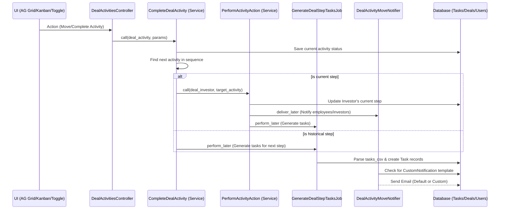

# Deal State Transitions, Emails, and Tasks

This document explains the technical implementation of state transitions, automated email notifications, and task generation within the Deals domain of IRM.

## Overview

The system automates the movement of an investor through various stages (activities) of a deal. Each transition can trigger:
1.  **Status Updates**: Moving the investor to the next step.
2.  **Email Notifications**: Notifying admins or investors using custom or default templates.
3.  **Task Generation**: Automatically creating tasks based on the requirements of the new stage.

## Architecture Diagram

## Component Details

### 1. State Transitions (`PerformActivityAction`)
State transitions are orchestrated by the `PerformActivityAction` Trailblazer operation. It ensures that moving an investor to a new stage is atomic and triggers all side effects.

- **Validation**: Ensures the investor is moving from the correct previous stage to prevent race conditions or stale UI updates.
- **Persistence**: Updates the `deal_activity_id` on the `DealInvestor` record.
- **Broadcasting**: Uses Turbo Streams to update the Kanban board or Grid view across all connected clients.

### 2. Automated Task Generation (`GenerateDealStepTasksJob`)
Tasks are defined as a CSV string in the `tasks_csv` field of a `DealActivity` (Stage).

- **Trigger**: When an investor moves to a new stage, `GenerateDealStepTasksJob` is enqueued.
- **Parsing**: The job splits the `tasks_csv` by commas or newlines.
- **Deduplication**: It checks if a task with the same title already exists for that investor to avoid duplicates during back-and-forth transitions.
- **Assignment**: Tasks are assigned to the user who performed the transition, with a default due date of 7 days.

### 3. Email Notifications (`DealActivityMoveNotifier`)
The system uses the `Noticed` gem to handle multi-recipient notifications.

- **Configuration**: Stages have `notify_employees` and `notify_investor` boolean flags.
- **Templates**:
    - **Custom**: Looks for a `CustomNotification` record associated with the Deal, matching the `email_method` "deal_activity_move" and tagged with the stage name.
    - **Default**: Falls back to `DealMailer#deal_activity_move` if no custom template is found.
- **Dynamic Data**: Injects context such as the Deal name, Investor name, and the new Stage title into the email body.

## Code Entry Points

- **Frontend**: `app/javascript/controllers/deals_list_ag_grid_controller.js`
- **Controller**: `app/packs/startups/deals/controllers/deal_activities_controller.rb`
- **Services**: 
    - `app/packs/startups/deals/services/complete_deal_activity.rb`
    - `app/packs/startups/deals/services/perform_activity_action.rb`
- **Jobs**: `app/packs/startups/deals/jobs/generate_deal_step_tasks_job.rb`
- **Mailers**: `app/packs/startups/deals/mailers/deal_activity_move_notifier.rb`
