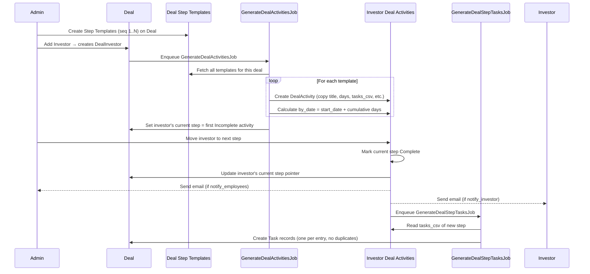

# Deal Steps: User Guide

## Overview

Deal Steps define the process pipeline that every investor goes through in a deal — stages like "Due Diligence", "Term Sheet Sent", "Legal Review", etc. The system works in two layers:

1. **Templates** — the master process definition for the deal (shared, reusable)
2. **Deal Activities** — per-investor copies of those templates, tracking each investor's actual progress

---

## Part 1: What Is a Template?

A **Deal Step Template** is a blueprint for one stage in your deal process. Templates belong to the deal, not to any specific investor. They define *what should happen* and *in what order* — but they are not themselves tracked or completed.

### Key fields on a Template

| Field | What it means |
|---|---|
| **Sequence / Order** | The numeric order of this step (1 = first, 2 = second, etc.) |
| **Title** | The name of the step, e.g. "KYC Review" or "Term Sheet" |
| **Details** | Rich text description — what this step entails, instructions, checklists |
| **Days** | Expected duration of this step in calendar days |
| **Tasks (one per line or comma-separated)** | Auto-tasks to create when an investor enters this step |
| **Notify Employees on Stage Move** | Send an email to company admins when any investor enters this step |
| **Notify Investor on Stage Move** | Send an email to the investor when they enter this step |
| **Status** | Always "Template" — templates are never Incomplete/Complete/Skip |

### Where to manage templates

Navigate to a Deal → **Deal Step Templates** tab → click **New Step Template**.

The index page shows all templates for the deal and displays a reminder:

> "The deal steps are generated based on the templates here. Modify/Add/Reorder these templates before starting the deal."

**Best practice:** Set up all your templates before adding investors to the deal. Templates added after investors are already added will not automatically backfill onto existing investors.

### Example: a typical 5-step pipeline

```
Seq 1 — Intro Call         (Days: 3)
Seq 2 — NDA Signed         (Days: 2,  Tasks: Send NDA, Verify signature)
Seq 3 — Due Diligence      (Days: 14, Tasks: Review financials, Check references, Verify ID)
Seq 4 — Term Sheet         (Days: 7,  Notify Investor: ✓)
Seq 5 — Legal & Close      (Days: 10, Notify Employees: ✓, Notify Investor: ✓)
```

---

## Part 2: How a Template Becomes a Deal Activity

When you **add an investor to a deal** (creating a DealInvestor record), the system automatically copies every template into a personal set of **Deal Activities** for that investor. This copy step happens in the background via `GenerateDealActivitiesJob`.

### What gets copied

For each template, one Deal Activity is created for the investor. Every field is copied:

| Template field | Investor's Deal Activity |
|---|---|
| title | title (same) |
| sequence | sequence (same order) |
| days | days (same) |
| tasks_csv | tasks_csv (same — used when they reach this step) |
| notify_employees | notify_employees |
| notify_investor | notify_investor |
| id (template's primary key) | template_id (reference back to the source template) |
| — | **by_date** (calculated: deal start date + cumulative days up to this step) |
| — | **status** set to "Incomplete" |
| — | **deal_investor_id** set to this investor |

### The by_date calculation

If the deal has a `start_date`, each activity's target date is calculated by summing the days of all preceding steps:

```
Step 1 (3 days)  → by_date = start_date + 3
Step 2 (2 days)  → by_date = start_date + 5  (3 + 2)
Step 3 (14 days) → by_date = start_date + 19 (3 + 2 + 14)
...
```

### The investor's current step

After activities are generated, the investor's `deal_activity_id` is set to the **first Incomplete activity**. This is how the system tracks "where is this investor in the process right now."

---

## Part 3: Moving an Investor Through the Steps

### How a stage transition works

When you mark an investor as moving to the next step (e.g. from "NDA Signed" to "Due Diligence"):

1. The previous activity is marked **Complete**
2. The investor's current step pointer (`deal_activity_id`) is updated to the new step's template
3. **Notification emails** are sent if the template has `notify_employees` or `notify_investor` checked
4. **Tasks are auto-created** from the new step's `tasks_csv`

### Auto-created tasks

Tasks are created from the `tasks_csv` field. You can enter them one per line or comma-separated:

```
Verify ID
Sign NDAs
Review Financials, Check References
```

Each entry becomes a Task record owned by the DealInvestor, due 7 days from today. Duplicate tasks are skipped — re-entering a step won't double-create tasks.

### Activity statuses

| Status | Meaning |
|---|---|
| **Incomplete** | This step has not yet been done for this investor |
| **Complete** | Investor has passed through this step |
| **Skip** | This step was intentionally skipped for this investor |
| **Template** | This is a master template (not investor-specific) |

---

## Part 4: Editing After the Fact

### Editing a template

Changes to a template do **not** retroactively update existing investor activities. The copy is made once at investor-addition time. If you update a template's tasks or notification flags, only investors added *after* that change will get the updated version.

### Editing an investor's activity directly

You can edit an individual investor's Deal Activity (e.g. adjust their `by_date`, change `status`, update their specific task list). This only affects that investor — it does not change the template or other investors.

---

## Part 5: Summary — Template vs. Deal Activity

```
TEMPLATE (deal-level, no investor)         DEAL ACTIVITY (investor-level copy)
─────────────────────────────────────────────────────────────────────────────
deal_investor_id = nil                     deal_investor_id = <investor id>
status = "Template"                        status = Incomplete / Complete / Skip
by_date = nil                              by_date = calculated from start_date
template_id = nil                          template_id = <source template id>

Defines WHAT the step is                   Tracks WHERE this investor stands
Shared across all investors                One record per investor per step
Set up once before deal starts             Auto-generated when investor is added
```

---

## Sequence Diagram: Template → Activity → Transition


