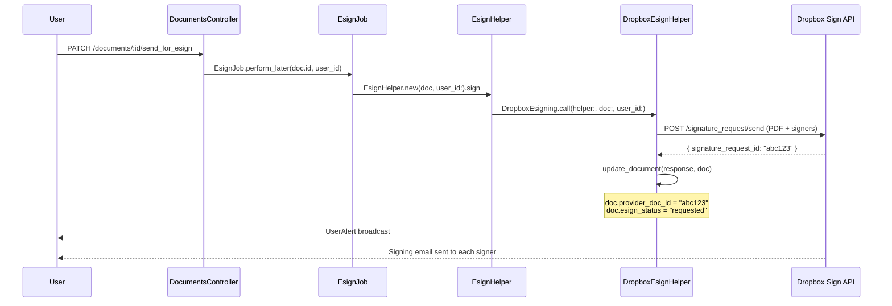
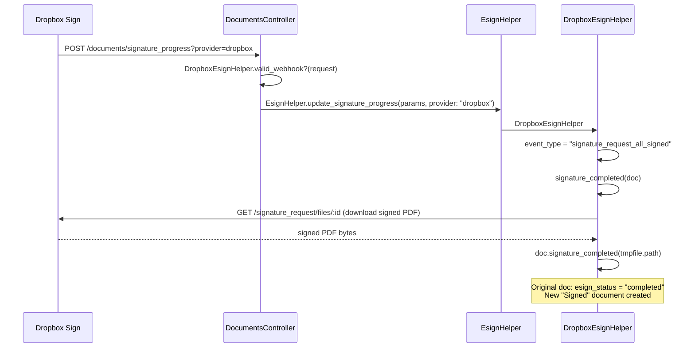
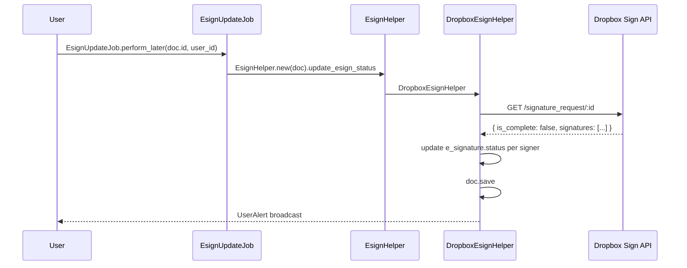

# Dropbox Sign Integration

This document describes how to add Dropbox Sign (formerly HelloSign) as a third e-signing provider alongside the existing Digio and DocuSign integrations. See `esigning.md` for the overall e-signing architecture and `docusign_code_review.md` for the DocuSign-specific context.

---

## Table of Contents

1. [Overview](#overview)
2. [Provider Comparison](#provider-comparison)
3. [Setup & Credentials](#setup--credentials)
4. [Files to Create](#files-to-create)
5. [Files to Modify](#files-to-modify)
6. [DropboxEsignHelper Implementation](#dropboxesignhelper-implementation)
7. [DropboxEsigning Operation](#dropboxesigning-operation)
8. [Webhook Integration](#webhook-integration)
9. [Entity Setting](#entity-setting)
10. [Sequence Diagrams](#sequence-diagrams)
11. [Testing Checklist](#testing-checklist)

---

## Overview

Dropbox Sign uses a REST API authenticated with a static API key (Basic auth) — significantly simpler than DocuSign's JWT OAuth flow. The Ruby gem is [`dropbox-sign`](https://github.com/hellosign/dropbox-sign-ruby).

Because `EsignHelper` already resolves providers via `constantize`:

```ruby
# esign_helper.rb
@helper = "#{@provider.strip.capitalize}EsignHelper".constantize.new
```

Adding Dropbox Sign only requires:
1. A `DropboxEsignHelper` class (mirrors `DigioEsignHelper` / `DocusignEsignHelper`)
2. A `DropboxEsigning` Trailblazer operation (mirrors `DocusignEsigning`)
3. A webhook route and routing update in `EsignHelper`
4. An `EntitySetting` `esign_provider` value of `"Dropbox"`

No changes to jobs, models, or the Document concern are needed.

---

## Provider Comparison

| Concern | Digio | DocuSign | Dropbox Sign |
|---|---|---|---|
| Auth | Basic (client_id:secret) | JWT RS256, Redis-cached | API key via Basic auth |
| Send endpoint | `POST /v2/client/document/uploadpdf` | Envelopes API (SDK) | `SignatureRequestApi#signature_request_send` |
| Sequential signing | `sequential: true` in body | `routing_order` per signer | `signing_options` + order field |
| Webhook events | `payload.document.status` | `envelope-completed` etc. | `signature_request_all_signed` etc. |
| Download signed doc | `GET /v2/client/document/download` | `get_document` (SDK) | `SignatureRequestApi#signature_request_files` |
| Cancel | `POST /v2/client/document/:id/cancel` | Envelope `status=voided` | `POST /signature_request/cancel/:id` |
| Webhook verification | None documented | HMAC-SHA256 header | `event.event_hash` HMAC-SHA256 |
| Max file size | 25 MB | ~25 MB | 40 MB |
| PDF only | Yes | Yes | Yes (also supports Word) |

---

## Setup & Credentials

### 1. Add the gem

```ruby
# Gemfile
gem 'dropbox-sign'
```

### 2. Add credentials

```bash
rails credentials:edit
```

```yaml
DROPBOX_SIGN_API_KEY: "your-api-key-here"
DROPBOX_SIGN_WEBHOOK_SECRET: "your-webhook-hmac-secret"
```

The API key is found in the Dropbox Sign developer dashboard under **Settings → API**.  
The webhook secret is configured when creating a callback URL under **Settings → API → Callbacks & webhooks**.

### 3. Set the provider on an entity

```ruby
entity.entity_setting.update(esign_provider: "Dropbox")
```

---

## Files to Create

| File | Purpose |
|------|---------|
| `app/packs/core/investor_kycs/models/concerns/dropbox_esign_helper.rb` | High-level Dropbox Sign operations |
| `app/packs/core/investor_kycs/services/dropbox/dropbox_esigning.rb` | Trailblazer operation |

---

## Files to Modify

| File | Change |
|------|--------|
| `app/packs/core/investor_kycs/models/helper/esign_helper.rb` | Add `"Dropbox"` to webhook routing |
| `config/routes/core.rb` | Add `?provider=` param support to webhook route (optional but recommended) |
| `Gemfile` | Add `dropbox-sign` gem |
| `rails credentials` | Add `DROPBOX_SIGN_API_KEY` and `DROPBOX_SIGN_WEBHOOK_SECRET` |

---

## DropboxEsignHelper Implementation

**File:** `app/packs/core/investor_kycs/models/concerns/dropbox_esign_helper.rb`

```ruby
# frozen_string_literal: true

require 'dropbox-sign'

class DropboxEsignHelper
  API_KEY            = Rails.application.credentials[:DROPBOX_SIGN_API_KEY]
  WEBHOOK_SECRET     = Rails.application.credentials[:DROPBOX_SIGN_WEBHOOK_SECRET]

  # Send document to Dropbox Sign and return { 'signature_request_id' => '...' }
  def send_document_for_esign(document)
    raise "Only PDF files are supported for eSigning" unless document.file.mime_type.include?("pdf")

    tmpfile = document.file.download
    begin
      signers = build_signers(document)
      api     = signature_request_api

      response = api.signature_request_send(
        Dropbox::Sign::SignatureRequestSendRequest.new(
          title:          document.name.truncate(100),
          subject:        "Please sign: #{document.name.truncate(80)}",
          message:        "You have been requested to sign #{document.name}.",
          signers:        signers,
          files:          [File.open(tmpfile.path)],
          signing_options: Dropbox::Sign::SubSigningOptions.new(
            draw:          true,
            type:          true,
            upload:        true,
            phone:         false,
            default_type:  "draw"
          ),
          # true = each signer is notified only after the previous has signed
          use_signer_order: document.force_esign_order
        )
      )

      { 'signature_request_id' => response.signature_request.signature_request_id }
    ensure
      tmpfile.close
      tmpfile.unlink
    end
  end

  # Update document record after send_document_for_esign
  def update_document(response, document)
    if response['signature_request_id'].present?
      document.update(
        sent_for_esign:      true,
        sent_for_esign_date: Time.zone.now,
        provider_doc_id:     response['signature_request_id'],
        esign_status:        "requested"
      )
    else
      document.update(sent_for_esign: true, esign_status: "failed")
      document.e_signatures.each { |e| e.update(status: "failed") }
    end
  end

  # Cancel a signature request
  def cancel_esign(doc)
    return unless cancel_dropbox_api(doc)

    ActiveRecord::Base.transaction do
      # rubocop:disable Rails/SkipsModelValidations
      doc.e_signatures.update_all(status: "cancelled")
      # rubocop:enable Rails/SkipsModelValidations
      doc.update(esign_status: "cancelled")
    end
  end

  # Manual status poll — called by EsignUpdateJob
  def update_esign_status(doc)
    return Rails.logger.debug { "Document #{doc.name} already completed" } if doc.esign_completed?

    api = signature_request_api
    sr  = api.signature_request_get(doc.provider_doc_id).signature_request

    doc.update(
      esign_status:         sr.is_complete ? "completed" : doc.esign_status,
      last_status_updated_at: Time.zone.now
    )

    sr.signatures.each do |sig|
      esign = doc.e_signatures.find_by(email: sig.signer_email_address)
      esign&.update(status: sig.status_code == "signed" ? "signed" : "requested")
    end

    doc.save
  end

  # Automatic webhook callback handler
  def update_signature_progress(params)
    event_type = params.dig('event', 'event_type')
    sr_id      = params.dig('signature_request', 'signature_request_id')

    unless sr_id.present?
      Rails.logger.warn "Dropbox Sign webhook missing signature_request_id: #{params}"
      return
    end

    doc = Document.find_by(provider_doc_id: sr_id)
    unless doc
      e = StandardError.new("Dropbox Sign: no document found for #{sr_id}")
      Rails.logger.error e.message
      ExceptionNotifier.notify_exception(e)
      return
    end

    case event_type
    when 'signature_request_signed'
      # individual signer has signed — find and update their record
      signed_email = params.dig('signature_request', 'signatures')
                           &.find { |s| s['status_code'] == 'signed' }
                           &.fetch('signer_email_address', nil)
      doc.e_signatures.find_by(email: signed_email)&.update(status: "signed")

    when 'signature_request_all_signed'
      signature_completed(doc)

    when 'signature_request_canceled'
      doc.update(esign_status: "voided")
      # rubocop:disable Rails/SkipsModelValidations
      doc.e_signatures.update_all(status: "voided")
      # rubocop:enable Rails/SkipsModelValidations

    when 'signature_request_declined'
      declined_email = params.dig('signature_request', 'signatures')
                             &.find { |s| s['status_code'] == 'declined' }
                             &.fetch('signer_email_address', nil)
      doc.e_signatures.find_by(email: declined_email)&.update(status: "failed")
      doc.update(esign_status: "failed")

    else
      Rails.logger.info "Dropbox Sign: unhandled event #{event_type} for #{sr_id}"
    end
  end

  # Check HMAC signature on incoming webhook
  def self.valid_webhook?(request)
    secret = WEBHOOK_SECRET
    return true if secret.blank?   # not yet configured

    event_hash   = JSON.parse(request.raw_post).dig('event', 'event_hash')
    event_time   = JSON.parse(request.raw_post).dig('event', 'event_time').to_s
    expected     = OpenSSL::HMAC.hexdigest('sha256', secret, event_time + 'hello_sign_event')
    ActiveSupport::SecurityUtils.secure_compare(event_hash.to_s, expected)
  end

  # Download the completed signed document
  def signature_completed(doc)
    api      = signature_request_api
    file_io  = api.signature_request_files(doc.provider_doc_id, get_url: false)
    tmpfile  = Tempfile.new([doc.name.to_s, ".pdf"], encoding: 'ascii-8bit')
    begin
      tmpfile.write(file_io.read)
      tmpfile.flush
      doc.signature_completed(tmpfile.path)
    ensure
      tmpfile.close
      tmpfile.unlink
    end
  end

  private

  def signature_request_api
    config          = Dropbox::Sign::Configuration.default
    config.username = API_KEY
    Dropbox::Sign::SignatureRequestApi.new(Dropbox::Sign::ApiClient.new(config))
  end

  def build_signers(document)
    document.e_signatures.order(:position).map.with_index(1) do |esign, idx|
      Dropbox::Sign::SubSignatureRequestSigner.new(
        email_address: esign.email,
        name:          esign.name.presence || esign.email,
        order:         idx    # only meaningful when use_signer_order: true
      )
    end
  end

  def cancel_dropbox_api(doc)
    api = signature_request_api
    api.signature_request_cancel(doc.provider_doc_id)
    true
  rescue Dropbox::Sign::ApiError => e
    Rails.logger.error "Dropbox Sign cancel error (#{doc.provider_doc_id}): #{e.message}"
    false
  end
end
```

---

## DropboxEsigning Operation

**File:** `app/packs/core/investor_kycs/services/dropbox/dropbox_esigning.rb`

```ruby
# frozen_string_literal: true

class DropboxEsigning < Trailblazer::Operation
  step :send_document_for_esign
  left :handle_errors, Output(:failure) => End(:failure)
  step :update_document

  def send_document_for_esign(ctx, helper:, doc:, **)
    ctx[:response] = helper.send_document_for_esign(doc)
    true
  rescue StandardError => e
    ctx[:error] = e
    false
  end

  def update_document(ctx, helper:, doc:, user_id:, **)
    helper.update_document(ctx[:response], doc)
    if user_id.present?
      UserAlert.new(user_id:, message: "Document - #{doc.name} sent for eSigning", level: "info").broadcast
    end
  end

  def handle_errors(ctx, **)
    ctx[:errors] = [ctx[:errors].to_s, ctx[:error]&.full_message].join(', ')
    Rails.logger.error "DropboxEsigning error: #{ctx[:errors]}"
    false
  end
end
```

---

## Webhook Integration

### 1. Update `EsignHelper.update_signature_progress`

Add `provider:` keyword and explicit routing — this also fixes the fragile payload-sniffing used by the existing providers (see `docusign_code_review.md` §12):

```ruby
# esign_helper.rb

def self.update_signature_progress(params, provider: nil)
  helper = resolve_helper(params, provider)
  unless helper
    e = StandardError.new("eSign webhook not supported - #{params}")
    Rails.logger.error e.message
    ExceptionNotifier.notify_exception(e)
    return
  end
  helper.update_signature_progress(params)
end

def self.resolve_helper(params, provider)
  case provider&.downcase
  when 'dropbox'   then DropboxEsignHelper.new
  when 'docusign'  then DocusignEsignHelper.new
  when 'digio'     then DigioEsignHelper.new
  else
    # Legacy fallback: detect by payload shape for existing webhooks
    if params.dig('data', 'envelopeId').present? && params.dig('data', 'accountId').present?
      DocusignEsignHelper.new
    elsif params.dig('payload', 'document', 'id').present?
      DigioEsignHelper.new
    end
  end
end
```

### 2. Configure the webhook URL in Dropbox Sign dashboard

Register this URL in **Dropbox Sign → API Settings → Callbacks**:

```
https://your-domain.com/documents/signature_progress?provider=dropbox
```

### 3. Add HMAC verification in the controller

```ruby
# documents_controller.rb — signature_progress action

def signature_progress
  if params[:provider] == 'dropbox'
    unless DropboxEsignHelper.valid_webhook?(request)
      return head :forbidden
    end
  end

  EsignHelper.update_signature_progress(params, provider: params[:provider])
  head :ok
end
```

Dropbox Sign also expects the response body to be `Hello API Event Received` for event acknowledgment (instead of a plain 200), but an empty 200 is tolerated for most events. Return the string if strict compliance is needed.

---

## Entity Setting

Add `"Dropbox"` as a valid option wherever `esign_provider` choices are listed:

```ruby
# entity_setting.rb (or wherever the enum/validation lives)
ESIGN_PROVIDERS = %w[Digio Docusign Dropbox].freeze
validates :esign_provider, inclusion: { in: ESIGN_PROVIDERS }
```

And in any front-end select:
```erb
<%= f.select :esign_provider, EntitySetting::ESIGN_PROVIDERS %>
```

---

## Sequence Diagrams

### Send for signature



### Webhook — all signed



### Manual status poll



---

## Testing Checklist

Use the Dropbox Sign sandbox (`https://api.hellosign.com` — same endpoint; sandbox accounts are free):

- [ ] Gem installed and `bundle install` clean
- [ ] Credentials set for `DROPBOX_SIGN_API_KEY` (test key) and `DROPBOX_SIGN_WEBHOOK_SECRET`
- [ ] `entity_setting.esign_provider = "Dropbox"` resolves to `DropboxEsignHelper` via `EsignHelper`
- [ ] Single PDF document sends successfully; `provider_doc_id` and `esign_status = "requested"` saved
- [ ] Parallel signing: both signers receive email simultaneously (use two different email addresses)
- [ ] Sequential signing: second signer only receives email after first signs
- [ ] Webhook fires `signature_request_signed` → individual `e_signature.status` updated to `"signed"`
- [ ] Webhook fires `signature_request_all_signed` → signed PDF downloaded, new "Signed" `Document` created
- [ ] HMAC verification rejects a forged webhook (tamper with `event_hash`)
- [ ] `cancel_esign` voids the request in Dropbox Sign and updates local records
- [ ] Manual poll (`EsignUpdateJob`) returns correct per-signer statuses
- [ ] `EsignJob` bulk folder send enqueues one job per eligible document
- [ ] `DocumentEsignUpdateJob` daily cron polls Dropbox Sign documents correctly
